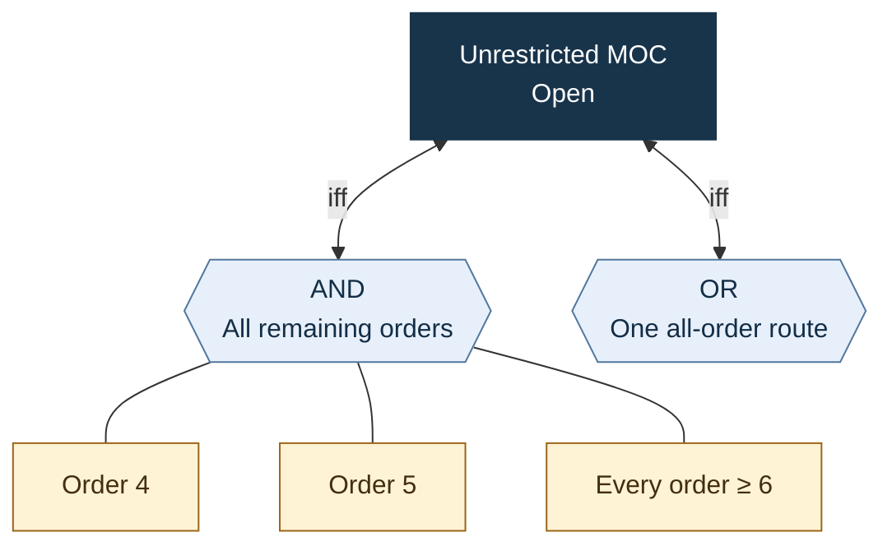
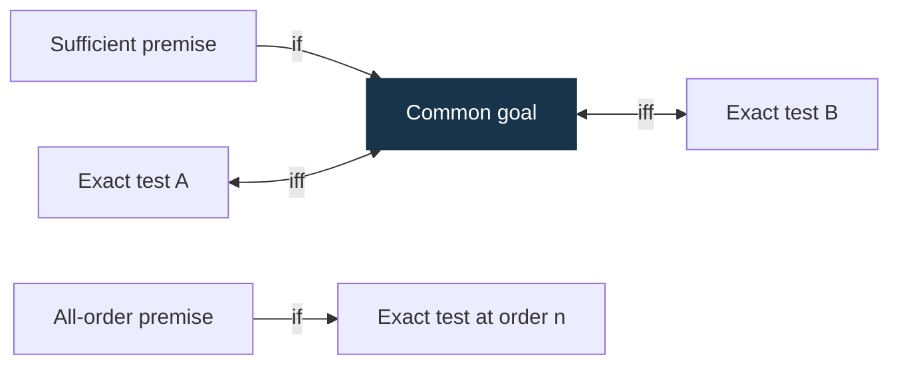
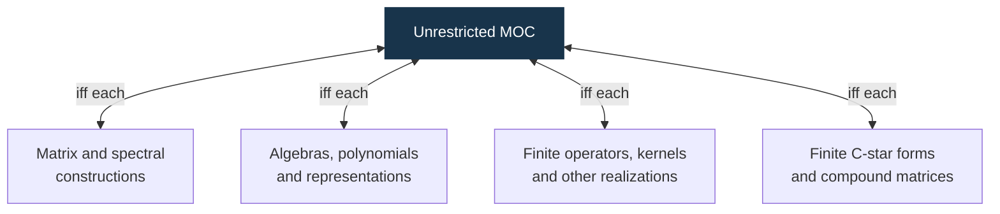
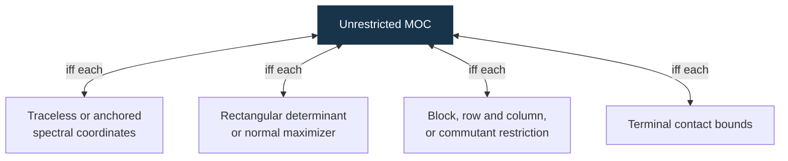
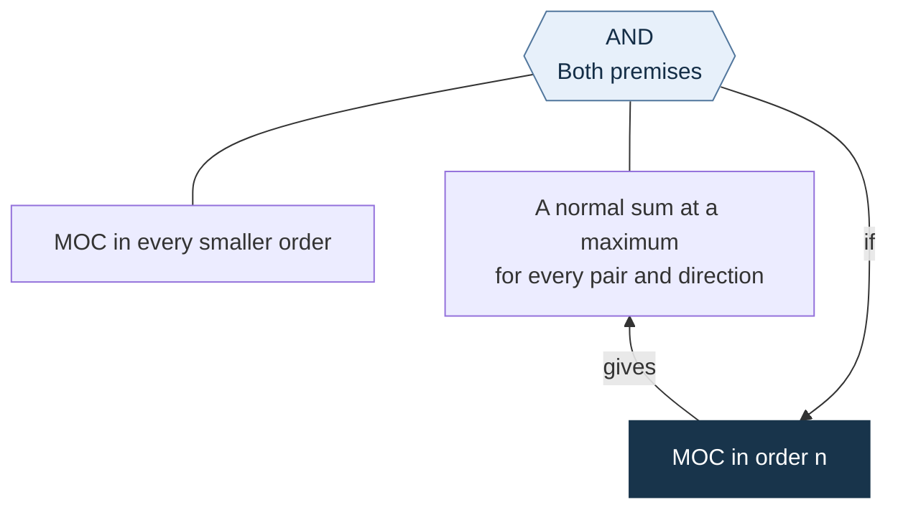
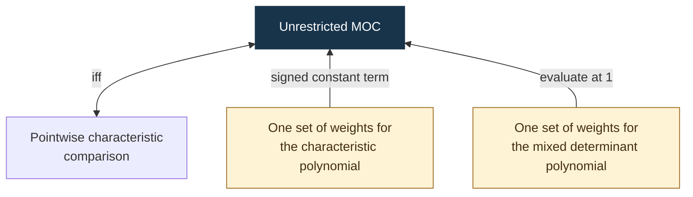
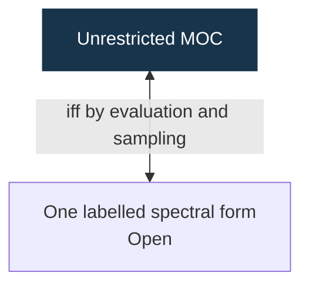

# All-order proof maps

[Conjecture and overview](../../README.md#proof-tree) · [Contact transfer](contact-proof-maps.md) · [Order four](order-four-proof-maps.md) · [Order five](order-five-proof-maps.md)

- [How routes connect](#how-routes-connect)
- [Matrix and operator formulations](#matrix-and-operator-formulations)
- [Normalization and least-order counterexamples](#normalization-and-least-order-counterexamples)
- [Induction through normal maximizers](#induction-through-normal-maximizers)
- [Polynomial and coefficient conditions](#polynomial-and-coefficient-conditions)
- [Labelled spectral formulations](#labelled-spectral-formulations)
- [Scope of the Lean source](#scope-of-the-lean-source)

The conjecture, denoted by MOC, states that the determinant of the sum of
two complex normal matrices lies in the real convex hull of the products
formed by matching their eigenvalues. See the [exact statement](../../README.md).
For fixed eigenvalue lists, $U$ is the unitary change between the eigenbases.

The tables cover the 67 general routes recorded in Lean. The
[labelled formulations](#labelled-spectral-formulations) cover the
additional 243 indexed routes. A proof of an implication or equivalence
establishes its arrow. The premise of each all-order route remains open.
[General route list](../../Lean/MOC/ProofRoutes.lean#L236) · [All-order disjunction](../../Lean/MOC/ProofRoutes.lean#L567)

## How routes connect

Read the arrows toward the goal. **Iff** gives both implications. **If**
gives a sufficient condition. An **AND** node needs every connected input.
An **OR** node needs one complete input.

The order split uses the proof for orders zero through three. MOC implies
the disjunction of the registered routes by choosing an exact route.
Each registered route supplies its implication back to MOC.
[Small orders](../../Lean/MOC/Small.lean#L68) · [Order split](../../Lean/MOC/ProofRoutes.lean#L214) · [Disjunction](../../Lean/MOC/ProofRoutes.lean#L57)

| Relation | Consequence | Lean source |
| --- | --- | --- |
| Two exact routes for one root | Their complete statements are equivalent. | [Equivalence of exact routes](../../Lean/MOC/ProofRoutes.lean#L41) |
| A sufficient route and an exact route | The sufficient premise implies the exact premise. | [Transfer to exact route](../../Lean/MOC/ProofRoutes.lean#L36) |
| Refutation of an exact route | The parent is false. | [Transfer of refutation](../../Lean/MOC/ProofRoutes.lean#L46) |
| An all-order route and an exact route at order $n$ | The all-order premise implies the fixed-order test. | [Restriction to an order](../../Lean/MOC/ProofRoutes.lean#L584) |
| All-order and fixed-order alternatives | Either a direct order-four route or an all-order route suffices for order four. The corresponding statement holds for order five. | [Order four](../../Lean/MOC/ProofRoutes.lean#L574) · [Order five](../../Lean/MOC/ProofRoutes.lean#L579) |

## Matrix and operator formulations

Each equivalence uses the finite objects and hypotheses stated in Lean.
For example, the exterior-power route quantifies over the allowed
degrees. Degree one supplies the reverse implication.
[Exterior-power equivalence](../../Lean/MOC/Reformulations/FirstStructured.lean#L44)

### Matrix and spectral constructions

| Route in Lean | Relation | Lean proof |
| --- | --- | --- |
| Normal complex matrices | Iff | [Statement and proof](../../Lean/MOC/Reformulations/FirstMatrix.lean#L46) |
| Normal eigenframes | Iff | [Statement and proof](../../Lean/MOC/Reformulations/FirstMatrix.lean#L70) |
| Nonnormal inputs with normal spectral representatives | Iff | [Statement and proof](../../Lean/MOC/Reformulations/FirstMatrix.lean#L86) |
| Commuting tuple scalar projections | Iff | [Statement and proof](../../Lean/MOC/Reformulations/FirstMatrix.lean#L103) |
| Normalized pencils | Iff | [Statement and proof](../../Lean/MOC/Reformulations/FirstMatrix.lean#L121) |
| Complex base change of commutative-ring matrices | Iff | [Statement and proof](../../Lean/MOC/Reformulations/FirstMatrix.lean#L141) |
| Exterior-power spectra | Iff | [Statement and proof](../../Lean/MOC/Reformulations/FirstStructured.lean#L44) |
| Symmetric-power spectra | Iff | [Statement and proof](../../Lean/MOC/Reformulations/FirstStructured.lean#L76) |
| Tensor spectra | Iff | [Statement and proof](../../Lean/MOC/Reformulations/FirstStructured.lean#L100) |
| Direct sum | Iff | [Statement and proof](../../Lean/MOC/Reformulations/FirstStructured.lean#L117) |
| Kronecker sum | Iff | [Statement and proof](../../Lean/MOC/Reformulations/FirstStructured.lean#L145) |
| Selected adjoint spectrum | Iff | [Statement and proof](../../Lean/MOC/Reformulations/FirstStructured.lean#L175) |
| Selected conjugation spectra | Iff | [Statement and proof](../../Lean/MOC/Reformulations/FirstGeometric.lean#L96) |
| Finite mixed discriminant | Iff | [Statement and proof](../../Lean/MOC/Reformulations/FirstStructured.lean#L202) |

### Algebras and representations

| Route in Lean | Relation | Lean proof |
| --- | --- | --- |
| Normal left regular representations | Iff | [Statement and proof](../../Lean/MOC/Reformulations/NativeFirstAAlgebra.lean#L48) |
| Frobenius algebra | Iff | [Statement and proof](../../Lean/MOC/Reformulations/NativeFirstAAlgebra.lean#L119) |
| Monic matrix polynomial roots | Iff | [Statement and proof](../../Lean/MOC/Reformulations/NativeFirstAPolynomial.lean#L61) |
| Top exterior power | Iff | [Statement and proof](../../Lean/MOC/Reformulations/NativeFirstAPolynomial.lean#L96) |
| Complex scalar extension and splitting | Iff | [Statement and proof](../../Lean/MOC/Reformulations/NativeFirstARepresentations.lean#L77) |
| Division ring block representations | Iff | [Statement and proof](../../Lean/MOC/Reformulations/NativeFirstARepresentations.lean#L124) |
| Finite complex representation | Iff | [Statement and proof](../../Lean/MOC/Reformulations/NativeFirstARepresentations.lean#L23) |
| Finite star representation | Iff | [Statement and proof](../../Lean/MOC/Reformulations/NativeFirstARepresentations.lean#L45) |

### Finite operators and other realizations

| Route in Lean | Relation | Lean proof |
| --- | --- | --- |
| Finite Fredholm determinant | Iff | [Statement and proof](../../Lean/MOC/Reformulations/NativeFirstAFredholm.lean#L41) |
| Finite regularized determinant at order two | Iff | [Statement and proof](../../Lean/MOC/Reformulations/NativeFirstAFredholm.lean#L99) |
| Finite atomic normalized kernel | Iff | [Statement and proof](../../Lean/MOC/Reformulations/NativeFirstAAtomicKernels.lean#L50) |
| Finite perturbation determinant | Iff | [Statement and proof](../../Lean/MOC/Reformulations/NativeFirstB.lean#L110) |
| Exponentiated determinant path | Iff | [Statement and proof](../../Lean/MOC/Reformulations/DeterminantPath.lean#L229) |
| Finite chain endomorphisms | Iff | [Statement and proof](../../Lean/MOC/Reformulations/NativeFirstBHomology.lean#L30) |
| Invertible normal projective lifts | Iff | [Statement and proof](../../Lean/MOC/Reformulations/NativeLinksB.lean#L29) |
| Actual integral torus characters | Iff | [Statement and proof](../../Lean/MOC/Reformulations/NativeLinksBTorus.lean#L88) |
| Joint Hermitian integrals | Iff | [Statement and proof](../../Lean/MOC/Reformulations/NativeLinksB.lean#L83) |
| Gaussian integer spectra | Iff | [Statement and proof](../../Lean/MOC/Reformulations/NativeLinksBGaussian.lean#L73) |
| Newton monomials | Iff | [Statement and proof](../../Lean/MOC/Reformulations/NativeLinksCMonomial.lean#L39) |
| Constant-generator monodromy | Iff | [Statement and proof](../../Lean/MOC/Reformulations/NativeLinksCFlow.lean#L20) |
| Finite bipartite matching | Iff | [Statement and proof](../../Lean/MOC/Reformulations/SecondNative.lean#L67) |
| Finite Euler determinant | Iff | [Statement and proof](../../Lean/MOC/Reformulations/SecondNative.lean#L170) |
| Normal word products | Iff | [Statement and proof](../../Lean/MOC/Reformulations/SecondNative.lean#L235) |
| Almost-sure finite spectra | Iff | [Statement and proof](../../Lean/MOC/Reformulations/SecondNative.lean#L253) |
| Joint tuple projections | Iff | [Statement and proof](../../Lean/MOC/Reformulations/SecondNative.lean#L271) |
| Invertible representatives | Iff | [Statement and proof](../../Lean/MOC/Reformulations/SecondReal.lean#L93) |

### Finite star algebra and compound matrices

| Route in Lean | Relation | Lean proof |
| --- | --- | --- |
| C-star matrix form | Iff | [Statement and proof](../../Lean/MOC/Reformulations/CStar.lean#L11) |
| C-star orbit form | Iff | [Statement and proof](../../Lean/MOC/Reformulations/CStar.lean#L25) |
| C-star commuting determinants | Iff | [Statement and proof](../../Lean/MOC/Reformulations/Commutant.lean#L91) |
| C-star integer coupling form | Iff | [Statement and proof](../../Lean/MOC/Reformulations/Coupling.lean#L119) |
| C-star Cartesian form | Iff | [Statement and proof](../../Lean/MOC/Reformulations/CStar.lean#L41) |
| C-star functional calculus | Iff | [Statement and proof](../../Lean/MOC/Reformulations/CStar.lean#L72) |
| C-star affine form | Iff | [Statement and proof](../../Lean/MOC/Reformulations/CStar.lean#L82) |
| C-star pointwise characteristic form | Iff | [Statement and proof](../../Lean/MOC/Reformulations/CStar.lean#L95) |
| C-star scalar weight form | Iff | [Statement and proof](../../Lean/MOC/Reformulations/CStar.lean#L110) |
| Paired finite star representations | Iff | [Statement and proof](../../Lean/MOC/Reformulations/SecondCoefficientFree.lean#L129) |
| Compound form | Iff | [Statement and proof](../../Lean/MOC/Reformulations/Compounds.lean#L32) |

## Normalization and least-order counterexamples

A proper block split of a least-order counterexample would give two
smaller orders that both satisfy the conjecture. A row or column with at
most two nonzero entries also reduces to smaller order. Every matrix that
commutes with both summands must be a scalar multiple of the identity.
[Block reduction](../../Lean/MOC/Claim.lean#L43) · [Least order](../../Lean/MOC/Claim.lean#L51) · [Rows](../../Lean/MOC/SparseRow.lean#L287) · [Columns](../../Lean/MOC/SparseRow.lean#L309) · [Common commutant](../../Lean/MOC/ReducingCommutant.lean#L70)

The three-coordinate normalization uses lists $x,y$ with $x_1=0$,
$x_2=1$, and $y_1=0$. Its determinant is
$\det(U-\mathrm{diag}(x)U\mathrm{diag}(y))/\det U$. Its vertices are
$\prod_j(1-x_{\sigma(j)}y_j)$ for permutations $\sigma$. The theorem
requires each entry of $U$ to be nonzero. The rectangular test instead
uses a matrix with at least three orthonormal rows and one extra column.
[Three-coordinate normalization](../../Lean/MOC/Reformulations/ThreeAnchorKernel.lean#L61) · [Rectangular test](../../Lean/MOC/PrincipalCoisometry.lean#L248)

| Route in Lean | Relation | Lean proof |
| --- | --- | --- |
| Affine linear parts | Iff | [Statement and proof](../../Lean/MOC/Reformulations/FirstGeometric.lean#L26) |
| Nonzero spectra | Iff | [Statement and proof](../../Lean/MOC/Reformulations/FirstGeometric.lean#L48) |
| Invertible projective diagonal lifts | Iff | [Statement and proof](../../Lean/MOC/Reformulations/FirstGeometric.lean#L71) |
| Traceless Cartan spectra | Iff | [Statement and proof](../../Lean/MOC/Reformulations/NativeLinksCTraceless.lean#L187) |
| Traceless real-part bound | Iff | [Statement and proof](../../Lean/MOC/Reformulations/TracelessSupport.lean#L14) |
| Regular anchored spectra | Iff | [Statement and proof](../../Lean/MOC/Reformulations/Anchored.lean#L70) |
| Three-anchor rank-one kernel in all orders | Iff | [Statement and proof](../../Lean/MOC/Reformulations/ThreeAnchorKernel.lean#L61) |
| Nonzero contact-saturated support bounds in every order | Iff | [Statement and proof](../../Lean/MOC/ProofRoutes.lean#L232) |
| Normal maximizers in every order | Iff | [Statement and proof](../../Lean/MOC/NormalSupportMaximum.lean#L314) |
| Principal coisometries in all orders | Iff | [Statement and proof](../../Lean/MOC/PrincipalCoisometry.lean#L248) |
| No paired block split | Iff | [Statement and proof](../../Lean/MOC/Claim.lean#L63) |
| Every row and column has degree at least three | Iff | [Statement and proof](../../Lean/MOC/SparseRow.lean#L321) |
| Regular spectra with scalar common commutant | Iff | [Statement and proof](../../Lean/MOC/ReducingCommutant.lean#L124) |
| All three order ranges | Iff | [Statement and proof](../../Lean/MOC/ProofRoutes.lean#L214) |

## Induction through normal maximizers

For fixed spectra and a fixed direction, a matching permutation gives
a sum diagonal in the first eigenbasis. If the conjecture holds in
that order, a permutation with largest matching projection gives a
global maximum with normal sum. In the other direction, the theorem
uses normality at a maximum and the smaller-order results to prove
the hull bound. The all-order route starts at order four.
[Conditional equivalence](../../Lean/MOC/NormalSupportMaximum.lean#L270) · [All-order equivalence](../../Lean/MOC/NormalSupportMaximum.lean#L314)

## Polynomial and coefficient conditions

The mixed determinant is $\det(A+zB)$, where $z$ is the polynomial
variable. In positive order $n$, its coefficients of degrees $0$, $1$,
$n-1$, and $n$ each lie in the corresponding matching hull. These bounds
allow separate weights for each degree. The simultaneous condition calls
for one set of weights for the whole polynomial.
[Pointwise characteristic comparison](../../Lean/MOC/Reformulations/CStar.lean#L95) · [First coefficient](../../Lean/MOC/Reformulations/NativeLinksA.lean#L106) · [Penultimate coefficient](../../Lean/MOC/Reformulations/NativeLinksA.lean#L149) · [Endpoint coefficients](../../Lean/MOC/Reformulations/NativeLinksA.lean#L161)

| Route in Lean | Relation | Lean proof |
| --- | --- | --- |
| Simultaneous characteristic hull | If | [Statement and proof](../../Lean/MOC/Reformulations/SecondCoefficient.lean#L50) |
| Simultaneous mixed-pencil coefficients | If | [Statement and proof](../../Lean/MOC/Reformulations/NativeLinksA.lean#L200) |

## Labelled spectral formulations

A labelled form supplies a sample type in each order. Two arbitrary
evaluation functions turn samples into eigenvalue lists. To recover MOC,
choose an available sample in each order and use constant functions to
realize every pair of lists. The statements concern the evaluated
spectra. A theorem about the underlying object requires its own
connection to these spectra.
[Common form](../../Lean/MOC/Reformulations/Common.lean#L8) · [Common equivalence](../../Lean/MOC/Reformulations/Common.lean#L14)

| Indices | Relation | Lean source |
| --- | --- | --- |
| 001–133 | Each entry is equivalent to unrestricted MOC. | [001 through 133](../../Lean/MOC/Reformulations/FirstAtlas.lean#L22-L837) |
| 134–243 | Each entry is equivalent to unrestricted MOC. | [134 through 243](../../Lean/MOC/Reformulations/SecondAtlas.lean#L22-L697) |

The registered list spans [001 through 243](../../Lean/MOC/ProofRoutes.lean#L320). At a
fixed order, the evaluated form is equivalent to the fixed-order
conjecture when the sample type is nonempty.
[Fixed-order form](../../Lean/MOC/ProofRoutes.lean#L71)

## Scope of the Lean source

The default MOC target imports the route registries. Its axiom audit
checks the safe project declarations in its imports. The checkout lacks
five modules referenced by standalone files outside that import graph.
The maps identify when a cited proof source depends on an absent module.
[Default target](../../lakefile.toml) · [Axiom audit](../../Lean/MOC.lean#L247)

The absent modules are MOC.ContactCensus, MOC.WeightedDiamondCensusPath,
MOC.WeightedDiamondChart, MOC.WeightedDiamondLowerInitial, and
MOC.WeightedDiamondWitnessMasks.
