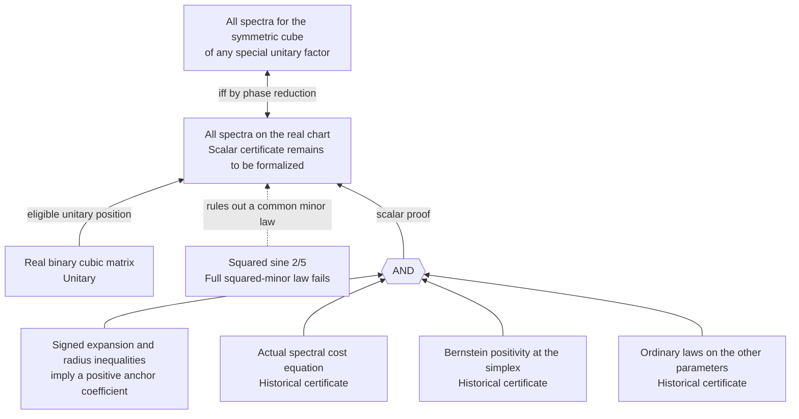

# Symmetric cube mixer reduction

[Conjecture and notation](../../README.md) · [Order-four proof map](order-four-proof-maps.md)

Let $G$ be a complex two by two unitary matrix with determinant one. The symmetric cube of $G$ acts on homogeneous polynomials of degree three in two variables. Its matrix $U$ has order four when written in the basis $x^3,sqrt{3}x^2y,sqrt{3}xy^2,y^3$. The target is the Marcus–de Oliveira determinant inclusion at this relative unitary position for every pair of complex spectral lists. [Matrix definition](../../Lean/MOC/BinaryCubicMixerReduction.lean#L22) · [Historical proof and certificate](https://github.com/ascendnoosphere/MOC/blob/a49606d39e8bb5903c9bb4a51651a18679499c0c/Docs/spin/PROOF.md)

The Lean source proves that it suffices to take the real rotation $egin{psmallmatrix}c&s\\-s&cend{psmallmatrix}$ with $c,sge0$ and $c^2+s^2=1$. Diagonal row and column phases preserve the determinant comparison. The symmetric cube of a real rotation is unitary. [Chart equivalence](../../Lean/MOC/BinaryCubicMixerReduction.lean#L148) · [Unitarity](../../Lean/MOC/BinaryCubicMixerReduction.lean#L56)

At $s^2=2/5$, write $m(I,J)$ for the squared modulus of the minor at rows $I$ and columns $J$, with indices from zero. The linear expression

$$
m(01,03)+m(12,03)+m(23,13)+m(23,03)-m(02,23)
$$

is at most one on each permutation profile. At the symmetric cube mixer it equals $132/125$. It follows that the mixer admits no single probability law for all squared minors. This obstruction concerns the common law. The determinant inclusion concerns the scalar hull for each separate choice of spectra. [Exact obstruction](../../Lean/MOC/BinaryCubicMixerReduction.lean#L253)

Suppose a signed profile expansion has one negative weight $p/2$ at an anchor and weights $w_i$ elsewhere. Suppose the positive radii $R_i$ satisfy $R_iw_i+pge0$. If a nonnegative cost violates the determinant bound, its anchor cost $a$ is positive. The remaining costs $h_i$ satisfy $sum_i (2h_i/a)/R_i<1$. Thus the normalized cost has a positive coefficient at the anchor in the simplex certificate. [Cost normalization](../../Lean/MOC/BinaryCubicMixerReduction.lean#L285)

The spin-specific signed expansion, radius inequalities, degree-nine equation for actual spectral costs, and 497,420 Bernstein coefficients remain in the historical scalar certificate. The new Lean source awaits kernel verification. [Certificate construction](https://github.com/ascendnoosphere/MOC/blob/a49606d39e8bb5903c9bb4a51651a18679499c0c/Code/spin/verify_scalar.py)
