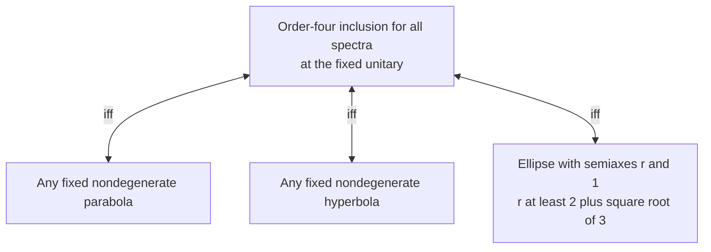

# Fixed conic tests for the determinant inclusion

[Conjecture and proof tree](../../README.md#proof-tree) · [Order-four map](order-four-proof-maps.md) · [All-order map](all-order-proof-maps.md)

Let \(U\) be unitary. Let \(a\) and \(b\) be complex eigenvalue lists of
length \(n\). The spectral inclusion compares the determinant of
\(\mathrm{diag}(a)+U\mathrm{diag}(b)U^*\) with the real convex hull of
its matching products. A fixed curve test checks distinct first lists
on one curve. The second list remains arbitrary. The same \(U\) appears
in the original problem and in the test.
[Lean test definition](../../Lean/MOC/ConicSpectralReductions.lean#L21)

## Order-four equivalences

- For the parabola, first send three eigenvalues to the real line by a
  fractional linear map. The fourth and the real line lie on two
  parallel lines. A common affine image of the parabola approximates
  both lines, including a list with some entries on each line.
  [Order-four parabola test](../../Lean/MOC/ConicSpectralReductions.lean#L308) · [Parallel-line limit](../../Lean/MOC/ConicSpectralReductions.lean#L164)
- For the hyperbola, first send three eigenvalues to the real line.
  Translate the fourth onto the second asymptote while keeping the
  first three on the first asymptote. Common dilations of the
  hyperbola approximate both asymptotes and their intersection.
  [Order-four hyperbola test](../../Lean/MOC/ConicSpectralReductions.lean#L365) · [Asymptote limit](../../Lean/MOC/ConicSpectralReductions.lean#L233)
- For the ellipse, reorder the four labels to give a cross ratio
  \(\lambda\) with \(\mathrm{Re}\,\lambda\le|\lambda|/2\). The longest
  side of the triangle with vertices \(0,1,\lambda\) gives the required
  ordering. For a square root \(w\) of that cross ratio, solve one real
  quadratic to put two antipodal pairs on the ellipse. The quadratic
  has a real solution if
  \(4r^2(\mathrm{Re}\,w)^2 \le (r^2-1)^2(\mathrm{Im}\,w)^2\).
  The stated bound on \(r\) guarantees this inequality.
  [Order-four ellipse test](../../Lean/MOC/ConicSpectralReductions.lean#L876) · [Antipodal construction](../../Lean/MOC/ConicSpectralReductions.lean#L546)

A common fractional linear change of the signed spectra preserves hull
membership. The pole may meet the partner list after the chart is
chosen. Perturb that list and take a limit. The same closedness argument
includes repeated eigenvalues. An invertible affine image gives the
same test. [Pole removal](../../Lean/MOC/ConicSpectralReductions.lean#L112) · [Affine images](../../Lean/MOC/ConicSpectralReductions.lean#L88)

## Order-five equivalences

The parabola and hyperbola tests also suffice in order five. Choose a
nearest pair in the first spectrum and send it to \(0,1\) by an affine
map. If all entries are real, one of the lines already contains them.
Otherwise move a circle center on the perpendicular bisector of that
pair. The first additional contact is a minimum of finitely many
ratios. At that contact the circle has at least three boundary points
and its open disk is empty. A fractional linear map sends the circle
to the real line and the exterior to the upper half-plane. Extra
boundary points move a small distance into that half-plane before the
limit is taken.
[Order-five parabola test](../../Lean/MOC/ConicSpectralReductions.lean#L1278) · [Order-five hyperbola test](../../Lean/MOC/ConicSpectralReductions.lean#L1299)

If two distinct points are in the upper half-plane, choose a real \(t\)
so the secant between their images under \(z\mapsto-1/(z-t)\) has any
given nonzero direction. For \(g(t)=(u-t)(v-t)\), its imaginary part
vanishes at a weighted average of the real parts of \(u,v\). At that
point \(g(t)\) is negative real. The direction equation is linear or
quadratic in \(t\). In the quadratic case this negative value gives a
real root. [Secant alignment](../../Lean/MOC/ConicSpectralReductions.lean#L451)

## Source scope

The Lean source gives the fixed parabola and hyperbola tests in orders
four and five. It gives the sufficient order-four ellipse test at
\(r\ge2+\sqrt3\). The sharp ellipse angle necessity for arbitrary
non-antipodal points remains a paper argument in
`Temp/pdf/Conics.pdf`. The Lean source was written without compilation.
