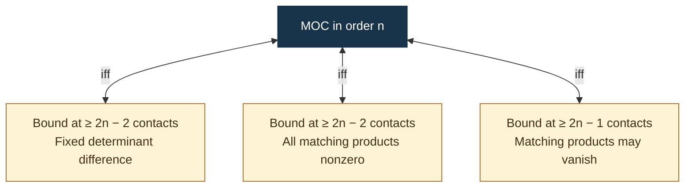
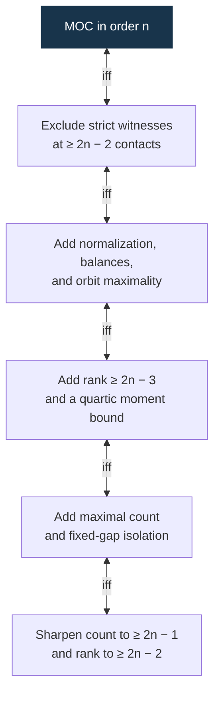
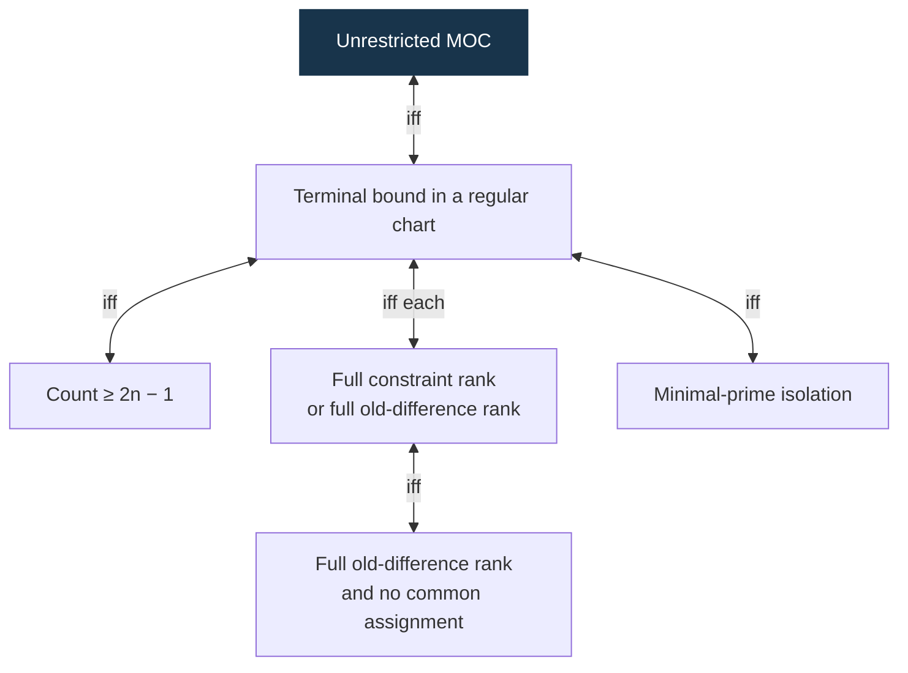

# Contact proof maps

[README overview](../../README.md#proof-tree) · [All-order routes](all-order-proof-maps.md) · [Order four](order-four-proof-maps.md#contact-patterns) · [Order five](order-five-proof-maps.md#contact-thresholds)

- [Growing the contact set](#growing-the-contact-set)
- [Restrictions on one terminal witness](#restrictions-on-one-terminal-witness)
- [Polynomial coordinate tests](#polynomial-coordinate-tests)

For eigenvalue lists $a,b$ of length $n$, let $P_\sigma$ be the matching
product for permutation $\sigma$. Fix a complex number $\eta$ and let
$H$ be the largest $\mathrm{Re}(\eta P_\sigma)$. A **contact** is a
permutation that attains $H$. A **strict witness** has
$\mathrm{Re}(\eta\det(A+B))>H$. A contact set counts permutations,
including separate permutations with the same product. The exact support
test excludes all strict witnesses.
[Directional bound](../../Lean/MOC/Support.lean#L52) · [Witness](../../Lean/MOC/ContactIteration.lean#L13)

## Growing the contact set

| Open test | Proved step from a strict witness | Lean source |
| --- | --- | --- |
| Bound witnesses with at least $2n-2$ contacts. | Below the threshold, keep the mixer $U$, direction, one maximizing permutation as a pivot, the complex determinant difference from that pivot, and the old complex differences from the pivot. Add a contact. The transfer can also keep selected polynomial values fixed within the count bound. | [Transfer and count bound](../../Lean/MOC/GlobalContactSlice.lean#L159) · [Exact test](../../Lean/MOC/GlobalContactSlice.lean#L243) |
| Bound witnesses with at least $2n-2$ contacts and all products nonzero. | First restrict to spectra with no zero pair sums. The transfer stays where every matching product is nonzero and increases the count below the threshold. | [Nonzero transfer](../../Lean/MOC/SaturatedContactReduction.lean#L18) · [Exact test](../../Lean/MOC/SaturatedContactReduction.lean#L70) |
| Bound witnesses with at least $2n-1$ contacts. | At or below $2n-2$ contacts, keep $U$, the direction, pivot, and old complex differences. Allow the determinant difference to vary. The proved continuation on a complex affine curve supplies the new witness. | [Continuation](../../Lean/MOC/AffineGapCover.lean#L80) · [Varying-difference transfer](../../Lean/MOC/VaryingGapTerminal.lean#L110) · [Exact test](../../Lean/MOC/AffineGapCover.lean#L85) |

Iteration uses the number of contacts still needed. The same induction
can keep an additional condition when the transfer preserves it.
[Shared iteration lemma](../../Lean/MOC/ContactIteration.lean#L53)

## Restrictions on one terminal witness

In positive order, **balance** here includes unit spectral energy, a unit
direction, equal traces, and equal cubic moments
$\sum_i |a_i|^2a_i=\sum_i |b_i|^2b_i$. Spectral energy is the sum of
the squared absolute values in both lists. The sum of the two normal
matrices is nonnormal at this witness. The determinant projection is
maximal over all relative unitaries for these lists.
[Balanced witness](../../Lean/MOC/BalancedContactReduction.lean#L46) · [Spectral energy](../../Lean/MOC/SpectralStationarity.lean#L58)

**Rank** here is the dimension of the complex span of the functions
given by the differences between the pivot product and the contact
products. The quartic constraint tests the centered spectral moments.
A transfer keeps the pivot and the old contacts, so the rank lower bound
survives the choice of a balanced maximizer.
[Rank and moments](../../Lean/MOC/ContactDifferenceRank.lean#L201) · [Quartic constraint](../../Lean/MOC/MobiusMomentWitness.lean#L13)

**Isolation** refers to the locus of matching profiles with the same old
differences and determinant difference. A polynomial that is nonzero
at the chosen profile cuts out a neighborhood in that locus containing
only that profile. The strengthened test has the larger count and rank
on the same balanced, isolated witness. The inequality on these
restricted witnesses remains open.
[Isolated witness](../../Lean/MOC/ContactFibreIsolation.lean#L215) · [Strengthened test](../../Lean/MOC/SharpContactRank.lean#L80)

## Polynomial coordinate tests

A regular chart represents the matching products by polynomial
evaluations. Its regularity condition requires a nonzero chart
coordinate, nonzero products, and distinct products for distinct
permutations. For a fixed pivot, the chart gap is the difference between
the pivot and another matching product in the chosen direction. All
projected gaps must be nonnegative. The remaining test bounds the
projected determinant difference by zero.
[Regularity](../../Lean/MOC/MatchingChartPolynomial.lean#L157) · [Gap](../../Lean/MOC/HighContact.lean#L21) · [Terminal chart test](../../Lean/MOC/MatchingContactTransfer.lean#L123)

Here $n$ denotes matrix order. The Lean chart labels it as two plus the
number of free entries on each side. The ranks count independent
polynomial constraints, rather than the number of tied permutations.

| Additional restriction on a regular chart | Lean source |
| --- | --- |
| At least $2n-2$ contacts. | [Base terminal chart](../../Lean/MOC/MatchingContactTransfer.lean#L123) |
| At least $2n-1$ contacts. | [Increased count](../../Lean/MOC/DeficitContactTransfer.lean#L304) |
| Constraint rank at least $2n-2$, including the determinant deficit constraint. | [Full constraint rank](../../Lean/MOC/MatchingContactRank.lean#L111) |
| Rank at least $2n-2$ for the old matching differences alone. | [Old-difference rank](../../Lean/MOC/DeficitContactTransfer.lean#L328) |
| Old-difference rank at least $2n-2$ and no row-column assignment shared by all contacts. | [No common assignment](../../Lean/MOC/TerminalActiveEdges.lean#L27) |
| The ideal of the chart point is a minimal prime of the ideal obtained by fixing the old matching differences. | [Minimal-prime condition](../../Lean/MOC/IsolatedContactFiber.lean#L61) |
