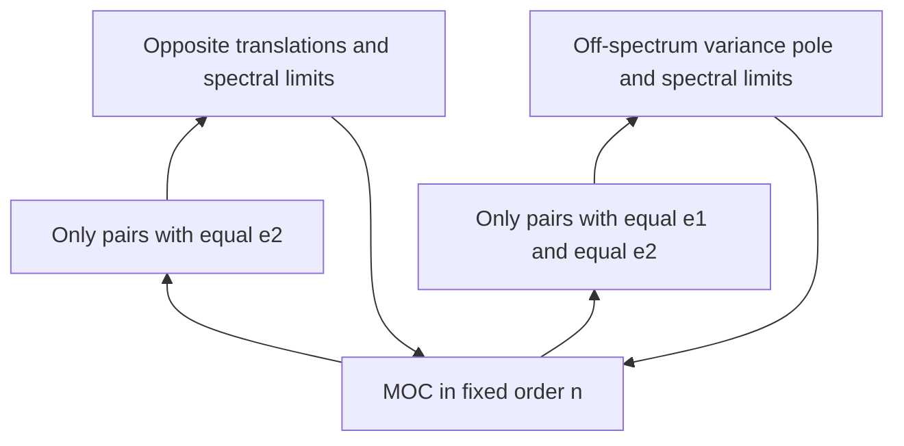

# Equal spectral coefficients

[Marcus–de Oliveira conjecture and proof tree](../../README.md#proof-tree)

Fix an order $n$ and two complex eigenvalue lists $a,b$. Write
$e_1(a)=\sum_i a_i$ and $2e_2(a)=e_1(a)^2-\sum_i a_i^2$. This is
Newton's formula for the second elementary symmetric coefficient.
Each restricted test in the diagram is equivalent to the full
conjecture in order $n$. Both reductions preserve the relative
unitary matrix. [Coefficient definition](../../Lean/MOC/EqualSpectralCoefficients.lean#L22) · [Equal second coefficient](../../Lean/MOC/EqualSpectralCoefficients.lean#L91) · [Both coefficients](../../Lean/MOC/EqualSpectralCoefficients.lean#L428)

For the first reduction, shift the first list by $t$ and the second
list by $-t$. The change in $e_2(a)-e_2(b)$ is
$(n-1)t(e_1(a)+e_1(b))$. If the coefficient of $t$ is nonzero,
choose $t$ to cancel the difference. If it is zero, approximate
the first spectrum by translations for which it is nonzero.
Use the unchanged determinant and matching products before taking the
limit. [Shift identity](../../Lean/MOC/EqualSpectralCoefficients.lean#L47)

For simultaneous equality, use the signed lists $a$ and $c=-b$.
At a pole $p$ off both lists, replace each entry $z$ by
$1/(p-z)$. Equality of the two centered sums of squares permits
a common subtraction from both signed lists. The resulting
first list and the negative of the resulting second signed list
have the same sum and the same sum of squares. They therefore have
equal $e_1$ and equal $e_2$. [Pole normalization](../../Lean/MOC/EqualSpectralCoefficients.lean#L295) · [Fractional-linear transport](../../Lean/MOC/ProjectiveTransport.lean#L61)

For simple disjoint signed lists, clear the two squared root products
from the variance difference. Its numerator is nonzero at each
spectral point. To obtain a nonconstant numerator, perturb one entry
of $c$. The difference between the numerator evaluations at two
distinct entries of $a$ is a nonzero polynomial in the perturbation
parameter. Thus arbitrarily small perturbations suffice. The complex
root theorem supplies a pole for each such perturbation. Transport
the comparison back to the perturbed lists, then take the limit.
Orders below two follow from the known small-order cases.
[Nonpole proof](../../Lean/MOC/EqualSpectralCoefficients.lean#L241) · [Nonconstant numerator](../../Lean/MOC/EqualSpectralCoefficients.lean#L377)

The starting statements are the equal-coefficient cases in
`Cases.pdf`. The Lean source uses a one-entry approximation to
handle the constant-numerator case. Exact arithmetic checked both
normalizations, the numerator at all six poles of a three-dimensional
example, the one-entry polynomial, all matching products, and the
common determinant multiplier.
