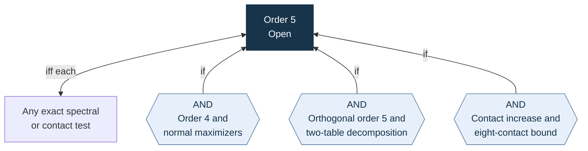
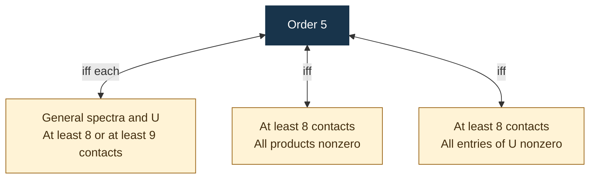
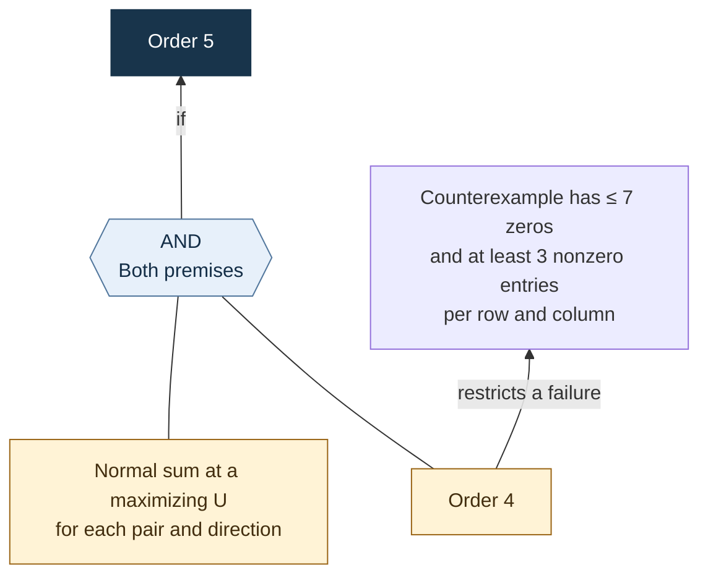
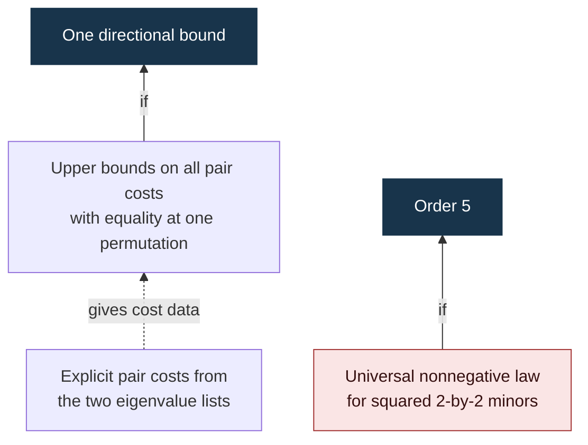

# Order-five proof maps

[README overview](../../README.md#order-five) · [All-order routes](all-order-proof-maps.md) · [Contact transfer](contact-proof-maps.md) · [Order four](order-four-proof-maps.md)

- [Registered routes](#registered-routes)
- [Contact thresholds](#contact-thresholds)
- [Sparse matrices and normal maximizers](#sparse-matrices-and-normal-maximizers)
- [Squared minors and permutation weights](#squared-minors-and-permutation-weights)

The order-five conjecture is the [determinant inclusion](../../README.md)
for all five-by-five normal pairs. In the spectral formulation, $U$
is the unitary change between eigenbases. The complete order-five
statement remains open in this library. A dagger marks a standalone
proof source with an absent dependency.
[Source scope](all-order-proof-maps.md#scope-of-the-lean-source)

## Registered routes

The ten registered routes include three sufficient conditions. Each
conjunction requires its two premises. The contact-transfer premise of
the eight-contact route follows from the all-order transfer, as shown
in the [threshold map](#contact-thresholds).
[Route register](../../Lean/MOC/ProofRoutes.lean#L187) · [Disjunction](../../Lean/MOC/ProofRoutes.lean#L210)

| Route in Lean | Relation | Lean proof |
| --- | --- | --- |
| Normal matrices of order five | Iff | [Statement and proof](../../Lean/MOC/Normal.lean#L280) |
| Regular spectra and full-support mixers | Iff | [Statement and proof](../../Lean/MOC/FullSupportReduction.lean#L118) |
| One-entry positive laws | Iff | [Statement and proof](../../Lean/MOC/ProofRoutes.lean#L89) |
| Evaluated atlas comparison at order five | Iff | [Statement and proof](../../Lean/MOC/ProofRoutes.lean#L71) |
| Principal coisometry of dimension four | Iff | [Statement and proof](../../Lean/MOC/PrincipalCoisometry.lean#L140) |
| Three-anchor rank-one kernel | Iff | [Statement and proof](../../Lean/MOC/Reformulations/ThreeAnchorKernel.lean#L11) |
| Order four AND existence of normal order-five maximizers | If | [Statement and proof](../../Lean/MOC/ProofRoutes.lean#L110) |
| Nonzero eight-contact support bound | Iff | [Statement and proof](../../Lean/MOC/SaturatedContactReduction.lean#L70) |
| One-contact transfer AND the eight-contact support test | If | [Statement and proof](../../Lean/MOC/OrderFiveContact.lean#L97) |
| Orthogonal minor convexification AND orthogonal order five | If | [Statement and proof](../../Lean/MOC/Realification.lean#L79) |

For the regular spectral test, each pair sum is nonzero, different
permutations give different products, and $U$ has no zero entries. The
rectangular test has four orthonormal rows and five columns. The
three-coordinate spectral test fixes two entries of the first list
and one of the second list in normalized coordinates.
[Regularity](../../Lean/MOC/FullSupportReduction.lean#L118) · [Rectangular test](../../Lean/MOC/PrincipalCoisometry.lean#L140) · [Normalized test](../../Lean/MOC/Reformulations/ThreeAnchorKernel.lean#L11)

## Contact thresholds

Each threshold counts permutations that attain the largest matching
projection in one direction. The general test uses $2n-2=8$ with a
fixed determinant difference or $2n-1=9$ with a varying difference.
The nonzero-product test also uses eight contacts. To get the eight-contact
test for $U$ with no zero entries, use density to restrict $U$ before
contact transfer. The transfer increases the count below eight with
the same $U$. Each test still needs its directional bound.
[Contact definitions](contact-proof-maps.md) · [General eight-contact test](../../Lean/MOC/GlobalContactSlice.lean#L243) · [Nine contacts](../../Lean/MOC/AffineGapCover.lean#L85) · [Eight nonzero-product contacts](../../Lean/MOC/SaturatedContactReduction.lean#L70) · [Eight contacts with nonzero entries](../../Lean/MOC/OrderFiveContact.lean#L97) · [Transfer](../../Lean/MOC/VaryingGapTerminal.lean#L110) · [Continuation](../../Lean/MOC/AffineGapCover.lean#L80)

## Sparse matrices and normal maximizers

Under order four, a proper block split, or a row or column with at
most two nonzero entries, gives a lower-order proof. If all rows and
columns have at least three nonzero entries, a two-by-two zero corner
forces its complementary three-by-three corner to have all entries
nonzero. The normal-maximizer criterion also becomes an equivalence
under the order-four premise.
[Counterexample structure](../../Lean/MOC/OrderFiveContact.lean#L34) · [Zero count](../../Lean/MOC/OrderFiveSparseGeometry.lean#L189) · [Zero corner](../../Lean/MOC/OrderFiveZeroCorner.lean#L101) · [Normal maxima](../../Lean/MOC/NormalSupportMaximum.lean#L270)

## Squared minors and permutation weights

Lean represents both the matching score and the determinant projection
with the same cost on pairs of indices. A row-and-column bound on that
cost gives an upper bound on the determinant projection. Equality on
the assignment induced by one actual permutation gives the desired
directional inequality.
[Matching score](../../Lean/MOC/OrderFivePairCost.lean#L217) · [Determinant projection](../../Lean/MOC/OrderFivePairCost.lean#L247) · [Tight cost bound](../../Lean/MOC/OrderFivePairCost.lean#L284)

One set of weights for all spectra of a fixed $U$ would reproduce the
squared absolute values of the two-by-two minors. The reflection
$U=I-2vv^*$, where every entry of the unit vector $v$ is $1/\sqrt{5}$,
refutes that premise. The determinant inclusion for this reflection
holds for every pair of lists. A separate pair-assignment example
shows that the best assignment on pairs can exceed every assignment
induced by a permutation of the individual indices.
[Pair-minor equivalence](../../Lean/MOC/OrderFivePairMarkers.lean#L225) · [Refuted law](../../Lean/MOC/ProofRoutes.lean#L132) · [Inclusion for the reflection](../../Lean/MOC/OrderFiveCommonLawObstruction.lean#L38) · [Pair-assignment example](../../Lean/MOC/PairAssignmentObstruction.lean#L116)

Lean also gives inclusion for the order-five Fourier matrix, the
unitary matrices with zero diagonal and off-diagonal magnitudes $1/2$,
and pairs with one real list and at least one real entry in the other.
[Fourier matrix](../../Lean/MOC/FourierProfiles.lean#L211) · [Zero diagonal](../../Lean/MOC/ConferenceFive.lean#L260) · [Real entry](../../Lean/MOC/HermitianByNormalFourProof.lean#L100)†
