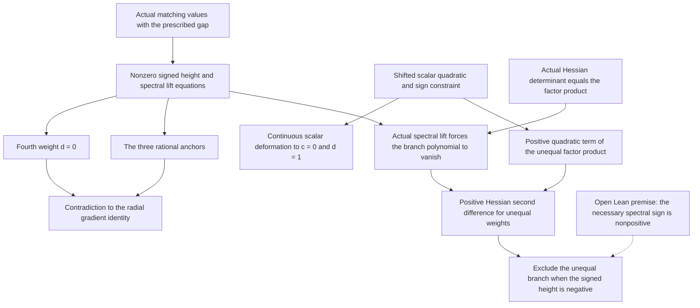

# Order-four contact family with rays 0, 7, 10, 18, and 22

[Conjecture and proof tree](../../README.md#proof-tree) · [Order four](order-four-proof-maps.md)

For normal matrices of order four, a matching product pairs the four
eigenvalues of the first matrix with the four eigenvalues of the
second. Fix a direction in the complex plane. A matching contact is a
permutation whose directional projection attains the selected
extremal value. The gap is the difference from that value.

This family uses nonnegative coefficients $a,b,c,d,e$ for the ordinary
rays 0, 7, 10, 18, and 22 in that order. A ray is a gap profile that
can be multiplied by any nonnegative real number. The mixed ray 34
has coefficient one. The common contact projection is the signed
height $t$. The eight common zero gaps occur at the lexicographic
permutation indices 7, 9, 12, 14, 15, 20, 22, and 23, starting at zero.
[Exact gap and evaluation](../../Lean/MOC/FourContact0710SpectralLift.lean#L17) · [Archived ray enumeration](https://github.com/ascendnoosphere/MOC/blob/a49606d39e8bb5903c9bb4a51651a18679499c0c/data/cone82.json)

| Step | Statement and scope | Lean source |
| --- | --- | --- |
| Spectral coordinates | The prescribed gap and signed height give exact values for the 24 matchings. A spectral lift forces $F+tQ=0$, where $F=-(c+1)((a+1)(b+1)+e)$ and $Q=e(d-1)-1$. Thus $Q$ and $t$ are nonzero. | [Evaluation](../../Lean/MOC/FourContact0710SpectralLift.lean#L33) · [Height](../../Lean/MOC/FourContact0710SpectralLift.lean#L70) |
| Real lift equations | The imaginary coordinates of a spectral lift lie in the real matching Hessian kernel. The imaginary and real coordinates have the same cubic gradient. | [Real lift equations](../../Lean/MOC/FourContact0710SpectralLift.lean#L98) |
| Fourth weight zero | Subtract Hessian rows 1 and 3. Since $t$ is nonzero, the imaginary coordinate $y_5$ is zero. Row 13 then gives $y_6=(e+1)y_0$. The imaginary radial gradient is $(e+1)y_0^2\ge0$. The real radial gradient is $-e-1<0$. The gradient identity is impossible. | [Boundary exclusion](../../Lean/MOC/FourContact0710SpectralLift.lean#L157) |
| Unequal rational anchors | At $(a,b,c,d,e)=(0,4,0,1,10)$ and $(4,0,0,1,10)$ the height is $-15$. The imaginary radial gradient is $(y_0-y_1/11)^2+(6/605)y_1^2$. The real radial gradient is $-1$. | [Unequal anchor exclusion](../../Lean/MOC/FourContact0710SpectralLift.lean#L200) |
| Equal rational anchor | At $(a,b,c,d,e)=(2,2,1,1,9)$ the height is $-36$. The imaginary radial gradient is $(35/27)y_0^2$. The real radial gradient is $-1$. | [Equal anchor exclusion](../../Lean/MOC/FourContact0710SpectralLift.lean#L213) |
| Shifted quadratic | On the scalar branch, the polynomial in the five weights is $e^2 A(c+p(c+1)/e)$ when $e\ne0$, with $p=(a+1)(b+1)$ and $A$ a quadratic. For unequal nonnegative first weights and $d>0$, a positive root forces the constant term of $A$ to be negative. The root is unique. | [Shift](../../Lean/MOC/FourContact0710ShiftedQuadratic.lean#L57) · [Positive root](../../Lean/MOC/FourContact0710ShiftedQuadratic.lean#L128) |
| Scalar deformation | For a scalar point with branch polynomial zero and $Q<0$, reduce $c$ to zero at the fixed positive root. On that slice move $d$ to one and choose the positive root at each value of $d$. The reconstruction preserves the branch equation and $Q<0$. At the endpoint, $p>4$. | [Third weight](../../Lean/MOC/FourContact0710ShiftedQuadratic.lean#L238) · [Fourth weight](../../Lean/MOC/FourContact0710ShiftedQuadratic.lean#L292) · [Endpoint condition](../../Lean/MOC/FourContact0710ShiftedQuadratic.lean#L342) · [Continuity of the root](../../Lean/MOC/FourContact0710ShiftedQuadratic.lean#L380) |
| Scalar pencil sign | At the signed height $t<0$, both scalar pencil factors vanish when the branch polynomial is zero. The slope of the linear factor is positive. The slope of the quadratic factor is negative. Thus the quadratic coefficient of their product multiplied by $-4$ is positive for unequal first weights. | [Height identities](../../Lean/MOC/FourContact0710PencilFactors.lean#L39) · [Slopes](../../Lean/MOC/FourContact0710PencilFactors.lean#L119) · [Quadratic term](../../Lean/MOC/FourContact0710PencilFactors.lean#L169) |
| Actual determinant | For $c\ge0$ and $d>0$, the leading eight rows and columns have determinant $d^2(c+1)^2$. The remaining six rows and columns give a Schur complement. This is the matrix after elimination of the first eight variables. Its rescaled determinant gives the exact product of the two scalar factors multiplied by $-4$. An actual lift forces the branch polynomial to vanish. | [Determinant](../../Lean/MOC/FourContact0710HessianPencil.lean#L197) · [Branch equation](../../Lean/MOC/FourContact0710HessianPencil.lean#L232) |
| Unequal spectral branch | Let $D(t)$ be the Hessian determinant at signed height $t$. If $a\ne b$, $d>0$, and $Q<0$, an actual lift would give $D(t+1)+D(t-1)-2D(t)>0$. The unequal branch is excluded if this second difference is nonpositive. | [Strict sign](../../Lean/MOC/FourContact0710HessianPencil.lean#L250) · [Conditional exclusion](../../Lean/MOC/FourContact0710HessianPencil.lean#L273) |

The full argument requires a nonpositive second difference for actual
spectra. Its proof uses the positive and negative directions of the
Hessian and the radial form. For equal weights the full argument uses
the rank-one restriction of the radial form to the Hessian kernel.
The necessary spectral sign, the general equal-weight exclusion, and
the support inequality for positive signed height remain open in Lean.
[Full paper argument](https://github.com/ascendnoosphere/MOC/blob/a49606d39e8bb5903c9bb4a51651a18679499c0c/Docs/research/eight0710_full_closure.txt)
