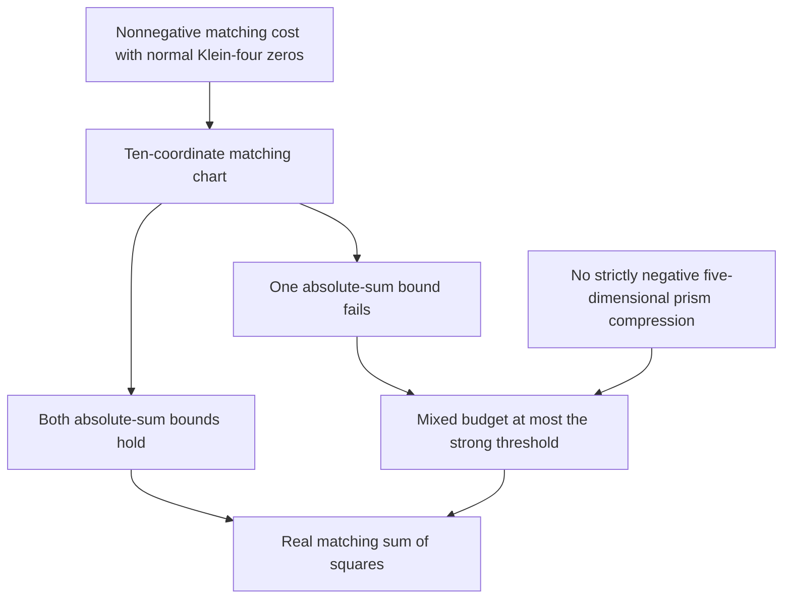

# Normal Klein-four matching squares

[Order-four proof map](order-four-proof-maps.md) · [Conjecture](../../README.md)

Let (g) be a real function of the 24 permutations of four labels.
A matching function is an evaluation from the 14-dimensional matching
space. A matching sum of squares expresses (g) as a finite sum of
pointwise squares of real matching functions. The normal Klein-four
contact set contains the identity and the three double transpositions.

The ten coordinates give three rectangle groups and two cycle groups.
Each rectangle has values (eta_ipm p_ipm q_i), so nonnegativity
gives (eta_ige |p_i|+|q_i|). The cycle baselines add to
(sum_ieta_i). The ordinary certificate allocates this total
between the two groups when each baseline bounds the sum of the
absolute signs in that group.
[Chart](../../Lean/MOC/FourKleinMatchingChart.lean) ·
[Ordinary certificate](../../Lean/MOC/FourKleinMatchingSquares.lean)

When one absolute-sum bound fails, coordinate changes put the cost in
one mixed cap. Write its critical budgets as (a^2,b^2,c^2) with
(age b,cge0), and let (t>0) be its mixed budget. If
(t>a(b+c)-bc), an explicit plane has a strictly negative quadratic
form. Completion of squares joins this plane to the three diagonal
directions of the prism. The resulting compression has dimension five.
This argument also covers (b=c=0).
[Negative plane](../../Lean/MOC/FourKleinNegativeCompression.lean) ·
[Five-dimensional compression](../../Lean/MOC/FourKleinPrism.lean)

The absence of such a compression forces (tle a(b+c)-bc). The
certificate uses an explicit positive combination of a diagonal Gram
matrix and the rank-one Gram matrix of ((a,-b,-c)). Each square is a
real matching function. The formula allows equality at the threshold.
[Prism-to-squares theorem](../../Lean/MOC/FourKleinChartSymmetry.lean)

The prism-to-squares theorem takes the prism compression bound as a
premise. To apply it to all spectral costs, the spectral inverse
quadratic must agree with the chart's prism after reindexing.
[Spectral inverse determinant](../../Lean/MOC/SpectralProfileDeterminant.lean)
