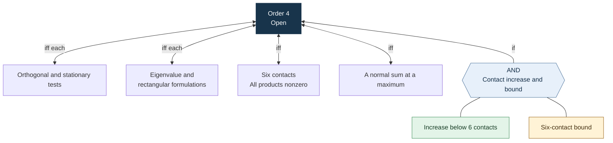
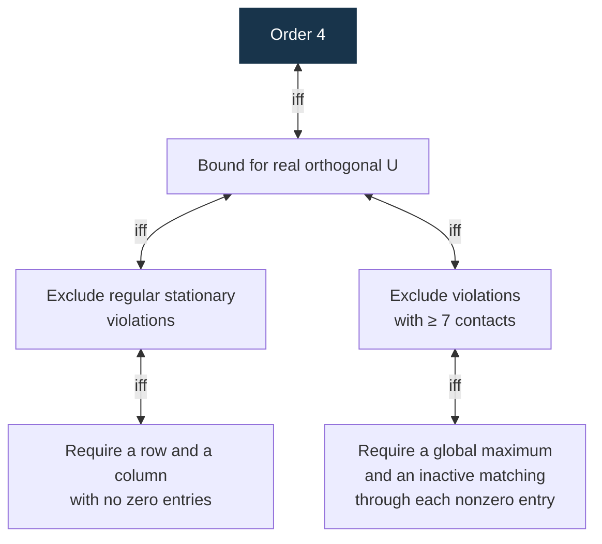
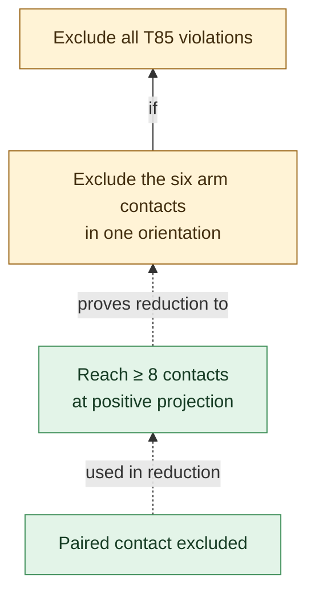

# Order-four proof maps

[README overview](../../README.md#order-four) · [All-order routes](all-order-proof-maps.md) · [Contact transfer](contact-proof-maps.md) · [Order five](order-five-proof-maps.md)

- [Registered routes](#registered-routes)
- [Real orthogonal and stationary tests](#real-orthogonal-and-stationary-tests)
- [Contact patterns](#contact-patterns)

The order-four conjecture asks for the determinant inclusion for every
pair of complex normal four-by-four matrices. In the eigenvalue
formulation, $U$ is the unitary change between the eigenbases. The full
order-four statement remains open in this library. A dagger marks a
standalone proof source with an absent dependency.
[Matrix equivalence](../../Lean/MOC/Normal.lean#L280) · [Source scope](all-order-proof-maps.md#scope-of-the-lean-source)

## Registered routes

The table covers all eleven registered routes. A **coisometry** here
is a rectangular matrix with orthonormal rows. A **regular** pair of
spectra has nonzero pair sums and distinct matching products. The
[contact map](contact-proof-maps.md) defines contacts and strict
witnesses. The all-order transfer gives the six-contact increase step.
The six-contact inequality required by this route remains open.
[Route register](../../Lean/MOC/ProofRoutes.lean#L169) · [Disjunction](../../Lean/MOC/ProofRoutes.lean#L207) · [Contact transfer](../../Lean/MOC/VaryingGapTerminal.lean#L110)

| Route in Lean | Relation | Lean proof |
| --- | --- | --- |
| Normal matrices of order four | Iff | [Statement and proof](../../Lean/MOC/Normal.lean#L280) |
| Real orthogonal mixers with complex spectra | Iff | [Statement and proof](../../Lean/MOC/FourMinorTransport.lean#L574) |
| Regular orthogonal support maximizers | Iff | [Statement and proof](../../Lean/MOC/OrderFourIndependent.lean#L90) |
| Normal sum at a support maximizer | Iff | [Statement and proof](../../Lean/MOC/NormalSupportMaximum.lean#L303) |
| One-entry positive laws | Iff | [Statement and proof](../../Lean/MOC/ProofRoutes.lean#L89) |
| Evaluated atlas comparison at order four | Iff | [Statement and proof](../../Lean/MOC/ProofRoutes.lean#L71) |
| Principal coisometry of dimension three | Iff | [Statement and proof](../../Lean/MOC/PrincipalCoisometry.lean#L140) |
| Exclude all regular stationary orthogonal witnesses | Iff | [Statement and proof](../../Lean/MOC/OrderFourIndependent.lean#L231) |
| Nonzero six-contact support bound | Iff | [Statement and proof](../../Lean/MOC/SaturatedContactReduction.lean#L70) |
| One-contact transfer AND the six-contact support test | If | [Statement and proof](../../Lean/MOC/ProofRoutes.lean#L148) |
| Three-anchor rank-one kernel | Iff | [Statement and proof](../../Lean/MOC/Reformulations/ThreeAnchorKernel.lean#L11) |

## Real orthogonal and stationary tests

Lean expresses all squared absolute values of the minors of an order-four
unitary as one finite convex combination of the corresponding tables of
real orthogonal matrices. Thus the eigenvalue lists stay complex while
$U$ can be restricted to real orthogonal matrices.
[Minor decomposition](../../Lean/MOC/FourMinorTransport.lean#L479) · [Orthogonal equivalence](../../Lean/MOC/FourMinorTransport.lean#L574)

| Exact test | Conditions proved for a counterexample | Lean source |
| --- | --- | --- |
| Regular orthogonal maximizers | Nonzero pair sums, distinct products, and at least three nonzero entries in each row and column. The real orthogonal matrix maximizes the determinant projection over all complex unitaries in the chosen direction. | [Regular maximizer](../../Lean/MOC/OrderFourIndependent.lean#L90) |
| Stationary orthogonal violations | The regular maximizers additionally satisfy the first-order stationarity equations. A further reduction gives one row and one column with no zero entries. | [Stationarity](../../Lean/MOC/OrderFourIndependent.lean#L231) · [Dense row and column](../../Lean/MOC/StationaryDenseCross.lean#L64) |
| Stationary violations with at least seven contacts | The determinant is nonzero. For each nonzero entry $U_{ij}$, a permutation with $\sigma(j)=i$ has strictly smaller projection than the contacts. | [Seven contacts](../../Lean/MOC/ZhengContactReduction.lean#L14) · [Stationary pivot](../../Lean/MOC/StationaryPivot.lean#L219) |
| No normal maximizer obstruction | It suffices that for each pair of lists and direction, some maximizer gives a normal sum. | [Exact normal-maximizer test](../../Lean/MOC/NormalSupportMaximum.lean#L303) |

The inclusion also holds if either spectrum lies on a circle or line,
if there is an opposite eigenvalue pair, or if the real orthogonal
matrix has a zero diagonal.
[Circle or line](../../Lean/MOC/HermitianByNormalFourProof.lean#L60)† · [Opposite pair](../../Lean/MOC/FourCoincidence.lean#L360) · [Zero diagonal](../../Lean/MOC/FourZeroDiagonal.lean#L342)

## Contact patterns

Each T-label names a set of permutations in the linked Lean statements.

| Status | Named pattern | Bound or reduction |
| --- | --- | --- |
| Proof in source | T1 | [Directional bound for the specified contacts](../../Lean/MOC/ZhengT1Circle.lean#L184) |
| Proof in source | T2, T3, T4, T5, T6 | [T2](../../Lean/MOC/FourT2Minor.lean#L338)† · [T3](../../Lean/MOC/FourT3.lean#L25)† · [T4](../../Lean/MOC/FourT4.lean#L30)† · [T5](../../Lean/MOC/FourT5.lean#L26)† · [T6](../../Lean/MOC/FourT6Support.lean#L11)† |
| Proof in source | T15 and T21 | [T15](../../Lean/MOC/FourT15.lean#L14)† · [T21](../../Lean/MOC/FourT21ContactCone.lean#L275)† |
| Partial | T34 | The bound holds at zero common projection, or with the additional contact specified in the theorem. [Zero projection](../../Lean/MOC/FourT34MinorBranch.lean#L145)† · [Additional contact](../../Lean/MOC/FourT34MinorBranch.lean#L56)† |
| Partial | T85 | The paired branch is excluded. A remaining strict witness reduces to eight or more contacts at positive projection. [Paired branch](../../Lean/MOC/ZhengPairedContacts.lean#L905) · [Positive branch](../../Lean/MOC/ZhengPairedContacts.lean#L915) |
| Open | General seven-contact test | The bound must hold for every real orthogonal case at the threshold. [Exact endpoint](../../Lean/MOC/ZhengContactReduction.lean#L14) |

The arm cases are the additional permutations in the marked row and
column defined in Lean. The inverse orientation follows by taking
the adjoint. The proof reduces the branch to that one orientation.
A separate example refutes a five-event linear weight test on the
marked assignments.
[One-orientation implication](../../Lean/MOC/ZhengT81Bypass.lean#L431) · [Refuted linear test](../../Lean/MOC/ZhengStarObstruction.lean#L161)
