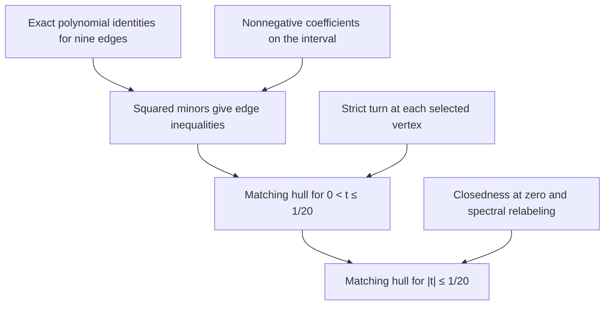

# Order-four real-parameter spectrum

Let $t$ be real and let $U$ be a unitary matrix of order four. Write $U^*$ for the conjugate transpose. Use the spectral lists

$$
a(t)=(t+i,-t+i,1,2+i), \qquad b=(-1+i,-2-2i,2-i,1+2i).
$$

The determinant of $\mathrm{diag}(a(t))+U\mathrm{diag}(b)U^*$ is in the convex hull of the 24 matching products $\prod_j(a(t)_{\sigma(j)}+b_j)$ when $|t|\le 1/20$ or $|t|\ge 99$. Each permutation $\sigma$ sends a column label to a row label. The statement covers every relative unitary. [Bounded interval](../../Lean/MOC/FourRealParameterFamily.lean#L452) · [Unbounded tails](../../Lean/MOC/FourRealParameterFamily.lean#L781)

For each edge, an integer polynomial identity expresses its oriented gap at each matching product as a sum of subset-image indicators. The same weights express the gap at the determinant as a sum of squared minors. Factor the lowest power of the parameter out of each weight. A bound on the negative terms proves the required signs. [Polynomial identities](../../Lean/MOC/FourRealParameterFamily.lean#L321) · [Coefficient bounds](../../Lean/MOC/FourRealParameterFamily.lean#L165) · [Minor transport](../../Lean/MOC/TwoValues.lean#L182)

For a chosen real projection, select a maximizing vertex of the nine-edge list. Its two incident edge inequalities bound the projection of the determinant. The positive turn makes the two adjacent edge directions independent. [Plane hull proof](../../Lean/MOC/PlaneHullEdges.lean#L55)

For $t \ge 99$, set $s=5/(1+t)$. Multiply the first two row factors of every matching product by $s$. This multiplies the product by $s^2$ and gives integer polynomials in $s$. The last cell supplies eight oriented edges. The same coefficient bound applies since $0<s\le 1/20$. Evaluate the weighted minor identity at the scaled determinant and cancel $s^2$. A row swap gives the negative tail. [Scaled hull proof](../../Lean/MOC/FourRealParameterFamily.lean#L505) · [Tail identities](../../Lean/MOC/FourRealParameterFamily.lean#L707)

## Full real-line certificate

The research notes use 89 open cells with exact algebraic endpoints after $x=t/(1+t)$. The interval $1/20<|t|<99$ still needs Lean proofs of the cell identities, coefficient signs, and coverage. Proving the open cells suffices because the matching hull condition is closed and the row swap sends $t$ to $-t$. [Open-cell reduction](../../Lean/MOC/FourRealParameterFamily.lean#L478)

The certificates are recoverable from repository history. Exact arithmetic checks 216 bounded facet identities, 108 bounded coefficient bounds, and nine bounded turn bounds. It also checks 192 tail facet identities, 95 tail coefficient bounds, and eight tail turn bounds. Lean compilation was omitted. [Historical bounded certificate](https://github.com/ascendnoosphere/MOC/blob/6fa170647b8e111ef388ba95d50e4196960d9c22/data/certificates/early/moc4_full_family_certificate.json) · [Historical all-real certificate](https://github.com/ascendnoosphere/MOC/blob/6fa170647b8e111ef388ba95d50e4196960d9c22/data/certificates/categorical/category_moc4_all_real_certificate.json)
