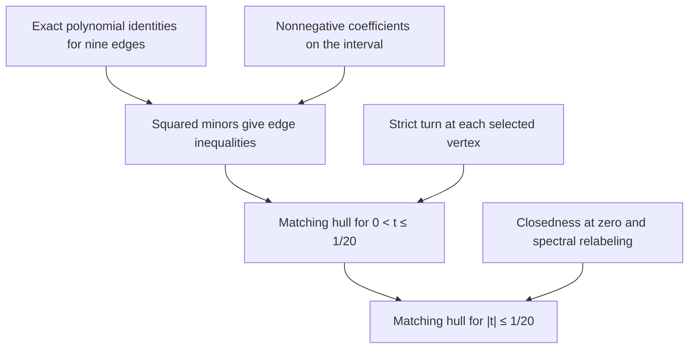

# Order-four real-parameter spectrum

Let $t$ be real and let $U$ be a unitary matrix of order four. Write $U^*$ for the conjugate transpose. Use the spectral lists

$$
a(t)=(t+i,-t+i,1,2+i), qquad b=(-1+i,-2-2i,2-i,1+2i).
$$

For $|t|le 1/20$, the determinant of $\mathrm{diag}(a(t))+U\mathrm{diag}(b)U^*$ is in the convex hull of the 24 matching products $\prod_j(a(t)_{\sigma(j)}+b_j)$. Each permutation $\sigma$ sends a column label to a row label. The statement covers every relative unitary. [Lean source](../../Lean/MOC/FourRealParameterFamily.lean#L510)

For each edge, an integer polynomial identity expresses its oriented gap at each matching product as a sum of subset-image indicators. The same weights express the gap at the determinant as a sum of squared minors. Factor the lowest power of the parameter out of each weight. A bound on the negative terms proves the required signs. [Polynomial identities](../../Lean/MOC/FourRealParameterFamily.lean#L380) · [Coefficient bounds](../../Lean/MOC/FourRealParameterFamily.lean#L224) · [Minor transport](../../Lean/MOC/TwoValues.lean#L182)

For a chosen real projection, select a maximizing vertex of the nine-edge list. Its two incident edge inequalities bound the projection of the determinant. The positive turn makes the two adjacent edge directions independent. [Plane hull proof](../../Lean/MOC/FourRealParameterFamily.lean#L70)

## Full real-line certificate

The research notes use 89 open cells with exact algebraic endpoints to cover all positive parameters after (x=t/(1+t)). The bounded proof uses nine edges on one interval. The remaining cell identities, coefficient signs, and coverage still require Lean proofs. Once the open cells are proved, the closedness and relabeling theorem covers their finite boundary points and all negative parameters. [Open-cell reduction](../../Lean/MOC/FourRealParameterFamily.lean#L536)

The bounded certificate is recoverable from repository history. Exact arithmetic checks the 216 facet identities, 108 coefficient bounds, and nine strict turn bounds. Lean compilation was omitted. [Historical bounded certificate](https://github.com/ascendnoosphere/MOC/blob/6fa170647b8e111ef388ba95d50e4196960d9c22/data/certificates/early/moc4_full_family_certificate.json)
