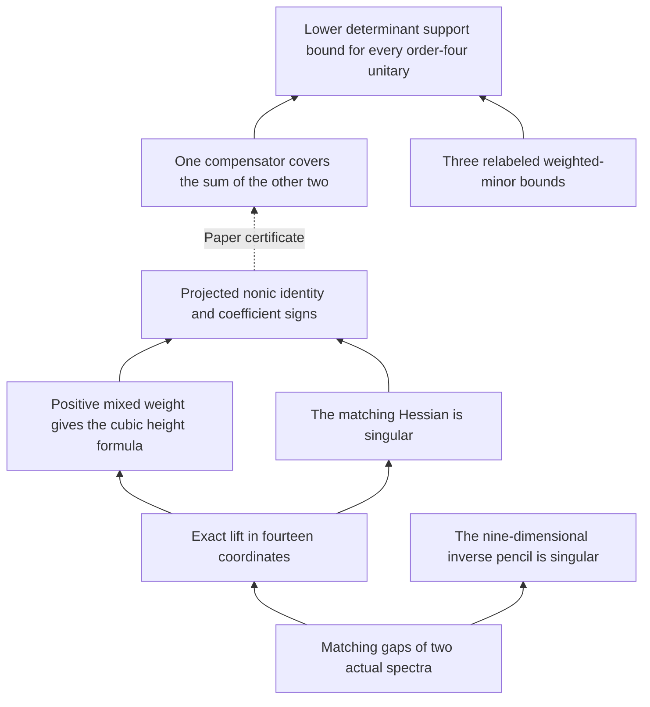

# Order-four symmetric six-contact proof map

This map concerns the Marcus–de Oliveira determinant bound in order
four. Fix two lists of four complex eigenvalues. Choose a complex
direction $\eta$. For each permutation, take the real part of $\eta$
times the product of the four matched sums. A contact attains a
common lower bound $-h$ of these real values. A gap is the difference
between a real value and $-h$. The objective is to prove that the real
part of $\eta$ times the determinant is at least $-h$ for every unitary
change between the two eigenbases.

This family has seven ordinary coefficients $a,b,c,d,p,q,r$ and a
mixed coefficient $\lambda$. All eight coefficients are nonnegative.
The first four ordinary rays use singleton squared minors. The last
three ordinary rays use squared minors of order two. The mixed ray
adds three minor values and subtracts one. Its permutation gap vector
and the seven ordinary vectors have six common zero entries. The code
fixes the row and column subsets and verifies their permutation
values. [Rows, columns, and weights](../../Lean/MOC/FourSymmetricSixContact.lean#L14-L34)

| Step | Scope |
| --- | --- |
| Noncrossing coordinates | The lift evaluates to the prescribed permutation gap minus $h$, for all real coefficients and all permutations. [Lean source](../../Lean/MOC/FourSymmetricSixContact.lean#L52) |
| Height | If $\lambda>0$, let $e_k$ be the elementary symmetric polynomial of degree $k$ in $(a,b,c,d)$. For actual spectra, the height is $(\lambda^3+e_1\lambda^2+e_2\lambda+e_3+pqr)/(\lambda^2+pq+pr+qr)>0$. [Lean source](../../Lean/MOC/FourSymmetricSixContact.lean#L92) |
| Hessian obstruction | The Hessian of the matching cubic at the lifted real coordinates is singular. This includes repeated eigenvalues and repeated products. [Lean source](../../Lean/MOC/FourSymmetricSixContact.lean#L123) |
| Inverse pencil | The same spectral data make a real symmetric matrix of order nine singular. Its coefficients are the nine signed matching evaluations in cofactor coordinates. The complex determinant of order two gives four complex squares, which provide at most eight real linear constraints on its kernel. [Lean source](../../Lean/MOC/FourSymmetricSixContactPencil.lean) |
| Unitary bound | If $\lambda^2\le p(q+r)$, $\lambda^2\le q(p+r)$, or $\lambda^2\le r(p+q)$, the determinant projection is at least $-h$. Zero $\lambda$ satisfies the first condition. All four singleton coefficients remain independent. [Lean source](../../Lean/MOC/FourSymmetricSixContact.lean#L267) |

For the last step, call the three squared minors $X,Y,Z$ in the order
$p,q,r$. The two-budget inequality bounds the mixed ray together with
each pair of these minors. The code checks the three relabelings on
integer permutation tables. The signed moment formula carries each
identity to all unitary tables. If $p(q+r)\ge\lambda^2$ and $q+r>0$,
allocate $\lambda^2/(q+r)$ to $X$ in two bounds. Combine them with
weights $q/(q+r)$ and $r/(q+r)$. The remaining coefficient of $X$ and
the first four ordinary terms are nonnegative.
[Weighted-minor theorem](../../Lean/MOC/FourTwoBudgetMinor.lean#L32) · [Permutation and unitary relabeling](../../Lean/MOC/FourSymmetricSixContact.lean#L153-L228)

The full paper closure obtains a compensator inequality from Hessian
singularity for every actual gap with positive mixed coefficient. It
uses a projected degree-nine polynomial with 2,285 terms and
coefficient signs in a cube and three other parameter regions. The
paper note and its independent audit record the certificate result.
The Lean source here does not yet contain the polynomial table,
determinant identity, or those coefficient-sign proofs.
[Full paper closure](https://github.com/ascendnoosphere/MOC/blob/14cf959d78ae5828a92013d13a65b9c50ebb01d0/Docs/research/six_symmetric_general_closure.txt) · [Independent paper audit](https://github.com/ascendnoosphere/MOC/blob/14cf959d78ae5828a92013d13a65b9c50ebb01d0/Docs/research/six_symmetric_general_independent_review.txt)
