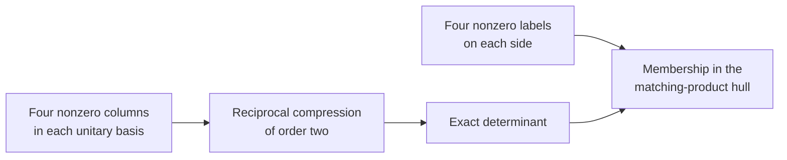

# Six-dimensional rank-two overlap example

[Conjecture and proof tree](../../README.md#proof-tree) · [All-order proof map](all-order-proof-maps.md)

The example in *Two-edge matchings and a rank condition for the
Marcus–de Oliveira conjecture* uses two normal matrices of order six.
The first eigenvalue list is $(1,2,3,i,0,0)$. The second is
$(4,7,-1+i,2-i,0,0)$. Each matrix has rank four. The sum of these
ranks is eight, so the rank-two overlap theorem gives determinant
inclusion. [Example matrices](../../Lean/MOC/RankTwoOverlapExample.lean#L19) ·
[Spectra and ranks](../../Lean/MOC/RankTwoOverlapExample.lean#L127) ·
[Inclusion](../../Lean/MOC/RankTwoOverlapExample.lean#L316)

Take the first four columns of each unitary basis. These columns form
two orthonormal frames, denoted by $X$ and $Y$. Their column spaces
intersect in the plane spanned by the first two standard basis vectors.
The determinant
of $XX^*+YY^*$ is $5184/4225$. Dividing by four gives the covering
mass $1296/4225$. The identity permutation is an available zero
matching product. [Intersection of column spaces](../../Lean/MOC/RankTwoOverlapExample.lean#L198) ·
[Gram determinant](../../Lean/MOC/RankTwoOverlapExample.lean#L262) ·
[Covering mass](../../Lean/MOC/RankTwoOverlapExample.lean#L269) ·
[Zero product](../../Lean/MOC/RankTwoOverlapExample.lean#L324)

The reciprocal compression has determinant $4537/20160-2729i/7560$.
Multiply by the covering mass and by the product $-504-168i$ of all
eight nonzero spectral values. The result is

$$
det(A+B)=rac{-225594+186786i}{4225}.
$$

The proof uses an upper triangular factorization for the Gram matrix
and exact rational arithmetic for the reciprocal compression. An
independent exact calculation also checked the full determinant.
[Reciprocal compression](../../Lean/MOC/RankTwoOverlapExample.lean#L274) ·
[Exact determinant](../../Lean/MOC/RankTwoOverlapExample.lean#L292) ·
[Hull membership](../../Lean/MOC/RankTwoOverlapExample.lean#L331)
