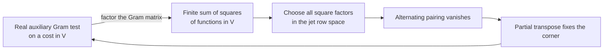

# Real matching sums of squares in order four

[Conjecture and proof tree](../../README.md#proof-tree) · [Order-four routes](order-four-proof-maps.md)

A matching is a permutation of the four eigenvalue labels. The matching
functions take real values on the 24 permutations.

## Permutation coordinates

The coordinates index permutations in lexicographic order. The inverse
gives the index of any permutation. In these coordinates, the reference
mixed facet has 13 zeros, which give 1716 six-element subsets.
[Permutation equivalence](../../Lean/MOC/ContactCensus.lean#L62) · [Reference facet](../../Lean/MOC/ContactCensus.lean#L102) · [Six-contact count](../../Lean/MOC/ContactCensus.lean#L120)

## The real auxiliary test

For two subsets of the label set, the subset-image indicator is one
when a permutation maps the first subset onto the second. It is zero
otherwise. Let $V$ be the real span of these indicators. The
noncrossing coordinates give $V$ dimension 14.
[Indicator span](../../Lean/MOC/RealMatchingSquares.lean#L185) · [Dimension](../../Lean/MOC/RealMatchingSquares.lean#L55)

Use the auxiliary values $eta=(0,1,-1,w)$, with $w$ a real variable.
For a permutation $pi$ and a subset $I$, take the constant and
linear coefficients of $prod_{iin I}eta_{pi(i)}$. Let $J$ be the
matrix that has these 32 coefficients in row $pi$. Its column space
is $V$. Write $j_pi$ for the transpose of that row.
[Jet definition](../../Lean/MOC/RealMatchingSquares.lean#L29) · [Column space](../../Lean/MOC/RealMatchingSquares.lean#L152)

Let $E$ be the $32$ by $4$ matrix that selects two exceptional
directions in each block of the jet. Its two directions, with
coordinates given by subsets, are

$$
u_1(01)=u_1(23)=1,quad u_1(02)=u_1(13)=-1,
$$

$$
u_2(01)=u_2(23)=u_2(02)=u_2(13)=1,quad
u_2(03)=u_2(12)=-2 .
$$

Their other coordinates are zero. Here $01$ means the subset
${0,1}$. For a real positive semidefinite matrix $T$, the cost is
$g_pi=j_pi^mathsf{T}Tj_pi$ and its corner is
$R=E^mathsf{T}TE$. The real auxiliary test requires that the range
of $T$ lie in the row space of $J$ and that the partial transpose of
$R$ be positive semidefinite. The partial transpose exchanges the
first tensor index of the row and column.
[Embedding](../../Lean/MOC/RealMatchingSquares.lean#L236) · [Partial transpose](../../Lean/MOC/RealMatchingSquares.lean#L280) · [Auxiliary test](../../Lean/MOC/RealMatchingSquares.lean#L435)

For $gin V$, the real auxiliary test is equivalent to the existence
of a finite list of functions $f_kin V$ with
$g_pi=sum_k f_k(pi)^2$ for every $pi$.
[Lean equivalence](../../Lean/MOC/RealMatchingSquares.lean#L441)

The sign of a permutation is $1$ for an even permutation and $-1$
for an odd one. The signed sum of a cost in $V$ is zero. Let
$K=egin{pmatrix}0&1\\-1&0end{pmatrix}^{\otimes 2}$. The signed sum of
the jet products equals $EKE^mathsf{T}$. The resulting pairing of
$K$ and the symmetric corner $R$ is zero. It is twice the difference
between entries $(00,11)$ and $(01,10)$ of $R$. This difference also
multiplies $K$ in the partial-transpose defect. Thus the partial
transpose fixes $R$.
[Alternating sum](../../Lean/MOC/RealMatchingSquares.lean#L268) · [Gram pairing](../../Lean/MOC/RealMatchingSquares.lean#L357) · [Fixed corner](../../Lean/MOC/RealMatchingSquares.lean#L397)

## Scope

The Lean source uses the real auxiliary triple $(0,1,-1)$. The
correspondence with the complex auxiliary triple $(0,1,i)$ uses a
separate fractional linear change of coordinates. For a determinant
proof, a further step must place the actual spectral support costs in
the matching sum-of-squares cone and establish the required
positivity on mixers. The equivalence leaves those steps open.

An exact integer check covered all 24 permutations, the column-span
certificates, and the signed kernel. A symbolic calculation checked
the partial-transpose identities for every symmetric corner. The new
Lean source awaits kernel verification.
