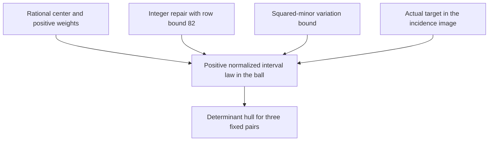

# Six-dimensional mixer ball for three pairs

[Marcus–de Oliveira conjecture](../../README.md)

Let $U_0$ be the rational unitary matrix defined in the source.
Let $U$ be a complex unitary matrix of order six. If the operator
norm of $U-U_0$ is at most $1/23083105288$, then the determinant
hull holds for every first spectrum and every second spectrum of the
form $(b_1,b_1,b_2,b_2,b_0,b_0)$. The relative position of the three
source pairs is fixed. The hypothesis includes the boundary of the
ball. Equal values among the $b_i$ are permitted.
[Lean statement](../../Lean/MOC/SixDimensionalMixerBall.lean#L1499)

| Step | Claim | Source |
| --- | --- | --- |
| Center | The integer numerator divided by $8389$ is unitary. All 90 archived weights are at least $3/70375321$ and give the required 50 squared-minor coordinates. | [Center proof](../../Lean/MOC/SixDimensionalMixerBall.lean#L581) |
| Repair | Selected coordinates determine every vector in the interval incidence image. The inverse on the selected coordinates has maximum absolute row sum $82$. | [Decoder proof](../../Lean/MOC/SixDimensionalMixerBall.lean#L769) |
| Compatibility | Group the real signed matching weights by the images of the first two and first four columns. This gives the actual target as a linear combination of interval columns. | [Signed target proof](../../Lean/MOC/SixDimensionalMixerBall.lean#L915) |
| Variation | Changing one minor column at a time and using the determinant norm bound gives a target change of at most twelve times the change in operator norm. | [Variation proof](../../Lean/MOC/SixDimensionalMixerBall.lean#L1472) |
| Evaluation | The interval law agrees on four subset monomials for each placement. A common linear substitution then gives the paired matching products for distinct values. The two-value theorem covers repeated values. | [Determinant evaluation](../../Lean/MOC/SixDimensionalMixerBall.lean#L1228) |

For a subset of rows of size two, the target uses the squared minor
from the first two columns. At size three, it uses the sum of the
squared minors obtained by including either of the next two columns.
At size four, it uses the squared minor from the first four columns.
Each interval column contributes one to each of its lower and upper
coordinates and one to each of its two middle coordinates. This
accounts for the 50 target coordinates and the 90 possible intervals.

The source includes the finite integer and rational checks of the
archived certificate. Exact arithmetic independently replayed the
center orthogonality, all target coordinates and weights, the selected
inverse, the full decoder identities, and the stated radius. A second
exact replay used a noncentral rational rotation and checked the
repaired weights against a determinant with Gaussian rational spectra.
The Lean source awaits compilation.
[Archived certificate](https://github.com/ascendnoosphere/MOC/blob/14cf959d/data/certificates/categorical/category_coupling_local_certificate.json)
