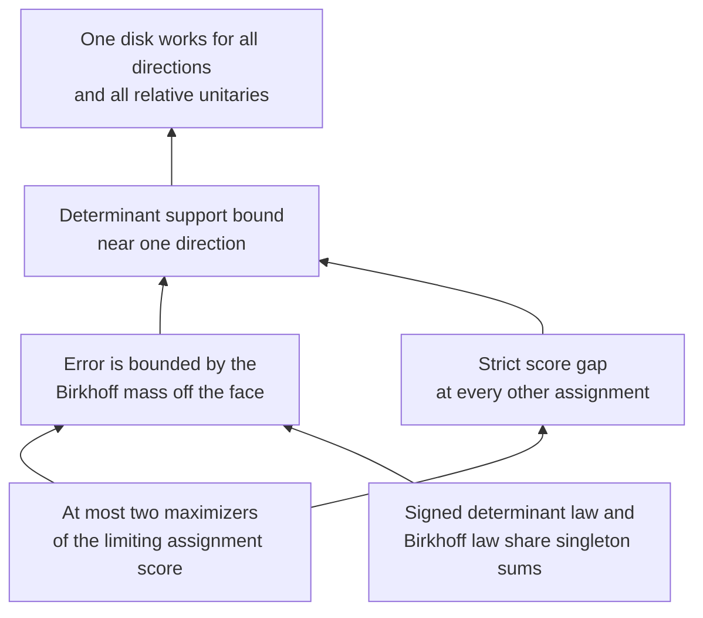

# Small spectral perturbations

[Marcus–de Oliveira conjecture and proof tree](../../README.md#proof-tree)

Let $a$ and $b$ be two complex eigenvalue lists indexed by the same finite
set. Assume every $a_i$ is nonzero. For each permutation $\sigma$, define
the assignment value $s_\sigma=\sum_j a_{\sigma(j)}^{-1}b_j$. Assume the
values are distinct and no three lie on one real affine line in
$\mathbb C$. The result gives a radius $r>0$ such that the determinant of
$\mathrm{diag}(a)+tU\mathrm{diag}(b)U^*$ lies in its matching hull for
every unitary matrix $U$ and every complex parameter $t$ with $|t|<r$.
This is a case of the conjecture in every finite order.
[Lean hypotheses](../../Lean/MOC/SmallSpectralPerturbation.lean#L568) · [Lean result](../../Lean/MOC/SmallSpectralPerturbation.lean#L753)

The maximizing assignments are the ones with largest real projection.
Call their union of matching edges the allowed set. Measure the mass of
the Birkhoff law on all other assignments. If there is one maximizing
assignment, use it twice in the two-assignment estimate.

For each other assignment, at least one edge lies outside the allowed
set. In the involutive case, at least two do. In the remaining case,
two columns share just one allowed row. Orthogonality bounds the product
of the two maximizing weights by a constant times the mass off the
face. There is then one maximizing assignment such that all its other
edges have small squared modulus. Every different matching differs in
at least two columns. The product of two small entries bounds its
signed coefficient. Equality of the singleton sums gives the same
order of error on the maximizing assignments.
[Individual signed coefficient bound](../../Lean/MOC/SmallSpectralPerturbation.lean#L170) · [Total variation bound](../../Lean/MOC/SmallSpectralPerturbation.lean#L364)

The assignment score gives a strict gap away from the maximizing
assignments. For a small change of the scores, the gap pays for the
signed-law error. The first coefficient of each normalized matching
polynomial is the reciprocal assignment sum. Its continuity gives
a neighborhood of each unit support direction. Compactness of the
unit circle gives one disk for all directions.
[Support stability](../../Lean/MOC/SmallSpectralPerturbation.lean#L493) · [Uniform disk](../../Lean/MOC/SmallSpectralPerturbation.lean#L659)

The source theorem is in sections 1–8 of the local
`variational_notes.txt`. The finite-law proof above gives the same
existential radius by a different argument. Exact arithmetic checked
the law estimates on 16 matrix and assignment pairs. It also checked
the note's order-four example. Its 24 assignment sums are distinct.
All 2024 orientations of triples are nonzero. The minimum absolute
orientation is 315. The general position density proof and the
explicit radius from the note remain paper results.
