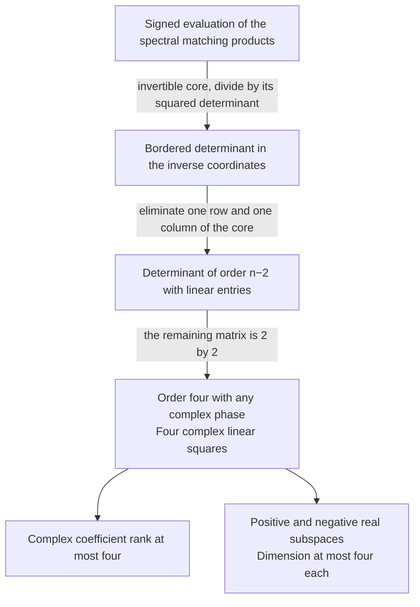

# Spectral profile determinant

[Main conjecture](../../README.md) · [Order four](order-four-proof-maps.md)

Let $a$ and $b$ be two complex spectral lists of length $n$. Each
permutation contributes the matching product
$z_\sigma=\prod_j(a_{\sigma(j)}+b_j)$. A balanced matrix has zero row
sums and zero column sums. Let $S$ be a balanced matrix, and put
$A=\mathrm{diag}(a)$ and $B=\mathrm{diag}(b)$. The signed evaluation of
the matching profile at $S$ is $\det(AS+SB)$.
[Signed evaluation](../../Lean/MOC/SpectralProfileDeterminant.lean#L24)

## Inverse coordinates in any order

Choose a basis with the constant vector as its first direction and
the zero-sum vectors in the remaining directions. Let $E$ change
coordinates from this basis to the original basis. Write
$S=E\,\mathrm{diag}(0,K)E^{-1}$, with $K$ of order $n-1$.
In this basis write $A_0$ and $B_0$ for the lower-right blocks of the
two diagonal operators. Write $u$ for the top-right block of the first
operator and $v$ for the bottom-left block of the second operator.
With $H=(K^{-1})^\mathsf{T}$, the normalized signed evaluation is

$$
\frac{\det(AS+SB)}{(\det K)^2}
=
\det\begin{pmatrix}
0 & u\\
v & H^\mathsf{T}A_0+B_0H^\mathsf{T}
\end{pmatrix}.
$$

The identity uses an invertible $K$. The determinant on the right is
defined for every $H$. A constant matching function evaluates to zero
on the balanced embedding. [Inverse-coordinate identity](../../Lean/MOC/SpectralProfileDeterminant.lean#L119) · [Constant matching functions](../../Lean/MOC/SpectralProfileDeterminant.lean#L135)

The smaller determinant follows by pivoting on one nonzero entry in
each border. The remaining matrix has entries linear in $H$. If
either border is zero, the original determinant is zero. No assumption
on the multiplicities of $a$ and $b$ is needed.
[Smaller determinant](../../Lean/MOC/SpectralProfileDeterminant.lean#L308)

## Rank and inertia in order four

The tetrahedral basis has first column $(1,1,1,1)^\mathsf{T}/2$.
It gives a polynomial in the nine entries of $H$. Multiply this
polynomial by any complex number $\eta$. The result is a sum of four
squares of complex linear functions. The complex symmetric coefficient
matrix therefore has rank at most four.
[Tetrahedral basis](../../Lean/MOC/SpectralProfileDeterminant.lean#L464) ·
[Complex square factorization](../../Lean/MOC/SpectralProfileDeterminant.lean#L329) ·
[Rank bound for a representing matrix](../../Lean/MOC/SpectralProfileDeterminant.lean#L431) ·
[Rank-four coefficient matrix](../../Lean/MOC/SpectralProfileDeterminant.lean#L509)

The real part of the square of $p+iq$ is $p^2-q^2$ for real $p,q$.
On a subspace where the real form is strictly positive on every
nonzero vector, the four positive linear functions give an injective
map into $\mathbb R^4$. The same argument with the opposite sign
bounds the strictly negative dimension. This includes singular cores
and repeated eigenvalues. For a support cost of the form
$h-\mathrm{Re}(\eta z_\sigma)$, the constant $h$ contributes zero.
[Positive dimension](../../Lean/MOC/SpectralProfileDeterminant.lean#L372) ·
[Negative dimension](../../Lean/MOC/SpectralProfileDeterminant.lean#L390)

The Lean source gives the actual spectral polynomial and its
coefficient bounds. The universal pencil on all matching functions
and the separate numerical data for the nonic obstruction require
their own formalization. These results give necessary conditions on
actual spectral costs.
