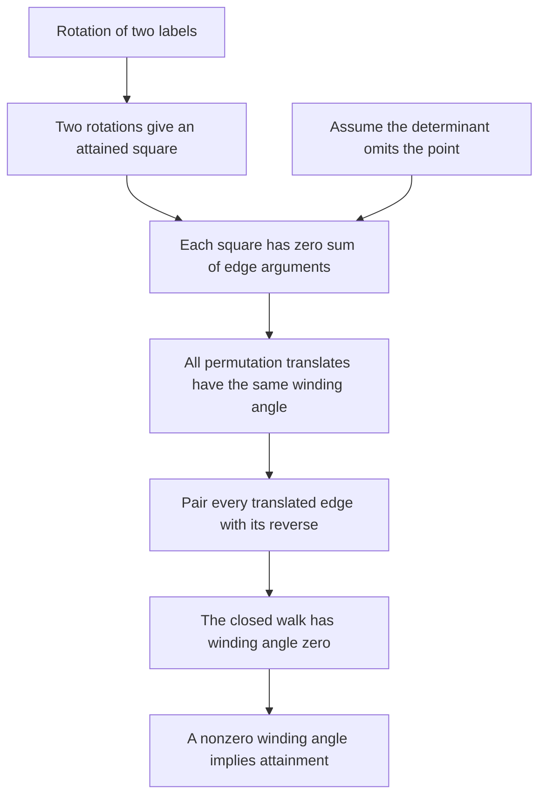

# Attained values from transposition walks

Let $a$ and $b$ be two lists of complex eigenvalues with the same finite
index set. For a permutation $p$, its matching product is
$z_p=prod_j(a_{p(j)}+b_j)$. The attainable determinant range consists
of $det(mathrm{diag}(a)+Umathrm{diag}(b)U^*)$ for unitary matrices
$U$. Eigenvalues in either list can repeat.

A transposition swaps two labels. A transposition walk gives a sequence
of permutations in which consecutive permutations differ by such a swap.
Draw the walk by joining consecutive matching products with straight
segments. For a point $q$ outside this polygonal walk, the winding angle
is the sum of the principal arguments of
$(z_{	ext{next}}-q)/(z_{	ext{current}}-q)$ along its edges. A full turn
has angle $2pi$. If the walk closes and the winding angle is nonzero,
some unitary matrix attains $q$. [Lean statement](../../Lean/MOC/TranspositionWinding.lean#L595)

For a transposition matrix $P$ and a parameter $0le tle1$, use the
unitary matrix $sqrt{1-t},I+isqrt{t},P$. Only the identity and the
transposition have nonzero signed determinant weights. One squared
matrix entry gives the transposition weight $t$. The two weighted
matching products therefore trace the entire straight segment. At the
other endpoint the factor $i$ cancels in conjugation. [Segment identity](../../Lean/MOC/TranspositionWinding.lean#L229)

Compose two rotations with independent parameters to obtain a square in
the attainable range. At one boundary, conjugation by the first
transposition relabels the second transposition. This gives the four
required edges. If the square omits $q$, its difference from $q$ has a
continuous logarithm. The proof adds principal logarithms of ratios
from a sufficiently fine subdivision of every radial segment in the
square. Their exponentials telescope. On a straight boundary edge, the
change of imaginary part is its principal change of argument. Summing
around the square cancels the four endpoint values. [Square construction](../../Lean/MOC/TranspositionWinding.lean#L347) · [Logarithm and angle calculation](../../Lean/MOC/TranspositionWinding.lean#L401)

Summing the square identities along a closed walk shows that its
winding angle is invariant under translation by a transposition.
Transpositions generate the permutation group. Averaging over the
whole group pairs all translated edges with their reversals, and the
average angle is zero. This contradicts nonzero winding if the range
omits $q$. Intersections of drawn segments add no edges to the abstract
walk. [Finite averaging proof](../../Lean/MOC/TranspositionWinding.lean#L63)

See Kovacec for the straight-segment calculation and the graph of
matching products. The square and averaging proof gives an inner bound
on attainable determinant values. [Preprint](https://www.mat.uc.pt/preprints/ps/p2611.pdf)
