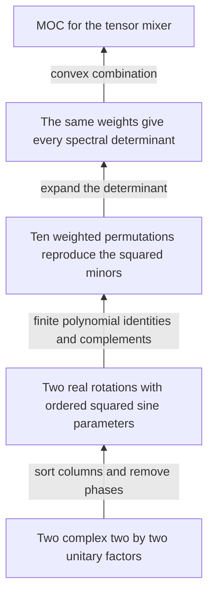

# Matching weights for a Kronecker product of two unitaries

[Conjecture and notation](../../README.md) · [Order-four proof map](order-four-proof-maps.md)

Let $A$ and $B$ be complex two by two unitary matrices. Set $U=A\otimes B$, where $\otimes$ denotes the Kronecker product. Index the rows and columns of $U$ by pairs. There is a probability law on at most ten permutations of the four labels. For each column subset $J$ and row subset $I$, the probability of mapping $J$ onto $I$ equals the squared modulus of the corresponding minor of $U$. For subsets of different sizes, the probability and the table entry are zero. [Minor law](../../Lean/MOC/TwoByTwoTensorPermutationLaw.lean#L391)

The same law gives the determinant in the Marcus–de Oliveira conjecture for every pair of complex spectral lists. The weights use $A$ and $B$ and are independent of the lists. [Determinant identity](../../Lean/MOC/TwoByTwoTensorPermutationLaw.lean#L428) · [Hull inclusion](../../Lean/MOC/TwoByTwoTensorPermutationLaw.lean#L437)

First sort the columns of each factor so the first row has its larger entry in the first column. Remove the two first-row phases. The orthogonal second row is a real perpendicular vector times a unit scalar. This reduction also works when a first-row entry is zero. [Phase reduction](../../Lean/MOC/TwoByTwoTensorPermutationLaw.lean#L279)

Let $p$ and $q$ be the squared sine parameters of the real rotations. Exchange the factors if necessary to obtain $0\le p\le q\le 1/2$. The law uses $x=1-2q$, $y=2(q-p)$ and $z=2p$. These numbers are nonnegative and sum to one. Every displayed weight is a polynomial with nonnegative coefficients in $x,y,z$. The ten weights sum to one. [Weights](../../Lean/MOC/TwoByTwoTensorPermutationLaw.lean#L80)

Check the 16 singleton entries and the 36 two by two minors by polynomial identities. Complementary minors and the corresponding complementary permutation events give the larger minors. Row and column changes transport the law to the original factors. [Polynomial identities](../../Lean/MOC/TwoByTwoTensorPermutationLaw.lean#L115) · [Complementary minors](../../Lean/MOC/FiniteMinorLaw.lean#L99) · [Relabeling](../../Lean/MOC/TwoByTwoTensorPermutationLaw.lean#L200)

This case is for products of exactly two two by two factors. The proof does not establish unrestricted order-four MOC. The source was reviewed with an exact arithmetic check of the finite identities and without Lean compilation.
