# Determinant inclusion in all orders

[Proof map index](README.md) · [Conjecture and overview](../README.md#proof-tree) · [Spectral and support results](spectral-support-proof-map.md) · [Contact transfer](contact-transfer-proof-map.md) · [Order four](order-four-proof-map.md) · [Order five](order-five-proof-map.md)

- [How routes connect](#how-routes-connect)
- [Tests at each order](#tests-at-each-order)
- [Matrix and operator formulations](#matrix-and-operator-formulations)
- [Normalization and order reduction](#normalization-and-order-reduction)
- [Induction through normal maximizers](#induction-through-normal-maximizers)
- [Polynomial and coefficient conditions](#polynomial-and-coefficient-conditions)
- [Spectral realizations and implications](#spectral-realizations-and-implications)
- [Spectral tests with arbitrary evaluators](#spectral-tests-with-arbitrary-evaluators)
- [Finite overlap compression](#finite-overlap-compression)
- [Common weights at small shifted rank sum](#common-weights-at-small-shifted-rank-sum)
- [Overlapping circle blocks](#overlapping-circle-blocks)
- [Normal products](normal-products-proof-map.md)
- [Paper cases in any order](#paper-cases-in-any-order)
- [Scope of the Lean source](#scope-of-the-lean-source)

Let $A$ and $B$ be complex normal matrices of the same order. Write $a,b$
for their eigenvalue lists, with multiplicity. Let $U$ be their unitary
change of eigenbasis. The Marcus–de Oliveira conjecture (MOC) places
$\det(A+B)$ in the real convex hull of the products
$\prod_j(a_{\sigma(j)}+b_j)$ over all permutations $\sigma$.
[Exact statement](../README.md) · [Lean conjecture](../Lean/MOC/Core.lean#L33)

The tables describe the general routes recorded in Lean. The
[spectral evaluation tests](#spectral-tests-with-arbitrary-evaluators)
use the common equivalence for arbitrary evaluators. A proved arrow
transfers a proof from one statement to another. The tables give the
status of each premise.
[General route list](../Lean/MOC/ProofRoutes.lean#L312) · [Combined route theorem](../Lean/MOC/ProofRoutes.lean#L679)

Write $\mathrm{MOC}_n$ for the conjecture in order $n$ and
$\mathrm{MOC}$ for the conjecture in every finite order.
Each named test in a relation is the complete statement in that row,
with its stated quantifiers. A subscript gives the matrix order.
$C_m$ denotes the rectangular test with $m$ orthonormal rows and $m+1$
columns. A checked relation can have an open premise.
[Notation and check status](README.md#notation-and-proof-status)

## How routes connect

Read the arrows toward the goal. **Iff** gives both implications. **If**
gives a sufficient condition. An **AND** node needs every connected input.
An **OR** node needs one complete input.

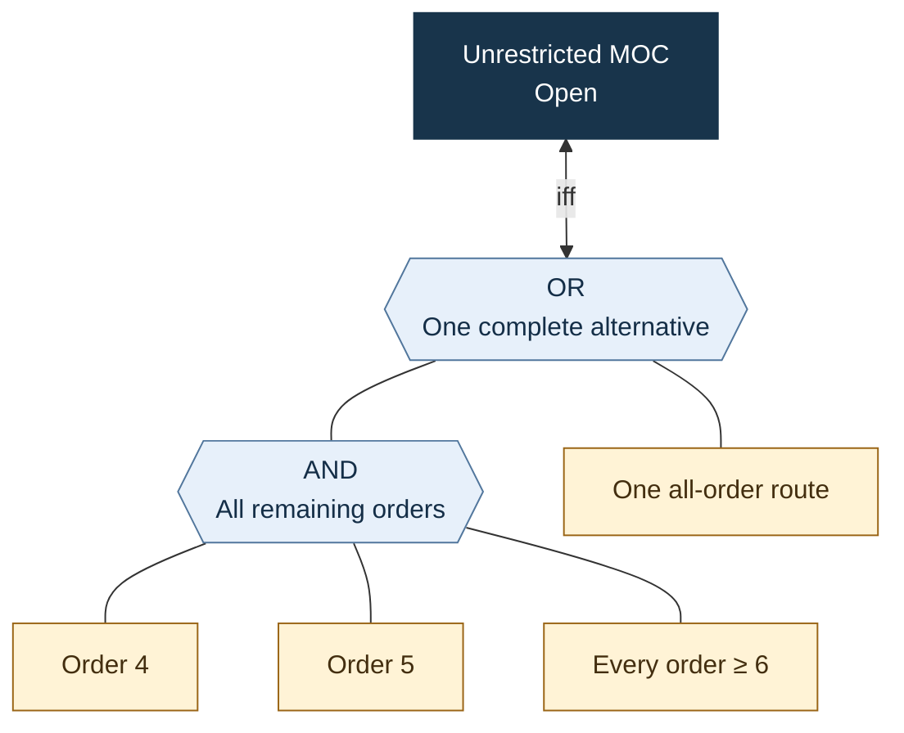

The order split uses the proof for orders zero through three. MOC implies
the disjunction of the registered routes by choosing an exact route.
Each registered all-order route supplies its implication back to MOC.
For the order split, choose one route at order four, one at order five,
and one at each order at least six. The choice can depend on the order.
[Small orders](../Lean/MOC/Small.lean#L68) · [Combined route theorem](../Lean/MOC/ProofRoutes.lean#L679)

For a proof of a named test, apply its implication to `MOCIsTrue` or
`Conjecture (Fin n)`, the inclusion at order $n$. For example, if
`h` proves `MOC.Reformulations.complexMatrices`, then
`MOC.Reformulations.moc_iff_complexMatrices.mpr h` proves `MOC.MOCIsTrue`.
The selected proof supplies the only premise in this application.
In the registry, `AnyRoute` means that one member has a proof of its
goal. `close_any` applies that member's implication. A route with a
conjunctive premise needs a proof of each conjunct.
[Normal matrix equivalence](../Lean/MOC/Reformulations/FirstMatrix.lean#L46) · [Route disjunction](../Lean/MOC/ProofRoutes.lean#L76) · [Closure](../Lean/MOC/ProofRoutes.lean#L79)

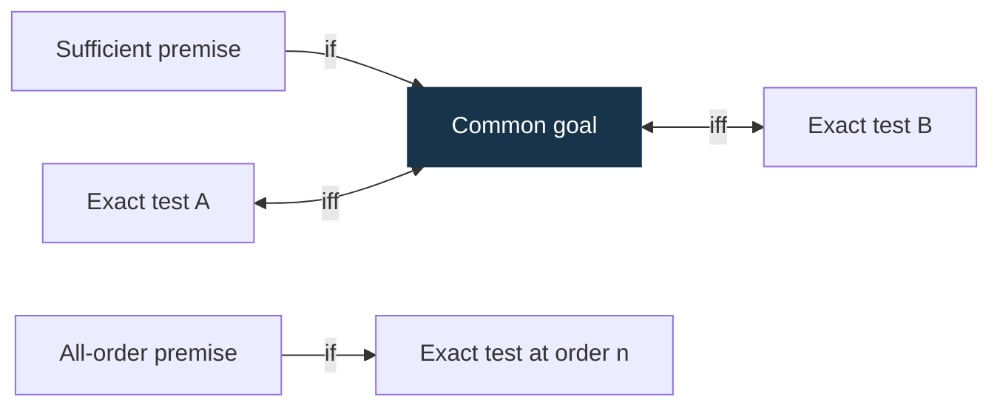

| Relation | Consequence | Lean source | Lean Checked? |
| --- | --- | --- | --- |
| Two exact routes for one root | Their complete statements are equivalent. | [Equivalence of exact routes](../Lean/MOC/ProofRoutes.lean#L67) | No |
| A sufficient route and an exact route | The sufficient premise implies the exact premise. | [Transfer to exact route](../Lean/MOC/ProofRoutes.lean#L62) | No |
| An all-order route and an exact route at order $n$ | The all-order premise implies the fixed-order test. | [Restriction to an order](../Lean/MOC/ProofRoutes.lean#L703) | No |
| All-order and fixed-order alternatives | Either a direct order-four route or an all-order route suffices for order four. The corresponding statement holds for order five. | [Order four](../Lean/MOC/ProofRoutes.lean#L693) · [Order five](../Lean/MOC/ProofRoutes.lean#L698) | No |

## Tests at each order

Fix an order $n\ge4$. Each row gives an exact test for the conjecture
at that order. The [order-four](order-four-proof-map.md#registered-routes)
and [order-five](order-five-proof-map.md#registered-routes) lists add
tests specific to their orders. Write $D=\det(A+B)$ and let $P_\sigma$
be the matching product for permutation $\sigma$. A contact attains
the largest matching projection in a given direction. A strict witness
has a determinant projection larger than that maximum.
[Common tests](../Lean/MOC/ProofRoutes.lean#L191) · [Fixed-order disjunction](../Lean/MOC/ProofRoutes.lean#L233)

| Exact test at order $n$ | Relation | Lean source | Lean Checked? |
| --- | --- | --- | --- |
| Normal complex matrices | $\mathrm{MOC}_n\Longleftrightarrow \text{normal complex matrices}_n$ | [Normal matrix form](../Lean/MOC/Normal.lean#L280) | Yes |
| One set of weights for one free partner eigenvalue | $\mathrm{MOC}_n\Longleftrightarrow \text{one-free-entry law}_n$ | [One-entry law](../Lean/MOC/FreeEntryEquivalence.lean#L19) | Yes |
| A planar intercept hull for one free partner eigenvalue | $\mathrm{MOC}_n\Longleftrightarrow \text{free-entry intercept test}_n$ | [Finite test](../Lean/MOC/FreeEigenvalueSlopeSlice.lean#L205) · [Equivalence](../Lean/MOC/FreeEigenvalueSlopeSlice.lean#L282) | Yes |
| If both spectra are in the open unit disk, require $\lvert 1+D\rvert\le\max_\sigma\lvert 1+P_\sigma\rvert$. | $\mathrm{MOC}_n\Longleftrightarrow \text{unit-disk modulus test}_n$ | [Disk test](../Lean/MOC/TranslatedDeterminantPowers.lean#L40) | Yes |
| Under the same spectral restriction, require $\lvert 1+D\rvert^{2k}\le\sum_\sigma\lvert 1+P_\sigma\rvert^{2k}$ for every nonnegative integer $k$. | $\mathrm{MOC}_n\Longleftrightarrow \text{unit-disk power test}_n$ | [Power test](../Lean/MOC/TranslatedDeterminantPowers.lean#L112) | Yes |
| Spectral evaluations on a nonempty sample type | $\mathrm{MOC}_n\Longleftrightarrow \text{spectral evaluations on a nonempty sample type}_n$ | [Spectral evaluation test](../Lean/MOC/ProofRoutes.lean#L97) | No |
| Equal traces | $\mathrm{MOC}_n\Longleftrightarrow \text{equal traces}_n$ | [Trace condition](../Lean/MOC/Core.lean#L167) | Yes |
| Equal second elementary coefficients | $\mathrm{MOC}_n\Longleftrightarrow \text{equal second elementary coefficients}_n$ | [Second coefficient](../Lean/MOC/EqualSpectralCoefficients.lean#L91) | Yes |
| Equal first and second elementary coefficients | $\mathrm{MOC}_n\Longleftrightarrow \text{equal first and second elementary coefficients}_n$ | [Both coefficients](../Lean/MOC/EqualSpectralCoefficients.lean#L428) | Yes |
| Bound in the real direction | $\mathrm{MOC}_n\Longleftrightarrow \text{bound in the real direction}_n$ | [Real-part bound](../Lean/MOC/Support.lean#L84) | Yes |
| All pair sums nonzero | $\mathrm{MOC}_n\Longleftrightarrow \text{all pair sums nonzero}_n$ | [Nonopposite spectra](../Lean/MOC/Support.lean#L101) | Yes |
| All pair sums nonzero and distinct matching products | $\mathrm{MOC}_n\Longleftrightarrow \text{all pair sums nonzero and distinct matching products}_n$ | [Regular products](../Lean/MOC/SpectralPerturbation.lean#L146) | Yes |
| Regular matching products and no zero mixer entries | $\mathrm{MOC}_n\Longleftrightarrow \text{regular matching products and no zero mixer entries}_n$ | [Full support](../Lean/MOC/FullSupportReduction.lean#L118) | Yes |
| Bilinear determinant pencil for every complex coefficient tuple | $\mathrm{MOC}_n\Longleftrightarrow \text{bilinear determinant pencil for every complex coefficient tuple}_n$ | [Bilinear pencil](../Lean/MOC/BilinearPencil.lean#L203) | Yes |
| Balanced spectra and a nonnormal sum | $\mathrm{MOC}_n\Longleftrightarrow \text{balanced spectra and a nonnormal sum}_n$ | [Balanced nonnormal test](../Lean/MOC/SpectralGap.lean#L314) | Yes |
| Regular spectra in the Möbius-balanced normalization | $\mathrm{MOC}_n\Longleftrightarrow \text{regular spectra in the Möbius-balanced normalization}_n$ | [Möbius balance](../Lean/MOC/MobiusOrbitMinimum.lean#L836) | Yes |
| One anchored coordinate in each normalized spectrum | $\mathrm{MOC}_n\Longleftrightarrow \text{one anchored coordinate in each normalized spectrum}_n$ | [Anchored test](../Lean/MOC/Reformulations/Anchored.lean#L53) | Yes |
| Three fixed coordinates in the rank-one kernel | $\mathrm{MOC}_n\Longleftrightarrow \text{three fixed coordinates in the rank-one kernel}_n$ | [Three-anchor test](../Lean/MOC/Reformulations/ThreeAnchorKernel.lean#L11) | Yes |
| Exclude strict witnesses with at least $2n-2$ contacts and nonzero matching products | $\mathrm{MOC}_n\Longleftrightarrow \text{nonzero-product contact test}_n$ | [Nonzero-product bound](../Lean/MOC/SaturatedContactReduction.lean#L70) | Yes |
| Exclude strict witnesses with at least $2n-2$ contacts | $\mathrm{MOC}_n\Longleftrightarrow \text{contact test}_n$ | [Global contact bound](../Lean/MOC/GlobalContactSlice.lean#L243) | Yes |
| The same contact count with spectral and direction normalization and moment balance | $\mathrm{MOC}_n\Longleftrightarrow \text{balanced-contact test}_n$ | [Balanced contact bound](../Lean/MOC/BalancedContactReduction.lean#L46) | Yes |
| Contact count, rank at least $2n-3$, and moment balance | $\mathrm{MOC}_n\Longleftrightarrow \text{contact-rank and moment test}_n$ | [Rank and moments](../Lean/MOC/ContactDifferenceRank.lean#L201) | Yes |
| Contact count, rank, moment balance, and an isolated contact point | $\mathrm{MOC}_n\Longleftrightarrow \text{isolated-contact test}_n$ | [Isolated contact point](../Lean/MOC/ContactFibreIsolation.lean#L215) | Yes |
| Exclude strict witnesses with at least $2n-1$ contacts | $\mathrm{MOC}_n\Longleftrightarrow \text{terminal-contact test}_n$ | [Sharp terminal bound](../Lean/MOC/AffineGapCover.lean#L85) | Yes |
| Exclude strict witnesses with contact difference rank at least $2n-2$ | $\mathrm{MOC}_n\Longleftrightarrow \text{terminal-rank test}_n$ | [Sharp rank bound](../Lean/MOC/SharpContactRank.lean#L65) | Yes |
| At least $2n-1$ contacts, rank at least $2n-2$, moments, and isolation | $\mathrm{MOC}_n\Longleftrightarrow \text{isolated terminal-rank test}_n$ | [Sharp isolated bound](../Lean/MOC/SharpContactRank.lean#L80) | Yes |
| At least $2n-1$ contacts, a global maximum, and negative inactive pivots | $\mathrm{MOC}_n\Longleftrightarrow \text{terminal stationary test}_n$ | [Terminal stationary test](../Lean/MOC/StationaryPivot.lean#L478) | Yes |
| Regular spectra with no assignment common to all maximizing permutations | $\mathrm{MOC}_n\Longleftrightarrow \text{no-common-assignment test}_n$ | [Common-edge exclusion](../Lean/MOC/FourContactRay.lean#L614) | Yes |

## Matrix and operator formulations

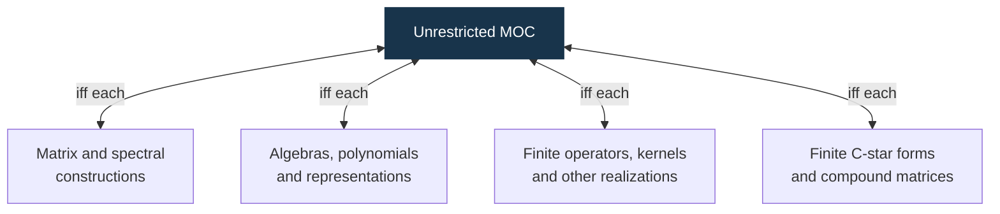

Each equivalence uses the finite objects and hypotheses stated in Lean.
For example, the exterior-power route quantifies over the allowed
degrees. Degree one supplies the reverse implication.
[Exterior-power equivalence](../Lean/MOC/Reformulations/FirstStructured.lean#L44)

### Matrix and spectral constructions

| Route in Lean | Relation | Lean proof | Lean Checked? |
| --- | --- | --- | --- |
| Normal complex matrices | $\mathrm{MOC}\Longleftrightarrow \text{normal complex matrices}$ | [Statement and proof](../Lean/MOC/Reformulations/FirstMatrix.lean#L46) | Yes |
| Normal eigenframes | $\mathrm{MOC}\Longleftrightarrow \text{normal eigenframes}$ | [Statement and proof](../Lean/MOC/Reformulations/FirstMatrix.lean#L70) | Yes |
| Nonnormal inputs with normal spectral representatives | $\mathrm{MOC}\Longleftrightarrow \text{nonnormal inputs with normal spectral representatives}$ | [Statement and proof](../Lean/MOC/Reformulations/FirstMatrix.lean#L86) | Yes |
| Commuting tuple scalar projections | $\mathrm{MOC}\Longleftrightarrow \text{commuting tuple scalar projections}$ | [Statement and proof](../Lean/MOC/Reformulations/FirstMatrix.lean#L103) | Yes |
| Normalized pencils | $\mathrm{MOC}\Longleftrightarrow \text{normalized pencils}$ | [Statement and proof](../Lean/MOC/Reformulations/FirstMatrix.lean#L121) | Yes |
| Complex base change of commutative-ring matrices | $\mathrm{MOC}\Longleftrightarrow \text{complex base change of commutative-ring matrices}$ | [Statement and proof](../Lean/MOC/Reformulations/FirstMatrix.lean#L141) | Yes |
| Exterior-power spectra | $\mathrm{MOC}\Longleftrightarrow \text{exterior-power spectra}$ | [Statement and proof](../Lean/MOC/Reformulations/FirstStructured.lean#L44) | Yes |
| Symmetric-power spectra | $\mathrm{MOC}\Longleftrightarrow \text{symmetric-power spectra}$ | [Statement and proof](../Lean/MOC/Reformulations/FirstStructured.lean#L76) | Yes |
| Tensor spectra | $\mathrm{MOC}\Longleftrightarrow \text{tensor spectra}$ | [Statement and proof](../Lean/MOC/Reformulations/FirstStructured.lean#L100) | Yes |
| Direct sum | $\mathrm{MOC}\Longleftrightarrow \text{direct sum}$ | [Statement and proof](../Lean/MOC/Reformulations/FirstStructured.lean#L117) | Yes |
| Kronecker sum | $\mathrm{MOC}\Longleftrightarrow \text{kronecker sum}$ | [Statement and proof](../Lean/MOC/Reformulations/FirstStructured.lean#L145) | Yes |
| Selected adjoint spectrum | $\mathrm{MOC}\Longleftrightarrow \text{selected adjoint spectrum}$ | [Statement and proof](../Lean/MOC/Reformulations/FirstStructured.lean#L175) | Yes |
| Selected conjugation spectra | $\mathrm{MOC}\Longleftrightarrow \text{selected conjugation spectra}$ | [Statement and proof](../Lean/MOC/Reformulations/FirstGeometric.lean#L96) | Yes |
| Finite mixed discriminant | $\mathrm{MOC}\Longleftrightarrow \text{finite mixed discriminant}$ | [Statement and proof](../Lean/MOC/Reformulations/FirstStructured.lean#L202) | Yes |

### Algebras and representations

| Route in Lean | Relation | Lean proof | Lean Checked? |
| --- | --- | --- | --- |
| Normal left regular representations | $\mathrm{MOC}\Longleftrightarrow \text{normal left regular representations}$ | [Statement and proof](../Lean/MOC/Reformulations/NativeFirstAAlgebra.lean#L48) | Yes |
| Frobenius algebra | $\mathrm{MOC}\Longleftrightarrow \text{frobenius algebra}$ | [Statement and proof](../Lean/MOC/Reformulations/NativeFirstAAlgebra.lean#L119) | Yes |
| Monic matrix polynomial roots | $\mathrm{MOC}\Longleftrightarrow \text{monic matrix polynomial roots}$ | [Statement and proof](../Lean/MOC/Reformulations/NativeFirstAPolynomial.lean#L61) | Yes |
| Top exterior power | $\mathrm{MOC}\Longleftrightarrow \text{top exterior power}$ | [Statement and proof](../Lean/MOC/Reformulations/NativeFirstAPolynomial.lean#L96) | Yes |
| Complex scalar extension and splitting | $\mathrm{MOC}\Longleftrightarrow \text{complex scalar extension and splitting}$ | [Statement and proof](../Lean/MOC/Reformulations/NativeFirstARepresentations.lean#L77) | Yes |
| Division ring block representations | $\mathrm{MOC}\Longleftrightarrow \text{division ring block representations}$ | [Statement and proof](../Lean/MOC/Reformulations/NativeFirstARepresentations.lean#L124) | Yes |
| Finite complex representation | $\mathrm{MOC}\Longleftrightarrow \text{finite complex representation}$ | [Statement and proof](../Lean/MOC/Reformulations/NativeFirstARepresentations.lean#L23) | Yes |
| Finite star representation | $\mathrm{MOC}\Longleftrightarrow \text{finite star representation}$ | [Statement and proof](../Lean/MOC/Reformulations/NativeFirstARepresentations.lean#L45) | Yes |

### Finite operators and other realizations

| Route in Lean | Relation | Lean proof | Lean Checked? |
| --- | --- | --- | --- |
| Finite Fredholm determinant | $\mathrm{MOC}\Longleftrightarrow \text{finite Fredholm determinant}$ | [Statement and proof](../Lean/MOC/Reformulations/NativeFirstAFredholm.lean#L41) | Yes |
| Finite regularized determinant at order two | $\mathrm{MOC}\Longleftrightarrow \text{finite regularized determinant at order two}$ | [Statement and proof](../Lean/MOC/Reformulations/NativeFirstAFredholm.lean#L99) | Yes |
| Finite atomic normalized kernel | $\mathrm{MOC}\Longleftrightarrow \text{finite atomic normalized kernel}$ | [Statement and proof](../Lean/MOC/Reformulations/NativeFirstAAtomicKernels.lean#L50) | Yes |
| Finite perturbation determinant | $\mathrm{MOC}\Longleftrightarrow \text{finite perturbation determinant}$ | [Statement and proof](../Lean/MOC/Reformulations/NativeFirstB.lean#L110) | Yes |
| Exponentiated determinant path | $\mathrm{MOC}\Longleftrightarrow \text{exponentiated determinant path}$ | [Statement and proof](../Lean/MOC/Reformulations/DeterminantPath.lean#L229) | Yes |
| Normal degree components of finite chain endomorphisms | $\mathrm{MOC}\Longleftrightarrow \text{normal degree components of finite chain endomorphisms}$ | [Statement and proof](../Lean/MOC/Reformulations/NativeFirstBHomology.lean#L30) | Yes |
| Invertible normal projective lifts | $\mathrm{MOC}\Longleftrightarrow \text{invertible normal projective lifts}$ | [Statement and proof](../Lean/MOC/Reformulations/NativeLinksB.lean#L29) | Yes |
| Actual integral torus characters | $\mathrm{MOC}\Longleftrightarrow \text{actual integral torus characters}$ | [Statement and proof](../Lean/MOC/Reformulations/NativeLinksBTorus.lean#L88) | Yes |
| Joint Hermitian integrals | $\mathrm{MOC}\Longleftrightarrow \text{joint Hermitian integrals}$ | [Statement and proof](../Lean/MOC/Reformulations/NativeLinksB.lean#L83) | Yes |
| Gaussian integer spectra | $\mathrm{MOC}\Longleftrightarrow \text{gaussian integer spectra}$ | [Statement and proof](../Lean/MOC/Reformulations/NativeLinksBGaussian.lean#L73) | Yes |
| Gaussian integer spectra and Gaussian rational mixers | $\mathrm{MOC}\Longleftrightarrow \text{gaussian integer spectra and Gaussian rational mixers}$ | [Statement and proof](../Lean/MOC/GaussianCayley.lean#L306) | Yes |
| Gaussian integer spectra and an integral matrix with $V^*V=d^2I$, $d>0$, with division-free comparisons | $\mathrm{MOC}\Longleftrightarrow \text{integral-matrix test}$ | [Exact integer test](../Lean/MOC/GaussianIntegerDeterminantTest.lean#L185) | Yes |
| Newton monomials | $\mathrm{MOC}\Longleftrightarrow \text{newton monomials}$ | [Statement and proof](../Lean/MOC/Reformulations/NativeLinksCMonomial.lean#L64) | Yes |
| Projective toric section weights | $\mathrm{MOC}\Longleftrightarrow \text{projective toric section weights}$ | [Statement and proof](../Lean/MOC/Reformulations/NativeLinksCMonomial.lean#L46) | Yes |
| Loopless complex directed adjacency | $\mathrm{MOC}\Longleftrightarrow \text{loopless complex directed adjacency}$ | [Statement and proof](../Lean/MOC/Reformulations/LooplessAdjacency.lean#L23) | Yes |
| Constant-generator monodromy | $\mathrm{MOC}\Longleftrightarrow \text{constant-generator monodromy}$ | [Statement and proof](../Lean/MOC/Reformulations/NativeLinksCFlow.lean#L20) | Yes |
| Finite bipartite matching | $\mathrm{MOC}\Longleftrightarrow \text{finite bipartite matching}$ | [Statement and proof](../Lean/MOC/Reformulations/SecondNative.lean#L85) | Yes |
| Weighted bipartite determinant | $\mathrm{MOC}\Longleftrightarrow \text{weighted bipartite determinant}$ | [Statement and proof](../Lean/MOC/Reformulations/SecondNative.lean#L66) | Yes |
| Finite Euler determinant | $\mathrm{MOC}\Longleftrightarrow \text{finite Euler determinant}$ | [Statement and proof](../Lean/MOC/Reformulations/SecondNative.lean#L188) | Yes |
| Finite Euler determinant at parameter one | $\mathrm{MOC}\Longleftrightarrow \text{finite Euler determinant at parameter one}$ | [Statement and proof](../Lean/MOC/Reformulations/SecondNative.lean#L210) | Yes |
| Normal word products | $\mathrm{MOC}\Longleftrightarrow \text{normal word products}$ | [Statement and proof](../Lean/MOC/Reformulations/SecondNative.lean#L253) | Yes |
| Almost-sure finite spectra | $\mathrm{MOC}\Longleftrightarrow \text{almost-sure finite spectra}$ | [Statement and proof](../Lean/MOC/Reformulations/SecondNative.lean#L271) | Yes |
| Joint tuple projections | $\mathrm{MOC}\Longleftrightarrow \text{joint tuple projections}$ | [Statement and proof](../Lean/MOC/Reformulations/SecondNative.lean#L289) | Yes |
| Invertible representatives | $\mathrm{MOC}\Longleftrightarrow \text{invertible representatives}$ | [Statement and proof](../Lean/MOC/Reformulations/SecondReal.lean#L93) | Yes |

### Finite star algebra and compound matrices

| Form | Exact comparison | Lean proof | Lean Checked? |
| --- | --- | --- | --- |
| Matrices | Two normal matrices with arbitrary relative unitary position | [Matrix form](../Lean/MOC/Reformulations/CStar.lean#L11) | Yes |
| Unitary orbits | A normal matrix with a fixed spectrum with multiplicities | [Orbit form](../Lean/MOC/Reformulations/CStar.lean#L25) | Yes |
| Commuting positions | Determinants at commuting positions of the two matrices | [Commutant form](../Lean/MOC/Reformulations/Commutant.lean#L92) | Yes |
| Spectral multiplicities | Integer tables with the two lists of spectral multiplicities as marginals | [Integer couplings](../Lean/MOC/Reformulations/Coupling.lean#L119) | Yes |
| Hermitian real and imaginary parts | Two commuting pairs of Hermitian real and imaginary parts | [Cartesian form](../Lean/MOC/Reformulations/CStar.lean#L41) | Yes |
| Functions on the spectra | Two functions on the actual spectra, each constant on equal eigenvalues | [Functional calculus](../Lean/MOC/Reformulations/CStar.lean#L72) | Yes |
| Affine transforms | Affine changes of the inputs and pointwise characteristic determinants | [Affine form](../Lean/MOC/Reformulations/CStar.lean#L82) · [Pointwise form](../Lean/MOC/Reformulations/CStar.lean#L95) | Yes |
| Representations of function algebras | Two finite function-algebra representations with fixed spectral multiplicities | [Representation form](../Lean/MOC/Reformulations/SecondCoefficientFree.lean#L129) | Yes |
| Squared minors | One scalar projection of the squared minors for each spectral pair | [Compound form](../Lean/MOC/Reformulations/Compounds.lean#L32) · [Scalar weights](../Lean/MOC/Reformulations/CStar.lean#L110) | Yes |
| Sums of represented functions | A sum of two functions, one in each represented factor | [Abelianization determinant](../Lean/MOC/Reformulations/SecondCoefficientFree.lean#L151) | Yes |

Each row is equivalent to unrestricted MOC. The two representation
forms use spectral bases of the represented functions.

The full unital free product gives a paper interpretation. Its universal
property identifies a pair of representations with one representation of
the free product. Its commutative quotient restricts the two ranges to
commute. Lean verifies the finite matrix forms in the table.

## Normalization and order reduction

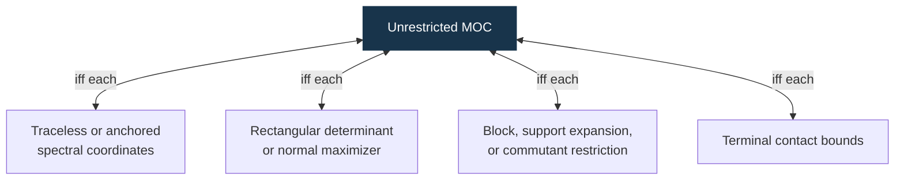

A proper block split of a least-order strict violation would give two
smaller orders that both satisfy the conjecture. A row or column with at
most two nonzero entries also reduces to smaller order. Every matrix that
commutes with both summands must be a scalar multiple of the identity.
[Block reduction](../Lean/MOC/Claim.lean#L43) · [Least order](../Lean/MOC/Claim.lean#L51) · [Rows](../Lean/MOC/SparseRow.lean#L339) · [Columns](../Lean/MOC/SparseRow.lean#L346) · [Common commutant](../Lean/MOC/ReducingCommutant.lean#L70)

Every strict violation, in any order, needs both a row and a column with
at least four nonzero entries. This follows from the inclusion for
arbitrary complex spectra when all rows, or all columns, have at most
three nonzero entries. In order four, the required row and column
have no zero entries.
[Strict violation restriction](../Lean/MOC/SparseUnitary.lean#L54) · [Order four](../Lean/MOC/SparseUnitary.lean#L66) · [Sparse unitary proof](sparse-unitary-proof-map.md)

In each order $n$, at most $n+8$ nonzero entries guarantee one
matching law for all spectra. The weights depend only on the mixer.
[Common law](../Lean/MOC/SparseUnitaryUniversalWeights.lean#L121)

Let $R$ be a nonempty set of rows with at least two rows outside it.
A column supports $R$ if it has a nonzero entry in a row of $R$.
In a least-order strict violation, at least $|R|+2$ columns support $R$.
Failure of this bound is equivalent to a zero submatrix with positive
side lengths $r,l$ such that $r+l=n-1$. Such a submatrix gives two
unitary factors of orders $l+1$ and $r+1$. Their coordinate blocks
have exactly one shared coordinate. The inclusions in both smaller
orders imply the inclusion for the product.
[Support condition](../Lean/MOC/SinglePortHallExpansion.lean#L23) · [Least-order restriction](../Lean/MOC/SinglePortHallExpansion.lean#L51) · [Zero-submatrix reduction](../Lean/MOC/SinglePortZeroCorner.lean#L223)

The composition proof needs the inclusion for all spectra for each
factor. It does not need a fixed law for all spectra. After restricting
to the nonzero permutation terms of the right factor, only the
partner eigenvalue at the shared coordinate varies in the left block.
One convex law works for this one free entry. Each term from that law
then uses the inclusion for the right block.
[Free entry](../Lean/MOC/SpectralMinorDecomposition.lean#L139) · [Composition theorem](../Lean/MOC/SinglePortComposition.lean#L132)

Take a finite sequence of unitary gates whose blocks contain one fixed
coordinate and are pairwise disjoint outside it. Extend each gate by the
identity outside its block. If each gate satisfies the inclusion for
every pair of local spectra, their ordered product satisfies it for
every pair of spectra on the union of the blocks. In the induction,
the first block and the union of the remaining blocks share only the
fixed coordinate.
[Factor matrices](../Lean/MOC/StarPortComposition.lean#L71) · [Ordered composition](../Lean/MOC/StarPortComposition.lean#L80)

Take a finite forest on the coordinate labels. On distinct edges, apply
two-by-two unitary gates of determinant one in any order. Each gate
mixes only the two coordinates of its edge. Write its first row on
these coordinates as $(c,s)$, with $|c|^2+|s|^2=1$.
For the resulting unitary, one set of nonnegative permutation weights
with sum one represents the determinant for every pair of complex
eigenvalue lists.

For the first gate in the matrix product, remove its edge from the
forest. Its endpoints lie in different components. Each remaining gate
stays within one component. The two-row determinant formula gives a
mixture of the previous law with weight $|c|^2$ and the law after the
endpoint swap with weight $|s|^2$. The empty product has weight one on
the identity permutation.
[Common law](../Lean/MOC/ForestGates.lean#L101) · [Ordered product](../Lean/MOC/ForestGates.lean#L167) · [Two-row formula](../Lean/MOC/OneBridge.lean#L227)

A coordinate where one summand has a scalar block gives a different
deletion step. If the other summand is a scalar plus a multiple of an
orthogonal projection, the determinant is a mixture of two smaller
determinants, each multiplied by an eigenvalue sum for that
coordinate. In each term with positive weight the remaining
projection has the rank that corresponds to the assigned eigenvalue.
[Determinant reduction](../Lean/MOC/ProjectionLeafPivot.lean#L110) · [Projection leaf deletion](projection-leaf-deletion-proof-map.md)

This deletion step proves a case with two overlapping two-level
blocks. Partition the coordinates into $X$, $H$, and $Y$. The first
summand has its two-level block on $X\cup H$ and is diagonal on $Y$.
The second has its two-level block on $H\cup Y$ and is diagonal on $X$.
Keep the two projection matrices fixed. The same law works for every
choice of the complex levels and private diagonal entries. The law
implies the inclusion in every order for this class of pairs.
[Common law](../Lean/MOC/OverlappingProjectionBlocks.lean#L636) · [Inclusion](../Lean/MOC/OverlappingProjectionBlocks.lean#L671) · [Proof map](projection-leaf-deletion-proof-map.md#two-overlapping-projection-blocks)

Two alternating layers on one even cycle also give a common law.
Let $K$ be a finite set of $m\ge2$ labels and let $s$ be a single
cycle on $K$. Use coordinates $(k,0)$ and $(k,1)$ for $k\in K$.
The left layer uses a gate $L_k$ on $((k,0),(k,1))$. The right
layer uses $R_k$ on $((k,0),(s(k),1))$. Each gate is a two-by-two
unitary. All gates except possibly two have squared entry moduli
$1/2$. The mixer is the left layer times the right layer.
[Gate condition](../Lean/MOC/BalancedGateProducts.lean#L10) · [Cycle mixer](../Lean/MOC/CyclicSwitchMatrices.lean#L179)

At a gate $Q$, choose the identity with probability $|Q_{00}|^2$ or
the swap with probability $|Q_{01}|^2$. For a full choice $x$, let
$P(x)$ be the product of these probabilities and let $N(x)$ be the
number of swaps in $x$. If at most one gate is biased, give $x$
weight $P(x)(1+c(-1)^{N(x)})$, where

$$
c=2^{2m}\,\mathrm{sign}(s)\,
\mathrm{Re}\!\left(\prod_{k\in K}
  (L_k)_{00}\overline{(L_k)_{01}}
  (R_k)_{00}\overline{(R_k)_{10}}\right).
$$

The sign is $1$ for an even permutation and $-1$ for an odd one.
Each gate contributes a factor of modulus at most $1/2$ inside the
real part. Thus $|c|\le1$, which gives nonnegative weights. Changing
any fair gate reverses parity and preserves $P(x)$, so the weights
sum to one. Compose the right layer's switches first. Add the
weights of choices that produce the same permutation. When all
gates are fair, $P(x)=2^{-2m}$.
[Gate probabilities](../Lean/MOC/BalancedGateProducts.lean#L104) · [Interference bound](../Lean/MOC/CyclicSwitchMatrices.lean#L35) · [Probability law](../Lean/MOC/SingleBiasedCyclicGateLaw.lean#L132) · [Fair case](../Lean/MOC/BalancedCyclicGateLaw.lean#L33)

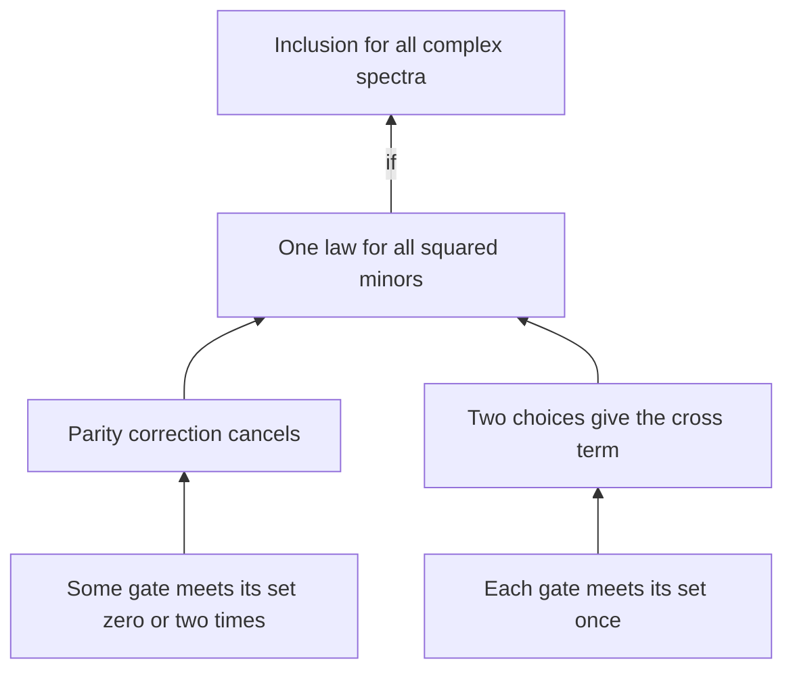

In the parity-cancellation case, at most one intermediate set
has compatible counts in both layers. The squared modulus of the
minor is zero if no such set exists. Otherwise it is the product
of the two squared minor moduli through that set. Equal row and
column cardinalities require at least two gates with zero or two
selected positions if any gate has such a count. If at most one
gate is biased, at least one of these gates is fair. Changing its
switch preserves the subset image and cancels the parity term. In
the other case, the two complementary choices have equal parity
and their probabilities sum to $2^{1-2m}$.
[Minor factorization](../Lean/MOC/CyclicSwitchMinor.lean#L294) · [Independent law](../Lean/MOC/CyclicSwitchMinor.lean#L362) · [Parity cancellation and complementary weights](../Lean/MOC/SingleBiasedCyclicGateLaw.lean#L132)

The probability that the resulting permutation maps the column
set onto the row set is the squared modulus of the corresponding
minor. This identity gives determinant inclusion for every pair of
complex spectra.
[Complementary choices](../Lean/MOC/CyclicSwitchEvents.lean#L360) · [Transversal cross term](../Lean/MOC/CyclicSwitchMatrices.lean#L62) · [Inclusion](../Lean/MOC/SingleBiasedCyclicGateLaw.lean#L233)

For two possible biased gates, label them $Q_1,Q_2$ and let $x_i$ be
the switch at $Q_i$. Define $b_i=|(Q_i)_{00}|^2-|(Q_i)_{01}|^2$,
$s_i=(-1)^{x_i}$, and $p=b_1b_2$. The interference bound improves
to $|c|\le1-|p|$. If $|p|<1$, a nonnegative weight for $x$ is

$$
P(x)\left(1+c(-1)^{N(x)}\frac{1-p s_1s_2}{1-p^2}\right).
$$

If $|p|=1$, the interference is zero and the law uses $P(x)$.
The product $P(x)(1-p s_1s_2)$ has only a constant term and terms
linear in $s_1,s_2$. Each term of the parity correction cancels
when its switch choice varies over a gate that preserves the
subset image and is absent from that term. At least two gates
preserve the image in the parity-cancellation case. For a
complementary pair, the linear terms cancel and the constant term
gives the minor's interference.
[Two-gate interference bound](../Lean/MOC/TwoBiasedCyclicGateLaw.lean#L73) · [Affine correction](../Lean/MOC/TwoBiasedCyclicGateLaw.lean#L149) · [Squared minors](../Lean/MOC/TwoBiasedCyclicGateLaw.lean#L240) · [Common law](../Lean/MOC/TwoBiasedCyclicGateLaw.lean#L331)

For any gate biases, write $T$ for the real interference scalar in the
squared-minor formula. The signed mass of each switch choice $x$ is
$P(x)+T(-1)^{N(x)}$. Summing these masses against the matching products
gives the determinant. In particular, if $|T|\le P(x)$ for every $x$,
the masses are nonnegative and give the inclusion.
[Signed minor law](../Lean/MOC/TwoLayerOrthogonalEndpoints.lean#L59) ·
[Determinant formula](../Lean/MOC/TwoLayerOrthogonalEndpoints.lean#L119) ·
[Inclusion under the bound](../Lean/MOC/TwoLayerOrthogonalEndpoints.lean#L138)

Suppose one gate joins coordinates with equal eigenvalues in the
first list for the left layer or the second list for the right layer.
Flipping that switch preserves the matching product and reverses parity.
The signed correction sums to zero, so independent switches give
inclusion for this pair of spectra at any gate biases.
[Equal spectral pair](../Lean/MOC/TwoLayerOrthogonalEndpoints.lean#L367)

For a separate case, choose $c\in\mathbb C$. Each pair of first-spectrum
labels joined by a left-layer gate must have sum $c$. Each pair of
second-spectrum labels joined by a right-layer gate must have sum $-c$.
The cycle has even order at least four. The gate probabilities and phases
are arbitrary. If $\bar x$ complements every bit of $x$, the matching
products satisfy $F_{\bar x}=F_x$, where $F_x$ is the product of the
matched eigenvalue sums for assignment $x$. Give each assignment the mass

$$
w(x)=\frac{P(x)+P(\bar x)}{2}+T(-1)^{N(x)}.
$$

Twice this mass is the squared absolute value of a sum of two gate
products. It is nonnegative. Complementation permutes the assignments,
and the parity terms sum to zero, so the masses sum to one. The equality
$F_{\bar x}=F_x$ preserves the signed determinant formula under this
averaging. Thus this spectral family satisfies the inclusion in every
even cycle order. Lean checked the proof and its axiom dependencies.
[Masses](../Lean/MOC/CyclicAntipodalSpectra.lean#L22) ·
[Positivity](../Lean/MOC/CyclicAntipodalSpectra.lean#L28) ·
[Normalization](../Lean/MOC/CyclicAntipodalSpectra.lean#L47) ·
[Determinant identity](../Lean/MOC/CyclicAntipodalSpectra.lean#L62) ·
[Inclusion with the spectral condition](../Lean/MOC/CyclicAntipodalSpectra.lean#L149)

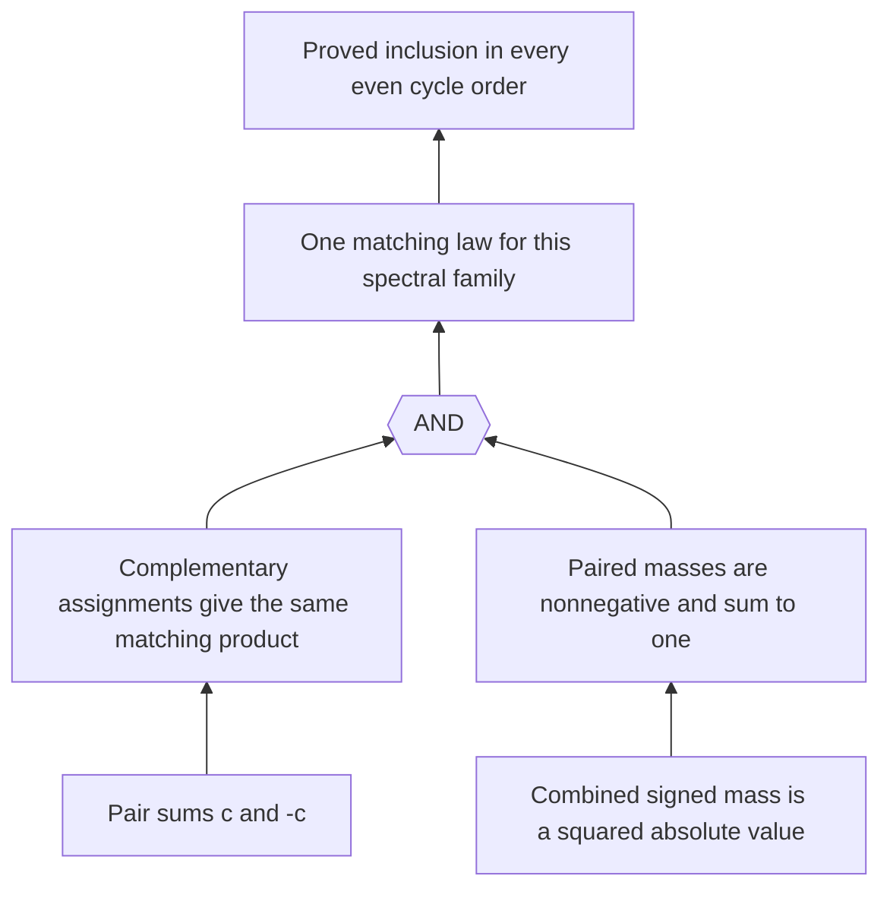

Fix the squared moduli of the entries of all gates. Two products of
real orthogonal gates attain opposite extreme values of $T$. The same
convex combination gives every squared minor of the complex mixer.
Thus the real orthogonal inclusion in the cycle's dimension suffices.
The support comparison for arbitrary biases at the real endpoints
remains open. Lean checks the reduction and the cases above.
[Orthogonal endpoints](../Lean/MOC/TwoLayerOrthogonalEndpoints.lean#L301) ·
[Transfer of inclusion](../Lean/MOC/TwoLayerOrthogonalEndpoints.lean#L342)

The three-coordinate normalization uses lists $x,y$ with $x_1=0$,
$x_2=1$, and $y_1=0$. Its determinant is
$\det(U-\mathrm{diag}(x)U\mathrm{diag}(y))/\det U$. Its vertices are
$\prod_j(1-x_{\sigma(j)}y_j)$ for permutations $\sigma$. The theorem
requires each entry of $U$ to be nonzero. The rectangular test instead
uses a matrix with at least three orthonormal rows and one extra column.
[Three-coordinate normalization](../Lean/MOC/Reformulations/ThreeAnchorKernel.lean#L61) · [Rectangular test](../Lean/MOC/PrincipalCoisometry.lean#L258)

| Route in Lean | Relation | Lean proof | Lean Checked? |
| --- | --- | --- | --- |
| Affine linear parts | $\mathrm{MOC}\Longleftrightarrow \text{affine linear parts}$ | [Statement and proof](../Lean/MOC/Reformulations/FirstGeometric.lean#L26) | Yes |
| Actual affine derivatives | $\mathrm{MOC}\Longleftrightarrow \text{actual affine derivatives}$ | [Statement and proof](../Lean/MOC/Reformulations/NativeFirstBGeometry.lean#L53) | Yes |
| Nonzero spectra | $\mathrm{MOC}\Longleftrightarrow \text{nonzero spectra}$ | [Statement and proof](../Lean/MOC/Reformulations/FirstGeometric.lean#L48) | Yes |
| Invertible projective diagonal lifts | $\mathrm{MOC}\Longleftrightarrow \text{invertible projective diagonal lifts}$ | [Statement and proof](../Lean/MOC/Reformulations/FirstGeometric.lean#L71) | Yes |
| Traceless Cartan spectra | $\mathrm{MOC}\Longleftrightarrow \text{traceless Cartan spectra}$ | [Statement and proof](../Lean/MOC/Reformulations/NativeLinksCTraceless.lean#L187) | Yes |
| Traceless real-part bound | $\mathrm{MOC}\Longleftrightarrow \text{traceless real-part bound}$ | [Statement and proof](../Lean/MOC/Reformulations/TracelessSupport.lean#L14) | Yes |
| Regular anchored spectra | $\mathrm{MOC}\Longleftrightarrow \text{regular anchored spectra}$ | [Statement and proof](../Lean/MOC/Reformulations/Anchored.lean#L70) | Yes |
| Three-anchor rank-one kernel in all orders | $\mathrm{MOC}\Longleftrightarrow \text{three-anchor rank-one kernel in all orders}$ | [Statement and proof](../Lean/MOC/Reformulations/ThreeAnchorKernel.lean#L61) | Yes |
| Nonzero contact-saturated support bounds in every order | $\mathrm{MOC}\Longleftrightarrow \text{nonzero contact-saturated support bounds in every order}$ | [Statement and proof](../Lean/MOC/ProofRoutes.lean#L308) | No |
| Normal maximizers in every order | $\mathrm{MOC}\Longleftrightarrow \text{normal maximizers in every order}$ | [Statement and proof](../Lean/MOC/NormalSupportMaximum.lean#L314) | Yes |
| Principal coisometries in all orders | $\mathrm{MOC}\Longleftrightarrow(\forall m\ge3,\ C_m)$ | [Statement and proof](../Lean/MOC/PrincipalCoisometry.lean#L258) | Yes |
| No paired block split | $\mathrm{MOC}\Longleftrightarrow \text{no paired block split}$ | [Statement and proof](../Lean/MOC/Claim.lean#L63) | Yes |
| At least $\lvert R\rvert+2$ supporting columns for every nonempty row set $R$ with $\lvert R\rvert\leq n-2$ | $\mathrm{MOC}\Longleftrightarrow \text{Hall expansion test}$ | [Statement and proof](../Lean/MOC/SinglePortHallExpansion.lean#L72) | Yes |
| Every row and column has degree at least three | $\mathrm{MOC}\Longleftrightarrow \text{every row and column has degree at least three}$ | [Statement and proof](../Lean/MOC/SparseRow.lean#L358) | Yes |
| Strict expansion of the support of every proper nonempty set of rows | $\mathrm{MOC}\Longleftrightarrow \text{strict expansion of the support of every proper nonempty set of rows}$ | [Statement and proof](../Lean/MOC/SupportBlocks.lean#L124) | Yes |
| Balanced spectra and strict support expansion | $\mathrm{MOC}\Longleftrightarrow \text{balanced spectra and strict support expansion}$ | [Statement and proof](../Lean/MOC/Extremal.lean#L82) | Yes |
| Scalar common commutant | $\mathrm{MOC}\Longleftrightarrow \text{scalar common commutant}$ | [Statement and proof](../Lean/MOC/ReducingCommutant.lean#L107) | Yes |
| Regular spectra with scalar common commutant | $\mathrm{MOC}\Longleftrightarrow \text{regular spectra with scalar common commutant}$ | [Statement and proof](../Lean/MOC/ReducingCommutant.lean#L124) | Yes |
| Regular spectra with scalar common commutant and nonnormal pole compressions | $\mathrm{MOC}\Longleftrightarrow \text{regular spectra with scalar common commutant and nonnormal pole compressions}$ | [Statement and proof](../Lean/MOC/NonnormalPoleReduction.lean#L33) | Yes |
| Terminal matching chart support | $\mathrm{MOC}\Longleftrightarrow \text{terminal matching chart support}$ | [Statement and proof](../Lean/MOC/MatchingContactTransfer.lean#L123) | Yes |
| Terminal matching chart with threshold $2n-1$ in matrix order $n$ | $\mathrm{MOC}\Longleftrightarrow \text{terminal-contact chart test}$ | [Statement and proof](../Lean/MOC/DeficitContactTransfer.lean#L303) | Yes |
| Terminal matching chart with old gap rank | $\mathrm{MOC}\Longleftrightarrow \text{terminal matching chart with old gap rank}$ | [Statement and proof](../Lean/MOC/DeficitContactTransfer.lean#L327) | Yes |
| Terminal matching chart with old gap rank and no common active edge | $\mathrm{MOC}\Longleftrightarrow \text{terminal matching chart with old gap rank and no common active edge}$ | [Statement and proof](../Lean/MOC/TerminalActiveEdges.lean#L27) | Yes |
| Terminal matching chart with constraint rank | $\mathrm{MOC}\Longleftrightarrow \text{terminal matching chart with constraint rank}$ | [Statement and proof](../Lean/MOC/MatchingContactRank.lean#L110) | Yes |
| Terminal matching chart with minimal prime isolation | $\mathrm{MOC}\Longleftrightarrow \text{terminal matching chart with minimal prime isolation}$ | [Statement and proof](../Lean/MOC/IsolatedContactFiber.lean#L61) | Yes |
| Regular contact covers AND the terminal chart bound | $T\Longrightarrow\mathrm{MOC}$ | [Statement and proof](../Lean/MOC/HighContact.lean#L276) | Yes |
| All three order ranges | $\mathrm{MOC}\Longleftrightarrow(\mathrm{MOC}_4\land\mathrm{MOC}_5\land\forall n\ge6,\ \mathrm{MOC}_n)$ | [Statement and proof](../Lean/MOC/ConjectureOrderSplit.lean#L6) | Yes |

## Real orthogonal induction

Let $U$ be a real orthogonal mixer of order $n$. For a row set $R$,
let $N(R)$ consist of the columns with a nonzero entry in a row in $R$.
If the real orthogonal inclusion fails, choose a failure of least
order. Real sparse deletion and real factorization across a zero
rectangle show that $|N(R)|\ge |R|+2$ for every nonempty $R$ with
$|R|+2\le n$. Change the spectra while keeping $U$ and a strict
separating direction. Contact transfer gives at least $2n-1$ matching
permutations on the supporting line. Excluding failures with both
conditions, in every order $n\ge4$, is equivalent to the real
orthogonal inclusion in all orders. The terminal bound remains open.
Lean checks the reductions.
[Real zero-rectangle factorization](../Lean/MOC/SinglePortZeroCorner.lean#L131) ·
[Support expansion](../Lean/MOC/RealOrthogonalInduction.lean#L109) ·
[Terminal equivalence](../Lean/MOC/RealOrthogonalInduction.lean#L130)

## Induction through normal maximizers

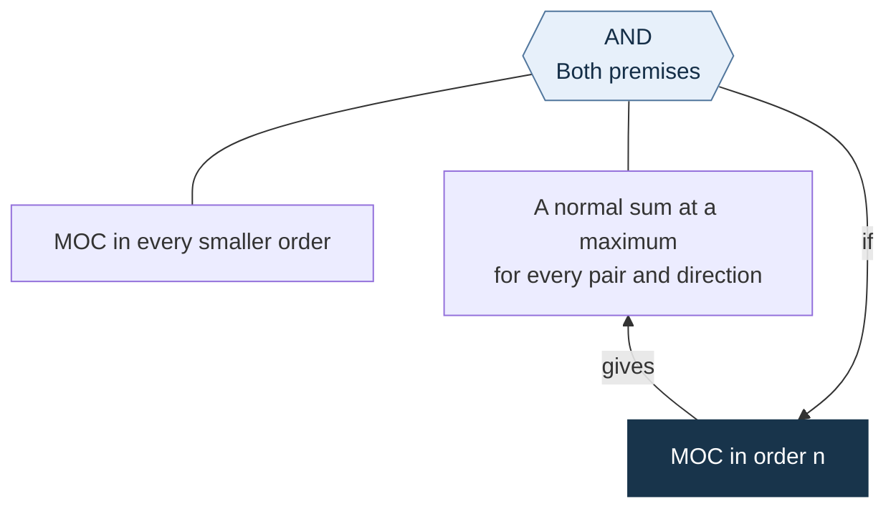

For fixed spectra and a fixed direction, a matching permutation gives
a sum diagonal in the first eigenbasis. If the conjecture holds in
that order, a permutation with largest matching projection gives a
global maximum with normal sum. In the other direction, the theorem
uses normality at a maximum and the smaller-order results to prove
the hull bound. The all-order route starts at order four.
[Conditional equivalence](../Lean/MOC/NormalSupportMaximum.lean#L270) · [All-order equivalence](../Lean/MOC/NormalSupportMaximum.lean#L314)

### A Hermitian matrix and a normal partner

Work in the eigenbasis of the normal partner. If the sum of the
partner and the Hermitian matrix is normal, the Hermitian matrix has
zero entries between partner coordinates with different imaginary
parts. Each remaining block has its two spectra on parallel lines.
The block laws give inclusion in any order. Thus the full Hermitian–normal
case is equivalent to the existence of a normal sum at a global maximum
in every support direction. If the sum at a global maximum is invertible,
a stationary equation relates its scaled inverse to the partner
eigenvalues. The equation allows both signs of the partner's imaginary
parts. Existence of the required normal maximum remains open.
[Normal-sum criterion](../Lean/MOC/HermitianNormalSupportDescent.lean#L16) ·
[Normal-sum inclusion](../Lean/MOC/HermitianNormalSupportDescent.lean#L68) ·
[Exact equivalence](../Lean/MOC/HermitianNormalSupportDescent.lean#L103) ·
[Stationary equation](../Lean/MOC/HermitianNormalSupportDescent.lean#L151) ·
[Coefficient route](free-eigenvalue-and-exterior-shifts-proof-map.md#one-law-for-a-free-eigenvalue)

### Stationary support and spectral exchange

At a unitary support maximum, sum the complex signed determinant
weights times the real matching score over permutations through a
fixed entry. The sum equals the maximum determinant score times the
squared modulus of that entry. If the maximum score strictly exceeds
every matching score and $a_i+b_j=0$, then $U_{ij}=0$.
[Complex marginal](../Lean/MOC/StationaryPivot.lean#L329) · [Cancelling pairs](../Lean/MOC/SpectralMultiplierRigidity.lean#L187)

An opposite exchange replaces one eigenvalue in each list with the
negative of the other. The sum of the opposite-exchange determinants
has a fixed relation to the sum over within-list exchanges. Scalar
bounds also follow from a stationary quadratic on a disk and from a
stationary Laurent polynomial. These bounds still require their
coefficient identities on the corresponding unitary orbits.
[Exchange identity](../Lean/MOC/StationarySpectralExchange.lean#L81) · [Disk bound](../Lean/MOC/StationarySpectralExchange.lean#L133) · [Laurent bound](../Lean/MOC/StationarySpectralExchange.lean#L152)

From a strict violation, select a normalized spectral maximizer. The
cofactor equations at this maximizer hold at zero pair sums as well.
For one rank-two phase, the support test at a stationary point is a
two-by-two positivity condition. For two sequential rank-one phases,
four inner phase evaluations give a scalar test for each outer phase.
The test requires a nonzero base determinant at each outer phase.
A proof must still use the actual cofactor data or phase coefficients
to exclude a strict witness.
[Cofactor equations](../Lean/MOC/SpectralMultiplierRigidity.lean#L118) · [Choice of maximizer](../Lean/MOC/SpectralMultiplierRigidity.lean#L214) · [Rank-two test](../Lean/MOC/RankTwoPhaseEscape.lean#L24) · [Two-phase determinant test](../Lean/MOC/RankTwoPhaseEscape.lean#L138)

For a rank-one phase variation with zero projected tangent, a quadratic
disk bound with penalty coefficient one is equivalent to three scalar
inequalities. For a rank-two variation with zero projected tangent, the
bound with penalty coefficient one half implies a nonnegative
homogeneous polynomial of degree six.
[Rank-one scalar criterion](../Lean/MOC/RankOneSupportDisk.lean#L48) · [Rank-one orbit](../Lean/MOC/RankOneSupportDisk.lean#L162) · [Sextic inequality](../Lean/MOC/PhaseDiskSextic.lean#L62)

## Polynomial and coefficient conditions

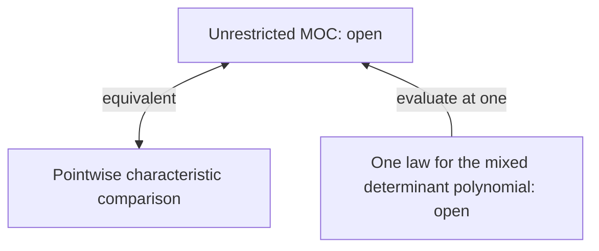

For complex eigenvalue lists $a,b$ and a unitary change of eigenbasis
$U$, let $A=\mathrm{diag}(a)$ and $B=U\mathrm{diag}(b)U^*$, where
$\mathrm{diag}$ forms a diagonal matrix and $U^*$ is the conjugate
transpose. The mixed determinant is $\det(A+zB)$, where $z$ is the
polynomial variable. Each permutation $\sigma$ gives the matching
polynomial $\prod_j(a_{\sigma(j)}+zb_j)$. In positive order $n$, the
coefficients of degrees $0$, $1$, $n-1$, and $n$ of the mixed determinant
each lie in the corresponding matching hull.
These bounds allow separate weights for each degree. The simultaneous
condition calls for one set of weights for the whole polynomial and
implies every separate comparison for this polynomial. The proved
bounds cover all degrees through order three.
[Pointwise characteristic comparison](../Lean/MOC/Reformulations/CStar.lean#L95) · [Separate mixed coefficients](../Lean/MOC/Reformulations/NativeLinksA.lean#L192) · [Small-order proof](../Lean/MOC/Reformulations/NativeLinksA.lean#L210)

Let $M=A+B$ and let $I$ be the identity matrix of order $n$. The
elementary coefficient $e_k(M)$ is the coefficient of $x^k$ in
$\det(I+xM)$. This polynomial uses the sum $M$ as one matrix. The mixed
determinant above scales only $B$. For a permutation $\sigma$, let
$M_\sigma$ be the diagonal matrix with entries $a_{\sigma(j)}+b_j$.
The separate coefficient condition asks whether $e_k(M)$ is in the real convex hull of the
$e_k(M_\sigma)$ for each $1\leq k\leq n$. The weights may depend on $k$.

The first three bounds use the same weights for all spectra at a fixed
$U$. Each of their matching values is a constant plus a sum of functions
of individual matched pairs. Birkhoff weights preserve that sum. The
fourth coefficient is zero in orders below four and equals the
determinant in order four.
[Coefficient definition](../Lean/MOC/Reformulations/SecondCoefficient.lean#L66) ·
[Separate coefficient form](../Lean/MOC/Reformulations/SecondCoefficient.lean#L84) ·
[First three coefficients](../Lean/MOC/Reformulations/SecondCoefficient.lean#L248) ·
[Merikoski and Virtanen, sections 2–4](https://doi.org/10.21136/CMJ.1992.128332)

The all-order separate coefficient form is equivalent to the
conjunction of MOC and the bounds for $4\le k<n$. Thus only the
determinant bound is needed for the separate form through order four.
[Exact split](../Lean/MOC/Reformulations/SecondCoefficient.lean#L293)

| Route in Lean | Relation | Lean proof | Lean Checked? |
| --- | --- | --- | --- |
| Pointwise characteristic polynomial of the spectral sum | $\mathrm{MOC}\Longleftrightarrow \text{pointwise characteristic polynomial of the spectral sum}$ | [Statement and proof](../Lean/MOC/Reformulations/SecondNative.lean#L145) | Yes |
| Simultaneous mixed-pencil coefficients | $T\Longrightarrow\mathrm{MOC}$ | [Statement and proof](../Lean/MOC/Reformulations/NativeLinksA.lean#L237) | Yes |

## Spectral realizations and implications

A spectral realization gives an equivalent test if it recovers the
original determinant comparison for every pair of spectra and every
relative unitary. For a restricted realization, MOC gives the comparison
on the permitted inputs. For mixed determinants, the pointwise
comparison is exact. The weights can depend on the scalar parameter.
[Pointwise mixed determinant equivalence](../Lean/MOC/Reformulations/FirstStructured.lean#L202)

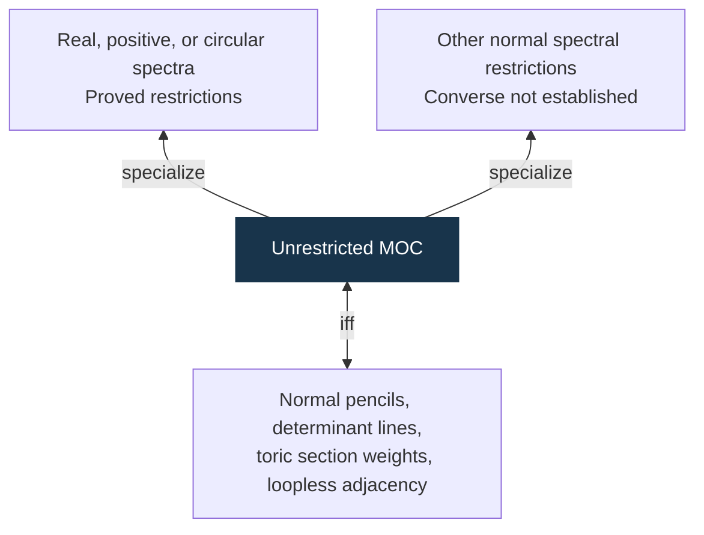

| Spectral data | Relation and scope | Lean source | Lean Checked? |
| --- | --- | --- | --- |
| Characteristic roots of nonnormal matrices | $\mathrm{MOC}\Longleftrightarrow \text{characteristic roots of nonnormal matrices}$. Test the normal diagonal matrices of characteristic roots. | [Representative equivalence](../Lean/MOC/Reformulations/FirstMatrix.lean#L86) | Yes |
| Joint spectra of commuting tuples | $\mathrm{MOC}\Longleftrightarrow \text{joint spectra of commuting tuples}$. Test one complex linear projection of joint spectra at a time. A single coordinate gives the converse. | [Commuting tuple projections](../Lean/MOC/Reformulations/FirstMatrix.lean#L103) · [Joint numerical range](../Lean/MOC/Reformulations/SecondNative.lean#L289) | Yes |
| Matrix pencils and top exterior powers | $\mathrm{MOC}\Longleftrightarrow \text{matrix pencils and top exterior powers}$. Test normal matrices obtained by normalizing regular pencils with invertible denominators, and for the action of the top exterior power of the sum. | [Pencils](../Lean/MOC/Reformulations/FirstMatrix.lean#L121) · [Determinant line](../Lean/MOC/Reformulations/NativeFirstAPolynomial.lean#L96) | Yes |
| Scaled and shifted determinants | $\mathrm{MOC}\Longleftrightarrow \text{scaled and shifted determinants}$. Test pointwise determinants of scaled sums or shifted generators. Weights can depend on the scalar parameter. The separate mixed determinant coefficients have the boundary cases stated above. | [Mixed determinants](../Lean/MOC/Reformulations/FirstStructured.lean#L202) · [Pointwise characteristic comparison](../Lean/MOC/Reformulations/SecondNative.lean#L145) | Yes |
| Weighted entries of a unitary matrix | $\mathrm{MOC}\Longleftrightarrow \text{weighted entries of a unitary matrix}$. Test the determinant of the matrix with entries $(a_i+b_j)U_{ij}$, divided by $\det U$. The comparison values are the products over perfect matchings. | [Weighted entry identity](../Lean/MOC/Weights.lean#L29) · [Weighted entry equivalence](../Lean/MOC/Reformulations/SecondNative.lean#L66) | Yes |
| Hermitian, positive, and circular spectra | Proved restrictions for Hermitian, positive definite, and unitary matrices, positive square roots of rectangular Gram matrices, Gram matrices, and the positive log-determinant interval. | [Hermitian](../Lean/MOC/Reformulations/FirstHermitian.lean#L28) · [Positive definite](../Lean/MOC/Reformulations/FirstHermitian.lean#L60) · [Unitary](../Lean/MOC/Reformulations/FirstUnitary.lean#L43) · [Gram](../Lean/MOC/Reformulations/FirstHermitian.lean#L70) · [Absolute value](../Lean/MOC/Reformulations/FirstHermitian.lean#L82) · [Log determinant](../Lean/MOC/Reformulations/NativeFirstAHermitian.lean#L37) | Yes |
| Adjoint differences and conjugation ratios | MOC implies the tests on the full lists of differences and ratios. A restriction to a selected column of matrix units gives an equivalent test. | [Adjoint differences](../Lean/MOC/Reformulations/FirstStructured.lean#L161) · [Conjugation ratios](../Lean/MOC/Reformulations/FirstStructured.lean#L189) · [Selected adjoint spectrum](../Lean/MOC/Reformulations/FirstStructured.lean#L175) · [Selected conjugation spectrum](../Lean/MOC/Reformulations/FirstGeometric.lean#L96) | Yes |
| Fredholm and perturbation determinants | The finite determinant variants are equivalent to MOC. The paper extension to infinite spaces uses finite-rank approximation and the closed hull. The infinite-only converse needs an additional argument because zero modes can enlarge the matching hull. | [Finite Fredholm determinant](../Lean/MOC/Reformulations/NativeFirstAFredholm.lean#L41) · [Finite regularized determinant at index two](../Lean/MOC/Reformulations/NativeFirstAFredholm.lean#L99) · [Finite perturbation determinant](../Lean/MOC/Reformulations/NativeFirstB.lean#L110) | Yes |

### Realizations of arbitrary spectral lists

| Spectral data | Realization for the converse | Evidence | Lean Checked? |
| --- | --- | --- | --- |
| Holomorphic endomorphisms and torus actions | Use a flat complex torus with Gaussian lattice. Its holomorphic diagonal endomorphisms act by Gaussian integers in bidegree $(1,0)$. Use a trivial action for the torus action case. The indicated bidegree gives a preserved free submodule, which the statement permits. Homogeneity and density give all complex lists. | [Lean density argument](../Lean/MOC/Reformulations/NativeLinksBGaussian.lean#L73) | Yes |
| Quantization of complex observables | If observables admit complex functions, use a finite disjoint union of points as a zero-dimensional symplectic manifold. Its quantization has one line per point. Multiplication by two complex functions gives arbitrary diagonal spectra. Self-adjoint observables alone give the proved real restriction. | Paper realization | Paper only |
| Toric section weights | Use the two line bundles obtained from the two copies of projective space of dimension $n-1$ in a product. Their coordinate sections give the two lists. Add two projective line factors and twist each linearization by a character on a different extra factor. The two twists give independent scales. An opposite spectral shift removes zeros. | [Lean section-weight model](../Lean/MOC/Reformulations/NativeLinksCMonomial.lean#L46) | Yes |
| Flag valuations of line-bundle sections | Two big line bundles on one projective variety give arbitrary evaluated valuation lists at degree one. The construction uses a common flag and a common real-linear evaluation. | [Paper proof](#newtonokounkov-valuation-realization) | Paper only |
| Obstruction theories on a point | On a point, the zero map from $\mathbb C^n$ in degree $-1$ to the cotangent complex is a perfect obstruction theory. The degree-zero cohomology is zero on both sides. The map in degree $-1$ surjects onto zero. Every endomorphism of the obstruction space is compatible. The degree $-1$ hull recovers MOC. | [Definition of perfect obstruction theory](https://arxiv.org/abs/alg-geom/9601010) | Paper only |
| Continuous Galois characters | With continuous $\ell$-adic coefficients and a complex scalar embedding, use unramified characters of the absolute Galois group of a finite field. A local unit can have any prescribed value in the dense set of Gaussian rationals that are local units. Usual complex continuity instead forces unit-circle spectra. | [Paper proof](#galois-scalar-realization) | Paper only |
| Loopless adjacency matrices | Require normal adjacency matrices of loopless directed graphs with complex edge weights. Conjugate each traceless spectrum by the discrete Fourier matrix. Each resulting diagonal entry is the mean of that spectrum and is zero. The traceless spectral test is exact. | [Adjacency equivalence](../Lean/MOC/Reformulations/LooplessAdjacency.lean#L23) · [Traceless test](../Lean/MOC/Reformulations/NativeLinksCTraceless.lean#L187) | Yes |

For the toric section weights, choose the effective torus on the two projective spaces and the
two projective lines. In each set of $n$ sections the weights are the
extra character and its products with the $n-1$ independent projective
characters. These $2n$ weights form a lattice basis. At one torus point,
they give any two lists of nonzero values independently.

#### Newton–Okounkov valuation realization

This is a paper proof. Fix $n\ge3$ and put $d=n-1$. For a large integer
$q$, choose a smooth irreducible hypersurface of degree $q$ in
$\mathbb P^d$. Its equation
spans the kernel of restriction of degree-$q$ forms to the hypersurface.
Choose $s=\binom{q+d}{d}-1$ distinct points on the hypersurface that
impose independent conditions on the quotient space of forms. To
choose each point, take a nonzero class in the current kernel and a
point where its restriction is nonzero.

Blow up the $s$ points to obtain $Y$. Write $H$ for the pullback of a
hyperplane and $E$ for the sum of the exceptional divisors. The line
bundle $L=\mathcal O(H)$ has $n$ independent sections. The bundle
$M=\mathcal O(qH-E)$ has one section. For the $k$th power of $M$,
the dimension of the section space is at least
$\binom{kq+d}{d}-s\binom{k-1+d}{d}$. Its leading coefficient as a function
of $k$ is positive because $q^d>s$ for large $q$ and $d\ge2$. Thus $M$
is big. The bundle $L$ is big because it is the pullback by a
birational map of an ample line bundle.

Use two copies of $Y$ and two elliptic curves, with marked points on all
four factors. On the two copies of $Y$, use $L$ and $M$ in opposite
orders for the two bundles on the product. Choose the flags at points
where the section of $M$ is nonzero. The coordinate sections of $L$
have values $0,e_1,\ldots,e_d$ in the first block, or
$0,f_1,\ldots,f_d$ in the second block. Here the vectors are the unit
vectors of the corresponding flag coordinates.

On each elliptic factor choose degree-one bundles whose unique sections
vanish at or away from the marked point as needed. Give the first
product bundle one simple zero on the first curve and the second
bundle one simple zero on the other curve. The extra valuation
coordinates add independent offsets $g_1$ and $g_2$. All four factors
use big bundles. Tensor products of the displayed sections give a basis
at degree one. In the common product flag the two valuation lists are
$g_1,g_1+e_1,\ldots,g_1+e_d$ and $g_2,g_2+f_1,\ldots,g_2+f_d$.
Choose a real-linear map on these independent coordinates. It sends
$g_1,g_2$ to the first elements of two desired complex lists and sends
the other basis vectors to the corresponding differences. This gives
every pair of lists. In orders below three, the conjecture already
holds. [Flag valuation definition](https://www.numdam.org/articles/10.24033/asens.2109/) · [Lean base orders](../Lean/MOC/Small.lean#L68)

#### Galois scalar realization

This is a paper proof. The absolute Galois group of a finite field is
the profinite completion of $\mathbb Z$. Frobenius is a topological
generator of this group.
Fix an embedding of the Gaussian rationals into a finite extension of
$\mathbb Q_\ell$ and a complex scalar embedding extending the usual
Gaussian embedding. Every unit of the local ring defines a continuous
character by sending Frobenius to that unit. Indeed, the powers of a
unit have finite image in every finite congruence quotient, and the
resulting maps from the profinite completion are compatible.

Gaussian rational local units are dense in $\mathbb C$. To approximate
a complex number, use large positive integer denominators prime to
$\ell$ and Gaussian integer numerators congruent to $1$ modulo $\ell$.
Take direct sums of these characters to realize a dense set of spectral
pairs in each order. The hull of the finite list of matching products
varies continuously, so the restricted bound extends to all pairs.
[Lean spectral closure](../Lean/MOC/Reformulations/NativeLinksBGaussian.lean#L73)

## Spectral tests with arbitrary evaluators

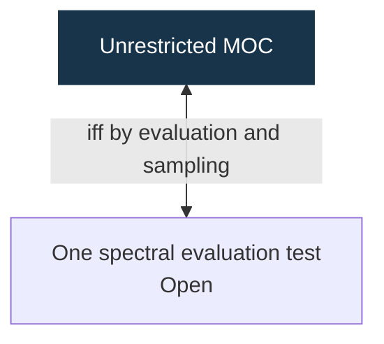

A spectral evaluation test supplies a sample type in each order. Two arbitrary
evaluation functions turn samples into eigenvalue lists. To recover MOC,
choose an available sample in each order and use constant functions to
realize every pair of lists. The statements concern the evaluated
spectra. A theorem about the underlying object requires its own
connection to these spectra.
[Common form](../Lean/MOC/Reformulations/Common.lean#L8) · [Common equivalence](../Lean/MOC/Reformulations/Common.lean#L14)

At a fixed order, the evaluated form is equivalent to the fixed-order
conjecture when the sample type is nonempty. Lean instantiates this
construction for matrix, algebra, geometric, and analytic sample types.
[Fixed-order form](../Lean/MOC/ProofRoutes.lean#L97) · [Registered evaluations](../Lean/MOC/ProofRoutes.lean#L425)

## Common weights at small shifted rank sum

Fix the relative unitary and the allowed nonzero labels of two
spectra after opposite scalar shifts. Write $n$ for the matrix
order. If the label counts sum to at most $n+2$, one probability
law on permutations represents the determinant for all allowed
values. The common law applies for $n\ge2$.

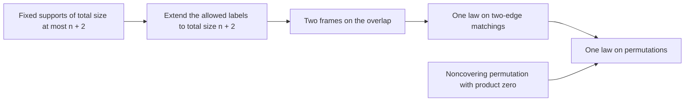

At excess two, compress to the intersection of the two support
spaces and take the determinant of order two on reciprocal
spectra. The two-frame law fixes all weights before any spectrum
is evaluated. Complete each two-edge matching to a permutation.
The completion depends only on the labels. If the support
projections do not span the whole space, the determinant is zero
for every set of values. In the spanning case, assign the remaining
mass to a fixed permutation that pairs two zero labels. An extension
of the allowed supports and continuity include smaller supports.
[Two-frame law](../Lean/MOC/TwoFrame.lean#L1016) · [Exact excess two](../Lean/MOC/RankTwoOverlap.lean#L440) · [Common shifted law](../Lean/MOC/RankTwoOverlap.lean#L709)

## Overlapping circle blocks

Let two coordinate blocks cover the basis. Each normal matrix can mix its
own block and is diagonal outside it. Require the first active spectrum
and the negatives of the second entries in the first block outside the
second block to lie on one generalized circle. Require the negative
second active spectrum and the first entries in the second block outside
the first block to lie on another generalized circle. These conditions
give determinant inclusion in every order. A scalar Schur pivot preserves
the conditions and reduces the order by one. The two-circle cover
theorem gives inclusion when the second block is the full remaining
matrix. [Exact theorem](../Lean/MOC/OverlappingCircleBlocks.lean#L83) · [Proof map](overlapping-circle-blocks-proof-map.md)

## Finite overlap compression

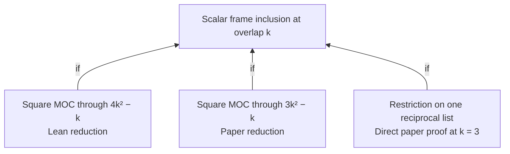

A frame here is a finite matrix with orthonormal columns. At overlap
$k$, the two frames compress their diagonal spectral lists to $k$ by
$k$ matrices. The scalar comparison uses products over matchings of
size $k$ and the zero vertex in the stated square reduction. The paper
proof reduces a strict violation to at most $3k^2$ row labels, so square
orders through $3k^2-k$ suffice. At $k=3$, this gives order 24. The Lean
reduction gives order 33. [Lean frame bound](../Lean/MOC/FiniteFrameLabels.lean#L501) ·
[Square bridge](../Lean/MOC/ReducedTwoFrame.lean#L382)

Proof of the smaller label bound

#### Paper proof

Discard zero rows. Write $A_i=e_i^*e_i$ and $B_j=f_j^*f_j$ for the
outer products of the remaining rows of $E$ and $F$. The nonnegative
row weights $r_i,s_j$ that satisfy
$\sum_i r_i A_i=I_k$ and $\sum_j s_j B_j=I_k$ form a compact
polytope. The original weights are all one. Each $A_i,B_j$ has
positive trace, so the trace equation bounds each weight.

Put $T(r,s)=\sum_i r_i x_i A_i+\sum_j s_j y_j B_j$.
Choose a real support direction that strictly separates the starting
determinant from the original hull. Maximize the directional determinant
on the polytope. Among the maximizers, take one with the least number
$m$ of positive weights.

Let $W$ be the real space of weight variations supported on these $m$
coordinates that preserve both identity constraints. Each constraint
takes values in a Hermitian matrix space of real dimension $k^2$.
Thus $\dim_{\mathbb R}W\ge m-2k^2$. The linear map $T$ is injective
on $W$. A nonzero vector in its kernel would allow a move along the
weight line until the first positive coordinate became zero. Compactness
guarantees a finite endpoint. The determinant would stay fixed and the
support of the weights would decrease.

Suppose $\dim_{\mathbb R} T(W)>k^2$. The real dimension of the space of
complex $k$ by $k$ matrices is $2k^2$, so $T(W)$ contains both
$Z\ne 0$ and $iZ$. The corresponding two real weight variations are
feasible near the maximizer because all their coordinates were positive.
Thus the real part of the holomorphic function
$z\mapsto\eta\det(T_0+zZ)$ has a local maximum at zero. Here $T_0$ is
the maximizing matrix and $\eta$ is the separating direction. The
maximum principle and the identity theorem make the polynomial constant.
Follow the real variation for $Z$ to the first zero weight. This
contradicts the minimum support.

Thus $\dim_{\mathbb R}W\le k^2$, so $m\le 3k^2$. Scale the selected
rows by the square roots of their weights. The identity constraints
keep the frames isometric. The new comparison products are a subset of
the original ones, so the strict inequality is preserved.

The restricted overlap-three theorem starts with positive ranks $r,s$
after opposite scalar shifts of the two normal matrices of order $n$.
Assume $r+s=n+3$. In one list of reciprocals of the nonzero shifted
eigenvalues, require at most two distinct values, or require collinearity
with both endpoints repeated. The other list is arbitrary. Interlacing
samples distinct scalar labels for one compression. Endpoint
interpolation reduces to a triple with a repeated value. A coupling of
adjacent minor laws then gives a three-edge matching.
[Paper proof](https://github.com/ascendnoosphere/MOC/blob/14cf959d78ae5828a92013d13a65b9c50ebb01d0/Docs/MOC_Overlap_Three_Supplement.md)

## Paper cases in any order

This section gives paper arguments. Where a Lean result covers a step
or a full theorem, the link gives its hypotheses and conclusion.

| Premise | Conclusion and proof | Lean Checked? |
| --- | --- | --- |
| A normal matrix differs from a diagonal matrix by rank at most one. | One probability law on its eigenvalue labels represents every principal minor and works for every complex diagonal partner in the same basis. The Hermitian case uses the secular equation on a fixed-spectrum interlacing chamber. The normal case uses a common fractional linear map that preserves the rank-one difference. | Paper only |
| One summand has fixed nonzero eigenvalues $a_i$. The other has eigenvalues $t\beta_j$. The values $\sum_i a_i^{-1}\beta_{\pi(i)}$ are distinct with no three collinear. | For all sufficiently small complex $t$, the inclusion holds uniformly over all relative unitaries. [Lean statement](../Lean/MOC/SmallSpectralPerturbation.lean#L757) · [Paper argument](#small-summands) | Yes |
| Form a block diagonal unitary. Apply a unitary gate on one row from each block. Each block satisfies the inclusion for all lists. At the chosen port spectrum, one law for the gate works for all partners. | The new matrix satisfies the inclusion for that port spectrum and all partners. The signed determinant coefficients factor through a port permutation and independent in-block permutations. [Paper factorization](https://github.com/ascendnoosphere/MOC/blob/e9a3f721a577ce14d5c899e0997066e7470d1640/Lean/UnitaryPortGates.md) · [Lean two-port case](../Lean/MOC/OneBridge.lean#L307) | Paper only |
| Use nested column sets of a unitary with a one-column difference. | The positive full-flag law gives the same covariance of the two subset scores as the signed law. Their separate second moments agree by the minor law. The increment selects a single row with the diagonal distribution of the rank-one projection difference. Polarization therefore gives the covariance identity. For a real spectrum with three levels and a singleton class, put that class between the two prefixes. The resulting positive score law matches the signed mean and variance. The variance is at least the product of the distances from the mean to the nearest attainable scores below and above it. [Lean flag law](../Lean/MOC/FullFlagLaw.lean#L209) · [Lean single-assignment moment](../Lean/MOC/SignedPairMoments.lean#L16) | Paper only |

Normal and Hermitian rank-one perturbations

#### A single permutation law for the principal minors of a diagonal plus a rank-one matrix

The Marcus–de Oliveira conjecture asks whether the determinant of the sum of two normal matrices lies in the convex hull of the products obtained by pairing their eigenvalues. Diagonalize the normal partner and use this basis throughout. The following result permits any normal eigenvalues, any dimension, and a Hermitian matrix of full rank with simple spectrum.

**Theorem.** Let $D$ be a real diagonal matrix of any order, $u$ a complex vector, $s$ real, and $H=D+suu^*$. Denote the eigenvalues of $H$, with labels and multiplicities, by $h_1,\ldots,h_n$. There is a probability distribution on the permutations of these labels such that
$$
 \det H[S]=\mathbb E\prod_{i\in S} h_{\sigma(i)}
 \qquad S\subseteq[n]. \tag{1}
$$
Consequently, for every complex diagonal matrix $B=\mathrm{diag}(b_1,\dots,b_n)$,
$$
 \det(H+B)=\mathbb E\prod_i(b_i+h_{\sigma(i)}).
$$
The same probability law works for all complex partner entries simultaneously. There is no bound on the number of distinct entries of $D$.

#### Proof

For a real multiaffine polynomial $p(x)=\sum_S a_S\prod_{i\in S}x_i$, define its principal-minor evaluation by
$$
 P(H)=\sum_S a_S\det H[S].
$$
It is enough to prove
$$
 P(H)\le M=\max_{\sigma\in S_n}p(h_{\sigma(1)},\dots,h_{\sigma(n)}) \tag{2}
$$
for every $p$. In fact, a point outside the finite convex hull of the vectors $(\prod_{i\in S}h_{\sigma(i)})_S$ has a strictly separating real linear functional, whose coefficients would give a violation of (2).

For $s>0$, absorb $\sqrt{s}$ into $u$. For $s<0$ apply the positive case to $-H$ and use the same labels, since every minor and every eigenvalue monomial of degree $k$ acquires the common factor $(-1)^k$. The case $s=0$ is diagonal. A diagonal unitary conjugation makes the entries of $u$ nonnegative without changing the principal minors.

Proceed by induction on $n$. Order one is immediate. Within order $n$, first suppose all $d_i$ are distinct and all $u_i$ are nonzero. Relabel the coordinates so that $d_1<\dots<d_n$. The characteristic identity
$$
 \det(xI-H)=\prod_i(x-d_i)\left(1-\sum_i\frac{|u_i|^2}{x-d_i}\right)
$$
and strict monotonicity of the secular function on each gap yield
$$
 d_1<h_1<d_2<h_2<\cdots<d_n<h_n .
$$
In particular the eigenvalues are distinct. Hold $h$ fixed. Allow $d$ to range throughout the connected open chamber
$$
 \Omega=(-\infty,h_1)\times(h_1,h_2)\times\cdots\times(h_{n-1},h_n).
$$
At every point in it set
$$
 r_i=-\frac{\prod_m(d_i-h_m)}{\prod_{j\ne i}(d_i-d_j)}.
$$
The signs of the factors give $r_i>0$. Interpolating the characteristic polynomial at the $n$ points $d_i$ shows that $H(d)=\mathrm{diag}d+\sqrt r\,\sqrt r^{\,T}$ has characteristic polynomial $\prod_m(x-h_m)$. Here the vector square root is componentwise. In particular $\sum_i r_i=\sum_i(h_i-d_i)$. The original matrix, after the diagonal phase conjugation, occurs in this family.

The determinant expansion of a rank-one perturbation gives
$$
 F(d)=P(H(d))=p(d)+\sum_i r_i\,p_i(d),\qquad p_i=\partial_i p. \tag{3}
$$
This identity follows by checking monomials and requires no $d_i$ to be nonzero. The fixed spectrum bounds $\|H(d)\|$ throughout $\Omega$, hence $F$ is bounded there.

For $i\ne j$ define
$$
 L_{ij}=\frac{p(d)-p((ij)d)}{d_i-d_j}.
$$
In the two coordinates, $p=A+B d_i+C d_j+E d_i d_j$, where the coefficients depend on the other coordinates only. Therefore $L_{ij}=B-C$ is independent of $d_i,d_j$, $L_{ji}=-L_{ij}$, and $p_i-p_j+(d_i-d_j)p_{ij}=L_{ij}$. For $j\ne i$, the residue formula gives $\partial_i r_j=-r_j/(d_i-d_j)$, while differentiating the trace gives $\sum_j\partial_i r_j=-1$. Use these identities and $p_{ii}=0$ in (3) to obtain
$$
 \partial_i F=\sum_{j\ne i}\frac{r_j L_{ij}}{d_i-d_j},\qquad
 \partial_{ii}F=-2\sum_{j\ne i}\frac{r_jL_{ij}}{(d_i-d_j)^2}.
$$
The terms for $(i,j)$ and $(j,i)$ then cancel in the weighted sum.
$$
 \boxed{\displaystyle \sum_i r_i\,\partial_{ii}F=0.} \tag{4}
$$

**The finite boundary.** Consider a sequence $d^{(m)}$ in $\Omega$ tending to its finite boundary, and pass to a subsequence along which the matrices converge. This is possible because their spectra are fixed. Their limit has the form $H_*=\mathrm{diag}d^*+ww^*$ with nonnegative $w$. The trace bounds each $r_i$ along this finite sequence, so the rank-one vectors also have a convergent subsequence. Its spectrum is $h$.

If two entries of $d^*$ coincide, partition the coordinates by equal diagonal entries. In each group with diagonal value $\delta_a$, let $c_a$ be the norm of the corresponding part of $w$ and let $v_a$ be its unit direction, chosen arbitrarily if $c_a=0$. The matrix on their active unit directions is $A=\mathrm{diag}(\delta_a)+cc^*$ of order strictly below $n$. Orthogonal to its active direction in group $a$, the local matrix is the scalar $\delta_a$. By induction $A$ has a law. Its law extends to one for $H_*$. To see this directly, put $Z_a=\mathrm{diag}(z_i:i\in G_a)$. For each core eigenvalue $x$ assigned to group $a$, the group polynomial equals
$$
 \det(Z_a+\delta_a I+(x-\delta_a)v_av_a^*)
 =\sum_{j\in G_a}|v_{aj}|^2(z_j+x)\prod_{i\ne j,\ i\in G_a}(z_i+\delta_a).
$$
Independently choose a representative $J_a$ in each group with these
probabilities. Assign its core eigenvalue there and the copies of
$\delta_a$ elsewhere. To check the factorization, let $g(i)$ be the group
of coordinate $i$. Set $W=\mathrm{diag}(z_i+\delta_{g(i)})$, $V=[v_a]$,
and $K=A-\mathrm{diag}(\delta_a)$. Then
$H_*+\mathrm{diag}(z)=W+VKV^*$. Factor out $\det W$ to get
$\det(I+K\mathrm{diag}(v_a^*W_a^{-1}v_a))$, where $W_a$ is the diagonal
block for group $a$. This expression is affine in each diagonal entry.
Replace each entry by $(z_{J_a}+\delta_a)^{-1}$ and take the expectation
over the independent choices. The expectation equals the original
expression. Multiplication by $\det W$ gives the determinant of the
core at the selected coordinates multiplied by the factors at the
other coordinates. Apply the law for $A$. Polynomial continuity gives
the result also when a denominator is zero. Thus (2) holds at this limit.

If all entries of $d^*$ are distinct, at least one equals an endpoint $h_j$ of a gap. Its residue tends to zero by the explicit formula, so this coordinate decouples as a scalar. The remainder is again a diagonal matrix plus a positive rank-one matrix of lower order. Apply induction and attach the fixed scalar label. This proves $P(H_*)\le M$ at every finite boundary limit.

**The unbounded chamber.** Since $n\ge2$, define
$$
 \phi(d)=d_1-h_1+(d_2-h_1)^2-(h_2-h_1)^2.
$$
It is nonpositive on $\Omega$ and tends uniformly to $-\infty$ as $d_1\to-\infty$. Moreover $\sum_i r_i\partial_{ii}\phi=2r_2>0$. For any $\varepsilon>0$, $F+\varepsilon\phi$ cannot have a local maximum in $\Omega$ because at such a point every pure second derivative is nonpositive, contradicting (4) and this strict inequality. A maximizing sequence cannot escape to infinity because $F$ is bounded. If its supremum exceeded $M$, after a subsequence it would either attain an interior maximum or tend to a finite boundary where $\limsup(F+\varepsilon\phi)\le M$. Both alternatives are impossible. Thus $F+\varepsilon\phi\le M$ throughout $\Omega$. Taking $\varepsilon\downarrow0$ proves (2).

This proves the generic order-$n$ assertion using the full lower-order assertion. Approximate arbitrary real $D$ and $u$ by distinct diagonal entries and vectors with no zero entries. Principal minors, ordered eigenvalues, and the maximum of the finitely many permutation evaluations are continuous. Inequality (2) passes to the limit for every $p$, establishing the full order-$n$ result and completing induction. Separation gives (1). ∎

#### Consequences and scope

The theorem also holds for a Hermitian arrowhead matrix in the partner basis. After coordinate phases write its first diagonal entry as $a$, its remaining diagonal block as $D'$, and the coupling vector as $w$. For $L>0$ take the vector $(\sqrt L,w/\sqrt L)$ and the diagonal matrix $\mathrm{diag}(a-L,D')$. Their diagonal-plus-rank-one sum has the desired first row and column and lower block $D'+ww^*/L$. It converges to the arrowhead matrix. Pass to the limit in (2).

The hypothesis on $H$ concerns the basis in which the partner is diagonal. Every complex diagonal partner is covered in that basis. A general Hermitian matrix in a prescribed basis can have off-diagonal entries incompatible with any rank-one matrix. For example, a necessary condition for a diagonal-plus-rank-one representation at four distinct indices is $H_{ij}H_{k\ell}=H_{i\ell}H_{kj}$. The proof establishes no reduction of an arbitrary Hermitian matrix to this class.

#### Strict positivity of a single law

If $D$ has distinct entries, $s\ne0$ and every $u_i\ne0$, there is a law satisfying (1) which gives strictly positive probability to **every** labeled permutation. Thus for every complex diagonal partner the determinant is in the relative interior of the permutation hull, including when that hull is a segment or a singleton.

To prove this, take $s>0$ as above. Suppose equality in (2) holds for $p$ at the given matrix. The rational function $F$ has a maximum at an interior point of $\Omega$. It is constant there by the strong maximum principle applied to (4). One can also see this without invoking that principle. If the analytic function $F$ were nonconstant, let $T_m$ be its first nonconstant homogeneous Taylor term about the maximizing point. A maximum forces $m\ge2$ and $T_m\le0$ in every real direction. The term of degree $m-2$ in (4) says $\sum_i r_i(d)\partial_{ii}T_m=0$, with the positive coefficients frozen at that point. A linear rescaling of the coordinates makes $T_m$ harmonic. The spherical mean-value identity for a harmonic polynomial would give mean $T_m(0)=0$, impossible for a nonzero nonpositive polynomial on the sphere. Thus $F$ is locally constant.

The residues are rational functions of the independent variables $d_i$. Local constancy therefore makes $F=M$ an identity wherever the $d_i$ are distinct. For any labeled permutation $\pi$, substitute $d_i=h_{\pi(i)}$ in this rational identity. The eigenvalues $h_i$ are distinct, so the denominators remain nonzero; every $r_i$ vanishes. Formula (3) yields $p(h_{\pi(1)},\ldots,h_{\pi(n)})=M$ for **every** $\pi$. Thus every linear functional supporting the moment vector is constant on the entire moment polytope. The vector lies in its relative interior.

For completeness, let $m$ denote this vector and $\bar v$ the uniform average of all permutation moment vectors. For sufficiently small $\delta>0$, the point $y=(m-\delta\bar v)/(1-\delta)$ is in the polytope by relative interior. Mix any law representing $y$ with total weight $1-\delta$ and the uniform law with weight $\delta$. This gives all permutations positive probability. The negative-$s$ case follows as before. A strictly positive combination of all the projected permutation products is in the relative interior of their convex hull.

**Stability under arbitrary small Hermitian perturbations.** Let $v_\pi(h)$ have coordinates $\prod_{i\in S}h_{\pi(i)}$ for all subsets $S$, and write $m(H)=(\det H[S])_S$. For every simple real spectrum $h$, the differences of its permutation vectors span the same linear space
$
 W=\{z:\sum_{|S|=k} z_S=0\text{ for }0\le k\le n\}.
$
Indeed, if a multiaffine polynomial $p$ is constant on all permutations of $h$, its difference under swapping $i,j$ equals $(x_i-x_j)q$, where $q$ depends only on the other variables. It follows that $q$ vanishes on all ordered choices of $n-2$ distinct nodes from the $n$ distinct eigenvalues. A multiaffine polynomial in $k$ variables vanishing on all injections from a set of at least $k+1$ nodes is identically zero. Fix $k-1$ inputs, vary the last between two unused nodes, and apply induction to its coefficients. Hence all transpositions leave $p$ unchanged. A symmetric multiaffine polynomial is a linear combination of the elementary symmetric polynomials. These give exactly the displayed equations for differences. The affine dimension is $2^n-n-1$.

Let $h^0$ be the spectrum of a strict center $H_0$ above. Inside the affine hull of its permutation vectors let $r>0$ be the radius of any ball about $m(H_0)$ contained in the hull. For a nearby Hermitian matrix $H$ with ordered eigenvalues $h$, suppose that in the Euclidean norm
$
 \|m(H)-m(H_0)\|+\max_\pi \|v_\pi(h)-v_\pi(h^0)\|<r .
$
The support gap is then positive for every unit direction in $W$, by the triangle inequality. Both $m(H)$ and the permutation vectors have rank-wise sums equal to the elementary symmetric functions of $h$, as seen by expanding the characteristic polynomial. Thus they lie in the same affine translate of $W$. Separation gives relative interior there. For all sufficiently small perturbations the spectrum stays simple and the norm condition holds by continuity. This proves one strictly positive law for each Hermitian matrix in a full open neighborhood of $H_0$, valid for all diagonal partners simultaneously. It allows perturbations of any rank. Every prescribed simple spectrum admits such a center. Choose one real $d_i$ in each of the interlacing intervals and use the positive residues in the proof.

#### Strict laws for arrowhead matrices

The strict conclusion extends to a Hermitian arrowhead with distinct leaf diagonals and all center-to-leaf couplings nonzero. After diagonal phase conjugation and relabeling let $d_2,\ldots,d_n$ be its increasing leaf diagonals. The arrowhead characteristic polynomial, or ordinary strict interlacing at a cyclic coordinate, gives $h_{j-1}<d_j<h_j$. Fix the $h_i$. The squared magnitudes of the couplings are
$$
 C_j=-\frac{\prod_m(d_j-h_m)}{\prod_{k\ge2,\,k\ne j}(d_j-d_k)}>0,
$$
and the central diagonal entry is $\sum_i h_i-\sum_{j\ge2}d_j$. These statements follow by evaluating the characteristic polynomial at $d_j$ and comparing its coefficient of degree $n-1$.

Put $d_1=-1/y$ in (3). Then $r_j=yC_j/(1+yd_j)$ for $j\ge2$ and $r_1=1/y+\sum_i h_i-\sum_{j\ge2}(d_j+r_j)$. Since $p$ is affine in $d_1$, its simple pole cancels the pole of $r_1p_1$. Each $r_j p_j$ for $j\ge2$ is also analytic in $y$ near zero. The resulting analytic limit $F_*(d_2,\ldots,d_n)$ is the principal-minor evaluation on the arrowhead; the off-diagonal entries $\sqrt{r_1r_j}$ tend to $\sqrt{C_j}$ and all couplings between distinct leaves tend to zero. Divide (4) by $y$ and tend to zero. The first term vanishes since $\partial_{d_1d_1}=y^4\partial_{yy}+2y^3\partial_y$ and $r_1=O(y^{-1})$. This proves
$$
 \sum_{j=2}^n C_j\,\partial_{jj} F_*=0
$$
throughout the product of open finite gaps. The function $F_*$ is rational in the leaf diagonals and bounded above by $M$. If it attains $M$ in the interior, the Taylor-term argument makes it rationally constant. For any permutation $\pi$ substitute $d_j=h_{\pi(j)}$ for all $j\ge2$ in that rational identity. The denominators remain nonzero, every $C_j$ vanishes and the center becomes $h_{\pi(1)}$. Thus all permutations attain $M$. It follows as above that a law with strictly positive mass on every permutation exists.

#### The common law for a normal rank-one perturbation of a complex diagonal

Suppose $N$ is normal and $D$ is diagonal in the prescribed basis. If $\mathrm{rank}(N-D)\le1$, then there is one probability law on the eigenvalues $a_1,\ldots,a_n$ assigned to the coordinates such that
$
 \det(N+\mathrm{diag} b)=\mathbb E\prod_i(b_i+a_{\pi(i)})
 \qquad(b\in\mathbb C^n).
$
The dimension and the possible diagonal partners are arbitrary. Equivalently, every principal minor of $N$ is the corresponding expected spectral product under this law.

**Proof.** The diagonal case is immediate. Write $N=D+xy^*$, with both vectors nonzero, and rescale them by reciprocal positive factors so that $\|x\|=\|y\|$. The diagonal entries of $NN^*-N^*N=0$ give $|x_i|=|y_i|$. A coordinate where both vanish is a common eigenline. Delete all such coordinates and adjoin their fixed assignments at the end.

On the remaining coordinates put $x_i=\xi_i y_i$, $|\xi_i|=1$, and $q=\|y\|^2$. Let $d_i=D_{ii}$ and $w_i=d_i+q\xi_i/2$. The off-diagonal normality equation, divided by $y_i\overline{y_j}$ and multiplied by $\xi_j$, gives
$
 d_i-d_j+q(\xi_i-\xi_j)
       =(\bar d_i-\bar d_j)\xi_i\xi_j ,
 \qquad
 w_i-w_j=(\bar w_i-\bar w_j)\xi_i\xi_j .
$
If every phase equals $\xi$, all differences $d_i-d_j$ lie in the line $\xi\mathbb R$. Both $D$ and $N=D+\xi yy^*$ become Hermitian after the same rotation and translation.

Otherwise, for two different phases, $w_i-w_j$ is a purely imaginary multiple of $\xi_i-\xi_j$. For equal phases $\xi_i=\xi_j=\xi$, their difference $w_i-w_j$ lies on the line $\xi\mathbb R$. Comparing both points with a third index of different phase also puts this difference on a line with direction whose ratio to its conjugate is $\xi\xi_k\ne\xi^2$. The two lines intersect only at zero. Thus equal phases have equal $w$.

It follows that $w_i=c+is\xi_i$ with $s$ real. For two distinct phases this follows from the purely imaginary multiple already proved. For three distinct phases the triangle of phases is noncollinear. Summing the three differences, each a real multiple of the corresponding edge rotated through a right angle, forces the three multipliers to coincide by independence of two edges. Keep two distinct phases fixed and apply the same argument to every additional phase. Hence
$
 D-cI=(is-q/2)D_\xi,\qquad
 N-cI=D_\xi\big[(is-q/2)I+yy^*\big].
$
The last bracket acts by $is+q/2$ on $y$ and by $is-q/2$ on its orthogonal complement. These numbers have equal nonzero absolute value. Both matrices therefore have spectra on the same circle.

Choose a fractional linear function $g(z)=(az+b)/(cz+d)$ carrying the resulting circle or line to the real line with pole off both finite spectra. Then $g(N)$ is Hermitian, $g(D)$ is real diagonal, and the difference still has rank at most one. Indeed
$
 (cN+dI)\,[g(N)-g(D)]\,(cD+dI)=(ad-bc)(N-D).
$
Apply the Hermitian rank-one theorem to $g(N)$ in this basis. For any diagonal matrix $T$ whose entries avoid the pole, apply that law to $g(N)-g(T)$. The same difference identity shows that the actual determinant and every permutation product acquire one common scalar, since the factors involving $N$ and $T$ depend only on their eigenvalues. Cancel it and set $T=-\mathrm{diag} b$. The resulting probabilities are independent of $b$. Equality of polynomials extends the result to all diagonal values. ∎

Uniform spectral perturbation arguments

For a complex list $a=(a_i)$, let $D_a$ be its diagonal matrix.
Let $U$ be a relative unitary matrix. A permutation product pairs the
entries of the two eigenvalue lists. It is enough to bound each real
projection of $\det(D_a+UD_bU^*)$ by the largest projection of the
permutation products. [Directional equivalence](../Lean/MOC/Support.lean#L52)

#### Small summands

**Paper theorem.** Take $n\ge 2$ and fix two complex lists $a,\beta$ of
length $n$. Assume each $a_i$ is nonzero. Suppose the values

$$
s_\pi=\sum_i a_i^{-1}\beta_{\pi(i)}
$$

are distinct and no three are collinear. There is a number $\epsilon>0$
such that for all complex $t$ with $|t|<\epsilon$ and all $U$, the
determinant of $D_a+tUD_\beta U^*$ belongs to the hull of
$\prod_i(a_i+t\beta_{\pi(i)})$.

Let $d=\prod_i a_i$. Subtract 1 from the determinant divided by $d$ and
divide by $t$. This gives a polynomial $G_t(U)$ that at $t=0$ equals
$\sum_{i,j} a_i^{-1}\beta_j |U_{ij}|^2$. Apply the same normalization to
the comparison products. The value $t=0$ in the original problem is a
singleton hull. [Minor expansion](../Lean/MOC/TwoValues.lean#L265)

Fix a unit complex direction $\eta$. The limit score is
$\mathrm{Re}(\eta G_0(U))$. The entry squares of $U$ are doubly
stochastic, so the Birkhoff theorem bounds this score by the maximum of
the permutation scores. At most two permutations attain that maximum.
If two attain it, their quotient has one nontrivial cycle. Splitting two
disjoint cycles would give more maximizing permutations, since neither
partial swap can improve the maximum and their score differences sum
to zero.

Let $S$ be the set of unitary maximizers of the limit score. For one
maximizing permutation it is the set of matrices on that permutation
pattern with arbitrary entry phases. For a tied transposition, it has
one full two-by-two unitary block and phases elsewhere. If the cycle is
longer, $S$ consists of the two permutation patterns with arbitrary
phases. An intermediate doubly stochastic matrix on the longer cycle
would give two rows that share exactly one nonzero column. Such rows
cannot be orthogonal.

Let $E$ be the union of the maximizing permutation patterns and $L_E(U)$
the sum of the squared entries outside $E$. If $\delta$ is the least
positive permutation deficit, a Birkhoff decomposition bounds the
limit deficit below by $\delta L_E(U)/n$. If there is no positive
deficit, the order is two and the exact two-by-two law applies.
At $U_0\in S$ the quadratic part of $L_E(e^K U_0)$ is the sum of
$|(KU_0)_{ij}|^2$ outside $E$, with $K$ skew-Hermitian. Its kernel is
the tangent space to $S$. For a permutation pattern a longer cycle gives
no allowed off-diagonal pair in both orientations. For a transposition
the only off-diagonal pairs in the kernel belong to its block. Compactness
of $S$ gives a uniform strictly negative Hessian of the limit score in
the remaining directions.

For every $t$, the sum matrix at $U_0$ is block diagonal. A derivative
across blocks has zero trace against its block diagonal adjugate. The
normal derivative of $G_t$ therefore vanishes, including at singular
sums and, by continuity, at $t=0$. Taylor's theorem in a small normal
tube gives a decrease at least $c\|K\|^2$ for the limit score, for
some $c>0$. The perturbation changes the difference by at most
$C(|t|+|\eta'-\eta|)\|K\|^2$ for some $C$, because the first normal
derivative still vanishes and the coefficients depend smoothly on the
parameters. For sufficiently small parameters the perturbed score is
bounded by its value at $U_0$. At that point it is a permutation score
or a convex average of the two block endpoints.

On the compact complement of a smaller tube the limit score has a
positive gap, so continuity preserves the bound for close parameters.
The unit circle of directions has a finite cover by the resulting open
phase intervals. Use the smallest of the corresponding positive radii
for $t$.

The hypotheses hold on an open dense set. Distinct permutations give
distinct bilinear polynomials in the inverse entries of $a$ and in
$\beta$. If three were identically collinear, the ratio of two
differences would be a real-valued holomorphic function on an open
set, hence constant. The coefficient matrices of the three polynomials
would then be three collinear permutation matrices. Each is a vertex
of the doubly stochastic polytope, which excludes collinearity.

#### Large shifts

The same proof applies to $\det(z I+D_a+UD_bU^*)$ for all sufficiently
large $|z|$, uniformly in $U$, if the hull of the sums $\sum_i a_i
b_{\pi(i)}$ is two-dimensional, each hull vertex has a unique label,
and each hull edge has only its endpoint labels. Divide by $z^n$ and
write $t=1/z$. Subtract the common terms of degrees zero and one, then
divide by $t^2$. Up to a constant independent of $U$, the limit score
comes from $-\mathrm{tr}(D_aUD_bU^*)$. The argument above applies to this
assignment score. The linked Lean theorem allows the radius to depend
on a fixed $U$ with no zero entries.
[Fixed-mixer Lean theorem](../Lean/MOC/ExtendedCases.lean#L428)

## Scope of the Lean source

The default Lean target imports the route registry. Its axiom audit
traverses the safe declarations imported from MOC modules. It permits
only propositional extensionality, classical choice, and quotient
soundness. Each open route is a proposition. A proof of that proposition
supplies the premise of its registered implication.
[Default target](../lakefile.toml) · [Registry import](../Lean/MOC.lean#L234) · [Axiom audit](../Lean/MOC.lean#L506)

[Lean check status](README.md#lean-check-status): **Partial (108/114)** for the 114 linked source modules.
