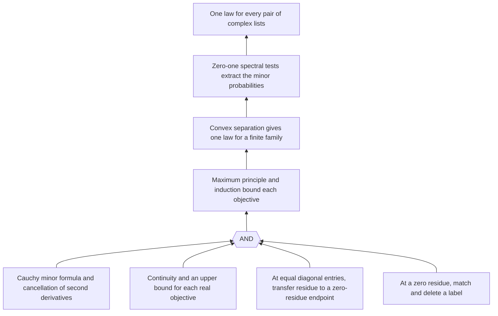

# Common permutation weights for Cauchy eigenbases

[Proof map index](README.md) · [Marcus–de Oliveira conjecture](../README.md)

Let $n$ be a finite matrix order, and let $a,b$ be two complex
lists of length $n$. Write $\mathrm{diag}(a)$ for the diagonal matrix
with entries $a_i$. Let $U$ be a unitary matrix, and write $U^*$ for
its conjugate transpose. For each permutation $\sigma$ of the
$n$ labels, form the matching product
$P_\sigma(a,b)=\prod_j(a_{\sigma(j)}+b_j)$. The Marcus–de Oliveira
inclusion places $\det(\mathrm{diag}(a)+U\mathrm{diag}(b)U^*)$ in the
real convex hull of the matching products. A common permutation law
uses the same weights for all pairs $a,b$.

## The common law

Take real lists $d,v,h$ of length $n$. Require $v_i\ge0$ for every
$i$, and require the entries of $h$ to be pairwise distinct. Form
$H=\mathrm{diag}(d)+vv^{\mathsf T}$, where $v$ is a column vector and
$v^{\mathsf T}$ is its transpose. Suppose $H=U\mathrm{diag}(h)U^*$
with $H$ and $h$ viewed over $\mathbb C$. Then there are nonnegative
real weights $w_\sigma$ with sum one such that, for every pair of
complex lists $a,b$,

$$
\det\bigl(\mathrm{diag}(a)+U\mathrm{diag}(b)U^*\bigr)
= \sum_\sigma w_\sigma P_\sigma(a,b).
$$

The weights are independent of $a$ and $b$. The list $h$ specifies
the eigenbasis and puts no restriction on the two lists in the
determinant comparison. Repeated entries of $d$ and zero entries of
$v$ are allowed. The simple spectrum condition applies to $h$.
[Common permutation law](../Lean/MOC/HermitianRankOneCauchyWeights.lean#L137) · [Universal weights](../Lean/MOC/HermitianRankOneCauchyWeights.lean#L199) · [Determinant inclusion](../Lean/MOC/HermitianRankOneCauchyWeights.lean#L210)

## Proof route

### Harmonicity and the upper bound

Fix $h$. For distinct $d_i$, the characteristic polynomial with
roots $h_j$ determines the squared vector entries. Define the
residue at $d_i$ by

$$
r_i(d)=-\frac{\prod_j(d_i-h_j)}{\prod_{k\ne i}(d_i-d_k)}.
$$

Vary $d$ in the open set where its entries are distinct and all
$r_i(d)>0$. At each point use $v_i=\sqrt{r_i(d)}$. The eigenvalues
of $H$ stay equal to the entries of $h$. In this open set, no $d_i$
equals an $h_j$. At each point take the columns of $U$ in the
order of the eigenvalues in $h$.
[Residue formula](../Lean/MOC/SecularResidueCalculus.lean#L20) · [Fixed spectrum](../Lean/MOC/SecularChamberGeometry.lean#L62) · [Distinctness from the spectrum](../Lean/MOC/SecularCauchyMinorCharts.lean#L135)

The Cauchy matrix with entries $(h_j-d_i)^{-1}$ diagonalizes a
matrix that is diagonally similar to $H$. For lists $x,y$ and
sets of labels $S,T$, define
$Q(x,y;S,T)=\prod_{i\in S}\prod_{j\in T}(x_i-y_j)$.
Let $I,J$ be sets of row and column labels of the same size.
Write $I^c,J^c$ for their complements. The squared modulus of the
minor of $U$ with rows $I$ and columns $J$ is

$$
\frac{Q(d,h;I,J^c) Q(h,d;J,I^c)}
     {Q(d,d;I,I^c) Q(h,h;J,J^c)}.
$$

As a function of one entry $d_i$, this ratio is a constant times
one plus simple fractions with poles at nodes on the other side
of the partition into $I$ and $I^c$. In the sum of the pure
second derivatives with weights $r_i(d)$, the terms for each pair
on opposite sides cancel. The two denominators are $(d_i-d_k)^3$
and $(d_k-d_i)^3$.
[Cauchy eigenvectors](../Lean/MOC/SecularCauchyEigenbasis.lean#L90) · [Cauchy determinant square](../Lean/MOC/CauchyDeterminantSquare.lean#L127) · [Minor formula](../Lean/MOC/SecularCauchyMinorFormula.lean#L180) · [Cancellation](../Lean/MOC/SecularCauchyHarmonic.lean#L97) · [Weighted second derivative identity](../Lean/MOC/SecularCauchyMinorCharts.lean#L190)

Take a finite family of real polynomials $p_\ell$ and real
diagonal lists $x^\ell$. The list of determinant values has one
entry $\det(\mathrm{diag}(x^\ell)+p_\ell(H))$ for each family
index $\ell$. Here $p_\ell(H)$ is polynomial evaluation at the
matrix $H$. Expanding these determinants in spectral minors gives
the weighted second derivative identity for every real linear
combination of the list. Each such combination has an upper bound
because the symmetric matrices with the fixed spectrum have
bounded entries. For continuity at the boundary, evaluate the same
polynomials at $\mathrm{diag}(d)+\mathbf{1}r^{\mathsf T}$, where
$\mathbf{1}$ is the column of ones and $r$ is the vector of residues.
The resulting determinant agrees with the symmetric matrix
evaluation at positive residues.
[Determinant expansion](../Lean/MOC/InverseBasisDeterminantExpansion.lean#L145) · [Column model](../Lean/MOC/SecularCauchyCollision.lean#L16) · [Equality for positive residues](../Lean/MOC/SecularCauchyDeterminantObjective.lean#L33) · [Objective properties](../Lean/MOC/SecularCauchyDeterminantObjective.lean#L92)

### Boundary and joint convex hull

At a finite boundary limit, the residues have a convergent
subsequence. Their limits are nonnegative and still give the
fixed characteristic polynomial. At least two diagonal entries
coincide or at least one residue vanishes.
[Boundary limits](../Lean/MOC/SecularChamberGeometry.lean#L91) · [Boundary cases](../Lean/MOC/SecularChamberGeometry.lean#L137)

When $d_i=d_k$, transfer residue between $i$ and $k$ with their
sum fixed. Each determinant value is affine in the transfer
parameter. The characteristic polynomial stays fixed. The two
transfer endpoints have a zero residue, and the same interpolation
weights apply to every family member. When $r_i=0$, the value $d_i$
equals one spectral entry $h_j$. For each $\ell$, match
$p_\ell(h_j)$ to $x^\ell_i$. The factor
$p_\ell(h_j)+x^\ell_i$ multiplies the determinant after deletion.
The smaller problem has order $n-1$. Induction starts in order
zero and supplies the joint hull inclusion at these boundary
points.
[Fixed characteristic polynomial](../Lean/MOC/SecularBoundaryResidueTransfer.lean#L71) · [Affine transfer](../Lean/MOC/SecularCauchyCollision.lean#L121) · [Deleted spectral label](../Lean/MOC/SecularChamberBoundary.lean#L67) · [Determinant factor](../Lean/MOC/SecularCauchyDeletion.lean#L81)

Add a positive multiple of an exponential barrier to the objective.
The upper level sets above the boundary bound then stay bounded.
The barrier also gives a strictly positive weighted second derivative
sum. Thus the perturbed objective cannot attain an interior maximum.
Let the barrier coefficient go to zero. The maximum principle bounds
each real objective by the largest matching value. Convex separation
then places the full list of determinant values in the convex hull
of the lists obtained from a single permutation at a time. This
gives one law for the whole family.
[Maximum principle](../Lean/MOC/SecularChamberGeometry.lean#L211) · [Joint hull theorem](../Lean/MOC/SecularCauchyCommonWeights.lean#L101)

### Extract the permutation weights

For each set $J$ of column labels, interpolate a real polynomial
$p_J$ that equals one on $h_j$ with $j\in J$ and zero on the other
$h_j$. The pairwise distinct entries of $h$ permit this
interpolation. For each row set $I$, take the diagonal list with
zero entries in $I$ and one elsewhere. Use all these pairs in one
finite family. For sets of the same size, each matching product is
one exactly when $\sigma(J)=I$, and zero otherwise. The determinant
is $|\det U[I,J]|^2$, where $U[I,J]$ has rows $I$ and columns $J$.
The joint law therefore gives every squared minor as a permutation
probability. The squared-minor expansion gives the determinant
identity for arbitrary complex lists.
[Interpolation](../Lean/MOC/SecularCauchyEigenbasis.lean#L44) · [Zero-one determinant test](../Lean/MOC/SubsetMarkerTest.lean#L28) · [Test for all spectra](../Lean/MOC/SubsetMarkerTest.lean#L43) · [Common permutation law](../Lean/MOC/HermitianRankOneCauchyWeights.lean#L137)
