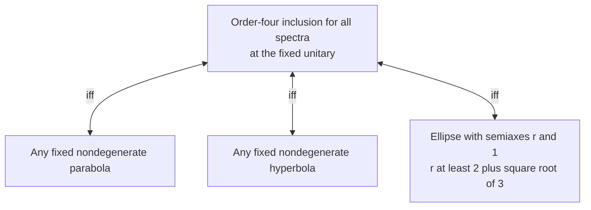
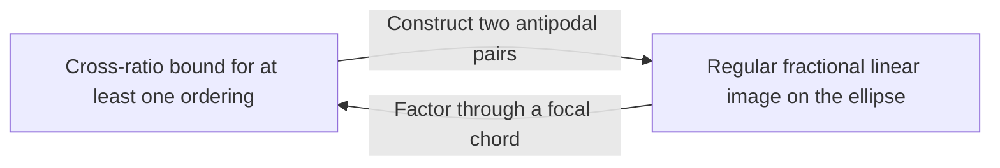

# Fixed conic tests for the determinant inclusion

[Proof map index](README.md) · [Conjecture and proof tree](../README.md#proof-tree) · [Order-four map](order-four-proof-map.md) · [All-order map](all-orders-proof-map.md)

Let $U$ be unitary. Let $a$ and $b$ be complex eigenvalue lists of
length $n$. The spectral inclusion compares the determinant of
$\mathrm{diag}(a)+U\mathrm{diag}(b)U^*$ with the real convex hull of
its matching products. A fixed curve test checks distinct first lists
on one curve. The second list remains arbitrary. The same $U$ appears
in the original problem and in the test.
[Lean test definition](../Lean/MOC/ConicSpectralReductions.lean#L22)

If a curve test gives inclusion for all spectra at each fixed unitary,
the test over all unitary mixers is equivalent to the conjecture at
that order. The order-four and order-five registries use this implication
for each conic below. The registered hyperbola has perpendicular
asymptotes and the product parameter is one.
[Quantifier bridge](../Lean/MOC/ConicSpectralReductions.lean#L27) · [Order four](../Lean/MOC/ProofRoutes.lean#L268) · [Order five](../Lean/MOC/ProofRoutes.lean#L286)

## Order-four equivalences

- For the parabola, first send three eigenvalues to the real line by a
  fractional linear map. The fourth and the real line lie on two
  parallel lines. A common affine image of the parabola approximates
  both lines, including a list with some entries on each line.
  [Order-four parabola test](../Lean/MOC/ConicSpectralReductions.lean#L318) · [Parallel-line limit](../Lean/MOC/ConicSpectralReductions.lean#L174)
- For the hyperbola, first send three eigenvalues to the real line.
  Translate the fourth onto the second asymptote while keeping the
  first three on the first asymptote. Common dilations of the
  hyperbola approximate both asymptotes and their intersection.
  [Order-four hyperbola test](../Lean/MOC/ConicSpectralReductions.lean#L375) · [Asymptote limit](../Lean/MOC/ConicSpectralReductions.lean#L243)
- For the ellipse, reorder the four labels to give a cross ratio
  $\lambda$ with $\mathrm{Re}\,\lambda\le|\lambda|/2$. The longest
  side of the triangle with vertices $0,1,\lambda$ gives the required
  ordering. For a square root $w$ of that cross ratio, solve one real
  quadratic to put two antipodal pairs on the ellipse. The quadratic
  has a real solution if
  $4r^2(\mathrm{Re}\,w)^2 \le (r^2-1)^2(\mathrm{Im}\,w)^2$.
  The stated bound on $r$ guarantees this inequality.
  [Order-four ellipse test](../Lean/MOC/ConicSpectralReductions.lean#L925) · [Antipodal construction](../Lean/MOC/ConicSpectralReductions.lean#L556)

A common fractional linear change of the signed spectra preserves hull
membership. The pole may meet the partner list after the chart is
chosen. Perturb that list and take a limit. The same closedness argument
includes repeated eigenvalues. An invertible affine image gives the
same test. [Pole removal](../Lean/MOC/ConicSpectralReductions.lean#L122) · [Affine images](../Lean/MOC/ConicSpectralReductions.lean#L98)

## Exact ellipse representation

For a fixed $r\ge1$, a quadruple of distinct points $z_0,z_1,z_2,z_3$ has
a fractional linear image on the ellipse with semiaxes $r$ and $1$ if
and only if some ordering of its
cross ratio $\lambda=(z_0-z_2)(z_1-z_3)/((z_0-z_3)(z_1-z_2))$
satisfies

$
((r^2-1)^2+4r^2)\,\mathrm{Re}\,\lambda
\le ((r^2-1)^2-4r^2)|\lambda|.
$

The right-hand coefficient divided by the left-hand coefficient is $\cos(4\arctan(1/r))$. Thus the bound
asks for an ordering with absolute principal argument at least
$4\arctan(1/r)$. The fractional map must have no pole at any of the four
points. [Exact representation criterion](../Lean/MOC/ConicSpectralReductions.lean#L1527)

- For necessity, normalize the ellipse points to the unit circle and
  take an ordering with negative circle cross ratio. The quotient of
  the two cross ratios is a quotient of displacements to two points
  on a focal segment. Enlarging the segment to both foci bounds the
  visual angle. The product of the two focal distances gives the
  stated coefficient.
  [Cross-ratio factorization](../Lean/MOC/EllipseVisualAngle.lean#L227) · [Focal chord bound](../Lean/MOC/EllipseVisualAngle.lean#L90)
- For sufficiency, take a square root of the cross ratio. The
  real-part bound is the discriminant condition for the quadratic
  that gives two antipodal pairs. Their cross ratio determines a
  fractional map from the initial quadruple.
  [Antipodal construction](../Lean/MOC/ConicSpectralReductions.lean#L556)

Every distinct quadruple has such an image exactly when
$r\ge2+\sqrt3$. For the quadruple $0,1,-1,i/\sqrt3$, every cross-ratio
ordering has real part $1/2$ and modulus $1$. The criterion for this
example forces the threshold. This lower bound concerns representation
by a fractional map. The determinant inclusion on a thinner ellipse
is a separate question.
[Sharp threshold](../Lean/MOC/ConicSpectralReductions.lean#L1619)

## Order-five equivalences

The parabola and hyperbola tests also suffice in order five. Choose a
nearest pair in the first spectrum and send it to $0,1$ by an affine
map. If all entries are real, one of the lines already contains them.
Otherwise move a circle center on the perpendicular bisector of that
pair. The first additional contact is a minimum of finitely many
ratios. At that contact the circle has at least three boundary points
and its open disk is empty. A fractional linear map sends the circle
to the real line and the exterior to the upper half-plane. Extra
boundary points move a small distance into that half-plane before the
limit is taken.
[Order-five parabola test](../Lean/MOC/ConicSpectralReductions.lean#L1320) · [Order-five hyperbola test](../Lean/MOC/ConicSpectralReductions.lean#L1341)

If two distinct points are in the upper half-plane, choose a real $t$
so the secant between their images under $z\mapsto-1/(z-t)$ has any
given nonzero direction. For $g(t)=(u-t)(v-t)$, its imaginary part
vanishes at a weighted average of the real parts of $u,v$. At that
point $g(t)$ is negative real. The direction equation is linear or
quadratic in $t$. In the quadratic case this negative value gives a
real root. [Secant alignment](../Lean/MOC/ConicSpectralReductions.lean#L461)

## Determinant-one exclusions

Let $E$ be a set of order-four unitary mixers with determinant one. A
test over every unitary mixer outside $E$ suffices for the test over
all unitary mixers. For an excluded mixer, multiply it by a scalar
of modulus one and fourth power $-1$. The new mixer has determinant
$-1$ and conjugates the second diagonal matrix to the same matrix.
[Scalar-phase equivalence](../Lean/MOC/ConicSpectralReductions.lean#L1680)

## Source scope

The fixed tests reduce the determinant inclusion to the stated curves
with the same unitary and arbitrary second list. The curve inequalities
remain open. The Lean source was written without compilation.
