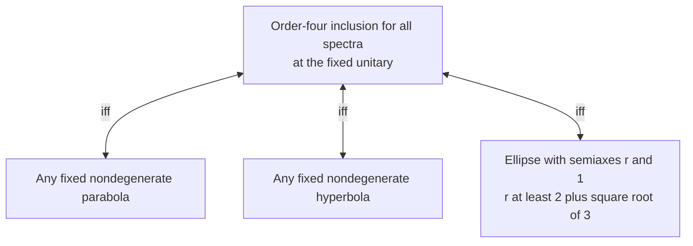
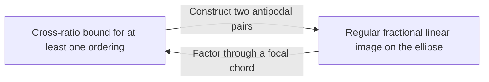

# Fixed conic tests for the determinant inclusion

[Proof map index](README.md) · [Conjecture and proof tree](../README.md#proof-tree) · [Order-four map](order-four-proof-map.md) · [All-order map](all-orders-proof-map.md)

Let $U$ be a complex unitary matrix of order $n$. Let $a$ and $b$ be
complex eigenvalue lists of length $n$. Write $U^*$ for the conjugate
transpose and $\mathrm{diag}(a)$ for the diagonal matrix with entries
$a_i$. The Marcus–de Oliveira inclusion places the determinant of
$\mathrm{diag}(a)+U\mathrm{diag}(b)U^*$ in the real convex hull of
$\prod_j(a_{\sigma(j)}+b_j)$ over all permutations $\sigma$.
A fixed curve test asks for this inclusion when the entries of $a$
are distinct and lie on the curve. The list $b$ is arbitrary. Use the
same matrix $U$ in the original problem and in the test.
[Lean test definition](../Lean/MOC/ConicSpectralReductions.lean#L22)

Suppose the curve test at each fixed unitary implies the inclusion
for all spectra at that unitary. Then the test for all unitary
matrices is equivalent to the conjecture at that order. The converse
uses the conjecture on the restricted lists. This gives the equivalence
for each conic below.
[Quantifier bridge](../Lean/MOC/ConicSpectralReductions.lean#L27) · [Order-four routes](../Lean/MOC/ProofRoutes.lean#L254) · [Order-five routes](../Lean/MOC/ProofRoutes.lean#L289)

## Order-four equivalences

The parabola has points $t+it^2$ for real $t$. For the hyperbola,
fix $d\in\mathbb C$ with $\mathrm{Im}(d)\ne0$ and a real $k\ne0$.
Its points are $x+yd$ with real $x,y$ and $xy=k$. The two asymptote
directions are $1,d$. The same reduction applies at $k=0$, when the
curve is the union of the asymptotes.
[Parabola definition](../Lean/MOC/ConicSpectralReductions.lean#L36) · [Hyperbola definition](../Lean/MOC/ConicSpectralReductions.lean#L42)

- For the parabola, first send three eigenvalues to the real line by a
  fractional linear map. Use the parallel line through the fourth
  eigenvalue for that entry. A family of affine images of the
  parabola approximates any prescribed finite list on these lines.
  Each image uses one affine map for the entire list.
  [Order-four parabola test](../Lean/MOC/ConicSpectralReductions.lean#L330) · [Parallel-line limit](../Lean/MOC/ConicSpectralReductions.lean#L180)
- For the hyperbola, first send three eigenvalues to the real line.
  Translate the fourth onto the second asymptote while keeping the
  first three on the first asymptote. Common dilations of the
  hyperbola approximate both asymptotes and their intersection.
  [Order-four hyperbola test](../Lean/MOC/ConicSpectralReductions.lean#L390) · [Asymptote limit](../Lean/MOC/ConicSpectralReductions.lean#L249)
- For the ellipse, reorder the four labels to give a cross ratio
  $\lambda$ with $\mathrm{Re}\,\lambda\le|\lambda|/2$. The longest
  side of the triangle with vertices $0,1,\lambda$ gives the required
  ordering. For a square root $w$ of that cross ratio, solve one real
  quadratic to put two antipodal pairs on the ellipse. The quadratic
  has a real solution if
  $4r^2(\mathrm{Re}\,w)^2 \le (r^2-1)^2(\mathrm{Im}\,w)^2$.
  The stated bound on $r$ guarantees this inequality.
  [Order-four ellipse test](../Lean/MOC/ConicSpectralReductions.lean#L946) · [Antipodal construction](../Lean/MOC/ConicSpectralReductions.lean#L574)

Use the same fractional linear map on $a$ and the entrywise negation
of $b$, then negate the second transformed list. The determinant and
all matching products scale by the same nonzero factor when the pole
avoids both signed lists. The selected pole can meet the negated list
of $b$. In that case, perturb $b$ to avoid the pole and take a limit.
Closedness also permits repeated eigenvalues. A complex affine map
with nonzero slope gives the same test on the image of the curve.
[Fractional covariance](../Lean/MOC/ProjectiveTransport.lean#L61) · [Pole removal](../Lean/MOC/ConicSpectralReductions.lean#L128) · [Affine images](../Lean/MOC/ConicSpectralReductions.lean#L104)

## Exact ellipse representation

For a fixed $r\ge1$, a quadruple of distinct points $z_0,z_1,z_2,z_3$ has
a fractional linear image on the ellipse with semiaxes $r$ and $1$ if
and only if some ordering of its
cross ratio $\lambda=(z_0-z_2)(z_1-z_3)/((z_0-z_3)(z_1-z_2))$
satisfies

$$
((r^2-1)^2+4r^2)\,\mathrm{Re}\,\lambda
\le ((r^2-1)^2-4r^2)|\lambda|.
$$

The coefficient ratio is $\cos(4\arctan(1/r))$. Thus the bound asks
for an ordering with absolute principal argument at least
$4\arctan(1/r)$. The fractional map must have no pole at any of the four
points. [Exact representation criterion](../Lean/MOC/ConicSpectralReductions.lean#L1557)

- For necessity, normalize the ellipse points to the unit circle and
  take an ordering with negative circle cross ratio. The quotient of
  the two cross ratios is a quotient of displacements to two points
  on a focal segment. Enlarging the segment to both foci bounds the
  visual angle. The product of the two focal distances gives the
  stated coefficient.
  [Cross-ratio factorization](../Lean/MOC/EllipseVisualAngle.lean#L227) · [Focal chord bound](../Lean/MOC/EllipseVisualAngle.lean#L90)
- For sufficiency, take a square root of the cross ratio. The
  real-part bound is the discriminant condition for the quadratic
  that gives two antipodal pairs. Their cross ratio determines a
  fractional map from the initial quadruple.
  [Antipodal construction](../Lean/MOC/ConicSpectralReductions.lean#L574)

Every distinct quadruple has such an image exactly when
$r\ge2+\sqrt3$. For the quadruple $0,1,-1,i/\sqrt3$, every cross-ratio
ordering has real part $1/2$ and modulus $1$. The criterion for this
example forces the threshold. This lower bound concerns representation
by a fractional map. The determinant inclusion on a thinner ellipse
is a separate question.
[Sharp threshold](../Lean/MOC/ConicSpectralReductions.lean#L1650)

## Order-five equivalences

The parabola and hyperbola tests also suffice in order five. Choose a
nearest pair in the first spectrum and send it to $0,1$ by an affine
map. If all entries are real, one of the lines already contains them.
Otherwise move a circle center on the perpendicular bisector of that
pair. The first additional contact is a minimum of finitely many
ratios. At that contact the circle has at least three boundary points
and its open disk is empty. A fractional linear map sends the circle
to the real line and the exterior to the upper half-plane. Extra
boundary points move a small distance into that half-plane before the
limit is taken.
[Order-five parabola test](../Lean/MOC/ConicSpectralReductions.lean#L1348) · [Order-five hyperbola test](../Lean/MOC/ConicSpectralReductions.lean#L1369)

Let $u,v$ be distinct points in the open upper half-plane. For any
given nonzero direction, choose a real $t$ so the secant between
their images under $z\mapsto-1/(z-t)$ is parallel to that direction.
For $g(t)=(u-t)(v-t)$, its imaginary part
vanishes at a weighted average of the real parts of $u,v$. At that
point $g(t)$ is negative real. The direction equation is linear or
quadratic in $t$. In the quadratic case this negative value gives a
real root. [Secant alignment](../Lean/MOC/ConicSpectralReductions.lean#L479)

## Determinant-one exclusions

Let $E$ be a set of order-four unitary mixers with determinant one. A
test over every unitary mixer outside $E$ suffices for the test over
all unitary mixers. For an excluded mixer, multiply it by a scalar
of modulus one and fourth power $-1$. The new mixer has determinant
$-1$ and conjugates the second diagonal matrix to the same matrix.
[Scalar-phase equivalence](../Lean/MOC/ConicSpectralReductions.lean#L1711)

## Source scope

Lean verifies the fixed-curve reductions with the same unitary and
an arbitrary second list. The curve inequalities remain open.

## Lean check status

| Lean scope | Lean Checked? |
| --- | --- |
| The 4 source modules linked in this map | Partial (3/4) |
| [ProofRoutes.lean](../Lean/MOC/ProofRoutes.lean#L254) | No |

[Status definitions](README.md#lean-check-status). Paper arguments retain their stated scope.
