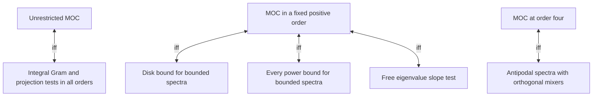

# Certificates for determinant inclusion

Let $a,b$ be lists of $n$ complex eigenvalues and let $U$ be a unitary matrix
of order $n$. Write $D=\det(\mathrm{diag}(a)+U\mathrm{diag}(b)U^*)$.
For each permutation $\sigma$ of the indices, set
$P_\sigma=\prod_j(a_{\sigma(j)}+b_j)$. Let $K$ be the real convex hull
of these products. The Marcus–de Oliveira conjecture asks whether $D\in K$
for every such input. The scripts linked below await kernel checking.
[Matching products](../Lean/MOC/Core.lean#L21) · [Hull inclusion](../Lean/MOC/Core.lean#L30) · [Proof tree](../README.md#proof-tree)

## Equivalent tests

Each row gives a universal inequality or certificate to seek.
A proof of any one test proves the conjecture in its stated orders.

| Order | Test | Lean statement |
| --- | --- | --- |
| All | Use Gaussian-integer spectra and a Gaussian-integer matrix $V$ with $V^*V=d^2I$ for a positive integer $d$. Compare integer projections on the four coordinate directions and on the normals to differences of matching products. Each input needs finitely many comparisons. Matrix order and entry size are unbounded. | [Integer comparisons](../Lean/MOC/GaussianIntegerDeterminantTest.lean#L28) · [Unrestricted equivalence](../Lean/MOC/GaussianIntegerDeterminantTest.lean#L181) |
| Every positive order | Fix any $R>0$. For $\lvert a_i\rvert,\lvert b_i\rvert<R$ and every $U$, find a matching with $\lvert1+D\rvert^2\le\lvert1+P_\sigma\rvert^2$. The center is always $-1$. | [Disk test](../Lean/MOC/TranslatedDeterminantPowers.lean#L40) |
| Every positive order | With the same radius restriction, prove $\lvert1+D\rvert^{2k}\le\sum_\sigma\lvert1+P_\sigma\rvert^{2k}$ for every integer $k\ge0$. This symmetric sum has a formula in terms of permanents of matrices of pair sums. | [Power test](../Lean/MOC/TranslatedDeterminantPowers.lean#L112) · [Permanent formula](../Lean/MOC/TranslatedDeterminantPowers.lean#L132) |
| Every positive order | Fix one entry of $b$ as a free complex variable $z$. Write $D(z)=x+zy$ and $P_\sigma(z)=s_\sigma+zt_\sigma$. For each complex direction $\eta$, use at most three pairs $(s_\sigma,t_\sigma)$ with affinely independent slopes over the reals. Their probability weights must average the slopes to $y$ and the projected intercepts to at least $\mathrm{Re}(\eta x)$. Equivalently, enumerate the feasible triples, pairs and singletons and test $x$ in the planar hull of their intercepts. | [Finite intercept hull](../Lean/MOC/FreeEigenvalueSlopeSlice.lean#L205) · [One free entry](../Lean/MOC/FreeEigenvalueSlopeSlice.lean#L251) · [Order equivalence](../Lean/MOC/FreeEigenvalueSlopeSlice.lean#L282) |
| Four | Test first lists $(1,-1,z,-z)$ with $\mathrm{Im}(z)>0$ and $\lvert z\rvert<1$, every second list, and every real orthogonal mixer. A fractional linear map gives the two antipodal pairs. The boundary consists of spectra on a circle or a line. | [Chart](../Lean/MOC/FourAntipodalSpectra.lean#L20) · [Boundary](../Lean/MOC/FourAntipodalSpectra.lean#L100) · [Orthogonal test](../Lean/MOC/FourAntipodalSpectra.lean#L208) |

For the disk test, a strict excess of the real part persists after both
spectra are multiplied by a sufficiently small positive real number $t$.
The disk comparison detects the excess in its term of order $t^n$.
For the power test, if the determinant distance exceeds every matching
distance, its $2k$-th power exceeds their sum for some finite $k$.
The required exponent can depend on the input.
[Scaling argument](../Lean/MOC/TranslatedDeterminantPowers.lean#L40) · [Finite power comparison](../Lean/MOC/TranslatedDeterminantPowers.lean#L84)

## All-order structural results

| Method | Result and remaining step | Lean statement |
| --- | --- | --- |
| Forced eigenvalue multiplicity | Write $m_a(c)$ for the number of entries of $a$ equal to $c$. Fix $z\in\mathbb C$ and an integer $k\ge0$. The sum has $z$ as an eigenvalue of algebraic multiplicity at least $k+1$ for every mixer if and only if some $c$ satisfies $m_a(c)+m_b(z-c)>n+k$. If the test fails, a permutation mixer witnesses the failure. The signed polynomial identity gives divisibility for every mixer. | [Matching count](../Lean/MOC/ForcedSpectralMultiplicity.lean#L74) · [Polynomial identity](../Lean/MOC/ForcedSpectralMultiplicity.lean#L117) · [Sharp criterion](../Lean/MOC/ForcedSpectralMultiplicity.lean#L170) |
| Composition of two mixers | Let $U,V$ be unitary. For every permutation $p$, require each choice of indices $f(j)$ with $U_{p(j),f(j)}V_{f(j),j}\ne0$ for every $j$ to use each index once. Fix $a$. Assume $U$ has one matching law for all second lists and $V$ satisfies inclusion at each required relabeling of $a$. Then inclusion holds for $UV$. Repeated intermediate indices are the remaining case for this composition rule. | [Path test](../Lean/MOC/PermutationPathComposition.lean#L25) · [Signed convolution](../Lean/MOC/PermutationPathComposition.lean#L117) · [Composition](../Lean/MOC/PermutationPathComposition.lean#L175) |
| Common low-degree coefficients | Fix $U$. One probability law gives the first three coefficients of $\det(I+x(\mathrm{diag}(a)+U\mathrm{diag}(b)U^*))$ for all $a,b$. This supplies the three low-degree bounds in the separate-coefficient route. At order four the remaining coefficient is the determinant. | [Uniform law](../Lean/MOC/Reformulations/SecondCoefficient.lean#L248) · [Remaining coefficients](../Lean/MOC/Reformulations/SecondCoefficient.lean#L293) |

## Order-four and order-five support bounds

In a direction $\eta\in\mathbb C$, write
$H=\max_\sigma\mathrm{Re}(\eta P_\sigma)$ and
$L=\min_\sigma\mathrm{Re}(\eta P_\sigma)$. A contact attains $H$.
The support gap of a matching is $H-\mathrm{Re}(\eta P_\sigma)$.
The conjecture asks for $\mathrm{Re}(\eta D)\le H$ in every direction.
[Support criterion](../Lean/MOC/Support.lean#L52)

| Order and method | Result and remaining step | Lean statement |
| --- | --- | --- |
| Four, width of the hull | Every unitary satisfies $\mathrm{Re}(\eta D)\le H+(H-L)/27$. The resulting enclosure is the hull of the points $P_\sigma+(P_\sigma-P_\tau)/27$. The original bound requires zero excess. | [Width estimate](../Lean/MOC/FourMixedRaySupportBound.lean#L222) · [Hull enclosure](../Lean/MOC/FourMixedRaySupportBound.lean#L249) |
| Four, individual support gaps | The order-four support cone has 48 mixed rays. If a mixed ray has negative value $v$ at $U$, take any matching where this ray has coordinate $r>0$. If the matching gap there is $g$, then $\mathrm{Re}(\eta D)-H\le -vg/r$. A contact on that coordinate gives the required bound. General spectra can have $g>0$. | [Ray lower bound](../Lean/MOC/FourMixedRaySupportBound.lean#L121) · [Coordinate estimate](../Lean/MOC/FourMixedRaySupportBound.lean#L202) |
| Four, zero-height contacts | Consider a strict witness with at least seven contacts, distinct nonzero matching products, and $H=0$. Require its gap vector to equal the fixed mixed ray with coefficient one plus a nonnegative combination of the thirteen specified ordinary rays. Then it has exactly seven contacts. Three explicit inequalities on the ordinary coefficients describe the alternatives left by the cubic identity. Excluding the seven-contact case remains open on this route. | [Thirteen rays](../Lean/MOC/FourCanonicalZeroHeight.lean#L18) · [Coefficient alternatives](../Lean/MOC/FourCanonicalZeroHeight.lean#L117) · [Terminal contact count](../Lean/MOC/FourCanonicalZeroHeight.lean#L305) |
| Five, transport between disjoint pairs | The squared minors for two disjoint column pairs admit a joint distribution on disjoint row pairs. This gives inequalities that can be added to the assignment bound on pairs. For each pair of spectra and each direction, it suffices to find a finite set of these inequalities and row and column potentials whose bound reaches a matching score. Existence for every input is open. | [Transport](../Lean/MOC/OrderFiveDisjointPairSupport.lean#L20) · [Dual bound](../Lean/MOC/OrderFiveDisjointPairSupport.lean#L148) · [Sufficient condition](../Lean/MOC/OrderFiveDisjointPairSupport.lean#L344) |
| Five, a sharp spectral certificate | For the two specified Gaussian-integer spectra and $\eta=34944-130480i$, every unitary satisfies $\mathrm{Re}(\eta D)\le1\,228\,164\,224$. A matching attains equality. The certificate combines 39 nonnegative minor terms with a disjoint-pair inequality. It applies to this direction and these spectra. | [Spectra and direction](../Lean/MOC/OrderFiveDisjointPairSupport.lean#L217) · [Bound](../Lean/MOC/OrderFiveDisjointPairSupport.lean#L291) · [Attainment](../Lean/MOC/OrderFiveDisjointPairSupport.lean#L323) |
