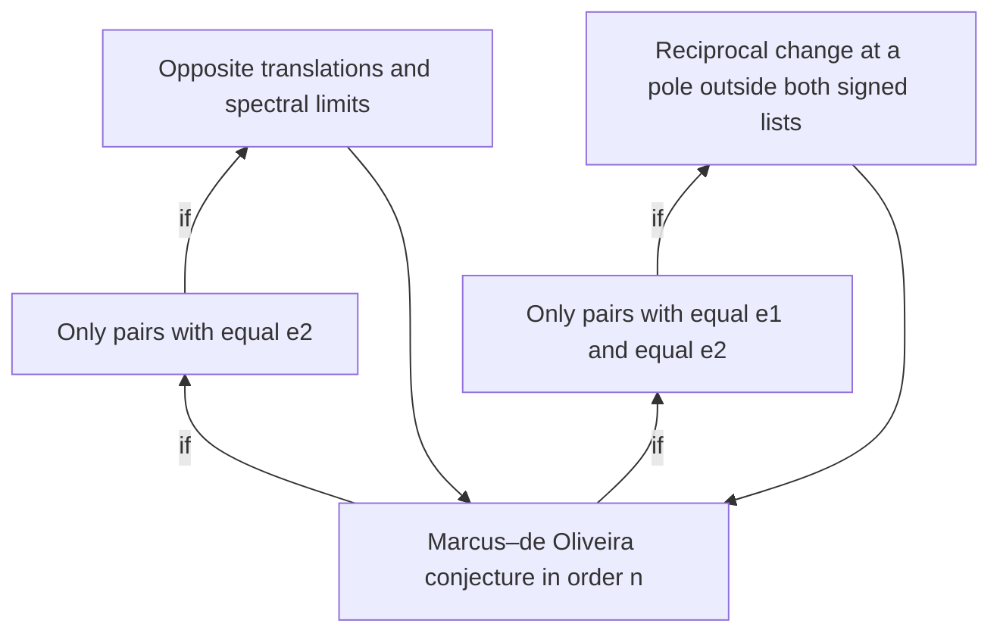

# Equal spectral coefficients

[Proof map index](README.md) · [Marcus–de Oliveira conjecture and proof tree](../README.md#proof-tree)

Fix an order $n$. For a complex eigenvalue list $a$ of length $n$,
write $e_1(a)=\sum_i a_i$ and $e_2(a)=\sum_{i<j}a_i a_j$. These
coefficients satisfy $2e_2(a)=e_1(a)^2-\sum_i a_i^2$. To prove the
Marcus–de Oliveira conjecture in order $n$, it suffices to prove the
determinant inclusion for every unitary change of eigenbasis under
either of the two restrictions below. The full conjecture also
implies each restricted test. Both reductions keep the same unitary
matrix. The restricted inclusion remains open in general.
[Coefficient definition](../Lean/MOC/EqualSpectralCoefficients.lean#L22) · [Equal second coefficient](../Lean/MOC/EqualSpectralCoefficients.lean#L91) · [Both coefficients](../Lean/MOC/EqualSpectralCoefficients.lean#L428)

For $n\ge 2$, add $t$ to the first list $a$ and subtract $t$ from the
second list $b$. The change in $e_2(a)-e_2(b)$ is
$(n-1)t(e_1(a)+e_1(b))$. If $e_1(a)+e_1(b)\ne0$, choose $t$ to cancel
the difference. The determinant and all matching products stay
constant under the opposite shifts. If $e_1(a)+e_1(b)=0$, first
approximate $a$ by translations for which this sum is nonzero. Take
the limit of the resulting inclusions.
[Shift identity](../Lean/MOC/EqualSpectralCoefficients.lean#L47) · [Reduction by continuity](../Lean/MOC/EqualSpectralCoefficients.lean#L91)

For simultaneous equality, take the signed lists $a$ and $c=-b$.
Choose a pole $p$ outside both lists. Replace each entry $z$ by
$1/(p-z)$. Write $x$ and $y$ for the two resulting lists, and set
$m=(e_1(x)+e_1(y))/(2n)$. The lists $x-m$ and $-(y-m)$ have the
same sum. They have the same sum of squares if

$$
n\sum_i x_i^2-e_1(x)^2=n\sum_i y_i^2-e_1(y)^2 .
$$

This equality gives equal $e_2$ for the two transformed spectra.
The fractional-linear change transfers their determinant inclusion
to the original pair.
[Pole normalization](../Lean/MOC/EqualSpectralCoefficients.lean#L295) · [Fractional-linear transport](../Lean/MOC/ProjectiveTransport.lean#L61)

First reduce to signed lists with distinct entries and no shared
entry. Consider the difference between the two sides of the last
equation as a function of $p$. Multiply it by
$\prod_i(p-a_i)^2\prod_i(p-c_i)^2$ to get a polynomial. This
polynomial is nonzero at each entry of the signed lists. To make
the polynomial nonconstant, perturb one entry of $c$. The difference
between the polynomial values at two distinct entries of $a$ is a
nonzero polynomial in the perturbation parameter. Thus arbitrarily
small perturbations suffice. The fundamental theorem of algebra
gives a root outside the perturbed signed lists. Use it as the pole,
then take a limit. Orders zero and one follow from the proved
small-order inclusion.
[Regular spectra](../Lean/MOC/SpectralPerturbation.lean#L146) · [Root outside both signed lists](../Lean/MOC/EqualSpectralCoefficients.lean#L241) · [Nonconstant numerator](../Lean/MOC/EqualSpectralCoefficients.lean#L377) · [Small orders](../Lean/MOC/Small.lean#L68)

## Lean check status

| Lean scope | Lean Checked? |
| --- | --- |
| The 4 source modules linked in this map | Yes |

[Status definitions](README.md#lean-check-status). Paper arguments retain their stated scope.
