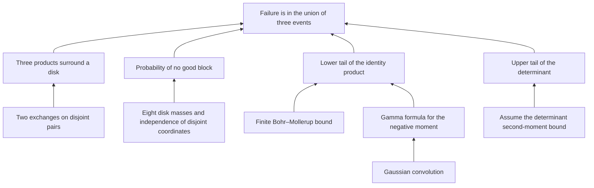

# Gaussian spectra and Haar mixing

[Proof map index](README.md) · [Unrestricted conjecture](../README.md) · [All-order proof maps](all-orders-proof-map.md)

Fix an order $n$. Let $a$ and $b$ be two lists of $n$ complex numbers.
Let $U$ be a unitary matrix. Write $d$ for the determinant of
$\mathrm{diag}(a)+U\mathrm{diag}(b)U^*$. The matching hull is the real
convex hull of the products obtained by matching the two lists.

Give every spectral entry the complex Gaussian density
$e^{-|z|^2}/\pi$, where $z$ is the value of the entry. Assume that all
entries are independent. In the Gaussian–Haar ensemble, $U$ has Haar
probability measure on the unitary group and is independent of the
entries. The failure event is that $d$ lies outside the matching hull.

The registered almost-sure reformulation requires inclusion almost
everywhere in every order on every probability space where the mixer
is unitary almost everywhere. A singleton probability space recovers
the deterministic conjecture. The Gaussian estimate bounds failure
under a premise on the second moment of $d$.
[Almost-sure equivalence](../Lean/MOC/Reformulations/SecondNative.lean#L271) · [Gaussian bound](../Lean/MOC/GaussianHaarContainment.lean#L1197)

## Deterministic inclusion

Let $z_0$ denote the identity matching product. For two disjoint
transpositions, let $q_1$ and $q_2$ denote their ratios to $z_0$.
Each ratio uses only the two affected factors. The three products
$z_0$, $z_0q_1$, and $z_0q_1q_2$ are matching vertices.

Put $\omega=(-1+i\sqrt3)/2$. If both ratios are within $1/10$ of
$\omega$, the normalized triangle contains the centered disk of
radius $1/4$. For an arbitrary support direction, the three
equilateral projections sum to zero. Their squared sum is three
halves of the squared norm of the direction. These identities give
a support bound of one half of that norm. The perturbation changes
each projection by at most $21/100$ of the norm. The proof applies
the resulting support bound to every direction.
[Disk inclusion](../Lean/MOC/GaussianHaarContainment.lean#L147)

For each pair, put the four disk centers at $0$, $1$, $1$, and
$(-2+i\sqrt3)/7$ in the order of the two entries of $a$ and the two
entries of $b$. Take radius $1/200$ at each center. The denominator
stays nonzero and the ratio is within $1/10$ of $\omega$. Two such
pairs give a matching triangle block.
[Ratio estimate](../Lean/MOC/GaussianHaarContainment.lean#L269) · [Block construction](../Lean/MOC/GaussianHaarContainment.lean#L432)

## Failure bound

For a disk with center $c$ and radius $r$, the Gaussian mass is at
least $r^2e^{-(|c|+r)^2}$. The proof multiplies its area by a lower
bound on the density on that disk. For the eight independent
coordinates of one block, this gives the lower bound
$p_0=e^{-5}/200^{16}$. The coordinates in different consecutive
blocks are disjoint. Their independence makes the block failure
probabilities multiply. The probability of no good block is at most
$(1-p_0)^{\lfloor n/4\rfloor}$.
[One disk](../Lean/MOC/GaussianHaarContainment.lean#L329) · [Eight disks](../Lean/MOC/GaussianHaarContainment.lean#L460) · [Consecutive blocks of independent spectra](../Lean/MOC/GaussianHaarContainment.lean#L635)

The sum of two independent spectral entries has density
$e^{-|z|^2/2}/(2\pi)$. Complete the square in the convolution of the
two original densities. Polar integration gives the expectation of
$|z|^{-1/10}$ as $2^{-1/20}\Gamma(19/20)$, where $\Gamma$ is the
Euler gamma function. The finite Bohr–Mollerup comparison at $255$
and bounds on two reciprocal sums give an upper bound of $e^{-7/2000}$.
Each sum $a_j+b_j$ uses its own pair of independent entries. The product
law of the pairs gives independence of these sums.
[Gaussian convolution](../Lean/MOC/GaussianHaarContainment.lean#L995) · [Gamma formula](../Lean/MOC/GaussianHaarContainment.lean#L1032) · [Gamma bound](../Lean/MOC/GaussianHaarContainment.lean#L868)

| Premise | Consequence | Lean source | Lean Checked? |
| --- | --- | --- | --- |
| The spectral entries are independent standard complex Gaussians. | The probability that $\lvert z_0\rvert $ is less than $e^{n/100}$ is at most $e^{-n/400}$. | [Lower tail](../Lean/MOC/GaussianHaarContainment.lean#L1159) | Yes |
| The squared magnitude $\lvert d\rvert ^2$ is almost everywhere measurable and its integral is at most $(n+2)(n+3)/6$. | The probability that $\lvert d\rvert $ is greater than $e^{n/100}/4$ is at most $\frac83(n+2)(n+3)e^{-n/50}$. | [Determinant upper tail](../Lean/MOC/GaussianHaarContainment.lean#L742) | Yes |

Assume independent standard complex Gaussian spectral entries. If
$|d|^2$ is almost everywhere measurable and has the stated integral
bound, the union bound gives

$$
\Pr(d\text{ is outside the matching hull})
\le (1-p_0)^{\lfloor n/4\rfloor} + e^{-n/400}
   + \frac83(n+2)(n+3)e^{-n/50}.
$$

The three events in this union may be correlated. The displayed
estimate decays exponentially in $n$. Its small value of $p_0$
gives no useful bound at moderate orders.
[Failure bound from the determinant moment](../Lean/MOC/GaussianHaarContainment.lean#L1197)

## Remaining Haar input

The evaluation of the second moment for the Haar ensemble remains a
paper argument. It uses orthogonality of the spectral monomials in
the expansion by squared unitary minors. Gaussian Gram–Schmidt gives
the fourth moments of the Haar minors. The Lean estimate takes the
second-moment inequality as a premise.
[Gaussian Gram–Schmidt construction, section 1.2](https://case.edu/artsci/math/esmeckes/Haar_book.pdf)

[Lean check status](README.md#lean-check-status): **Yes** for the 2 linked source modules.
