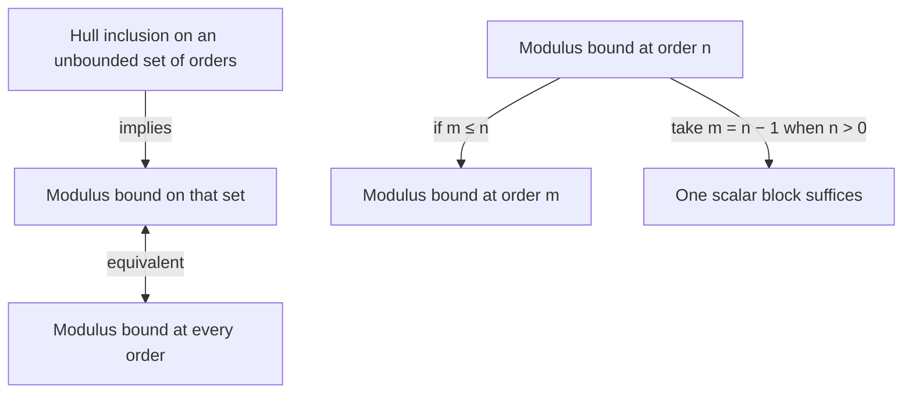

# Transfer of the determinant modulus bound between orders

Let $A$ and $B$ be complex normal matrices of order $n$. List their
eigenvalues as $a_1,\ldots,a_n$ and $b_1,\ldots,b_n$, with multiplicity.
For a permutation $p$ of the $n$ labels, put
$P_p=\prod_j(a_{p(j)}+b_j)$. Write $D=\det(A+B)$.
The modulus bound $R(n)$ states that $|D|\leq\max_p|P_p|$ for every such
pair of matrices. The Marcus–de Oliveira conjecture $M(n)$ places $D$
in the real convex hull of the $P_p$. This hull lies in the closed disk
with center zero and radius $\max_p|P_p|$.
[Modulus bound](../Lean/MOC/ModulusOrderTransfer.lean#L17) ·
[Convex-hull implication](../Lean/MOC/ModulusOrderTransfer.lean#L29)

## Transfer by one order

For all integers $0\leq m\leq n$, $R(n)$ implies $R(m)$. Thus a strict
violation of the modulus bound at order $m$ forces a violation at
**every** larger order, including $m+1$.
[One-order step](../Lean/MOC/ModulusOrderTransfer.lean#L114) ·
[All larger orders](../Lean/MOC/ModulusOrderTransfer.lean#L120)

Choose a matching of maximum modulus $M$. Suppose $M>0$. Duplicate
one matched pair by appending its two eigenvalues as scalar blocks.
Write $s$ for their sum. The determinant becomes $sD$, and the new
maximum modulus is exactly $|s|M$. The extended original matching
attains this value.
[Scalar blocks](../Lean/MOC/ModulusOrderTransfer.lean#L47) ·
[Upper bound for every enlarged matching](../Lean/MOC/DuplicatedAssignment.lean#L114)

To prove the upper bound, take an arbitrary enlarged matching. Merge
the two copies of each duplicated label. Add the edges of the original
maximizing matching except for the chosen pair. Each vertex now has
degree two, counting multiplicities. Hall's theorem splits these edges
into two matchings of the original labels. Their product has modulus at
most $M^2$. The added edges contribute $M/|s|$. Division gives the
claimed bound. If $M=0$, all matching products vanish. The signed
determinant identity then gives $D=0$.
[Two matchings](../Lean/MOC/DuplicatedAssignment.lean#L45) ·
[Hall's theorem in the pinned mathlib](https://github.com/leanprover-community/mathlib4/blob/c44e0c8ee63ca166450922a373c7409c5d26b00b/Mathlib/Combinatorics/Hall/Finite.lean#L249) ·
[Zero maximum](../Lean/MOC/ModulusOrderTransfer.lean#L95) ·
[Signed determinant identity](../Lean/MOC/Weights.lean#L41)

## Unbounded sets of orders

Let $S$ be a set of nonnegative integers. Suppose that for every $m$
there is an $n\in S$ with $n\geq m$. Then $R(n)$ for all $n\in S$ is
equivalent to the modulus bound at every order. In particular, a proof
of $M(n)$ in all even orders, or in all odd orders, would prove the
modulus bound at every order. The full convex-hull conclusion at the
other orders remains open.
[Equivalence](../Lean/MOC/ModulusOrderTransfer.lean#L127) ·
[Implication from convex-hull inclusion](../Lean/MOC/ModulusOrderTransfer.lean#L137)

