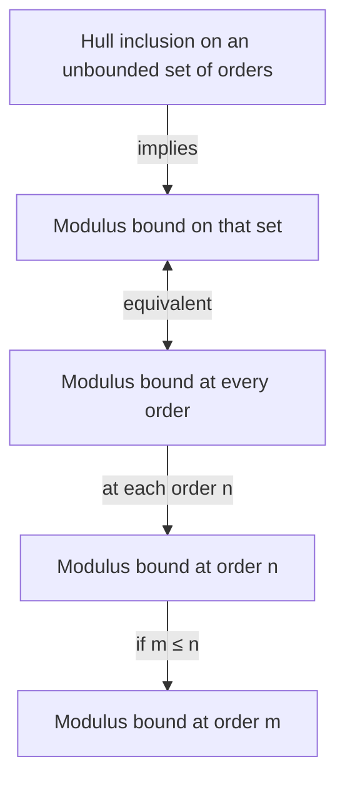
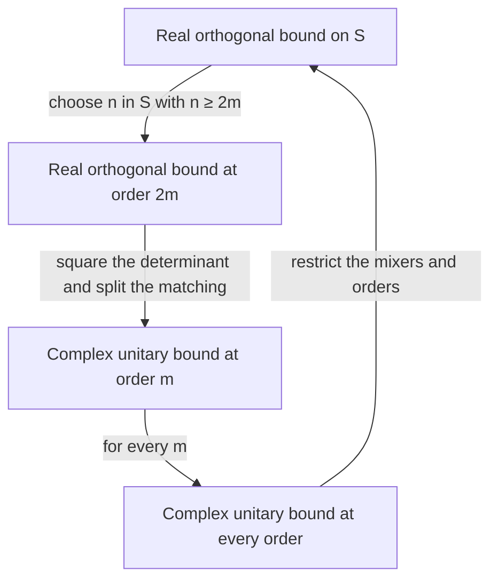

# Transfer of the determinant modulus bound between orders

Let $A$ and $B$ be complex normal matrices of order $n$. List their
eigenvalues as $a_1,\ldots,a_n$ and $b_1,\ldots,b_n$, with multiplicity.
For a permutation $p$ of the $n$ labels, put
$P_p=\prod_j(a_{p(j)}+b_j)$. Write $D=\det(A+B)$.
The modulus bound $R(n)$ states that $|D|\leq\max_p|P_p|$ for every such
pair of matrices. The Marcus–de Oliveira conjecture $M(n)$ places $D$
in the real convex hull of the $P_p$. This hull lies in the closed disk
with center zero and radius $\max_p|P_p|$.
[Modulus bound](../Lean/MOC/ModulusOrderTransfer.lean#L17) ·
[Convex-hull implication](../Lean/MOC/ModulusOrderTransfer.lean#L29)

## Transfer by one order

For all integers $0\leq m\leq n$, $R(n)$ implies $R(m)$. Thus a strict
violation of the modulus bound at order $m$ forces a violation at
**every** larger order, including $m+1$.
[One-order step](../Lean/MOC/ModulusOrderTransfer.lean#L134) ·
[All larger orders](../Lean/MOC/ModulusOrderTransfer.lean#L140)

Choose a matching of maximum modulus $M$. Suppose $M>0$. Duplicate
one matched pair by appending its two eigenvalues as scalar blocks.
Write $s$ for their sum. The determinant becomes $sD$, and the new
maximum modulus is exactly $|s|M$. The extended original matching
attains this value.
[Scalar blocks](../Lean/MOC/ModulusOrderTransfer.lean#L47) ·
[Upper bound for every enlarged matching](../Lean/MOC/DuplicatedAssignment.lean#L114)

To prove the upper bound, take an arbitrary enlarged matching. Merge
the two copies of each duplicated label. Add the edges of the original
maximizing matching except for the chosen pair. Each vertex now has
degree two, counting multiplicities. Hall's theorem splits these edges
into two matchings of the original labels. Their product has modulus at
most $M^2$. The added edges contribute $M/|s|$. Division gives the
claimed bound. If $M=0$, all matching products vanish. The signed
determinant identity then gives $D=0$.
[Two matchings](../Lean/MOC/DuplicatedAssignment.lean#L45) ·
[Hall's theorem in the pinned mathlib](https://github.com/leanprover-community/mathlib4/blob/c44e0c8ee63ca166450922a373c7409c5d26b00b/Mathlib/Combinatorics/Hall/Finite.lean#L249) ·
[Zero maximum](../Lean/MOC/ModulusOrderTransfer.lean#L99) ·
[Signed determinant identity](../Lean/MOC/Weights.lean#L41)

## Unbounded sets of orders

Let $S$ be a set of nonnegative integers. Suppose that for every $m$
there is an $n\in S$ with $n\geq m$. Then $R(n)$ for all $n\in S$ is
equivalent to the modulus bound at every order. In particular, a proof
of $M(n)$ in all even orders, or in all odd orders, would prove the
modulus bound at every order. The full convex-hull conclusion at the
other orders remains open.
[Equivalence](../Lean/MOC/ModulusOrderTransfer.lean#L147) ·
[Implication from convex-hull inclusion](../Lean/MOC/ModulusOrderTransfer.lean#L157)

## Real orthogonal mixers

Choose a unitary change of eigenbasis $U$. Write the sum as
$\mathrm{diag}(a)+U\mathrm{diag}(b)U^*$, where $U^*$ is the conjugate
transpose. Let $R_{\mathbb R}(n)$ be the modulus bound at order $n$ when
all entries of $U$ are real. Such a unitary matrix is orthogonal.
Both lists $a$ and $b$ can have arbitrary complex entries.
For every unbounded set $S$ of orders, $R_{\mathbb R}(n)$ for all
$n\in S$ is equivalent to $R(m)$ at every order $m$.
[Real orthogonal bound](../Lean/MOC/RealOrthogonalModulus.lean#L17) ·
[Equivalence](../Lean/MOC/RealOrthogonalModulus.lean#L94)

The one-order step relabels the rows and columns and adds a scalar
block to the mixer. Each operation preserves real entries. Thus
$R_{\mathbb R}(n)$ gives $R_{\mathbb R}(2m)$ whenever $2m\leq n$.
[Padding lemma](../Lean/MOC/ModulusOrderTransfer.lean#L99) ·
[Real orthogonal order transfer](../Lean/MOC/RealOrthogonalModulus.lean#L56)

For a unitary mixer $U$ of order $m$, duplicate both eigenvalue lists
and use the real orthogonal mixer

$$
\begin{pmatrix}
\mathrm{Re}(U)&-\mathrm{Im}(U)\\
\mathrm{Im}(U)&\mathrm{Re}(U)
\end{pmatrix}.
$$

Here the real and imaginary parts act entry by entry. Over the complex
numbers, the change of coordinates from $(x,y)$ to $(x+iy,x-iy)$ gives
two blocks with mixers $U$ and its entrywise conjugate. Each repeated
spectral diagonal matrix commutes with this change of coordinates.
The determinant for the conjugate mixer equals $D$, because
transposition preserves the determinant and the diagonal matrices.
The enlarged determinant is therefore $D^2$.
[Real orthogonal mixer](../Lean/MOC/RealOrthogonalDoubling.lean#L88) ·
[Determinant identity](../Lean/MOC/RealOrthogonalDoubling.lean#L115)

Every matching product for the duplicated lists factors as $P_pP_q$
for two original permutations $p$ and $q$. Hall's theorem supplies the
two matchings after the two copies of every label have been merged.
Apply $R_{\mathbb R}(2m)$ and choose the larger of $|P_p|$ and $|P_q|$.
Its square bounds $|D|^2$, so its modulus bounds $|D|$.
[Factorization](../Lean/MOC/DoubledMatching.lean#L27) ·
[From order $2m$ to order $m$](../Lean/MOC/RealOrthogonalModulus.lean#L72)

## Failure of duplicate anchors in order four

Let $i^2=-1$. Take the two eigenvalue lists

$$
a=(2+i,2i,-2+2i,2-2i),\qquad b=(1,1-2i,-1-i,-2).
$$

Among the 24 matching products, the largest real part is five. The
reverse permutation attains it. Choose any entry $c$ from $a$ and any
entry $d$ from $b$. Append these entries to the corresponding lists.
For each of the 16 choices, $c+d\ne 0$ and some enlarged matching
product $Q$ satisfies $\mathrm{Re}(Q/(c+d))>5$.
[Lists](../Lean/MOC/DuplicateAnchorObstruction.lean#L29) ·
[Upper bound](../Lean/MOC/DuplicateAnchorObstruction.lean#L97) ·
[Attainment](../Lean/MOC/DuplicateAnchorObstruction.lean#L104) ·
[Enlarged matchings](../Lean/MOC/DuplicateAnchorObstruction.lean#L112)

The enlarged determinant is $(c+d)D$. Division recovers $D$, but the
enlarged matching hull extends past the original supporting line.
This refutes the duplicate-anchor criterion for transferring the
convex-hull bound from order five to order four. The order-four
conjecture remains open.

The same two lists exclude every pair of complex scalars $c,d$ with
$c+d\ne0$. The proof uses 29 enlarged matchings and a polynomial
identity for their real parts.
[Arbitrary scalar padding](../Lean/MOC/ScalarAnchorObstruction.lean#L851) ·
[Order-four proof map](order-four-scalar-padding-proof-map.md)
