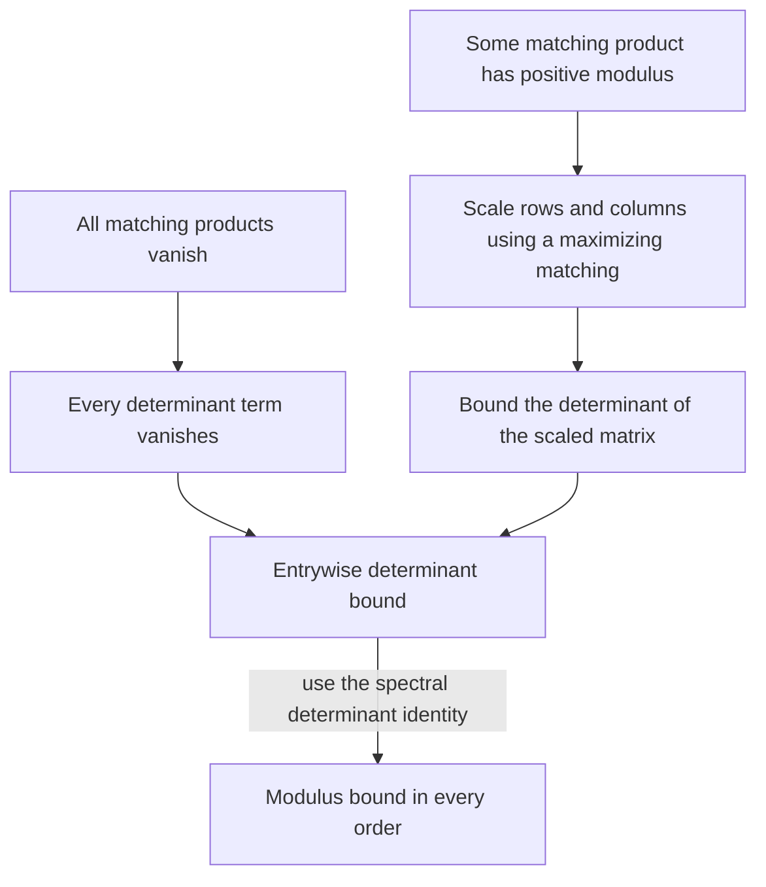
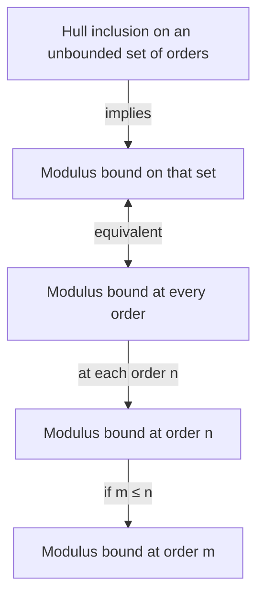
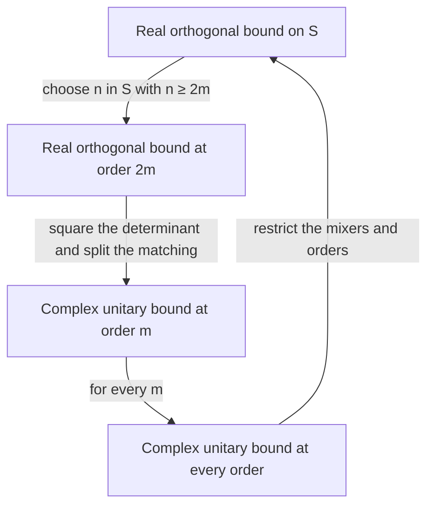

# Determinant modulus bound in all orders

Let $A$ and $B$ be complex normal matrices of order $n$. List their
eigenvalues as $a_1,\ldots,a_n$ and $b_1,\ldots,b_n$, with multiplicity.
For a permutation $p$ of the $n$ labels, put
$P_p=\prod_j(a_{p(j)}+b_j)$. Write $D=\det(A+B)$.
The modulus bound $R(n)$ states that $|D|\leq\max_p|P_p|$ for every such
pair of matrices. The Marcus–de Oliveira conjecture $M(n)$ places $D$
in the real convex hull of the $P_p$. This hull lies in the closed disk
with center zero and radius $\max_p|P_p|$.
[Modulus bound](../Lean/MOC/ModulusOrderTransfer.lean#L17) ·
[Convex-hull implication](../Lean/MOC/ModulusOrderTransfer.lean#L29)

## Direct proof in every order

Drury proved the determinant modulus bound for the entrywise product of
a complex matrix and a unitary matrix in 1994. The bound for the sum of
two normal matrices follows as a corollary.
[Drury, *Linear Algebra and its Applications* 199, pp. 329–338](https://doi.org/10.1016/0024-3795(94)90356-5)

For any nonnegative integer $n$, let $C$ be a complex matrix of order $n$
and let $U$ be a unitary matrix of the same order. Write $C\circ U$ for
the matrix with entries $C_{ij}U_{ij}$. Then

$$
| \det(C\circ U) | \leq\max_p\prod_j | C_{p(j),j} |
$$

Lean proves this bound and $R(n)$ for every finite order.
[Entrywise determinant bound](../Lean/MOC/DeterminantModulusBound.lean#L53) ·
[Modulus theorem in every order](../Lean/MOC/DeterminantModulusBound.lean#L131)

If the maximum is positive, choose positive row factors $r_i$ and
column factors $c_j$ such that $|C_{ij}|\leq r_ic_j$ for all $i,j$ and
$(\prod_i r_i)(\prod_j c_j)=\max_p\prod_j|C_{p(j),j}|$. To obtain these
factors, move a maximizing matching to the diagonal and divide each
column by its positive diagonal modulus. In this normalized matrix, the
product of the weights on any directed cycle is at most one. Otherwise
the permutation on that cycle would improve the matching. Write $w_{ij}$
for the normalized weight from $i$ to $j$. For each $i$, let $s_i$ be the
maximum product along paths that start at $i$ and have no repeated
indices. Include the path of length zero, with product one. Prepend the
edge from $i$ to $j$ to a maximizing path from $j$. Deleting a cycle
cannot decrease the product, so $w_{ij}s_j\leq s_i$. In the relabeled
matrix use $s_i$ as the row factors. Use the diagonal moduli divided by
$s_j$ as the column factors.
[Matching potentials](../Lean/MOC/MatchingPotential.lean#L67) ·
[Row and column factors](../Lean/MOC/MatchingPotential.lean#L114)

Let $V$ be the matrix obtained by dividing the $(i,j)$ entry of
$C\circ U$ by $r_ic_j$. Each entry of $V$ has modulus at most $|U_{ij}|$.
Each row then has Euclidean norm at most one because $U$ is unitary.
For $n>0$, the trace of $VV^*$ is at most $n$, where $V^*$ is the
conjugate transpose. Apply the arithmetic–geometric mean inequality to
the nonnegative eigenvalues of $VV^*$ to get
$\det(VV^*)=|\det V|^2\leq1$. In order zero, the empty determinant is
one. Undo the scaling to get the entrywise bound. If the maximum is
zero, every term of the determinant is zero by the permutation formula.
[Determinant bound after scaling](../Lean/MOC/UnitaryPhaseCuts.lean#L53) ·
[Entrywise determinant bound](../Lean/MOC/DeterminantModulusBound.lean#L53)

Choose a unitary change of eigenbasis $U$ for $A$ and $B$. Write the sum
in the eigenbasis of $A$ as $\mathrm{diag}(a)+U\mathrm{diag}(b)U^*$,
where $\mathrm{diag}$ forms a diagonal matrix and $U^*$ is the conjugate
transpose. With $C_{ij}=a_i+b_j$, multiplication of this sum on the
right by $U$ gives $C\circ U$. Since $|\det U|=1$, the entrywise bound
gives $R(n)$. The [unrestricted convex-hull conjecture](../README.md#proof-tree)
remains open in this library.
[Spectral determinant identity](../Lean/MOC/Weights.lean#L29) ·
[Bound for any enumeration of the eigenvalues](../Lean/MOC/DeterminantModulusBound.lean#L141)

## Transfer by one order

For all integers $0\leq m\leq n$, $R(n)$ implies $R(m)$. Thus a strict
violation of the modulus bound at order $m$ forces a violation at
**every** larger order, including $m+1$.
[One-order step](../Lean/MOC/ModulusOrderTransfer.lean#L134) ·
[All larger orders](../Lean/MOC/ModulusOrderTransfer.lean#L140)

Choose a matching of maximum modulus $M$. Suppose $M>0$. Duplicate
one matched pair by appending its two eigenvalues as scalar blocks.
Write $s$ for their sum. The determinant becomes $sD$, and the new
maximum modulus is exactly $|s|M$. The extended original matching
attains this value.
[Scalar blocks](../Lean/MOC/ModulusOrderTransfer.lean#L47) ·
[Upper bound for every enlarged matching](../Lean/MOC/DuplicatedAssignment.lean#L114)

To prove the upper bound, take an arbitrary enlarged matching. Merge
the two copies of each duplicated label. Add the edges of the original
maximizing matching except for the chosen pair. Each vertex now has
degree two, counting multiplicities. Hall's theorem splits these edges
into two matchings of the original labels. Their product has modulus at
most $M^2$. The added edges contribute $M/|s|$. Division gives the
claimed bound. If $M=0$, all matching products vanish. The signed
determinant identity then gives $D=0$.
[Two matchings](../Lean/MOC/DuplicatedAssignment.lean#L45) ·
[Hall's theorem in the pinned mathlib](https://github.com/leanprover-community/mathlib4/blob/c44e0c8ee63ca166450922a373c7409c5d26b00b/Mathlib/Combinatorics/Hall/Finite.lean#L249) ·
[Zero maximum](../Lean/MOC/ModulusOrderTransfer.lean#L99) ·
[Signed determinant identity](../Lean/MOC/Weights.lean#L41)

## Unbounded sets of orders

Let $S$ be a set of nonnegative integers. Suppose that for every $m$
there is an $n\in S$ with $n\geq m$. Then $R(n)$ for all $n\in S$ is
equivalent to the modulus bound at every order. The transfer also gives
an implication from $M(n)$ on any such set of orders to $R(m)$ at every
order $m$.
[Equivalence](../Lean/MOC/ModulusOrderTransfer.lean#L147) ·
[Implication from convex-hull inclusion](../Lean/MOC/ModulusOrderTransfer.lean#L157)

## Real orthogonal mixers

Let $R_{\mathbb R}(n)$ be the modulus bound at order $n$ when
all entries of $U$ are real. Such a unitary matrix is orthogonal.
Both lists $a$ and $b$ can have arbitrary complex entries.
For every unbounded set $S$ of orders, $R_{\mathbb R}(n)$ for all
$n\in S$ is equivalent to $R(m)$ at every order $m$.
[Real orthogonal bound](../Lean/MOC/RealOrthogonalModulus.lean#L17) ·
[Equivalence](../Lean/MOC/RealOrthogonalModulus.lean#L94)

The one-order step relabels the rows and columns and adds a scalar
block to the mixer. Each operation preserves real entries. Thus
$R_{\mathbb R}(n)$ gives $R_{\mathbb R}(2m)$ whenever $2m\leq n$.
[Padding lemma](../Lean/MOC/ModulusOrderTransfer.lean#L99) ·
[Real orthogonal order transfer](../Lean/MOC/RealOrthogonalModulus.lean#L56)

For a unitary mixer $U$ of order $m$, duplicate both eigenvalue lists
and use the real orthogonal mixer

$$
\begin{pmatrix}
\mathrm{Re}(U)&-\mathrm{Im}(U)\\
\mathrm{Im}(U)&\mathrm{Re}(U)
\end{pmatrix}.
$$

Here the real and imaginary parts act entry by entry. Over the complex
numbers, the change of coordinates from $(x,y)$ to $(x+iy,x-iy)$ gives
two blocks with mixers $U$ and its entrywise conjugate. Each repeated
spectral diagonal matrix commutes with this change of coordinates.
The determinant for the conjugate mixer equals $D$, because
transposition preserves the determinant and the diagonal matrices.
The enlarged determinant is therefore $D^2$.
[Real orthogonal mixer](../Lean/MOC/RealOrthogonalDoubling.lean#L88) ·
[Determinant identity](../Lean/MOC/RealOrthogonalDoubling.lean#L115)

Every matching product for the duplicated lists factors as $P_pP_q$
for two original permutations $p$ and $q$. Hall's theorem supplies the
two matchings after the two copies of every label have been merged.
Apply $R_{\mathbb R}(2m)$ and choose the larger of $|P_p|$ and $|P_q|$.
Its square bounds $|D|^2$, so its modulus bounds $|D|$.
[Factorization](../Lean/MOC/DoubledMatching.lean#L27) ·
[From order $2m$ to order $m$](../Lean/MOC/RealOrthogonalModulus.lean#L72)

## Lean check status

| Lean scope | Lean Checked? |
| --- | --- |
| The 9 source modules linked in this map | Partial (6/9) |

[Status definitions](README.md#lean-check-status). Paper arguments retain their stated scope.
