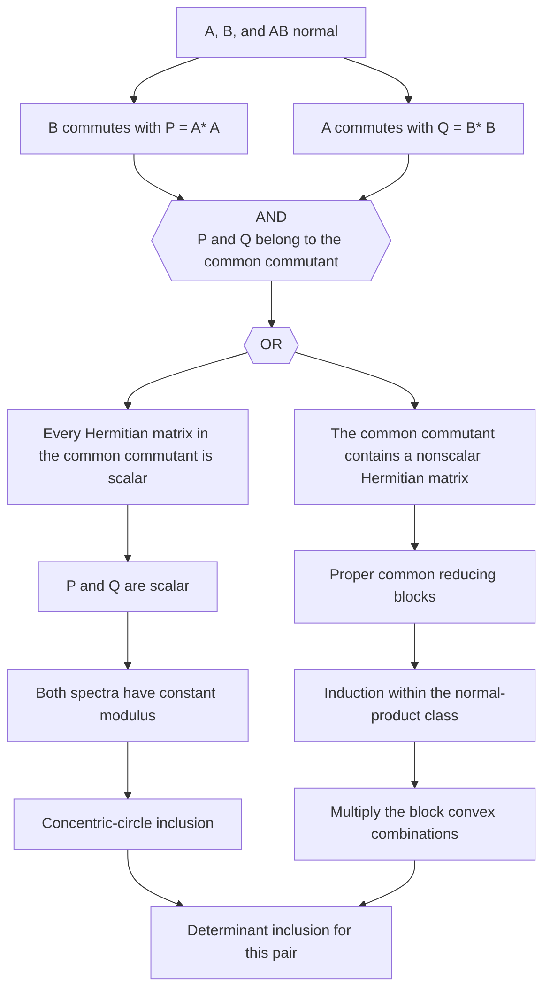
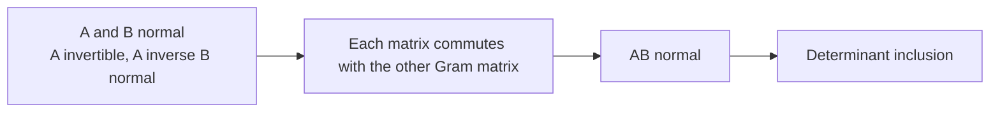

# Normal products

[Proof map index](README.md) · [All orders](all-orders-proof-map.md) · [Conjecture](../README.md#proof-tree)

Let $A$ and $B$ be complex normal matrices of the same finite order $n$.
Write $M^*$ for the conjugate transpose of a matrix $M$. Normality means
$M^*M=MM^*$. Let $a_1,\ldots,a_n$ and $b_1,\ldots,b_n$ enumerate the
eigenvalues of $A$ and $B$, with algebraic multiplicity. Let $S_n$ be the
permutation group on these labels.

Let $\mathrm{conv}_{\mathbb R}$ denote the real convex hull. If $AB$ is
normal, then

$$
\det(A+B)\in\mathrm{conv}_{\mathbb R}
\left\{\prod_{j=1}^n(a_{\sigma(j)}+b_j):\sigma\in S_n\right\}.
$$

The theorem allows all finite orders, singular matrices, and repeated
eigenvalues.
[Matrix theorem](../Lean/MOC/NormalProductInclusion.lean#L282) ·
[Spectral theorem](../Lean/MOC/NormalProductInclusion.lean#L222)

## Proof route

Set $P=A^*A$ and $Q=B^*B$. Both Gram matrices belong to the common
commutant, the set of matrices that commute with $A$ and $B$. A Hermitian
matrix equals its conjugate transpose. A common reducing subspace is
preserved by $A$, $B$, and both conjugate transposes.

The induction hypothesis covers only smaller pairs with a normal
product. The restriction of $AB$ to a common reducing block is the
product of the restricted matrices. That restriction remains normal.
[Complete induction](../Lean/MOC/NormalProductInclusion.lean#L200)

### Gram commutation

Choose a unitary eigenbasis of $A$. In this basis,
$A=\mathrm{diag}(a_1,\ldots,a_n)$. Write $B_{ij}$ for the entries of $B$
and put $q_i=|a_i|^2$. The row and column energy identities for $B$ and
$AB$ give

$$
\sum_{i,j}|B_{ji}|^2(q_i-q_j)^2=0.
$$

Each term is nonnegative. Therefore $B_{ij}=0$ whenever $q_i\ne q_j$.
This proves $PB=BP$.
[Energy identity](../Lean/MOC/RelativeUnitaryGram.lean#L72) ·
[Commutation](../Lean/MOC/RelativeUnitaryGram.lean#L108)

Normality of $AB$ and commutation of $P$ with $B$ give
$AQA^*=PQ$. Its $(i,j)$ entry is

$$
a_i Q_{ij}\overline{a_j}=|a_i|^2 Q_{ij}.
$$

If $a_i\ne0$ and $Q_{ij}\ne0$, cancellation gives $a_i=a_j$.
If $a_i=0$ and $a_j\ne0$, apply the reversed entry identity.
The equality $Q_{ji}=\overline{Q_{ij}}$ gives the same conclusion.
Thus $(a_i-a_j)Q_{ij}=0$ for all labels. This proves $AQ=QA$.
This argument includes zero eigenvalues.
[Entrywise proof](../Lean/MOC/RelativeUnitaryGram.lean#L115)

### Reduction and assembly

If every Hermitian matrix in the common commutant is scalar, then
$P=r^2I$ and $Q=s^2I$ for nonnegative real numbers $r,s$. Every eigenvalue
of $A$ has modulus $r$. Every eigenvalue of $B$ has modulus $s$.
The concentric-circle theorem gives the inclusion.
[Scalar commutant](../Lean/MOC/NormalRelativeInclusion.lean#L45) ·
[Concentric circles](../Lean/MOC/ConcentricPerturbation.lean#L131)

Otherwise, diagonalize a nonscalar Hermitian matrix in the common
commutant. Its eigenspaces give proper common reducing blocks. Apply the
theorem in the smaller orders. If the block weights are $u_\sigma$ and
$v_\tau$, use the products $u_\sigma v_\tau$. These weights are
nonnegative and sum to one. Each block matching extends to a matching
of the full spectra.
[Block assembly](../Lean/MOC/Blocks.lean#L32)

## Independent scalar shifts

Let $c,d$ be arbitrary complex numbers and let $I$ be the identity matrix.
If $(A-cI)(B-dI)$ is normal, the same determinant inclusion holds for
$\det(A+B)$ with the original eigenvalue lists $a$ and $b$. The two
shifts can differ. The theorem allows singular shifted matrices.
[Matrix theorem](../Lean/MOC/NormalProductInclusion.lean#L251) ·
[Spectral theorem](../Lean/MOC/NormalProductInclusion.lean#L213)

Put $C=A-cI$ and $D=B-dI$. Their Gram matrices $C^*C$ and $D^*D$
commute with $C$, $D$, and each other. The simultaneous Gram eigenspaces
give common reducing blocks, and the shifts preserve those blocks. On
each block the eigenvalues of $A$ have constant distance from $c$ and
those of $-B$ have constant distance from $-d$. Apply the two-circle
theorem and combine the block laws.
[Scalar moduli](../Lean/MOC/NormalRelativeInclusion.lean#L45) ·
[Two-circle theorem](../Lean/MOC/TwoSpectralCircles.lean#L100) ·
[Induction with offsets](../Lean/MOC/NormalProductInclusion.lean#L200)

## Normal relative products

Suppose $A$ is invertible and $A^{-1}B$ is normal. The existing relative
Gram theorem gives $BP=PB$ and $AQ=QA$. These two equalities make $AB$
normal. The normal-product theorem gives the determinant inclusion.
[Spectral relative-product theorem](../Lean/MOC/NormalProductInclusion.lean#L229) ·
[Matrix relative-product theorem](../Lean/MOC/NormalProductInclusion.lean#L292)

[Relative Gram identities](../Lean/MOC/RelativeUnitaryGram.lean#L220) ·
[Normal-product criterion](../Lean/MOC/RelativeUnitaryGram.lean#L170)

## Interpretation and source

The Gram matrix records the squared change in length. The energy identity
prevents the other matrix from mixing unequal length levels. On each
irreducible common block, both length changes are constant. The phase
data can still vary. The circle theorem controls that remaining freedom.

In algebraic terms, the two positive Gram matrices are central in the
unital algebra generated by the summands and their adjoints. Common
Hermitian eigenspaces supply the decomposition used by the proof.
The Lean proof uses finite-dimensional matrix arguments directly.

The block structure for normal products is classical. See Theorem 1.1
and Section 3 of Aurelian Gheondea,
[When are the products of normal operators normal?](https://ssmr.ro/bulletin/pdf/52-2/Gheondeamod.pdf)
(2009). The paper attributes the finite-dimensional structure theorem
to Gantmaher and Krein (1930). Publication novelty of the determinant
corollary has not been established.
