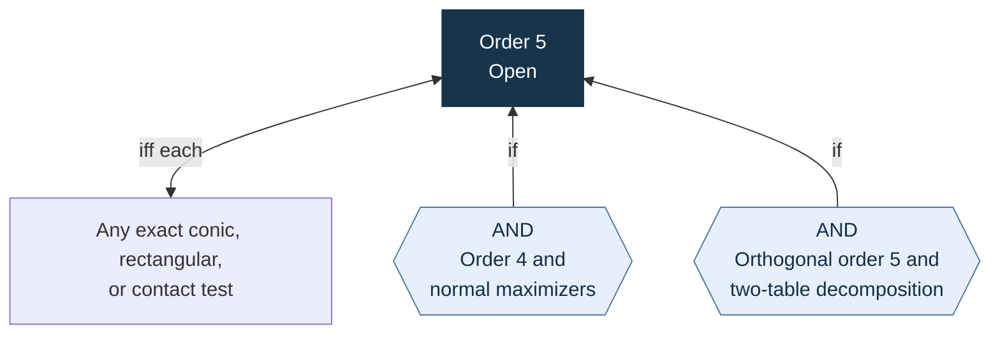
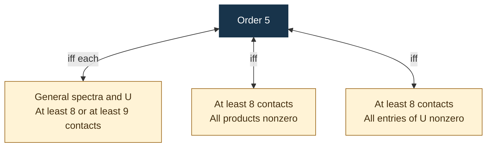
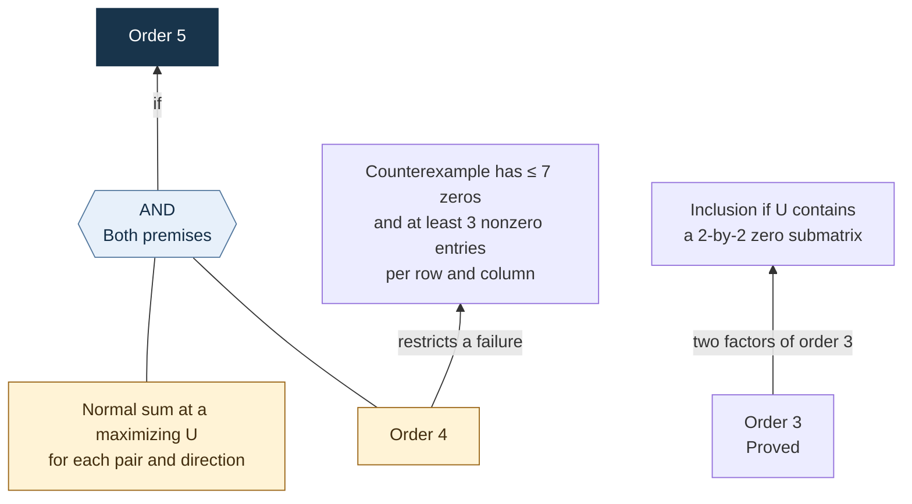
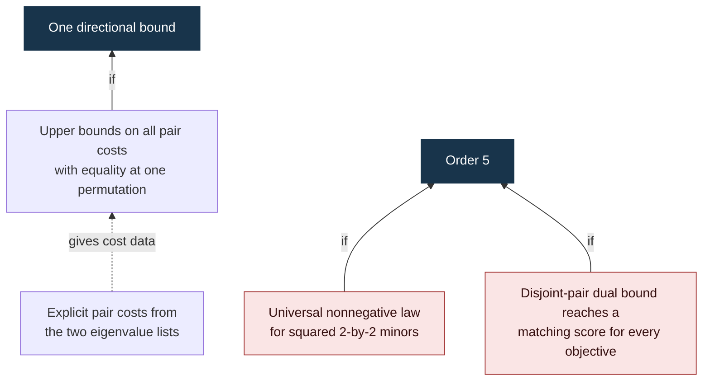
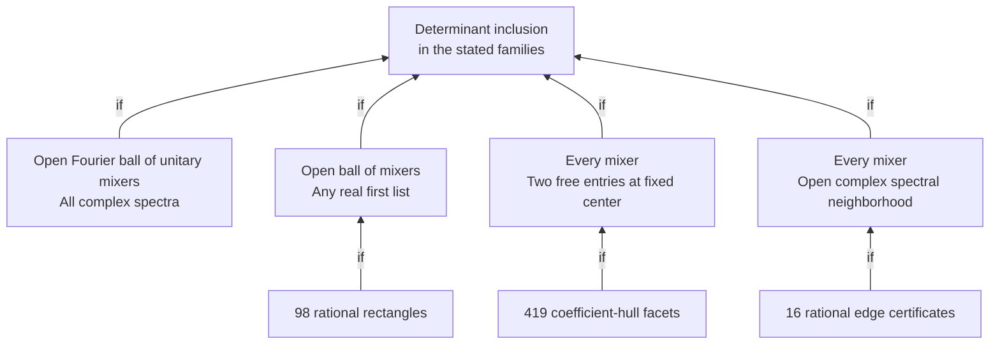

# Order-five proof maps

[Proof map index](README.md) · [README overview](../README.md#order-five) · [All-order routes](all-orders-proof-map.md) · [Contact transfer](contact-transfer-proof-map.md) · [Order four](order-four-proof-map.md) · [Spectral and support results](spectral-support-proof-map.md#spectra-mixers-and-attainable-values)

- [Registered routes](#registered-routes)
- [Contact thresholds](#contact-thresholds)
- [Sparse matrices and normal maximizers](#sparse-matrices-and-normal-maximizers)
- [Squared minors and permutation weights](#squared-minors-and-permutation-weights)
- [Exact spectral and mixer cases](#exact-spectral-and-mixer-cases)

The order-five conjecture is the [determinant inclusion](../README.md)
for all five-by-five normal pairs. In the spectral formulation, $U$
is the unitary change between eigenbases. The complete order-five
statement remains open in this library. Disjoint-pair transport
gives a sharp bound for a specified integer example. Its universal
certificate test has a counterexample.
[Certificates](determinant-inclusion-certificates-proof-map.md#order-four-and-order-five-support-bounds)
[Source scope](all-orders-proof-map.md#scope-of-the-lean-source)

## Registered routes

The table covers the tests specific to order five. The registry also
includes the [tests at each order](all-orders-proof-map.md#tests-at-each-order).
Each conjunction requires its two premises. The all-order contact
transfer makes the full-support eight-contact test exact.
[Route register](../Lean/MOC/ProofRoutes.lean#L289) · [Disjunction](../Lean/MOC/ProofRoutes.lean#L311)

| Route in Lean | Relation | Lean proof |
| --- | --- | --- |
| Principal coisometry of dimension four | Iff | [Statement and proof](../Lean/MOC/PrincipalCoisometry.lean#L140) |
| Rectangular compression with four rows | Iff | [Statement and proof](../Lean/MOC/PrincipalCoisometry.lean#L218) |
| Order four AND existence of normal order-five maximizers | If | [Statement and proof](../Lean/MOC/ProofRoutes.lean#L134) |
| Eight-contact support bound with no zero mixer entries | Iff | [Statement and transfer](../Lean/MOC/ProofRoutes.lean#L295) |
| Distinct first spectrum on the standard parabola | Iff | [Fixed-curve test](../Lean/MOC/ConicSpectralReductions.lean#L1348) |
| Distinct first spectrum on the fixed hyperbola | Iff | [Fixed-curve test](../Lean/MOC/ConicSpectralReductions.lean#L1369) |
| Orthogonal minor convexification AND orthogonal order five | If | [Statement and proof](../Lean/MOC/Realification.lean#L79) |

For the regular spectral test, each pair sum is nonzero, different
permutations give different products, and $U$ has no zero entries. The
rectangular test has four orthonormal rows and five columns. The
three-coordinate spectral test fixes two entries of the first list
and one of the second list in normalized coordinates.
[Regularity](../Lean/MOC/FullSupportReduction.lean#L118) · [Rectangular test](../Lean/MOC/PrincipalCoisometry.lean#L140) · [Normalized test](../Lean/MOC/Reformulations/ThreeAnchorKernel.lean#L11)

## Contact thresholds

Each threshold counts permutations that attain the largest matching
projection in one direction. The general test uses $2n-2=8$ with a
fixed determinant difference or $2n-1=9$ with a varying difference.
The nonzero-product test also uses eight contacts. To get the eight-contact
test for $U$ with no zero entries, use density to restrict $U$ before
contact transfer. The transfer increases the count below eight with
the same $U$. Each test still needs its directional bound.
[Contact definitions](contact-transfer-proof-map.md) · [General eight-contact test](../Lean/MOC/GlobalContactSlice.lean#L243) · [Nine contacts](../Lean/MOC/AffineGapCover.lean#L85) · [Eight nonzero-product contacts](../Lean/MOC/SaturatedContactReduction.lean#L70) · [Eight contacts with nonzero entries](../Lean/MOC/OrderFiveContact.lean#L97) · [Transfer](../Lean/MOC/VaryingGapTerminal.lean#L110) · [Continuation](../Lean/MOC/AffineGapCover.lean#L80)

## Sparse matrices and normal maximizers

Under order four, a proper block split, or a row or column with at
most two nonzero entries, gives a lower-order proof. The normal-maximizer
criterion also becomes an equivalence under the order-four premise.
[Counterexample structure](../Lean/MOC/OrderFiveContact.lean#L34) · [Zero count](../Lean/MOC/OrderFiveSparseGeometry.lean#L189) · [Normal maxima](../Lean/MOC/NormalSupportMaximum.lean#L270)

Suppose that two distinct rows of $U$ both vanish in two distinct
columns. Then the inclusion holds for arbitrary complex spectra,
without the order-four premise. Reindex the rows and columns and
factor $U$ into two order-three unitary matrices extended by the
identity. Their coordinate blocks have exactly one shared coordinate.
The proved order-three result applies to each factor.
[Factorization](../Lean/MOC/SinglePortZeroCorner.lean#L21) · [Order-five theorem](../Lean/MOC/SinglePortZeroCorner.lean#L143)

## Squared minors and permutation weights

Lean represents both the matching score and the determinant projection
with the same cost on pairs of indices. A row-and-column bound on that
cost gives an upper bound on the determinant projection. Equality on
the assignment induced by one actual permutation gives the desired
directional inequality.
[Matching score](../Lean/MOC/OrderFivePairCost.lean#L217) · [Determinant projection](../Lean/MOC/OrderFivePairCost.lean#L247) · [Tight cost bound](../Lean/MOC/OrderFivePairCost.lean#L284)

One set of weights for all spectra of a fixed $U$ would reproduce the
squared absolute values of the two-by-two minors. The reflection
$U=I-2vv^*$, where every entry of the unit vector $v$ is $1/\sqrt{5}$,
refutes that premise. The determinant inclusion for this reflection
holds for every pair of lists. A separate pair-assignment example
shows that the best assignment on pairs can exceed every assignment
induced by a permutation of the individual indices.
[Pair-minor equivalence](../Lean/MOC/OrderFivePairMarkers.lean#L225) · [Refuted law](../Lean/MOC/ProofRoutes.lean#L156) · [Inclusion for the reflection](../Lean/MOC/OrderFiveCommonLawObstruction.lean#L38) · [Pair-assignment example](../Lean/MOC/PairAssignmentObstruction.lean#L116)

The disjoint-pair constraints give a stronger bound. They require a
transport between the two columns of the pair table for every two
disjoint column pairs. Each transport has support on disjoint row
pairs. For the lists $(2,2,1,1,1)$ and $(0,0,-1,-1,-1)$ in the real
direction, every matching product is zero. A doubly stochastic pair
table satisfies all these transport constraints and has score $4/45$.
Every bound from the corresponding dual constraints is therefore at
least $4/45$ for these spectra.
[Transport bound](../Lean/MOC/OrderFiveDisjointPairSupport.lean#L145) · [Conditional implication](../Lean/MOC/OrderFiveDisjointPairSupport.lean#L343) · [Refuted certificate test](../Lean/MOC/OrderFiveDisjointPairObstruction.lean#L122)

Lean also gives inclusion for unitary matrices with zero diagonal and
off-diagonal magnitudes $1/2$, and for pairs with one real list and at
least one real entry in the other.
[Zero diagonal](../Lean/MOC/ConferenceFive.lean#L260) · [Real entry](../Lean/MOC/HermitianByNormalFourProof.lean#L100)

## Exact spectral and mixer cases

| Family | Exact conclusion |
| --- | --- |
| Open Fourier ball | There is an operator-norm ball about the normalized order-five Fourier matrix. Each unitary in the ball has one probability law that represents all squared minor moduli. The law gives the determinant for every pair of complex spectra. [Minor law](../Lean/MOC/FiveFourierNeighborhood.lean#L28) · [Inclusion](../Lean/MOC/FiveFourierNeighborhood.lean#L68) |
| Open mixer ball | An explicit real orthogonal matrix $V$ has an operator-norm ball of radius $1/167772160$. For each unitary in the ball and each real first list, one probability law works for all complex second lists. The law may depend on every entry of the real list. Five exact separating tests show that this dependence is necessary for the stated replacements. |
| Two free complex entries | In every order $n\ge5$, use $h=(-1,1,2,0,\ldots,0)$ and $b=(i,\ldots,i,-1+i,v,w)$ with $n-3$ copies of $i$. For every unitary, one law works for all $(v,w)\in\mathbb C^2$. The order-five proof checks the hull of the four complex coefficients. |
| Spectral neighborhood beyond ordinary minors | Each complex spectral entry can move by at most $5\cdot10^{-16}$ from the center specified below. For every unitary the determinant lies inside the hull. Exactly three of its sixteen edge costs lie outside the cone of singleton and two-element subset indicators. |

To transfer the Fourier law to a nearby unitary, add the change of
each real signed permutation weight to the corresponding Fourier
probability. The correction has total mass zero. Its sum over the
permutations that map a given column set to a given row set equals
the change in the squared modulus of that minor. The weights are
continuous at the Fourier matrix. A sufficiently small ball keeps
all 120 weights at least half the positive lower bound at the center.
[Positive Fourier law](../Lean/MOC/FourierProfiles.lean#L308) · [Weight correction](../Lean/MOC/FiveFourierNeighborhood.lean#L28)

The fixed-anchor extension of order-four realification fails in order
five. An actual unitary with a fixed full-support first row has
singleton and anchor-pair minor data that no mixture of real
orthogonal tables with the same first-row magnitudes can reproduce.
The graph independence theorem proves the finite algebraic step.
The paper argument realizes its limiting effects in a family of
unitary matrices.
[Graph independence](../Lean/MOC/GraphEffectIndependence.lean) ·
[Paper proof](https://github.com/ascendnoosphere/MOC/blob/e9a3f721a577ce14d5c899e0997066e7470d1640/Lean/FixedAnchorOrderFiveObstruction.md)

### Exact verification

The arithmetic checks covered 98 rational rectangles for the mixer
ball, all 419 facets for the two free entries, and all 16 edges
throughout the spectral neighborhood. The local text bundle under
`Temp/txt/` contains the replay inputs and checkers.

Open mixer ball and its strict separation examples

#### 1. An open set of relative eigenbases, with both spectral lists unrestricted

Set
\[
 K=\begin{pmatrix}
 0&37&38&34&3\\
 -37&0&26&-27&-18\\
 -38&-26&0&21&2\\
 -34&27&-21&0&4\\
 -3&18&-2&-4&0
 \end{pmatrix},\qquad V=(60I-K)^{-1}(60I+K).
\]
Skew symmetry makes \(V\) orthogonal. All 25 entries are nonzero.

**Theorem 1.** For every unitary \(U\) satisfying \(\|U-V\|_{\mathrm{op}}<1/167772160\) and every \(h\in\mathbb R^5\), there is a probability law on \(S_5\) such that
\[
 d_U(h,b)=\mathbb E\prod_{i=1}^5 (b_i+h_{\pi(i)})\qquad(b\in\mathbb C^5).
\]
Throughout this ball, fix \(h=(1,2,3,4,5)\). For each index \(j\), a law that is required to hold for every \(b\) cannot cover both replacements \(h_j=0\) and \(h_j=1\) with the other four entries fixed. Thus allowing one selected eigenvalue to vary with a common law is a strictly stronger requirement even on a set where all real spectra satisfy the theorem.

#### Reducing the real spectrum to two variables

Write \(Q_{S,J}(U)=|\det U[S,J]|^2\). The coefficient of \(\prod_{i\notin S} b_i\) in the determinant is \(\sum_{|J|=|S|} h_J Q_{S,J}(U)\), where \(h_J=\prod_{j\in J}h_j\). The same coefficient under a permutation replaces \(Q_{S,J}\) by \(P_{S,J}(\pi)=1_{\pi(S)=J}\). This follows by expanding in principal minors and applying Cauchy–Binet.

One can use projective eigenvalues \([a_j:c_j]\) in this coefficient rule. Replace \(h_J\) by \(\prod_{j\in J}a_j\prod_{j\notin J}c_j\). The formula follows from \(h_j=a_j/c_j\) after clearing denominators, including \(c_j=0\) by polynomiality. A common real fractional linear change of the Hermitian eigenvalues preserves the existence of a law valid for every partner. To verify covariance, use homogeneous coordinates \([u_i:v_i]\) for the partner, so each matching factor is \(v_i a_j+u_i c_j\). Apply an invertible two-by-two matrix to every column \((a_j,c_j)^t\) and its inverse on the right to every row \((v_i,u_i)\). All pairings are preserved, and the transformed partner still ranges over the whole projective line. This also preserves the determinant: in homogeneous coordinates it is \(\det[(v_i a_j+u_i c_j)U_{ij}]/\det U\), first by multiplication on the right by \(U\), then by continuity. Rescaling any homogeneous representative multiplies every expression by the same factor.

For distinct real eigenvalues, fix a cyclic order of their five labels on the real projective line. After a real fractional linear transformation, their labeled values in that order are
\[
 \infty,\quad 1,\quad s,\quad st,\quad 0,\qquad 0<s,t<1.
\]
The first and last values are neighbors in the cyclic order. Write \(a\) for the infinity label, \(e\) for the zero label, and \(j_1,j_2,j_3\) for the three intervening labels in decreasing order. Define \(R_{S,J}=Q_{S,J}-\mathbb E P_{S,J}\). To prove the identity for all partner variables it suffices to match the singleton probabilities and, for every two-row set \(S\), to have
\[
 \sum_{k=1}^3 (1,s,st)_k R_{S,\{a,j_k\}}=0,\qquad
 \sum_{k=1}^3 (st,t,1)_k R_{S,\{e,j_k\}}=0. \tag{1}
\]
Indeed, a nonzero coefficient term must include the infinity label and omit the zero label. The two-minor coefficients give the first formula. For three-minor coefficients take complementary minors. The products of the two retained middle labels are \(s^2t,st,s\); dividing by \(s\) gives the second formula. The remaining coefficients follow from singletons and complementation or vanish identically.

#### Certifying the entire parameter space

For one labeled order it suffices to test \(\min(s,t)\le 2/3\) provided we also test the next cyclic order on the same region. In fact, rotate the labels by one place and make the fractional linear change \(x\mapsto(1-s)/(1-x)\). The new parameters are
\[
 (s',t')=\left(\frac{1-s}{1-st},\,1-st\right).
\]
If both old parameters exceed \(2/3\), then \(t'<5/9\). Up to reversal and cyclic rotation there are \(4!/2=12\) labeled cyclic orders. Testing each chosen order and its rotation therefore covers every labeled distinct spectrum. This change of coordinates avoids a degeneracy at \(s=t=1\).

The certificate uses 98 closed rational rectangles in these 24 coordinate choices. On each rectangle it gives a probability vector at each of the four corners. Interpolate the four laws by bilinear interpolation in the two local rectangle coordinates. This preserves positivity and total mass. Each side of (1) is then a polynomial of degree at most two in each variable. Equality on the three-by-three grid made of the two endpoints and midpoint of each interval proves equality on the whole rectangle by two successive univariate interpolations.

The independent verifier reconstructs \(V\), all its singleton and pair minors, and all 120 permutation columns. With exact integer arithmetic it checks all singleton constraints and both equations (1) for all ten row pairs at each grid point. It checks coverage by subdividing at the rational rectangle boundaries. Since the covering rectangles are closed, testing all the open grid cells in the required region covers their boundaries as well. There are 392 corner laws and 47,040 positive rational probabilities. Their minimum is exactly \(2^{-24}\). Every interpolated law has the same lower bound on its entries. Repeated eigenvalues follow by continuity of the original finite polynomial coefficients and compactness of the probability simplex. This proves the result at \(V\).

#### Why the same certificate persists under complex changes of eigenbasis

For any unitary \(U\), define the real signed weights
\[
 \omega_\pi(U)=\mathrm{Re}\left(\frac{\mathrm{sgn}(\pi)\prod_i U_{i,\pi(i)}}{\det U}\right).
\]
Their sum is one. They reproduce every squared minor: group the determinant terms with \(\pi(S)=J\), factor the two complementary determinants, and use unitarity and Jacobi's complementary minor identity. Consequently replacing a certified law \(\lambda(h)\) at \(V\) by
\[
 \lambda(h)+\omega(U)-\omega(V)
\]
corrects **all** the required moment differences. The mass stays one. Each entry of a unitary has modulus at most one. Telescoping both the product of its selected entries and its determinant gives
\[
 \max_\pi|\omega_\pi(U)-\omega_\pi(V)|\le 2n\|U-V\|_{\mathrm{op}} .
\]
For the determinant bound, change one column at a time and apply Hadamard's inequality. The determinants of the endpoints have modulus one. At \(n=5\) the claimed radius is \(2^{-24}/10\). This proves positivity throughout the stated neighborhood.

#### Why one more freely variable label fails at the same eigenbasis

For each proposed \(j\), take separately \(h_j=0,1\), always keeping the other entries of \((1,2,3,4,5)\). Stack the two vectors of principal-minor coefficients, including a constant row per vector. Existence of one law for both tests would place this stacked vector in the convex hull of the 120 corresponding stacked permutation vectors. The certificate uses one integer linear functional per \(j\). Its value at the true vector exceeds its largest value on the 120 vertices by the following strict rational lower bounds, expressed in the units of that functional.

| Free position | 1 | 2 | 3 | 4 | 5 |
|---|---:|---:|---:|---:|---:|
| Separation exceeds | 79 | 93 | 114 | 95 | 18 |

The accompanying exact verifier also supplies a positive law at the original \(h=(1,2,3,4,5)\). The five separations persist on the whole stated ball. Specifically, if \(U\) moves by \(\varepsilon\), then \(UD_hU^*\) moves by at most \(10\varepsilon\) for all ten tests. The principal minor on \(k\) rows changes by at most \(10k5^{k-1}\varepsilon\) by column telescoping. Weighting by the absolute values of the five separating functionals gives respective Lipschitz bounds \(23543210,25568690,12199530,24380720,262927580\). Each bound times the radius is smaller than its certified separation. The permutation vertices do not depend on \(U\).

This example tests the unrestricted real spectrum through the complete two-parameter space. Restricting the proof in advance to laws that can ignore at least one Hermitian eigenvalue would exclude this example however that position was selected.

Two independently varying complex entries

#### Theorem 1. Two complex eigenvalues can vary independently

For every integer \(n\ge5\) take
\[
 h=(-1,1,2,\underbrace{0,\ldots,0}_{n-3}),\qquad
 b=(\underbrace{i,\ldots,i}_{n-3},-1+i,v,w).
\]
For every unitary \(U\) there are nonnegative numbers \(\lambda_\pi\), of sum one, such that
\[
 \det(U\mathrm{diag}(h)U^*+\mathrm{diag}(b))
 =\sum_{\pi\in S_n}\lambda_\pi\prod_{j=1}^n(b_j+h_{\pi(j)})
 \qquad\text{for every }(v,w)\in\mathbb C^2 .
\]
Thus the same probabilities work at once for all values of both free entries. If both entries are nonreal, all eigenvalues of the normal partner are nonreal. Reordering either list simply relabels the equation.

#### Proof in dimension five

Use the order \((-1,0,0,1,2)\) for the Hermitian labels. Each determinant is affine in \(v\) and in \(w\) separately. Its four complex coefficients give an eight-dimensional real vector. For a permutation that assigns \((a,b,c,x,y)\) to the five positions, write \(s=(a+i)(b+i)(c-1+i)\). Its four coefficients, in the order \(1,v,w,vw\), are \((sxy,sy,sx,s)\). The asserted identity is equivalent to membership of the coefficient vector in the convex hull of these vectors. The 120 permutations give 33 different points. The integer enumeration verifies that their hull has 419 facets. For completeness, the facet enumeration verifies the dimension by a nonzero minor, computes intersections of the proposed supports, and checks that each ridge is shared by two facets. Induction on face dimension and connectedness of the facet adjacency graph give the full list.

A useful way to verify an identity between costs on unitaries is to start with its values on permutations. The real signed weights
\[
 \omega_\pi=\Re\left(\mathrm{sgn}(\pi)
                   \prod_i U_{i,\pi(i)}/\det U\right)
\]
have total one. Their sum over \(\pi(I)=J\) equals \(|\det U[I,J]|^2\). Expansion of the determinant on rows \(I\) gives the minor times its signed complement. The complementary-minor identity for a unitary gives the claimed square after division by \(\det U\). Thus a linear identity between permutation indicators of this type also holds between the corresponding squared minors. This identity is used only to transfer equalities. Nonnegativity requires a separate argument.

The proof of 335 facet inequalities uses two positive permutation laws on restricted collections of costs. At a coordinate set to a real number \(r\), delete that coordinate from \((H+rI)^{-1}\). The compression is Hermitian and its four eigenvalues interlace the five original inverse eigenvalues. The order-four principal-minor theorem gives a joint law in the other four entries. To lift it, assign each interlacing eigenvalue at the upper end of the ordered list one of its two bracketing endpoints with probabilities that give its mean. Delete the chosen endpoint and continue downwards. Each choice preserves interlacing, so the conditional expected product in the remaining positions equals its target. Factoring out \(\det(H+rI)\prod_{j\ne i}(b_j-r)\) returns the original products. Singular data follow by continuity. The other law matches the minor distributions on the successive initial segments of any one row ordering. The exterior vectors of adjacent row spaces are \(s\) and \(s\wedge u\). Contraction with \(u\) has norm one. The mass of any family of lower-level column sets is therefore at most the mass of its upper shadow. The finite flow theorem gives a coupling by containment. Pasting these couplings gives a random full chain, hence a permutation. For each of the 335 facets, the certificate decomposes its slack into costs that are nonnegative on every permutation and belong to one of these two classes. The spectral products, decomposition, and signs are checked exactly. The order-four argument and its independent verifier are included.

For the remaining facets, let \(Z\) be the three-by-three block in the exceptional partner rows and exceptional Hermitian columns. Every cost used here has coordinates
\[
 c+\sum A_{jk}|Z_{jk}|^2+\sum B_{jk}|\mathrm{cof}_{jk}Z|^2 .
\]
The two three-dimensional subspaces meet in dimension at least one. Consequently \(Z\) has a unit singular value and \(\det(I-Z^*Z)=0\), which expresses \(|\det Z|^2\) in these coordinates. Exact coefficient checks on all numerical assignments and the signed identity above verify the conversion for each facet.

Take the three exceptional columns of the full unitary as an orthonormal frame \(X\). An entry square or a cofactor square can be written as a quadratic form in the cubic monomials \(m_p=\prod_{j=1}^3 X_{p_jj}\). Multiply a minor square by the squared norms of the unused columns to make all terms cubic on both sides of the product. The transposed unitary gives a second such representation. Ordinary Gram matrices in the two frames, possibly combined with the preceding positive costs, prove 24 further inequalities.

For the final 60 facets the crucial additional squares have the form
\[
 \left|\sum_p a_p\prod_{j\notin S}X_{p_j j}
                    \prod_{j\in S}\overline{X_{p_j j}}\right|^2 .
\]
In a cross term indexed by \((p,q)\), interchange \(p_j\) and \(q_j\) for the columns in \(S\). This converts the term to the original cubic coordinates. It is an entrywise identity for every complex matrix. Column orthogonality is used only on the original frame, when adding multiples of its orthogonality relations. For each of 30 representative facets the certificate gives a sum of such squares in the two frames and previously established positive costs. All multipliers are nonnegative rational numbers. The empty mask and three single-column masks suffice. Swapping the free positions gives the other 30 facets. The verifier expands every square and checks every coefficient. This exhausts all 419 facets and proves the coefficient vector belongs to the hull. Any convex representation gives the desired probabilities.

#### Proof for every larger dimension

Let \(E\) be the span of the three exceptional partner coordinate vectors, and let \(L\) be the span of the three nonzero Hermitian eigenvectors. Write \(Z\) for the matrix of their overlaps in the prescribed bases. For \(n\ge7\), the subspace \(E^\perp\cap L^\perp\) has dimension at least \(n-6\). On this subspace the Hermitian matrix is zero and the partner is \(iI\). Delete a common unit vector and adjoin the pairing \((0,i)\) to any law in the smaller dimension. The vector and the pairing are independent of \(v,w\). This reduces the proof to dimension six.

In dimension six any three-by-three contraction is an admissible overlap matrix. To see this, complete each singular value \(s\) by the unitary two-by-two block having first row \((s,\sqrt{1-s^2})\), then undo the changes of singular bases. If \(\|Z\|=1\), the spaces \(E,L\) intersect. Their orthogonal complements also intersect since \(\dim E+\dim L=6\). Delete a common \((0,i)\) line and apply the order-five result.

Suppose \(\|Z\|<1\). Scale the row belonging to \(v\) by \(\sqrt{x}\) and denote the resulting matrix by \(Z(x)\). At \(x=0\), the coordinate of \(v\) lies in the zero eigenspace of the Hermitian matrix. Delete this line. The remaining normal spectrum is \((i,i,i,-1+i,w)\), to which the order-five result applies by setting one free entry to \(i\). Adjoin the deleted factor \(v\). This also proves the assertion immediately if the selected row was zero initially. In the other cases the norm of \(Z(x)\) tends to infinity with \(x\), so there is a first \(x_*>1\) at which the norm equals one. The preceding norm-one argument supplies a second law there.

It remains to justify interpolation of the determinants between these endpoints. Write \(F=\mathrm{diag}(-1,v-i,w-i)\), \(g=1/i\), and
\(G=\mathrm{diag}((h_j+i)^{-1}-g)\) on the three nonzero labels. The determinant lemma gives
\[
 \det(H+B)=\det(H+iI)\det(I_3+F(gI_3+ZGZ^*)).
\]
Expansion by Cauchy–Binet expresses the second factor as a linear combination of squared absolute minors of \(Z\). Under the row scaling, every such square is constant or proportional to \(x\). The determinant at \(x=1\) is therefore the combination of the endpoint determinants with weights \(1-1/x_*\) and \(1/x_*\), respectively. Mixing their permutation laws with these same weights proves the identity for all \(v,w\) at once.

#### The unrestricted question

Theorem 1 fixes the three exceptional Hermitian values and the repeated and first exceptional normal values. It therefore gives a lower bound of two for the number of free entries at this center. A worst-case threshold over all real spectra would require other spectra to be covered as well. The original one-free example used different data.

The supplement treats four independent values \((\beta,\beta,z_1,z_2,z_3)\), the partial classification of stationary support values, and structured Hermitian matrices with an arbitrary normal spectrum. A proof for every pair in every dimension still requires the comparison at the remaining irreducible pairs.

Complex spectral neighborhood beyond ordinary minors

Let
\[
 h=(-23,-13,1,17,31),\quad x=(14,37,48,91,123),\quad
 v=(52440003,-6726720,-177802625,-1637862200,-3190187000).
\]
Allow each of the ten entries of \(h\) and \(x+10^{-9}iv\) to move independently in the closed complex disk of radius \(5\cdot10^{-16}\) about its stated value. For every resulting pair of normal matrices, determinant inclusion holds. Their permutation polygon has 16 edges. Exactly three of these edges have area tables outside the cone generated by the 125 subset-assignment indicators of sizes one and two. In zero-based lexicographic order, they run from 81 to 57, 57 to 72, and 72 to 47.

**Proof.** Use counterclockwise orientation and let \(G_{ij}(r)=\Im(\overline{P_j-P_i}(P_r-P_i))\) denote the area table for an edge. Its expectation under the signed unitary functional gives the same area evaluated on the determinant. As in the real-pivot argument, this functional takes nonnegative values on the indicator cone and on each nonnegative auxiliary real-pivot table. The latter assertion continues to apply when the actual spectral data are both complex, since the functional depends only on the unitary. No pivot in the actual spectra is required.

Each of the 16 central edges has exactly two incident labels \(i,j\). Let \(T\) consist of all indicator columns vanishing on both. The integer certificate writes its area table as a sum of \(10^{-10}\max_r G_{ij}(r)\) times **every** column of \(T\) and a residual in the sum of the indicator cone and the real-pivot cones. Thirteen residuals only require indicators. The dimension of the space spanned by all 125 indicators is 42. The two row evaluations on this space are independent, and the supplied forty columns from \(T\) span its subspace of tables vanishing at the two labels. In fact the certificate supplies forty further evaluation rows on which these columns give an invertible square matrix \(A_{ij}\). Exact elimination gives \(\max_{ij}\|A_{ij}^{-1}\|_\infty=40435/1768\).

For precision, on writing \(d=10^9\), let \(B_{k,p}=|h_{p(k)}+x_k|+\lceil |v_k|/d\rceil+1\) and put \(L_p=3\sum_k\prod_{s\ne k}B_{s,p}\). When each eigenvalue changes by at most \(\rho=5\cdot10^{-16}\), each factor changes by at most \(2\sqrt2\rho<3\rho\) in the complex norm \(\|z\|_1=|\Re z|+|\Im z|\). The original and changed factors have norm at most \(B_{k,p}\). Telescoping the products bounds the change in \(P_p\) by \(L_p\rho\). Let \(D_{ij}=\lceil\|P_i-P_j\|_1\rceil\). The check \(2\rho\max_p L_p<1\) bounds the perturbed difference norm by \(D_{ij}+1\). Hence the area table changes by at most \(\Delta_{ij}=\rho\max_r[(D_{ij}+1)(L_i+L_r)+D_{ir}(L_i+L_j)]\) in maximum norm.

The verifier compares rational numbers and establishes three strict bounds on each applicable edge. First, \(\Delta_{ij}\) is smaller than the least positive original area. Thus all original oriented edges persist with exactly the same incidence. Their directed cycle encloses all remaining labeled points and is the entire new boundary. Second, \(\Delta_{ij}\|A_{ij}^{-1}\|_\infty<10^{-10}\max_r G_{ij}(r)\). The new area table belongs to the same 42-dimensional space by determinant expansion, and its difference from the original vanishes at \(i,j\). Absorb this difference in the forty basis coefficients. They retain positive weights and the unchanged residual continues to have nonnegative evaluation on every unitary. This proves all sixteen inequalities. Third, on each of the three mixed edges, the strict negative value under the fixed signed witness \(L=( -\delta_4+\delta_{23}+\delta_{28}+\delta_{59}+\delta_{81}+\delta_{102})/4\) has magnitude larger than \(\|L\|_1\Delta_{ij}\). Its negativity survives throughout the disk. The witness is nonnegative on every indicator. The other thirteen edges retain positive indicator representations, proving the exact count.

The replay of this proof uses integer and rational arithmetic.

### Order-four principal-minor input

Proof of the principal-minor input

**Theorem.** Let \(A\) be a Hermitian matrix of order four with eigenvalues \(a_1,\ldots,a_4\). There is a probability distribution \(\lambda\) on permutations such that, simultaneously for every \(b\in\mathbb C^4\),
\[
\det(A+\mathrm{diag} b)=\sum_{\pi\in S_4}\lambda_\pi\prod_{j=1}^4(a_j+b_{\pi(j)}).
\]
The distribution may depend on \(A\). Consequently MOC holds at order four whenever one spectrum lies on a generalized circle. The other spectrum and the relative eigenbasis are arbitrary.

#### The projection of the permutation polytope

Normalize the four distinct real eigenvalues to \((0,x,y,1)\) with \(0<x<y<1\). An affine change of variables in the polynomial identity reverses this normalization. Repeated eigenvalues follow by continuity and compactness of the probability simplex. Write \(A=U\mathrm{diag}(0,x,y,1)U^*\) and \(Q_{I,J}=|\det U[I,J]|^2\).

Choose eigenvalue labels independently with inclusion probabilities \((0,x,y,1)\). Given the chosen set \(J\), select a row set \(I\) with probability \(Q_{I,J}\). Cauchy–Binet, or expansion of \(\det(I-A+A\mathrm{diag}z)\), gives the inclusion probabilities \(\Pr[T\subseteq I]=\det A[T,T]\). For a random permutation \(\pi\) independent of the eigenvalue selection, replace \(I\) by \(\pi(J)\). Equality of these set distributions implies the theorem by expansion in \(b\).

At size one the selected label is \(4\). At size three the missing label is \(1\). The two possible size-two label sets are \(42\) and \(43\). Their conditional probabilities are \(p=x(1-y)/(x+y-2xy)\) and \(1-p\), with \(0<p<1/2\). It suffices to match every singleton \(Q_{i,j}\) and the six coordinates
\[
p Q_{I,42}+(1-p)Q_{I,43},\qquad |I|=2.
\]
The comparison points for permutations replace \(Q_{I,J}\) by \(1_{I=\pi(J)}\).

All linear identities on the full permutation indicator vectors transfer to unitary minor vectors. Indeed, the complex measure formed by the Leibniz terms of \(\det U\) divided by \(\det U\) has mass one. Summing terms under \(\pi(J)=I\) gives \(Q_{I,J}\) by the complementary-minor identity.

#### The analytic inequality

Put \(Q_0=Q_{34,34}\), \(Q_1=Q_{23,23}\) and
\[
F=Q_{2,3}+Q_{3,2}+Q_0-Q_{24,13}.
\]
Every real orthogonal mixer of order four satisfies
\[
F+Q_1+2\sqrt{Q_0Q_1}\ge0. \tag{1}
\]
Row signs reduce to determinant one. Use unit real quaternions \(q,r\) so that the rotation is left multiplication by \(q\) and right multiplication by \(r\), using the coordinate order \(1,i,j,k\). Put \(P_i=q_i^2,\ R_i=r_i^2,\ s_i=P_i+R_i\) with \(i=0,1,2,3\). Direct multiplication gives the signed minors
\[
d_0=P_0+P_1+R_0+R_1-1,\quad d_1=1-P_1-P_2-R_1-R_2,\quad v=R_0+R_2-P_0-P_2.
\]
Their squares are \(Q_0,Q_1,Q_{24,13}\), respectively. The two singleton squares sum to
\[
2[(q_0r_3-q_3r_0)^2+(q_1r_2+q_2r_1)^2]\ge2(D_0^2+D_1^2),
\]
where \(D_0=\sqrt{P_3R_0}-\sqrt{P_0R_3}\) and \(D_1=\sqrt{P_1R_2}-\sqrt{P_2R_1}\). Also
\[
(|d_0|+|d_1|)^2=\max\{(s_0-s_2)^2,(s_1-s_3)^2\}.
\]
The lower bound for the singleton squares is invariant under \(P\leftrightarrow R\). Assume \(v\ge0\). Set
\[
u=R_2-P_0,\quad t=R_0-P_2,\quad w=P_3-R_1,\quad z=P_1-R_3.
\]
Then \(u+t=w+z=v\), and
\[
v^2-(s_0-s_2)^2=4ut,\qquad v^2-(s_1-s_3)^2=4wz.
\]
If either product is nonpositive, (1) follows. Otherwise all four variables are positive. The geometric mean inequality \(\sqrt{(a+b)(c+d)}\ge\sqrt{ac}+\sqrt{bd}\), applied twice, gives
\[
D_0+D_1\ge\sqrt{wt}+\sqrt{zu}\ge2(utwz)^{1/4}.
\]
Thus \(2(D_0^2+D_1^2)\ge4\min(ut,wz)\), proving (1).

For nonnegative coefficients \(w_0,w_1,w_f\) with \(w_1\ge w_f\) and \(w_0(w_1-w_f)=w_f^2\), (1) implies
\[
w_0Q_0+w_1Q_1+w_f F\ge
(\sqrt{w_0Q_0}-\sqrt{(w_1-w_f)Q_1})^2\ge0. \tag{2}
\]
All row and column permutations of (2) hold.

#### Passage to complex unitaries

Make one anchor row real using column phases. On its real orthogonal complement, the three other rows yield positive semidefinite real effects \(E_i=\mathrm{Re}(u_i u_i^*)\) with trace one and sum equal to the three-dimensional identity. Every extreme triple consists of three orthogonal rank-one projections. Indeed, if all ranks are at least two, the real spaces of symmetric perturbations on their ranges have total dimension at least nine. The trace and sum constraints impose at most eight independent equations. Perturbation in both signs contradicts extremality. If a trace-one effect has rank one, it is a projection. The other two sum to the identity on its two-dimensional complement and commute. Their spectral decomposition splits them into a mixture of two ordered orthogonal frames.

Every singleton and every anchored pair coordinate depends affinely on these effects. Every nonanchored pair is complementary to an anchored pair, and triple minors reduce to singletons. Thus a complex unitary profile is a convex combination of real orthogonal profiles. Applying (2) before averaging proves it for the original complex mixer. [Lean minor transport](../Lean/MOC/FourMinorTransport.lean#L593)

#### Exact finite completeness

The principal-minor verifier in the local text bundle uses integers and rational numbers.

The full permutation profiles have affine dimension thirteen. Their cone of nonnegative affine costs has 82 generating rays. There are 16 singleton coordinates, 18 pair coordinates up to complementation, and 48 distinct row and column relabelings of \(F\). The checker verifies completeness independently. It forms intersections of their supporting zero sets up to row and column relabeling. Each intersection is a face of the actual hull. All maximal chains have the same length, which attains the upper bound from the ambient dimension. Strict face inclusions then identify the actual dimension of each intersection. Within each candidate face, every ridge belongs to exactly two listed facets. By induction on dimension each listed facet contains all its true proper faces. Connectedness of the actual facet adjacency graph implies that the list is complete. The respective orbit counts in dimensions zero through thirteen are \(1,4,9,36,77,169,233,246,167,87,31,10,3,1\).

A rational row reduction gives ten independent constant and singleton coordinates and four additional pair coordinates. The projected cost space has dimension twelve including the constant, so it imposes two linear equations on the full fourteen-dimensional space. Write \(h=p/(1-2p)>0\). For the two pair rows chosen in the basis, if \(c_0,c_1\) are the coefficients on the two middle labels, the residual equation is \((1+h)c_0-hc_1=0\). The checker verifies the corresponding identities for all six pair rows.

A projected facet cost is a nonnegative combination of full facet rays whose weighted residual vectors in \(\mathbb R^2\) sum to zero. Every nonnegative dependence is a sum of support-minimal positive dependences, each of size at most three. A projected facet vanishes on at least eleven permutation vertices, since the projected polytope has affine dimension eleven. Every full facet ray with positive weight therefore vanishes on those same vertices.

The checker enumerates every support of at most three rays whose common zero set contains at least eleven vertices and which includes a mixed ray. One-ray and two-ray supports give no new condition for generic \(h>0\). With three rays their positive kernel weights, up to scaling, are their three cyclic two-by-two determinants. These are polynomials of degree at most two in \(h\). Every nonzero polynomial whose sign is needed has coefficients of one sign. The 96 surviving supports each have exactly eleven common zero vertices. Each is a relabeling of \(Q_0,Q_1,F\), with polynomial weights satisfying (2). Supports consisting entirely of ordinary rays are nonnegative on every unitary. Generic parameter values suffice, as membership in a convex hull with finitely many continuously varying vertices is closed. Thus the proposed unitary profile belongs to the projected permutation hull. This proves the theorem.

#### Consequences

Apply the same Möbius map to \(\sigma(A)\) and \(-\sigma(B)\). The determinant and all comparison vertices acquire one common nonzero multiplier, when neither spectrum meets the pole. A generalized circle containing one spectrum can be mapped to the real line by choosing a pole on it away from the finitely many spectral values. This proves the generalized-circle case.

Theorem 19 in Y. Shitov, *A further sufficient condition for the determinantal conjecture*, lifts the Hermitian dimension-four base case to all orders when \(A\) is Hermitian and at most four eigenvalues of \(B\) are nonreal. Möbius covariance extends this to a common generalized circle containing all \(a_i\) and at least \(n-4\) of the reflected values \(-b_j\). The proof leaves unrestricted order four with two nonconcyclic spectra unresolved.

