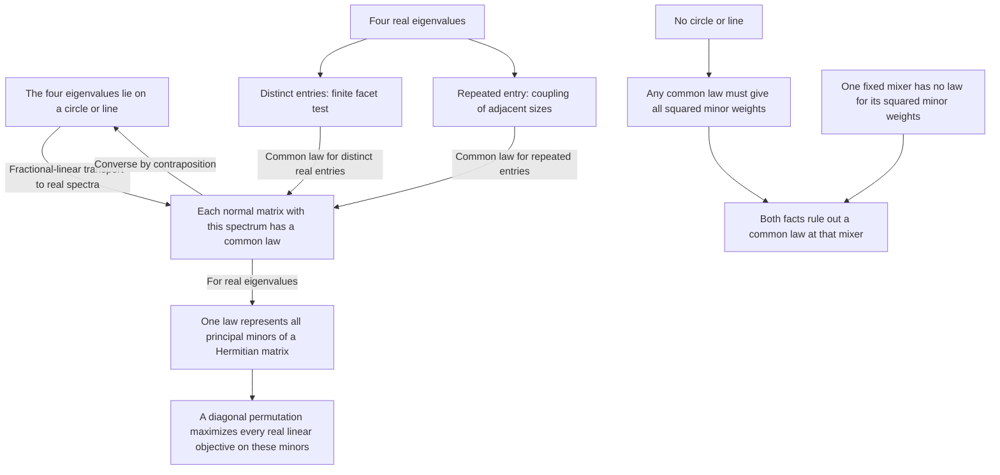

# Common determinant weights on a circle or line

[Proof map index](README.md) · [All-order proof map](all-orders-proof-map.md) · [Order-four proof map](order-four-proof-map.md)

Let $a$ be a list of four complex eigenvalues, and let $H$ be a normal
matrix with this spectrum. A common law assigns nonnegative weights
with sum one to permutations $\sigma$ of the four labels. The law
represents $\det(H+\mathrm{diag}(b))$ as the weighted average of
$\prod_j(a_{\sigma(j)}+b_j)$ for every complex list $b$.

There is a common law for every such $H$ if and only if the entries of
$a$ lie on one circle or one straight line. Repeated entries are
allowed. The weights can depend on the fixed spectrum and on $H$.
[Circle-or-line criterion](../Lean/MOC/FourCircleLineCommonWeights.lean#L651)

## The two implications

| Premise | Argument | Lean source |
| --- | --- | --- |
| Four distinct real eigenvalues | A finite facet test on the lower parameter interval gives common weights. Closedness includes the upper endpoint. | [Facet test](../Lean/MOC/HermitianByNormalFourProof.lean#L40) · [Conversion to weights](../Lean/MOC/HermitianByNormalFour.lean#L80) |
| A repeated entry in a real list of length four | Put the labels in three groups, one of which has one label. A coupling of squared minors of adjacent sizes gives common weights. | [Real-spectrum proof](../Lean/MOC/FourCircleLineCommonWeights.lean#L54) |
| One circle or line contains the four eigenvalues | A fractional-linear change maps the fixed spectrum to real values. The law survives this change. Continuity includes partner values at the pole. | [Sufficiency](../Lean/MOC/FourCircleLineCommonWeights.lean#L92) |
| The spectrum lies on no circle or line | Agreement on every diagonal partner gives the squared-minor weights for every subset image. Triple product moments determine the singleton weights. The nonreal cross ratio separates the remaining pair weights. Complementation gives the larger subsets. | [Necessary minor weights](../Lean/MOC/FourCircleLineCommonWeights.lean#L610) |
| One mixer has no common squared-minor law | For any spectrum off a circle or line, the converse uses that same mixer to rule out a common law. | [Converse](../Lean/MOC/FourCircleLineCommonWeights.lean#L651) |

The lower interval has eleven ray transitions. Each transition adds
one permutation inequality. Lean has checked the first seven transitions.
Their bit masks certify that distinct ray supports are incomparable and
that each omitted crossing has a witness. Lean checks the masks with a
bitwise identity for set difference. The last four transitions need
complete module checks.
[Incomparability condition](../Lean/MOC/WeightedDiamondSparseCut.lean#L41) · [Crossing condition](../Lean/MOC/WeightedDiamondSparseCut.lean#L46) · [Bitwise identity](../Lean/MOC/WeightedDiamondWitnessMasks.lean#L10) · [First transition](../Lean/MOC/WeightedDiamondLowerCut01.lean#L142) · [Seventh transition](../Lean/MOC/WeightedDiamondLowerCut07.lean#L400)

The common law gives pointwise determinant inclusion on the circle or
line. Repeated eigenvalues also satisfy the pointwise inclusion in
order four. It therefore suffices to test pairs of distinct spectra
where neither signed spectrum lies on a circle or line. These are the
first list and the negation of the second list.
[Pointwise circle or line case](../Lean/MOC/HermitianByNormalFourProof.lean#L60) · [Exact remaining test](../Lean/MOC/HermitianByNormalFourProof.lean#L124)

## Two free diagonal entries

Take the fixed spectrum $(1,-i,-2,-2i)$ and the diagonal partner
$(x,y,0,1+i)$ with $x,y\in\mathbb C$. The mixer in the basis of the
diagonal partner is $1/14$ times the real matrix below.
[Unitary proof](../Lean/MOC/FourCircleLineCommonWeights.lean#L112)

$$
\begin{pmatrix}
-5&-11&1&-7\\
-1&-5&-11&7\\
7&-7&7&7\\
-11&1&5&7
\end{pmatrix}.
$$

Evaluate the determinant and each matching product at $(0,0)$,
$(1,0)$, and $(1,1)$. Form the real part of their linear combination
with coefficients $1+3i$, $2-i$, and $-4+2i$ in this order. Every
permutation gives a score at most $-4$. The mixer gives $-769/196$,
which is greater than $-4$. Thus a common law cannot match the three
evaluations. [Two-entry obstruction](../Lean/MOC/FourCircleLineCommonWeights.lean#L210)

## Principal minors

For a subset $S$ of the four labels, let $H[S,S]$ be the principal
submatrix with rows and columns in $S$. In the Hermitian case the
common law with weights $w_\sigma$ gives

$$
\det H[S,S]=\sum_\sigma w_\sigma\prod_{j\in S}a_{\sigma(j)}
$$

for every $S$. To extract this identity, shift and scale the columns
outside $S$ by a single parameter. At parameter zero, the determinant
is that of a block triangular matrix with the desired principal
submatrix and an identity block. [Coefficient extraction](../Lean/MOC/FourCircleLineCommonWeights.lean#L669) · [Common principal-minor law](../Lean/MOC/FourCircleLineCommonWeights.lean#L764)

For any real coefficients $c_S$, the objective
$\sum_S c_S\det H[S,S]$ attains its maximum at a diagonal
permutation of the spectrum. The same conclusion holds on
the real symmetric orbit. In particular, the coefficients of
a homogeneous multiaffine polynomial of degree $k$ give such
an objective by setting $c_S=0$ when $S$ has size different
from $k$. [Hermitian maximum](../Lean/MOC/FourCircleLineCommonWeights.lean#L832) · [Real symmetric maximum](../Lean/MOC/FourCircleLineCommonWeights.lean#L870)
