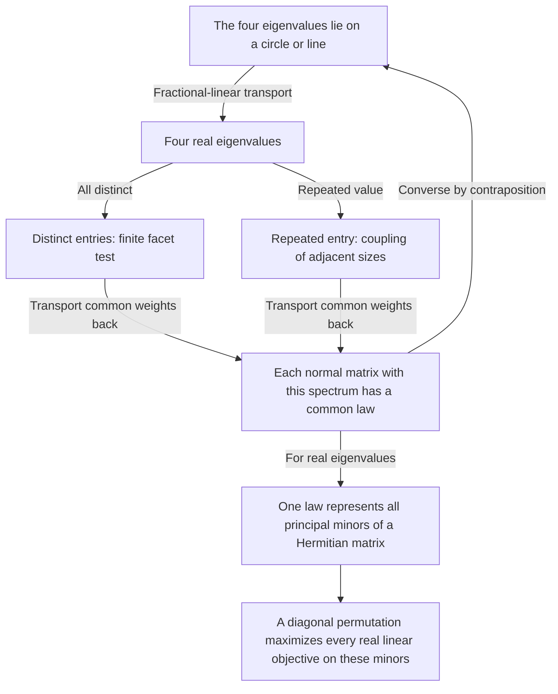

# Common determinant weights on a circle or line

[Proof map index](README.md) · [All-order proof map](all-orders-proof-map.md) · [Order-four proof map](order-four-proof-map.md)

Fix a list $a$ of four complex eigenvalues, with multiplicity. For a
normal matrix $H$ with this spectrum, a common law assigns
nonnegative weights with sum one to permutations $\sigma$ of the four
labels. For every complex list $b$, the same law represents
$\det(H+\mathrm{diag}(b))$ as the weighted sum of
$\prod_j(a_{\sigma(j)}+b_j)$. Here $\mathrm{diag}(b)$ is the diagonal
matrix with entries from $b$.

Every such $H$ has a common law if and only if all entries of $a$
lie on one circle or one straight line. Repeated entries are allowed.
The weights can depend on $a$ and $H$.
[Circle-or-line criterion](../Lean/MOC/FourCircleLineCommonWeights.lean#L654)

## Construction of the common law

| Premise | Argument | Lean source | Lean Checked? |
| --- | --- | --- | --- |
| Four distinct real eigenvalues | Normalize to the finite facet test with a middle parameter $t$ in $(1,2]$. The certificate applies for $1<t<2$. Closedness includes $t=2$. | [Facet test](../Lean/MOC/HermitianByNormalFourProof.lean#L40) · [Conversion to weights](../Lean/MOC/HermitianByNormalFour.lean#L80) · [Common law](../Lean/MOC/FourCircleLineCommonWeights.lean#L54) | Partial (1/3) |
| A repeated entry in a real list of length four | Put the labels in three groups, one of which has one label. A coupling of squared minors of adjacent sizes gives common weights. | [Real-spectrum proof](../Lean/MOC/FourCircleLineCommonWeights.lean#L54) | No |
| One circle or line contains the four eigenvalues | A fractional-linear change maps the fixed spectrum to real values. The law survives this change. Continuity includes partner values at the pole. | [Sufficiency](../Lean/MOC/FourCircleLineCommonWeights.lean#L92) | No |

The finite certificate adds eleven permutation inequalities, one per
transition. At each transition it uses the signs of the old ray
coordinates to check that distinct ray supports are incomparable. The
same signs identify a witness for every omitted crossing. The
certificate then gives the complete nonnegative facet decomposition
on the open interval.
[Transition path](../Lean/MOC/HermitianByNormalFourProof.lean#L25) · [Witness check](../Lean/MOC/SparseRayCutKernelChecks.lean#L7) · [Facet decomposition](../Lean/MOC/HermitianByNormalFourProof.lean#L40)

The common law gives pointwise determinant inclusion on the circle or
line. Repeated eigenvalues also satisfy the pointwise inclusion in
order four. It therefore suffices to test pairs of distinct spectra
where neither signed spectrum lies on a circle or line. These are the
first list and the negation of the second list.
[Pointwise circle or line case](../Lean/MOC/HermitianByNormalFourProof.lean#L64) · [Exact remaining test](../Lean/MOC/HermitianByNormalFourProof.lean#L128)

The inclusion holds in every finite order if a single circle or line
contains the whole first spectrum and all but at most four labels
of the negative of the second spectrum.
Count the omitted labels with multiplicity. A fractional-linear
change gives a real first spectrum. Deletion of real partner labels
reduces the test to orders at most four.
[All-order inclusion with four omitted labels](../Lean/MOC/HermitianByNormalFourProof.lean#L82)

## Principal minors

For a subset $S$ of the four labels, let $H[S,S]$ be the principal
submatrix with rows and columns in $S$. In the Hermitian case the
common law with weights $w_\sigma$ gives

$$
\det H[S,S]=\sum_\sigma w_\sigma\prod_{j\in S}a_{\sigma(j)}
$$

for every $S$. To extract this identity, shift and scale the columns
outside $S$ by a single parameter. At parameter zero, the determinant
is that of a block triangular matrix with the desired principal
submatrix and an identity block. [Coefficient extraction](../Lean/MOC/FourCircleLineCommonWeights.lean#L672) · [Common principal-minor law](../Lean/MOC/FourCircleLineCommonWeights.lean#L767)

For any real coefficients $c_S$, the objective
$\sum_S c_S\det H[S,S]$ attains its maximum at a diagonal
permutation of the spectrum. The same conclusion holds on
the real symmetric orbit. In particular, the coefficients of
a homogeneous multiaffine polynomial of degree $k$ give such
an objective by setting $c_S=0$ when $S$ has size different
from $k$. [Hermitian maximum](../Lean/MOC/FourCircleLineCommonWeights.lean#L835) · [Real symmetric maximum](../Lean/MOC/FourCircleLineCommonWeights.lean#L873)

[Lean check status](README.md#lean-check-status): **Partial (1/4)** for the 4 linked source modules.
