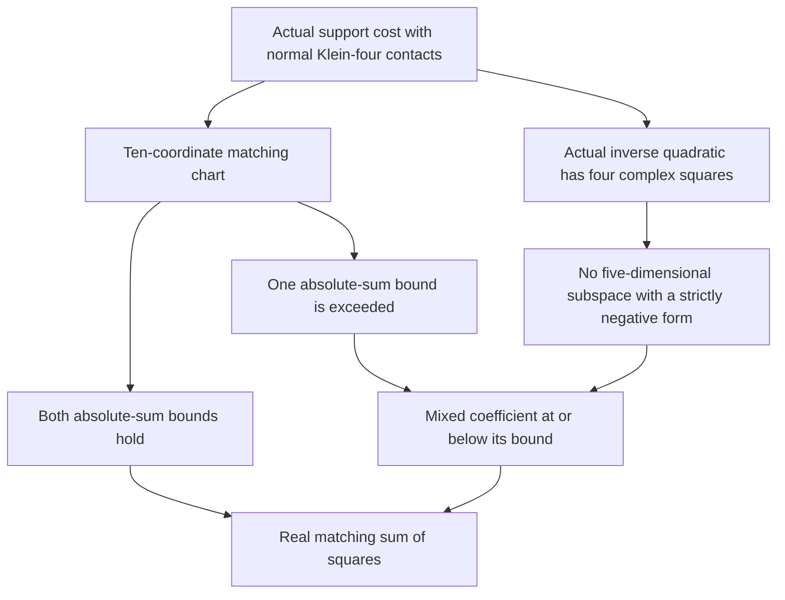

# Order-four Klein-four matching squares

[Proof map index](README.md) · [Order-four proof map](order-four-proof-map.md) · [Conjecture](../README.md)

For two complex spectra of order four, a support cost subtracts
the real projection of each matching product from a common upper
bound. An index is a contact if its cost is zero. The normal
Klein-four contact set contains the identity and the three double
transpositions. If all four indices are contacts, the cost is a
finite sum of squares of real functions from the 14-dimensional
matching space. This includes repeated spectra and additional
contacts. [Spectral theorem statement](../Lean/MOC/FourKleinSpectralSquares.lean#L259)

The ten coordinates give three rectangle groups and two cycle groups.
Each rectangle has values $\beta_i\pm p_i\pm q_i$, so nonnegativity
gives $\beta_i\ge |p_i|+|q_i|$. The constant parts of the two cycle
groups add to $\sum_i\beta_i$. The ordinary certificate allocates this
total between the groups if each constant part bounds the sum of the
absolute values of the other coordinates in that group.
The chart reconstruction checks an integer identity on the coordinate
basis. Linearity extends the identity to all real matching evaluations.
Its correction terms vanish at the four prescribed contacts.
[Chart](../Lean/MOC/FourKleinMatchingChart.lean#L176) · [Ordinary certificate](../Lean/MOC/FourKleinMatchingSquares.lean#L79)

The spectral data give a quadratic form in nine real matrix entries.
The signed matching polynomial equals this form in the cofactor entries.
For an invertible matrix, the determinant factor converts these
cofactors to inverse coordinates. A shift by a real scalar matrix
extends the identity across singular coordinates. In the actual
spectral form, the real part of four complex linear squares represents
the form. The four imaginary parts give a linear map to $\mathbb R^4$.
On a five-dimensional real subspace, that map has a nonzero kernel.
[Cofactors](../Lean/MOC/FourKleinInversePencil.lean#L130) · [Extension](../Lean/MOC/FourKleinSpectralSquares.lean#L181) · [Four-square rank bound](../Lean/MOC/FourKleinNegativeCompression.lean#L136)

When one absolute-sum bound is exceeded, coordinate changes reduce the cost
to one mixed case. Write its three square coefficients as $a^2,b^2,c^2$
with $a\ge b,c\ge0$, and let $t>0$ be the mixed coefficient. If
$t>a(b+c)-bc$, an explicit plane has a strictly negative form.
Completion of squares joins this plane to the three diagonal
directions of the form. The argument includes the case $b=c=0$.
[Negative plane](../Lean/MOC/FourKleinNegativeCompression.lean#L53) · [Five-dimensional compression](../Lean/MOC/FourKleinPrism.lean#L61)

The absence of this compression gives $t\le a(b+c)-bc$. A convex
combination of a diagonal Gram matrix and the rank-one Gram matrix of
$(a,-b,-c)$ gives the mixed certificate. The formula allows equality at
the threshold. [Mixed certificate](../Lean/MOC/FourKleinMatchingSquares.lean#L190) · [All chart cases](../Lean/MOC/FourKleinChartSymmetry.lean#L455)

## Lean check status

| Lean scope | Lean Checked? |
| --- | --- |
| The 7 source modules linked in this map | Partial (4/7) |
| [FourKleinChartSymmetry.lean](../Lean/MOC/FourKleinChartSymmetry.lean#L455) | No |
| [FourKleinInversePencil.lean](../Lean/MOC/FourKleinInversePencil.lean#L130) | No |
| [FourKleinSpectralSquares.lean](../Lean/MOC/FourKleinSpectralSquares.lean#L259) | No |

[Status definitions](README.md#lean-check-status). Paper arguments retain their stated scope.
