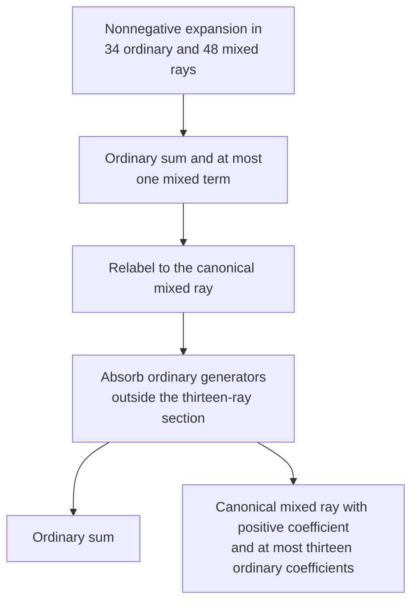

# Order-four mixed-ray cancellation

[Proof map index](README.md) · [Order-four proof map](order-four-proof-map.md) · [Unrestricted conjecture](../README.md)

A cost profile assigns a real number to each of the 24 permutations of
four labels. An ordinary ray is the indicator that a permutation sends
a specified row set to a specified column set. The 34 ordinary rays
use singleton sets and one representative from each complementary pair
of two-element sets. A mixed ray is a relabeling of a fixed signed sum
of four of these indicators. All indices in the Lean source start at
zero. [Cost profiles](../Lean/MOC/FourSupportCostProfiles.lean#L24)

For two distinct mixed rays, their sum is a nonnegative combination of
ordinary rays. Multiply this identity by the smaller mixed coefficient.
The operation removes at least one mixed term and preserves the whole
profile. Induction adds the mixed terms one at a time. [Pair cancellation](../Lean/MOC/FourMixedRayCancellation.lean#L376) · [Reduction to one mixed term](../Lean/MOC/FourMixedRayCancellation.lean#L421)

After relabeling the remaining mixed term, pair it with each ordinary
term outside the canonical set of thirteen ordinary rays. The exact
absorption identity puts the paired part in that set. The procedure
uses the smaller of the two coefficients at each step. If the mixed
coefficient becomes zero, the result is in the ordinary cone. Otherwise
the final profile has the canonical mixed ray and ordinary coefficients
on the thirteen-ray set. [Absorption identities](../Lean/MOC/FourMixedRayCancellation.lean#L180) · [Support bound](../Lean/MOC/FourMixedRayCancellation.lean#L26) · [Normal form](../Lean/MOC/FourMixedRayCancellation.lean#L511)

Signed determinant weights evaluate a cost profile at a fixed mixer by
a linear map. An ordinary ray evaluates to the squared modulus of its
specified minor. Thus the cancellation identities preserve the value
at every unitary mixer, and the ordinary branch is nonnegative.
Nonnegativity in the mixed section requires a separate argument for
the costs that come from spectra. [Squared-minor evaluation](../Lean/MOC/FourMixedRayCancellation.lean#L553) · [Ordinary nonnegativity](../Lean/MOC/FourMixedRayCancellation.lean#L582)

The Lean proof checks the 47 seed pair identities and the 21
absorption identities over integer permutation profiles. An independent
exact replay also checked closure of the ordinary rays under the 48
relabelings used here. The new Lean source was written without a build.
[Archived certificate source](https://github.com/ascendnoosphere/MOC/blob/a49606d39e8bb5903c9bb4a51651a18679499c0c/data/certificates/geometry/mixed_cancellation_graph.json)
