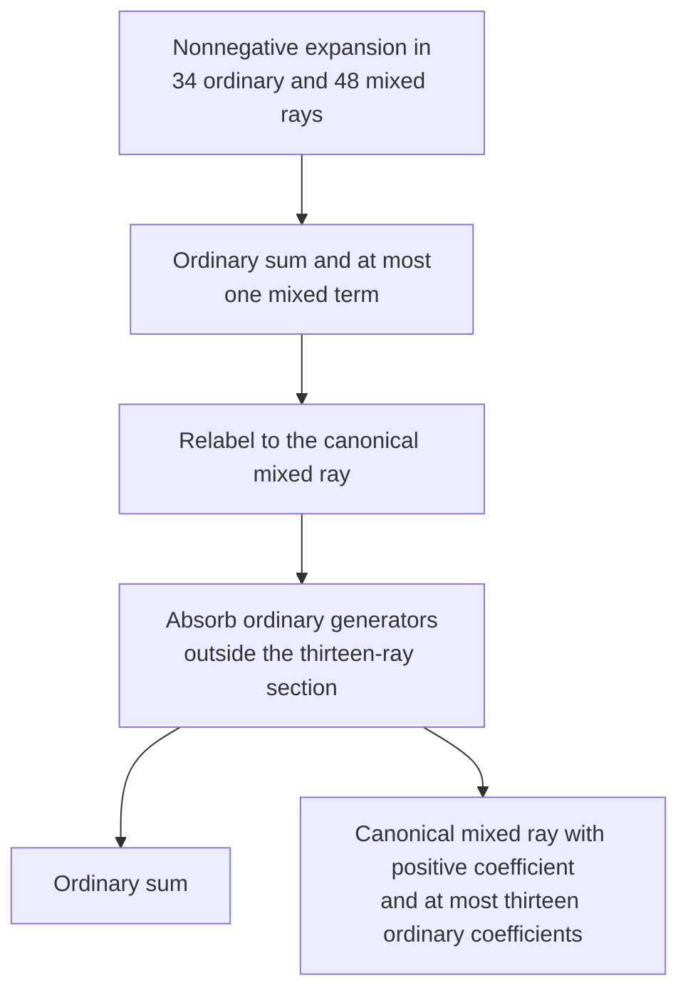
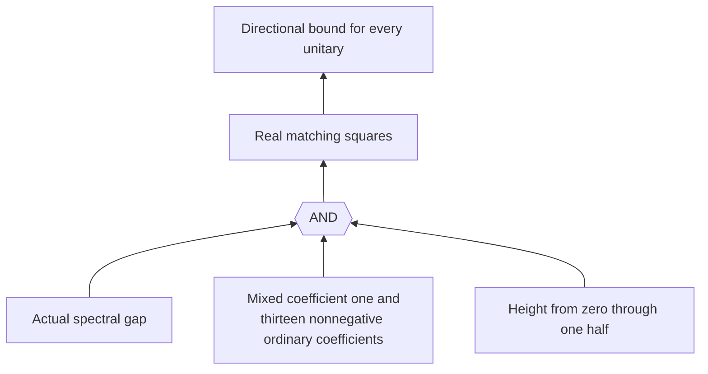

# Order-four mixed-ray cancellation

[Proof map index](README.md) · [Order-four proof map](order-four-proof-map.md) · [Unrestricted conjecture](../README.md)

A cost profile assigns a real number to each of the 24 permutations of
four labels. An ordinary ray is the indicator that a permutation sends
a specified row set to a specified column set. The 34 ordinary rays
use singleton sets and one representative from each complementary pair
of two-element sets. A mixed ray is a relabeling of a fixed signed sum
of four of these indicators. All indices in the Lean source start at
zero. [Cost profiles](../Lean/MOC/FourSupportCostProfiles.lean#L24)

For two distinct mixed rays, their sum is a nonnegative combination of
ordinary rays. Multiply this identity by the smaller mixed coefficient.
The operation removes at least one mixed term and preserves the whole
profile. Induction adds the mixed terms one at a time. [Pair cancellation](../Lean/MOC/FourMixedRayCancellation.lean#L380) · [Reduction to one mixed term](../Lean/MOC/FourMixedRayCancellation.lean#L425)

After relabeling the remaining mixed term, pair it with each ordinary
term outside the canonical set of thirteen ordinary rays. The exact
absorption identity puts the paired part in that set. The procedure
uses the smaller of the two coefficients at each step. If the mixed
coefficient becomes zero, the result is in the ordinary cone. Otherwise
the final profile has the canonical mixed ray and ordinary coefficients
on the thirteen-ray set. [Absorption identities](../Lean/MOC/FourMixedRayCancellation.lean#L184) · [Support bound](../Lean/MOC/FourMixedRayCancellation.lean#L26) · [Normal form](../Lean/MOC/FourMixedRayCancellation.lean#L515)

Signed determinant weights evaluate a cost profile at a fixed mixer by
a linear map. An ordinary ray evaluates to the squared modulus of its
specified minor. Thus the cancellation identities preserve the value
at every unitary mixer, and the ordinary branch is nonnegative.
Nonnegativity in the mixed section requires a separate argument for
the costs that come from spectra. [Squared-minor evaluation](../Lean/MOC/FourMixedRayCancellation.lean#L557) · [Ordinary nonnegativity](../Lean/MOC/FourMixedRayCancellation.lean#L586)

The Lean proof checks 47 pair identities and 21 absorption identities
over integer permutation profiles. The ordinary rays are closed under
the 48 relabelings used in the proof.
[Pair identities](../Lean/MOC/FourMixedRayCancellation.lean#L150) · [Absorption identities](../Lean/MOC/FourMixedRayCancellation.lean#L171)

## Canonical contact certificates

### Normalized heights from zero through one half

Let $H$ be the real support height in a complex direction $\eta$.
For each matching product $P_\sigma$, its gap is
$H-\mathrm{Re}(\eta P_\sigma)$. Suppose this gap profile is the
fixed mixed ray with coefficient one plus a nonnegative sum of
the thirteen prescribed ordinary rays. If the original mixed
coefficient is positive, rescale the direction and height by
dividing both by that coefficient.
[Thirteen ordinary rays](../Lean/MOC/FourCanonicalHeightSquares.lean#L17) · [Canonical gap](../Lean/MOC/FourCanonicalHeightSquares.lean#L22)

If $0\le H\le 1/2$, the matching cubic forces a coefficient
bound for square completion. The proof uses two kinds of square
identities. One uses an ordinary coefficient and two associated
ordinary coefficients. The other uses the three ordinary
coefficients with ray indices 18, 23, and 28. If all these
bounds fail, the cubic is strictly negative throughout the
stated height interval. This contradicts its vanishing on the
spectral profile. Nonnegative evaluation of the squares gives
$\mathrm{Re}(\eta D)\le H$, where $D$ is the determinant of the
sum at any unitary mixer.
[Zero-height coefficient alternatives](../Lean/MOC/FourCanonicalHeightSquares.lean#L350) · [Interval square certificate](../Lean/MOC/FourCanonicalHeightSquares.lean#L719) · [Unitary support bound](../Lean/MOC/FourCanonicalHeightSquares.lean#L767)

### Certificates for specified ray sets

Write a normalized cost as the canonical mixed ray plus a sum of
ordinary rays with nonnegative coefficients. Each tuple specifies the
ordinary ray indices and the order of their coefficients. The premises
use the mixed-sign factors of the inverse-pencil determinants. Each
factor has a positive constant term.

| Ordinary ray indices | Premise and conclusion |
| --- | --- |
| $(13,17,18,27,30)$ | If the first determinant factor is nonpositive, the coefficients on rays 13, 18 and 27 satisfy the bound for a square decomposition. The full cost is a sum of matching squares. [Lean statement](../Lean/MOC/FourEightContactSmallFactors.lean#L167) |
| $(7,13,20,27,31)$ | If the second determinant factor is nonpositive, the coefficients on rays 7, 13 and 31 satisfy the bound for a square decomposition. The full cost is a sum of matching squares. [Lean statement](../Lean/MOC/FourEightContactSmallFactors.lean#L219) |

Both certificates allow zero coefficients. The determinant factorizations
and square identities use exact arithmetic on all 24 permutations.
[Factor and square calculations](https://github.com/ascendnoosphere/MOC/blob/14cf959d78ae5828a92013d13a65b9c50ebb01d0/Docs/research/moc_high_contact_nonlinear_capacity_20261031.txt)

### Additional whole-domain certificates

Each table row uses positive ordinary coefficients. The proofs expand
the determinant identities and verify the square decompositions on
the 24 permutations.

| Ordinary ray indices | Premise and result |
| --- | --- |
| $(13,18,23,28,30)$ | A zero mixed determinant factor forces one of three square bounds. [Lean statement](../Lean/MOC/FourEightContactReducedFactors.lean#L397) |
| $(7,18,20,23,28)$ | A zero mixed determinant factor forces one of four square bounds. [Lean statement](../Lean/MOC/FourEightContactReducedFactors.lean#L423) |
| $(13,17,18,27,28)$ | A zero mixed determinant factor and the cubic height equation at positive height give one of three square bounds. [Lean scalar certificate](../Lean/MOC/FourEightContactHigherFactors.lean#L48) |
| $(7,13,17,27,31)$ | A zero mixed determinant factor gives a matching sum of squares through an explicit four-by-four Gram matrix. [Lean statement](../Lean/MOC/FourEightContactLargestFactors.lean#L45) |

A rectangle bound gives squares for the whole
family $(7,13,18,27,31)$ on its mixed factor sublevel. For six
seven-contact families, setting one coefficient to zero reduces the
nonpositive factor to that of a settled family, with relabeling where
necessary. The removed term is an ordinary square. The six tuples are
$(13,17,18,20,27,30)$, $(7,13,20,27,30,31)$,
$(7,13,18,27,30,31)$, $(7,13,17,18,27,30)$,
$(7,10,13,17,27,30)$ and $(7,10,13,20,23,30)$.
For $(7,17,18,23,27,30)$ the factor equation forces the product of the
coefficients on rays 18 and 23 to be at least one. The formal factor
links remain separate from these Lean square lemmas.
[Inheritance](../Lean/MOC/FourSevenContactAffineElimination.lean#L65) · [Pair capacity](../Lean/MOC/FourSevenContactAffineElimination.lean#L82) · [Pair square certificate](../Lean/MOC/FourSevenContactAffineElimination.lean#L121) · [Rectangle bound](https://github.com/ascendnoosphere/MOC/blob/14cf959d78ae5828a92013d13a65b9c50ebb01d0/Docs/research/moc_high_contact_threshold_rectangle_closure_20261031.txt)

### Remaining coefficient tests

For $(7,13,23,30,31)$ the factor equation gives squares when the
coefficient on ray 31 is at most one. For four seven-contact classes,
affine factor equations have a nonzero slope or give a pair bound on
the zero-slope branch. Shared Gram terms give further sufficient
conditions in seven-contact classes.
[Eight-contact bound](../Lean/MOC/FourEightContactAffineFactors.lean#L216) · [Affine charts](../Lean/MOC/FourSevenContactAffineChambers.lean#L37) · [Shared compensation](../Lean/MOC/FourSevenContactMiddleNonlinearFactors.lean#L77) · [Four-feature Gram client](../Lean/MOC/FourSevenContactHighNonlinearFactors.lean#L10)

In twelve seven-contact profiles the matching cubic fixes the height
as a quotient with positive numerator. Positive height requires a
positive denominator. Some rank-eight matrices at roots of the
determinant factors satisfy this test. The test leaves open whether
the corresponding spectral gaps satisfy the support bound.
[First six profiles](../Lean/MOC/FourSevenContactSmallNonlinearFactors.lean#L85) · [Second six profiles](../Lean/MOC/FourSevenContactLargeNonlinearFactors.lean#L65)
