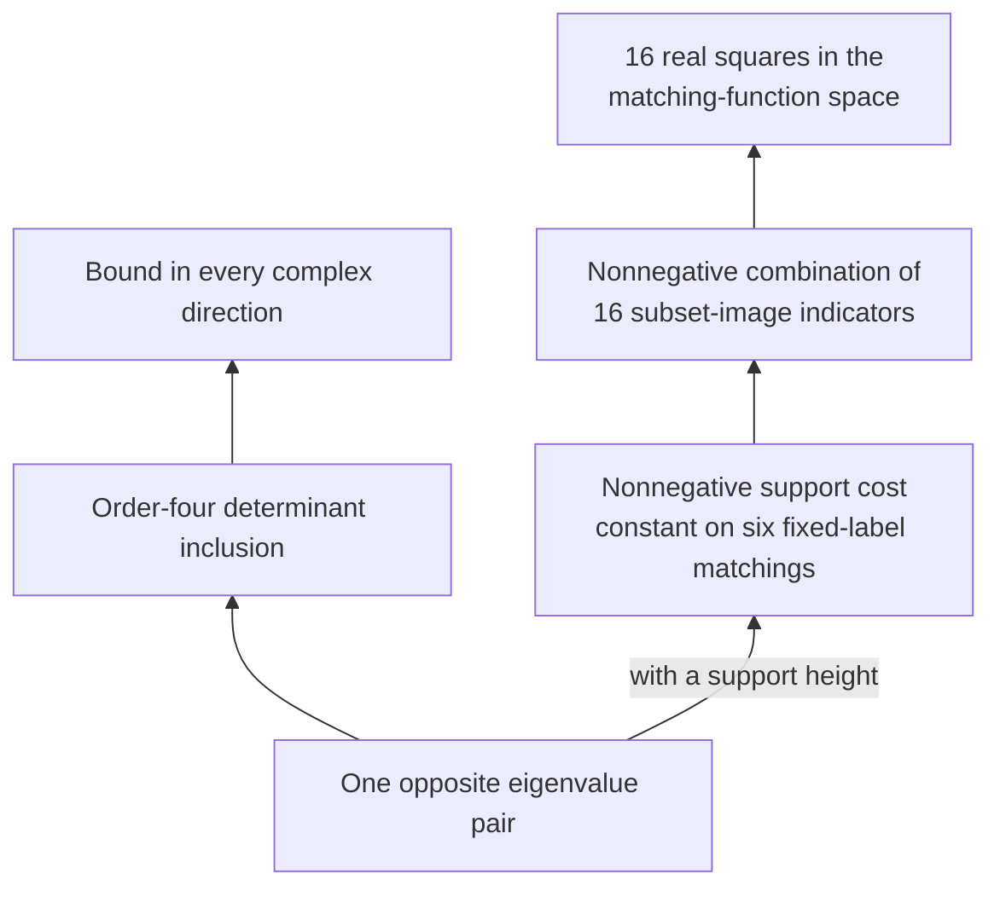

# Order-four opposite eigenvalue support

[Proof map index](README.md) · [Conjecture](../README.md) · [Order-four proof routes](order-four-proof-map.md)

Let $a$ and $b$ be complex eigenvalue lists of length four. Let $U$
be the unitary matrix that relates their eigenbases. For a permutation
$\sigma$, the matching product is
$P_\sigma=\prod_j(a_{\sigma(j)}+b_j)$. If $a_i+b_j=0$ for one pair
of labels, the determinant of
$\mathrm{diag}(a)+U\mathrm{diag}(b)U^*$ belongs to the convex hull of
the matching products for every unitary $U$. The eigenvalues can
repeat. For every $\eta\in\mathbb C$, the real part of the determinant
times $\eta$ is at most $\max_\sigma\mathrm{Re}(\eta P_\sigma)$.
[Lean hull inclusion](../Lean/MOC/FourCoincidence.lean#L360) · [Directional statement](../Lean/MOC/FourOppositePairSupport.lean#L396)

## Ordinary cost and sum of squares

The cost decomposition and its sum of squares await verification
in the library build. The hull inclusion follows from the checked
common distribution.

Relabel the opposite pair as $a_0+b_0=0$. Fix a direction $\eta\in
\mathbb C$ and a real number $H$ with
$\mathrm{Re}(\eta P_\sigma)\le H$ for all $\sigma$. The cost
$g(\sigma)=H-\mathrm{Re}(\eta P_\sigma)$ is nonnegative. All six
permutations with $\sigma(0)=0$ have cost $H$.
[Spectral cost](../Lean/MOC/FourOppositePairSupport.lean#L366)

For sets $S,T$ of labels, the subset-image indicator is one if
$\sigma(S)=T$ and zero otherwise. The decomposition uses seven
singleton indicators and nine indicators on two-element sets. One
singleton indicator is supported on the six permutations that
fix zero. The other fifteen are zero on these permutations.
[Ordinary generators](../Lean/MOC/FourOppositePairSupport.lean#L181)

The same decomposition holds for every nonnegative function in the
fourteen-coordinate matching-function space that is constant on
those six permutations. This space consists of the real functions on
the 24 permutations obtained by evaluating 14 real coordinates with a
fixed linear map.
[Matching-function space](../Lean/MOC/RealMatchingSquares.lean#L54) ·
[Evaluation map](../Lean/MOC/FourMatchingRelations.lean#L196)

The proof uses a table $w$ with three rows
and three columns to express the other eighteen matching costs.
Each cost is the sum of two entries in distinct rows and columns.
Every such pair occurs. Thus two negative entries cannot lie in
distinct rows and columns. The negative entries all lie on one row
or one column.

If they lie on row $i$, let $p$ and $q$ be its two largest nonnegative
deficits, with a zero deficit for each nonnegative entry. Put
$p+q$ on the singleton indicator for row $i$. Put $p-q$ on the
singleton indicator for a column $j$ that attains the largest deficit.
Add these amounts to the corresponding row and column of the table,
then subtract $p$ from each cell. The resulting table is nonnegative.
For each pair of selected cells, adding the singleton coefficients
for the missing row and column preserves the original matching cost.
Transposition gives the same construction when the negative entries
lie on a column. [Lean decomposition](../Lean/MOC/FourOppositePairSupport.lean#L226)

Each indicator $I$ belongs to the matching-function space. For its
coefficient $t\ge0$, the function $tI$ equals $(\sqrt{t}I)^2$.
The sixteen terms give the real sum of squares.
[Lean sum of squares](../Lean/MOC/FourOppositePairSupport.lean#L329)

The matching coordinates use Appendix A of Zheng's preprint.
[Zheng's preprint](https://doi.org/10.13140/RG.2.2.36790.25923)

For each fixed unitary $U$, the opposite-pair law gives one distribution
that works for every pair of lists with $a_0+b_0=0$.
[Common distribution](../Lean/MOC/FourCoincidence.lean#L338)

## Lean check status

| Lean scope | Lean Checked? |
| --- | --- |
| The 4 source modules linked in this map | Partial (2/4) |
| [FourOppositePairSupport.lean](../Lean/MOC/FourOppositePairSupport.lean#L396) | No |

[Status definitions](README.md#lean-check-status). Paper arguments retain their stated scope.
