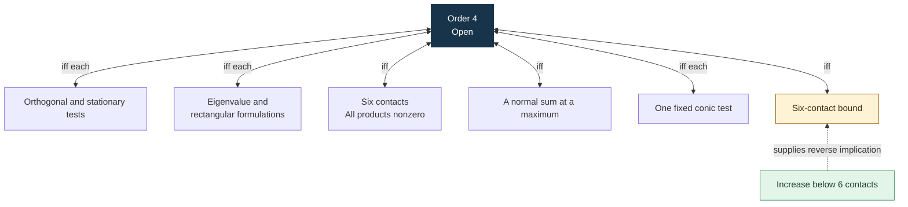
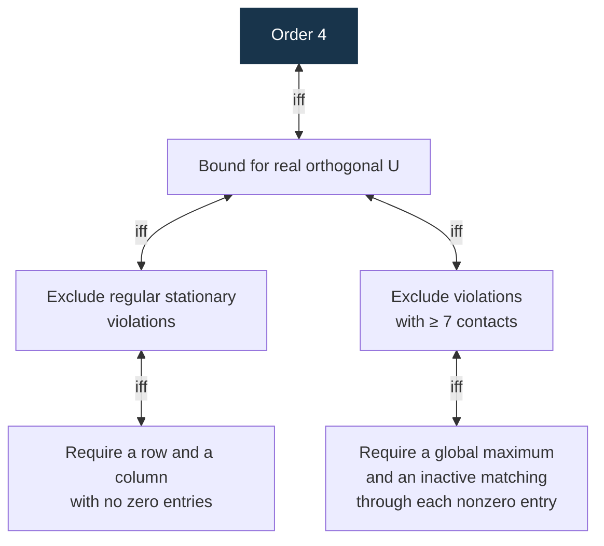
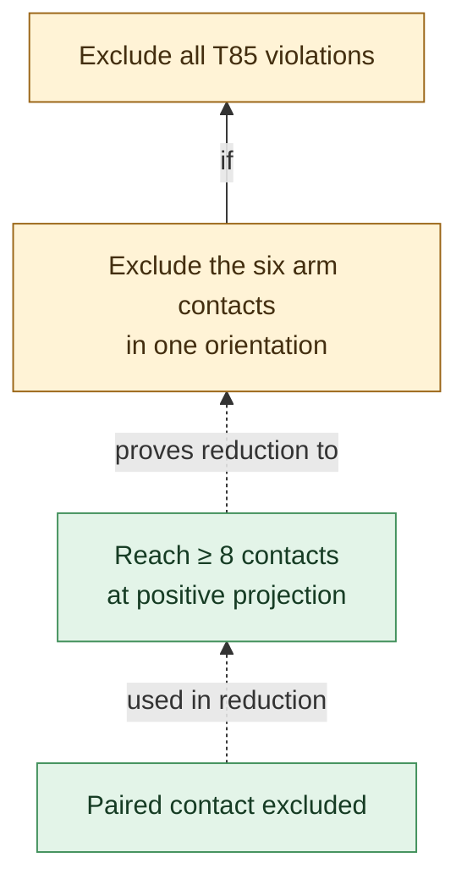

# Order-four proof maps

[Proof map index](README.md) · [README overview](../README.md#order-four) · [All-order routes](all-orders-proof-map.md) · [Contact transfer](contact-transfer-proof-map.md) · [Order five](order-five-proof-map.md) · [Spectral and support results](spectral-support-proof-map.md#order-four-support-costs)

- [Registered routes](#registered-routes)
- [Real orthogonal and stationary tests](#real-orthogonal-and-stationary-tests)
- [Contact patterns](#contact-patterns)
- [Paper support bounds and exact examples](#paper-support-bounds-and-exact-examples)

The order-four conjecture asks for the determinant inclusion for every
pair of complex normal four-by-four matrices. In the eigenvalue
formulation, $U$ is the unitary change between the eigenbases. The full
order-four statement remains open in this library. The antipodal spectral
test and the width bound have complete proof scripts awaiting kernel checking.
[Certificates](determinant-inclusion-certificates-proof-map.md)
[Matrix equivalence](../Lean/MOC/Normal.lean#L280) · [Source scope](all-orders-proof-map.md#scope-of-the-lean-source)

## Registered routes



The table covers the tests specific to order four. The registry also
includes the [tests at each order](all-orders-proof-map.md#tests-at-each-order).
A **coisometry** is a rectangular matrix with orthonormal rows. A **regular** pair of
spectra has nonzero pair sums and distinct matching products. The
[contact map](contact-transfer-proof-map.md) defines contacts and strict
witnesses. The all-order transfer gives the six-contact increase step.
The six-contact inequality required by this route remains open.
[Route register](../Lean/MOC/ProofRoutes.lean#L254) · [Disjunction](../Lean/MOC/ProofRoutes.lean#L308) · [Contact transfer](../Lean/MOC/ProofRoutes.lean#L193)

| Route in Lean | Relation | Lean proof |
| --- | --- | --- |
| Real orthogonal mixers with complex spectra | Iff | [Statement and proof](../Lean/MOC/FourMinorTransport.lean#L574) |
| Regular orthogonal support maximizers | Iff | [Statement and proof](../Lean/MOC/OrderFourIndependent.lean#L90) |
| Normal sum at a support maximizer | Iff | [Statement and proof](../Lean/MOC/NormalSupportMaximum.lean#L303) |
| Principal coisometry of dimension three | Iff | [Statement and proof](../Lean/MOC/PrincipalCoisometry.lean#L140) |
| Rectangular compression with three rows | Iff | [Statement and proof](../Lean/MOC/PrincipalCoisometry.lean#L218) |
| Regular spectra and real orthogonal mixers | Iff | [Statement and proof](../Lean/MOC/Reformulations/StationaryFour.lean#L43) |
| Exclude all regular stationary orthogonal witnesses | Iff | [Statement and proof](../Lean/MOC/OrderFourIndependent.lean#L231) |
| Exclude regular stationary witnesses with a row and a column with no zero entries | Iff | [Statement and proof](../Lean/MOC/StationaryDenseCross.lean#L64) |
| Exclude orthogonal witnesses with at least seven contacts | Iff | [Statement and proof](../Lean/MOC/ZhengContactReduction.lean#L14) |
| Exclude stationary orthogonal witnesses with at least seven contacts and the inactive pivot constraints | Iff | [Statement and proof](../Lean/MOC/StationaryPivot.lean#L221) |
| Exclude regular terminal orthogonal witnesses | Iff | [Statement and proof](../Lean/MOC/FourTerminalCoverage.lean#L114) |
| Exclude regular terminal orthogonal witnesses with canonical mixed cost | Iff | [Statement and proof](../Lean/MOC/FourTerminalCoverage.lean#L398) |
| Six-contact support bound | Iff | [Statement and proof](../Lean/MOC/ProofRoutes.lean#L274) |
| First list $(1,-1,z,-z)$, with $\mathrm{Im}(z)>0$, $\lvert z\rvert<1$, and a real orthogonal mixer | Iff | [Antipodal test](../Lean/MOC/FourAntipodalSpectra.lean#L208) |
| Distinct spectra and neither signed spectrum on a circle or line | Iff | [Statement and proof](../Lean/MOC/HermitianByNormalFourProof.lean#L124) |
| Distinct first spectrum on the standard parabola | Iff | [Fixed-curve test](../Lean/MOC/ConicSpectralReductions.lean#L330) |
| Distinct first spectrum on the fixed hyperbola | Iff | [Fixed-curve test](../Lean/MOC/ConicSpectralReductions.lean#L390) |
| Distinct first spectrum on the ellipse with semiaxes $2+\sqrt 3$ and $1$ | Iff | [Fixed-curve test](../Lean/MOC/ConicSpectralReductions.lean#L946) |
| Signed support gap on the realized bilinear chart | Iff | [Statement and proof](../Lean/MOC/FourDirectSupportCertificate.lean#L118) |

The conic conditions quantify over every unitary mixer and every
second spectrum. The fixed-curve transport preserves the mixer.
[Universal conic tests](conic-spectral-reductions-proof-map.md) · [Quantifier bridge](../Lean/MOC/ConicSpectralReductions.lean#L27)

## Real orthogonal and stationary tests

The inclusion also holds for every complex unitary matrix of order four
whose entries all have modulus $1/2$. The three partitions of four
labels into two pairs give a common probability law for all squared
minors and hence for all pairs of spectra.
[Common law](../Lean/MOC/OrderFourComplexHadamard.lean#L259) ·
[Proof map](order-four-complex-hadamard-proof-map.md)



Lean expresses all squared absolute values of the minors of an order-four
unitary as one finite convex combination of the corresponding tables of
real orthogonal matrices. Thus the eigenvalue lists stay complex while
$U$ can be restricted to real orthogonal matrices.
[Minor decomposition](../Lean/MOC/FourMinorTransport.lean#L479) · [Orthogonal equivalence](../Lean/MOC/FourMinorTransport.lean#L574)

| Exact test | Conditions proved for a counterexample | Lean source |
| --- | --- | --- |
| Regular orthogonal maximizers | Nonzero pair sums, distinct products, and at least three nonzero entries in each row and column. The real orthogonal matrix maximizes the determinant projection over all complex unitaries in the chosen direction. | [Regular maximizer](../Lean/MOC/OrderFourIndependent.lean#L90) |
| Stationary orthogonal violations | The regular maximizers additionally satisfy the first-order stationarity equations. A further reduction gives one row and one column with no zero entries. | [Stationarity](../Lean/MOC/OrderFourIndependent.lean#L231) · [Dense row and column](../Lean/MOC/StationaryDenseCross.lean#L64) |
| Stationary violations with at least seven contacts | The determinant is nonzero. For each nonzero entry $U_{ij}$, a permutation with $\sigma(j)=i$ has strictly smaller projection than the contacts. | [Seven contacts](../Lean/MOC/ZhengContactReduction.lean#L14) · [Stationary pivot](../Lean/MOC/StationaryPivot.lean#L221) |
| No normal maximizer obstruction | It suffices that for each pair of lists and direction, some maximizer gives a normal sum. | [Exact normal-maximizer test](../Lean/MOC/NormalSupportMaximum.lean#L303) |

The inclusion also holds if either spectrum lies on a circle or line
or if there is an opposite eigenvalue pair.
[Circle or line](../Lean/MOC/HermitianByNormalFourProof.lean#L60) · [Opposite pair](../Lean/MOC/FourCoincidence.lean#L360)

### Complex unitary matrices with zero diagonal

Four zeros in any positions suffice for the order-four inclusion.
This follows from the all-order bound on the total number of nonzero
entries. The zero-diagonal case below is a step in that proof.
[Four arbitrary zeros](../Lean/MOC/SparseSupportCardinality.lean#L74) · [All-order count](sparse-unitary-proof-map.md#total-number-of-nonzero-entries)

Four zeros also suffice for a single probability law that works for
all spectra. The threshold of four is sharp for this stronger statement.
An orthogonal matrix with exactly three zeros forces contradictory
probabilities for two events.
[Four-zero law](../Lean/MOC/SparseUnitaryUniversalWeights.lean#L138) · [Three-zero obstruction](sparse-unitary-proof-map.md#three-zeros-in-order-four)

Let $U$ be a complex unitary matrix of order four with zero diagonal.
The inclusion holds for every pair of complex eigenvalue lists. If another
entry is zero, its row has at most two nonzero entries. Expansion along that
row reduces the claim to order three.
[Inclusion](../Lean/MOC/OrderFourZeroDiagonalUnitary.lean#L196) · [Row reduction](../Lean/MOC/SparseRow.lean#L248)

Suppose all off-diagonal entries are nonzero. Only the nine permutations
with no fixed point contribute to the determinant of $U$. Swaps that
preserve this condition connect all nine permutations. Row orthogonality
makes the ratio of the two signed terms at each swap a positive real
number. All nine terms therefore have the same argument. Division by
their sum gives nonnegative weights for the matching products.
[Swaps](../Lean/MOC/OrderFourZeroDiagonalUnitary.lean#L40) · [Positive ratio](../Lean/MOC/OrderFourZeroDiagonalUnitary.lean#L86) · [Weights](../Lean/MOC/OrderFourZeroDiagonalUnitary.lean#L149)

## Contact patterns

Zheng states the full order-four theorem in Theorem 1.1. An audit of the
public supplement reproduced all 214 symmetry classes of six-contact
sets. Of these, 124 use only squared minors. The audit matched the other
90 classes to the individual proofs used by Proposition 4.3. All five
portable checks passed in a local replay of selected exact calculations.
A full independent review of the case proofs and a Lean proof of the
full bound remain open. The earlier audit used the main paper as its
external source.
[Paper](https://doi.org/10.13140/RG.2.2.36790.25923) · [Pinned supplement](https://github.com/DongzheZheng/The-Marcus-de-Oliveira-conjecture-for-n-4/tree/53ec16567d2307266ce52a8e9678410b2457cc27) · [Scope of the exact checks](https://github.com/DongzheZheng/The-Marcus-de-Oliveira-conjecture-for-n-4/blob/53ec16567d2307266ce52a8e9678410b2457cc27/docs/verification-scope.md)

Each T-label names a set of permutations in the linked Lean statements.

| Status | Named pattern | Bound or reduction |
| --- | --- | --- |
| Proof in source | T1 | [Directional bound for the specified contacts](../Lean/MOC/ZhengT1Circle.lean#L184) |
| Proof in source | T2, T3, T4, T5, T6 | [T2](../Lean/MOC/FourT2Minor.lean#L338) · [T3](../Lean/MOC/FourT3.lean#L25) · [T4](../Lean/MOC/FourT4.lean#L30) · [T5](../Lean/MOC/FourT5.lean#L26) · [T6](../Lean/MOC/FourT6Support.lean#L11) |
| Proof in source | T15 and T21 | [T15](../Lean/MOC/FourT15.lean#L14) · [T21](../Lean/MOC/FourT21ContactCone.lean#L275) |
| Partial | T34 | The bound holds at zero common projection, or with the additional contact specified in the theorem. [Zero projection](../Lean/MOC/FourT34MinorBranch.lean#L145) · [Additional contact](../Lean/MOC/FourT34MinorBranch.lean#L56) · [Hessian pivot block](../Lean/MOC/FourMatchingHessianMatrix.lean#L123) |
| Partial | T85 | The paired branch is excluded. A remaining strict witness reduces to eight or more contacts at positive projection. [Paired branch](../Lean/MOC/ZhengPairedContacts.lean#L905) · [Positive branch](../Lean/MOC/ZhengPairedContacts.lean#L915) |
| Open | General seven-contact test | The bound must hold for every real orthogonal case at the threshold. [Exact endpoint](../Lean/MOC/ZhengContactReduction.lean#L14) |



The arm cases are the additional permutations in the marked row and
column defined in Lean. The inverse orientation follows by taking
the adjoint. The proof reduces the branch to that one orientation.
A separate example refutes a five-event linear weight test on the
marked assignments.
[One-orientation implication](../Lean/MOC/ZhengT81Bypass.lean#L431) · [Refuted linear test](../Lean/MOC/ZhengStarObstruction.lean#L161)

### Canonical contact reduction

A strict counterexample yields a real orthogonal witness with at
least seven contacts. All matching products are nonzero and distinct.
Normalize the mixed coefficient to one by scaling the support
direction. Row and column relabeling and matrix transpose preserve
the strict excess and contact count. At nonzero height, the contact
set cannot contain the four matchings from two disjoint swaps.
[Regular witness](../Lean/MOC/FourTerminalCoverage.lean#L114) · [Canonical witness equivalence](../Lean/MOC/FourTerminalCoverage.lean#L398) · [Rectangle exclusion](../Lean/MOC/FourTerminalCoverage.lean#L414)

For a gap in this canonical form, the directional bound holds for
every unitary at normalized heights from zero through one half.
The gap equals a sum of matching squares throughout this interval.
The theorem permits coincident and zero matching products, and any
number of contacts.
[Square certificate](../Lean/MOC/FourCanonicalHeightSquares.lean#L719) · [Unitary support bound](../Lean/MOC/FourCanonicalHeightSquares.lean#L767) · [Canonical gap premises](order-four-mixed-ray-cancellation-proof-map.md#normalized-heights-from-zero-through-one-half)

Thus any order-four violation has a regular canonical witness with
normalized support height $H<0$ or $H>1/2$. This witness still has at
least seven contacts.
[Height exclusion](../Lean/MOC/FourTerminalHeightInterval.lean#L11)

The earlier exact-seven result uses regular spectra and at least
seven contacts at zero height. Its proof uses the matching cubic
and disjoint-swap rectangles. The contact-count source awaits a
normal build. The directional bound covers that height directly.
[Exact-seven statement](../Lean/MOC/FourCanonicalZeroHeight.lean#L190) · [Zero-height support](../Lean/MOC/FourCanonicalHeightSquares.lean#L784)

The exact Python census gives 90 seven-contact and 58 eight-contact
classes at nonzero height. Two canonical eleven-contact profiles
force equality of distinct matching products. For negative height
the Lean rescaling applies if the normalized external lower bound
holds. The finite orbit census and universal external lower bound
remain outside these Lean proofs. This source awaits verification.
[Eleven-contact exclusion](../Lean/MOC/FourTerminalHeight.lean#L128) · [External-bound rescaling](../Lean/MOC/FourTerminalHeight.lean#L15)

The wall cost has a matching-square certificate under a reciprocal
weight bound. A corrected mixer moment gives the associated minor
amplitude inequality. The replay ledger also gives a seven-contact
certificate from a nonpositive determinant factor and four
contradictions to affine moment equations. Each application still
requires the stated link from the spectral data.
[Wall and replay premises](research-attempts-proof-map.md#further-steps-from-the-replay-bundles)

### Signed weights and the bilinear spectral chart

The fourteen-term formula expresses the determinant as a signed sum
of matching products. It has thirteen nonnegative coefficients when
its anchor coefficient is negative. At most one mixed ray evaluates
negatively at a fixed mixer. If none does, the support cone proves the
bound for all spectra. If a mixed ray evaluates negatively, a contact
where that ray is positive also gives the bound.
[Signed formula](../Lean/MOC/FourFourteenTermSupport.lean#L78) · [Unique negative ray](../Lean/MOC/FourFourteenTermSupport.lean#L186) · [Contact bound](../Lean/MOC/FourFourteenTermSupport.lean#L260)

Fix the right-hand coordinates of an anchored spectral chart in order
four. The 24 matching products are linear in four complex coefficients.
With a nonzero scale, one quadratic equation on those coefficients gives
spectral realization. Nonnegativity of the signed gap at every maximizing
matching on this chart is equivalent to order four.
The contact equalities and strict support test are real linear conditions
on the coefficients. The rank-drop and remaining feasibility tests are
open. The new Lean source awaits verification.
[Spectral realization](../Lean/MOC/FourDirectSupportCertificate.lean#L47) · [Bilinear support equivalence](../Lean/MOC/FourDirectSupportCertificate.lean#L118)

## Paper support bounds and exact examples

| Result | Hypotheses and conclusion |
| --- | --- |
| Support at a maximizing unitary with a zero entry | For arbitrary complex lists and any direction, if some global maximizer has a zero entry, a permutation attains the same score. The proof passes to real orthogonal components, each with the same zero. A stationary first-order correction at an admissible pivot makes the singleton table doubly stochastic. In order four, its anchored pair entries and their complements give the same law for the corrected minor table. The proof finds an admissible pivot for every orthogonal matrix with a zero. [Paper proof](https://github.com/ascendnoosphere/MOC/blob/e9a3f721a577ce14d5c899e0997066e7470d1640/Lean/StationaryPivotReduction.md) · [Lean orthogonal replacement](../Lean/MOC/OrderFourIndependent.lean#L73) · [Lean correction](../Lean/MOC/StationaryFullSupport.lean#L211) |
| High-contact support | For nonzero, distinct products, the paper proofs give the directional bound with at least nine contacts or with at least seven at height zero. They give a nonnegative squared-minor representation with at least ten contacts. The eight-contact ledger records closed families with their coefficient hypotheses. [Proofs and scope](https://github.com/ascendnoosphere/MOC/blob/14cf959d78ae5828a92013d13a65b9c50ebb01d0/Docs/geometry/MOC4_Verified_Results.md) · [Exact case ledger](https://github.com/ascendnoosphere/MOC/blob/14cf959d78ae5828a92013d13a65b9c50ebb01d0/data/certificates/research/eight_contact_closure_ledger.json) |
| The positive-height branch of T85 | The paper comparison uses the five boundary bounds and the transfer to eight contacts. This settles the named branch under the stated hypotheses. The open seven-contact classification still includes cases outside this pattern. [Earlier audit and dependencies](https://github.com/ascendnoosphere/MOC/blob/e9a3f721a577ce14d5c899e0997066e7470d1640/Lean/ZhengOrderFourReview.md) · [Lean positive branch reduction](../Lean/MOC/ZhengPairedContacts.lean#L915) |
| An open set beyond ordinary minor certificates | The Lean source gives the hull inclusion at the explicit center for every unitary. The paper proof permits independent complex perturbations of the eight entries by less than $10^{-17}$. Throughout the neighborhood one direction fails the ordinary squared-minor test. [Lean proof of the center](order-four-weighted-minor-center-proof-map.md) |
| A complete cross-spectral family | For every real $r\ge1$, the lists $(1,-1,-ir,ir)$ and $(-r,r,-i,i)$ satisfy the inclusion for every unitary. The proof covers each edge of the permutation hull. Common fractional linear transport on the signed spectra extends the result wherever the map has no pole. [Paper proof](https://github.com/ascendnoosphere/MOC/blob/14cf959d78ae5828a92013d13a65b9c50ebb01d0/Docs/research/moc_moonshot_variational_20261031.txt) · [Lean spectral transport](../Lean/MOC/ProjectiveTransport.lean#L61) |

### Complex spectral lift

Write a scaled exact bracket profile as $u+iv$, with $u,v$ real.
Let $G$ be the gradient of the matching cubic and let $J(u)$ be its
Hessian. The complex equation $G(u+iv)=0$ splits into $J(u)v=0$ and
$G(v)=G(u)$. Both conditions are necessary for an exact bracket lift.
The new Lean proof expands the quadratic coordinates of $G$.
[Lean lift equations](../Lean/MOC/FourMatchingHessianKernel.lean#L125)

Take $u=(4,0,12,-18,4,0,0,-12,-4,9,3,3,-3,-11)$ in the bracket order
of the linked definition. The cubic is zero and its Hessian has a
two-dimensional kernel. If $r=v_{12}$ and $s=v_{13}$, every vector
in that kernel has first gradient coordinate
$-9(25r^2-14rs+29s^2)/169$. This is nonpositive, while $G(u)_0=72$.
The example therefore excludes sufficiency of the cubic and Hessian
kernel tests. It concerns the spectral equations for the profile,
before comparison with a unitary.
[Bracket convention](../Lean/MOC/FourMatchingPolarization.lean#L18) ·
[Lean exact example](../Lean/MOC/FourMatchingHessianKernel.lean#L170)

### Other exact obstructions

- A rational orthogonal mixer and a fourteen-dimensional minor cost
  give seven contacts and negative signed value $-4800/79$. The cost
  obeys stationarity and every real rank-one reflection test. Its cubic
  equation forces one height and the Hessian is invertible there.
  This excludes a proof based on the relaxed cost space, stationarity,
  and real rank-one reflections alone. The related generic reflection
  test uses a three-by-three positive semidefinite matrix.
  The mixer, cost, and rational tests are recorded below.
- Integer complex spectra give an actual gap that fails the proposed
  triangle certificate. The gap has a sum-of-squares certificate in the
  larger space. [Integer spectra and certificate](https://github.com/ascendnoosphere/MOC/blob/14cf959d78ae5828a92013d13a65b9c50ebb01d0/Docs/research/moc_actual_triangle_failure_integer_20261031.txt)
- Rational spectra and a rational unitary give a determinant outside
  the original polygon of Kovačec's Conjecture 7. The determinant lies
  strictly inside a triangle of matching products. [Exact polygon example](https://github.com/ascendnoosphere/MOC/blob/14cf959d78ae5828a92013d13a65b9c50ebb01d0/Docs/research/kovacec_polygon_counterexample_tenths.txt)

<details>
<summary>Stationary cost with seven contacts and no spectral lift</summary>

Use the real orthogonal matrix

$$
U=\frac1{79}\begin{pmatrix}
-29&-6&42&60\\
30&-51&-38&36\\
-66&-30&-27&-16\\
12&-52&48&-33
\end{pmatrix}.
$$

In zero-based lexicographic order of row-to-column permutations, the
cost table is

```text
13696, 0, 49680, 31830, 4290, 136, 0, 8035, 12184, 15924, 12325, 8030,
23800, 33345, 0, 9404, 141, 0, 0, 1510, 0, 23100, 0, 21590
```

For a real cost $g$ in the span of subset indicators, let $L_U(g)$
denote its expectation under the real signed determinant weights.
The table above belongs to that span. Its sixteen pivot score
equations hold and $L_U(g)=-4800/79$.

For $x\ne0$, put $R_x=I-2xx^{\mathsf T}/(x^{\mathsf T}x)$.
Multiply the reflected score difference by $(x^{\mathsf T}x)^2$.
For a minor with row set $I$ and column set $J$, put
$d=\det U[I,J]$ and $y=U^{\mathsf T}x$. Its reflected determinant
multiplied by $x^{\mathsf T}x$ is
$(x^{\mathsf T}x)d-2y_J^{\mathsf T}\mathrm{adj}(U[I,J])x_I$.
Taking the specified linear combination of squares gives a quartic.
The rational calculation represents this quartic by a symmetric
$3$ by $3$ Gram matrix on the quadrics through the four coordinate
axes and the four columns of $U$. Its principal minors are positive
and its determinant is $8309494356029153280000/3077056399$. Hence
every real reflection passes the score test.

In the bracket coordinates, the cubic applied to the projected
matching profile of height $h$ is
$-949585314h+9292385296000$. At its only root the projected Hessian
has rank fourteen. A spectral lift would require a nonzero Hessian
kernel. The exact intermediate calculations are in the local Cycle 07
research note in `Temp/txt/`. [Lean Hessian necessity](../Lean/MOC/FourMatchingHessianKernel.lean#L45)

</details>


<details>
<summary>Explicit spectra and proof of the weighted-minor neighborhood</summary>

A matching product pairs the two eigenvalue lists by a permutation. The Marcus–de Oliveira inclusion places the determinant in their convex hull. This example gives an open set of pairs with that inclusion for every unitary.

#### A complete order-four result for explicit spectra

Take $u=3-2i$, $v=(61-43i)/16$, $x=(1-12i)/5$, $y=(-8-24i)/5$, and $z=(89+22i)/15$. These give $(r,s,t,\ell)=(-3,2,-2,2)$. For ordinary finite spectra let $T(w)=1/(w-2)$ and $T(\infty)=0$. Use
$$
a=(0,T(x),T(y),T(z)),\qquad b=-(T(0),T(1),T(u),T(v)).
$$
All eight signed marks are distinct. The imaginary parts of the two circle tests $(z-x)/(y-x)$ and $u(v-1)/(v(u-1))$ are $34/45$ and $577/11140$. A common projective change preserves generalized circles. Consequently neither spectral list is concyclic or collinear.

**Theorem for this spectral pair.** For every $U\in U(4)$, its determinant belongs to the permutation hull. In the normalized chart the nine hull vertices, in counterclockwise order, have labels
$$
0,\ 6,\ 18,\ 12,\ 11,\ 17,\ 4,\ 10,\ 2 .
$$
For each oriented edge $(i,j)$, form its 24 signed area determinants $g_k=\det_{\mathbb R}(P_j-P_i,P_k-P_i)$. All are nonnegative. For seven edges the supplied rational identities express this area function as a nonnegative sum of subset markers. For the other two edges, $(10,2)$ and $(2,0)$, the certificates also use a weighted inequality from the repository.

In its canonical labelling let $Q_0=M_{23,23}$, $Q_1=M_{12,12}$, and $R=M_{1,2}+M_{2,1}+Q_0-M_{13,02}$. Here $23$ denotes the subset $\{2,3\}$. For every $\tau>0$ the cost
$$
R+\tau Q_0+(1+1/\tau)Q_1
$$
evaluates nonnegatively on real orthogonal mixers. The quaternion inequality bounds $L(R)+L(Q_1)+2\sqrt{L(Q_0)L(Q_1)}$ below by zero. Apply the arithmetic–geometric mean inequality. Row signs, permutations and transposition preserve the comparison. The two-real-table theorem transports these *linear* costs to every complex unitary. The certificates give a nonnegative evaluation on every hull edge, which proves inclusion. The change to finite spectra multiplies every vertex and the determinant by the same nonzero scalar.

**Why this example tests the missing technique.** For $\eta=-i/d$, the upper height is $24/5$. Exactly $0,1,2,7,8,13,19$ are contacts and the smallest positive gap is $1224/4321$. For each ordinary marker that vanishes at all seven contacts, $M(10)-M(4)\geq0$. Yet the actual gap gives $g_{10}-g_4=-2352/4321$. Positivity forces every marker in an ordinary certificate to vanish at those contacts. This proves that such a certificate is impossible. The weighted certificate proves the desired inequality for this same example.

[Weighted-minor inequality](https://github.com/ascendnoosphere/MOC/blob/e9a3f721a577ce14d5c899e0997066e7470d1640/Lean/MOC/WeightedMinor.lean#L157) · [Quaternion representation](https://github.com/ascendnoosphere/MOC/blob/e9a3f721a577ce14d5c899e0997066e7470d1640/Lean/MOC/FourQuaternionRotation.lean#L170) · [Two real tables](https://github.com/ascendnoosphere/MOC/blob/e9a3f721a577ce14d5c899e0997066e7470d1640/Lean/MOC/FourMinorTransport.lean#L550)


#### An open set of spectra with a uniform proof

**Theorem.** Change each entry of the two finite lists on the preceding page independently by less than $10^{-17}$ in complex modulus. Every resulting pair satisfies MOC for every relative unitary. For each pair, some direction still admits no certificate made only of ordinary subset markers. The radius is a sufficient bound.

**A local test for any contact set.** Let $V$ be the 14-dimensional marker span and $S$ the zeros of a gap $g$. Suppose $g$ is a strictly positive combination of valid costs spanning $V_S=\{v\in V:v|_S=0\}$. For each $k\in S$, suppose an ordinary marker $E_k$ is one at $k$ and zero on the other contacts. Given a nearby nonnegative $g'\in V$, subtract $\sum_{k\in S}g'_k E_k$. The remainder belongs to $V_S$ and tends to $g$. A basis of the original costs absorbs the change with positive coefficients. Adding the markers back proves support for $g'$.

**All support directions pass this test.** The costs in each edge certificate span its full $V_S$. At a vertex, each interior normal direction has gap $\alpha G_e+\beta G_f$, where $G_e,G_f$ are the adjacent edge gaps and $\alpha,\beta>0$. The combined costs span the space for their common contacts. The checker verifies the ranks and finds all the required $E_k$ for the nine edges and nine vertices. This also covers changes that split a repeated vertex or a seven-contact edge.

**Uniform radius.** The smallest coefficient in the edge identities, in signed-area units, is $c=1231421/376740$. Across the 18 bases the largest inverse row-sum norm times $1+|S|$ is $288$. Thus $h=c/288$ is a valid local gap radius for an edge. At a vertex, $\min(\alpha,\beta)h$ suffices. For a unit direction, $\max(\alpha,\beta)\geq\sigma=1/(2N)$, with $N=38173/150$ an upper bound on the edge lengths. Let $G=105907043/7200$ be the maximum edge-gap entry. If the smaller coefficient is below $\sigma h/(2G)$, the gap is within $\sigma h/2$ of the larger scaled edge. Otherwise the vertex bound applies. In both cases the following uniform gap radius suffices:
$$
\rho=(\sigma h/2)\min(1,h/G).
$$
For the finite lists write $f$ for the common chart factor. Changing each input by $\epsilon<1$ changes each normalized gap by at most $16(2622/793)^3\epsilon/|f|$. This follows by telescoping the four factors and also bounding the change in their maximum projection. The checker gives $|f|\geq362198/399969375$. These constants permit $\epsilon=10^{-17}$.

**Persistence of the obstruction.** For the original seven labels $S$, the functional $v_{10}-v_4+\sum_{k\in S}v_k$ is nonnegative on every ordinary marker. At the central gap it equals $-2352/4321$ in the direction $-i/d$. Its possible change in the unit direction is at most nine times the gap perturbation. The exact bound keeps this value negative throughout the stated neighbourhood.

</details>

### Exact verification

The exact replay checked the nine edge identities on all 24
permutations, every required face rank, and the rational perturbation
bound. The replay inputs and checkers are kept in the local text
bundle under `Temp/txt/`.
