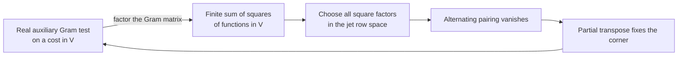

# Real matching sums of squares in order four

[Proof map index](README.md) · [Conjecture and proof tree](../README.md#proof-tree) · [Order-four routes](order-four-proof-map.md)

A matching is a permutation of the four eigenvalue labels. The matching
functions take real values on the 24 permutations.

## Permutation coordinates

The coordinates index permutations in lexicographic order. The inverse
gives the index of any permutation. In these coordinates, the reference
mixed facet has 13 zeros, which give 1716 six-element subsets.
[Permutation equivalence](../Lean/MOC/ContactCensus.lean#L62) · [Reference facet](../Lean/MOC/ContactCensus.lean#L102) · [Six-contact count](../Lean/MOC/ContactCensus.lean#L120)

## The real auxiliary test

For two subsets of the label set, the subset-image indicator is one
when a permutation maps the first subset onto the second. It is zero
otherwise. Let $V$ be the real span of these indicators. The
noncrossing coordinates give $V$ dimension 14.
[Indicator span](../Lean/MOC/RealMatchingSquares.lean#L203) · [Dimension](../Lean/MOC/RealMatchingSquares.lean#L57)

Use the auxiliary values $\beta=(0,1,-1,w)$, with $w$ a real variable.
For a permutation $\pi$ and a subset $I$, take the constant and
linear coefficients of $\prod_{i\in I}\beta_{\pi(i)}$. Let $J$ be the
matrix that has these 32 coefficients in row $\pi$. Its column space
is $V$. Write $j_\pi$ for the transpose of that row.
[Jet definition](../Lean/MOC/RealMatchingSquares.lean#L34) · [Column space](../Lean/MOC/RealMatchingSquares.lean#L170)

Let $E$ be the $32$ by $4$ matrix that selects two exceptional
directions in each block of the jet. Its two directions, with
coordinates given by subsets, are

$$
u_1(01)=u_1(23)=1,\quad u_1(02)=u_1(13)=-1,
$$

$$
u_2(01)=u_2(23)=u_2(02)=u_2(13)=1,quad
u_2(03)=u_2(12)=-2 .
$$

Their other coordinates are zero. Here $01$ means the subset
$\{0,1\}$. For a real positive semidefinite matrix $T$, the cost is
$g_\pi=j_\pi^\mathsf{T}Tj_\pi$ and its corner is
$R=E^\mathsf{T}TE$. The real auxiliary test requires that the range
of $T$ lie in the row space of $J$ and that the partial transpose of
$R$ be positive semidefinite. The partial transpose exchanges the
first tensor index of the row and column.
[Embedding](../Lean/MOC/RealMatchingSquares.lean#L273) · [Partial transpose](../Lean/MOC/RealMatchingSquares.lean#L319) · [Auxiliary test](../Lean/MOC/RealMatchingSquares.lean#L478)

For $g\in V$, the real auxiliary test is equivalent to the existence
of a finite list of functions $f_k\in V$ with
$g_\pi=\sum_k f_k(\pi)^2$ for every $\pi$.
[Lean equivalence](../Lean/MOC/RealMatchingSquares.lean#L484)

The sign of a permutation is $1$ for an even permutation and $-1$
for an odd one. The signed sum of a cost in $V$ is zero. Let
$K=\begin{pmatrix}0&1\\-1&0\end{pmatrix}^{\otimes 2}$. The signed sum of
the jet products equals $EKE^\mathsf{T}$. The resulting pairing of
$K$ and the symmetric corner $R$ is zero. It is twice the difference
between entries $(00,11)$ and $(01,10)$ of $R$. This difference also
multiplies $K$ in the partial-transpose defect. Thus the partial
transpose fixes $R$.
[Alternating sum](../Lean/MOC/RealMatchingSquares.lean#L307) · [Gram pairing](../Lean/MOC/RealMatchingSquares.lean#L400) · [Fixed corner](../Lean/MOC/RealMatchingSquares.lean#L440)

## From a positive moment to a support inequality

For signed coefficients $c_\pi$, their moment is
$J^\mathsf{T}\mathrm{diag}(c)J$. Suppose a real scalar $t$ makes the
moment of $c_\pi+t\,\mathrm{sign}(\pi)$ positive semidefinite. If the
cost $g$ lies in $V$ and is a sum of matching squares, then
$\sum_\pi c_\pi g_\pi\ge0$. The added alternating term has zero
pairing with $g$. The rank-one partial-transpose defect is a separate
identity that can help construct such a scalar.
[Positive-moment implication](../Lean/MOC/RealMatchingSquares.lean#L578) · [Rank-one defect](../Lean/MOC/RealMatchingSquares.lean#L547)

Suppose the real moment is the sum of a positive semidefinite matrix
and the embedded partial transpose of $uu^\mathsf T$, for a real
four-vector $u$. Reshape $u$ as a two-by-two matrix. Its determinant
gives the scalar correction $t$. The corrected moment is positive
semidefinite. If each real orthogonal mixer admits such a corrected
moment, the common squared-minor mixture gives the support inequality
for every complex unitary mixer and every matching sum of squares in $V$.
[Correction](../Lean/MOC/FourMatchingPhysicalPositivity.lean#L76) · [Unitary transport](../Lean/MOC/FourMatchingPhysicalPositivity.lean#L183)

For every real orthogonal matrix $O$ of order four, Lean gives the
corrected moment directly. Index the coordinates from $0$ to $3$.
For $i\in\{1,2,3\}$, let $\Delta_{0i}$ be the principal minor
on $\{0,i\}$. The scalar correction is

$$
t=\det(O)\left(\Delta_{01}\Delta_{02}\Delta_{03}
                  -\prod_{i=0}^{3}O_{ii}\right).
$$

The proof first uses a matrix with fourteen columns. The columns
give the constant, nine singleton indicators, and four two-element
indicators. Their corrected moment is a Gram matrix for the
normalized trace pairing on real matrices. These indicators span
$V$, so the corrected moment on the columns of $J$ is also positive
semidefinite. This supplies the orthogonal premise of the unitary
evaluation theorem.
[Correction formula](../Lean/MOC/FourMatchingAlternatingCorrection.lean#L102) · [Indicator Gram matrix](../Lean/MOC/FourOrthogonalCorrectedMoment.lean#L154) · [Indicator span](../Lean/MOC/FourMatchingIndicatorBasis.lean#L47) · [Corrected moment on the matching jet](../Lean/MOC/FourOrthogonalMatchingMomentTransport.lean#L12)

For every complex unitary mixer of order four, the signed determinant
weights give a nonnegative value to each cost in $V$ that is a sum of
matching squares. For complex eigenvalue lists and a complex direction,
take the cost whose value at each permutation is the support height
minus the projected matching product. If this cost belongs to $V$ and
is a sum of matching squares, the determinant projection is at most
the support height.
[Unitary evaluation](../Lean/MOC/FourMatchingPhysicalPositivity.lean#L201) · [Directional bound](../Lean/MOC/FourMatchingPhysicalPositivity.lean#L227)

### Wall cost

Let $r_i$ be the ordinary matching indicator of index $i$. Define
$h=1-r_0-r_1-r_4+r_{10}+r_{16}-r_{23}$. For all real $c,q>0$ and
$a\ge 1/c+1/q$, the cost $h+a r_{27}+c r_{29}+q r_5$ is a sum
of real matching squares.
[Ordinary indicators](../Lean/MOC/FourSupportCostProfiles.lean#L76) · [Square certificate](../Lean/MOC/FourMatchingCompensation.lean#L94)

Let $L_U$ be the signed evaluation at an order-four unitary $U$.
Put $A=\sqrt{L_U(r_{27})}$, $B=\sqrt{L_U(r_{29})}$, and
$C=\sqrt{L_U(r_5)}$. The three radicands are squared minor moduli.
If a multiple of the alternating sign makes the moment of the
signed weights positive semidefinite, then
$L_U(h)+2A(B+C)\ge0$. The bound includes zero radicands.
[Signed evaluation](../Lean/MOC/FourMixedRayCancellation.lean#L544) · [Amplitude certificate](../Lean/MOC/FourMatchingCompensation.lean#L173)

## Scope

The Lean source uses the real auxiliary triple $(0,1,-1)$. The
correspondence with the complex auxiliary triple $(0,1,i)$ uses a
separate fractional linear change of coordinates. For a determinant
proof, a further step must place the actual spectral support costs in
the matching sum-of-squares cone. This spectral test remains open
for general support costs.

An exact integer check covered all 24 permutations, the column-span
certificates, and the signed kernel. A symbolic calculation checked
the partial-transpose identities for every symmetric corner. Lean
checks the real matching-square equivalence and the positive-moment
implication.
