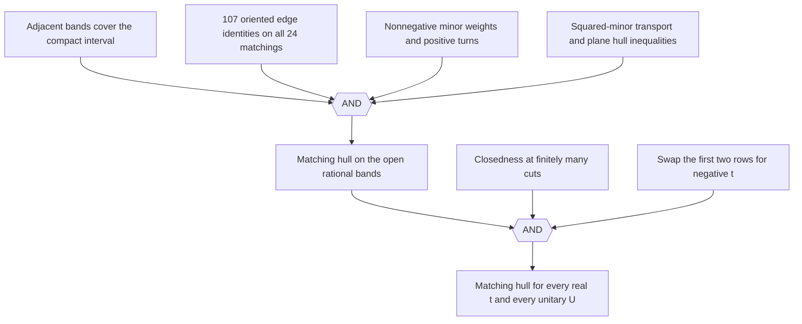

# Order-four real-parameter spectrum

[Proof map index](README.md)

Let $t$ be real and let $U$ be a complex unitary matrix of order four.
Write $U^*$ for the conjugate transpose and $\mathrm{diag}(a)$ for the
diagonal matrix with entries $a_j$. Use the spectral lists

$$
a(t)=(t+i,-t+i,1,2+i), \qquad b=(-1+i,-2-2i,2-i,1+2i).
$$

Lean proves that for every $t$ and $U$, the
determinant of $\mathrm{diag}(a(t))+U\mathrm{diag}(b)U^*$ belongs to
the real convex hull of the 24 matching products
$\prod_j(a(t)_{\sigma(j)}+b_j)$. The permutation $\sigma$ sends a
column index to a row index. All ten certificate modules passed the
project build. The endpoint passed the standard axiom audit.
[Theorem in Lean](../Lean/MOC/FourRealParameterCells.lean#L142)

## Compact parameter and band coverage

For $t>0$, set $x=t/(1+t)$. Then $0<x<1$ and $t=x/(1-x)$.
Multiply the two factors that contain the first two entries of $a(t)$
by $1-x$. The product becomes a polynomial in $x$. This multiplies
each matching product and the determinant by the same positive
factor $(1-x)^2$. Cancel this factor after the hull calculation.
[Scaled vertex](../Lean/MOC/FourRealParameterFamily.lean#L994) · [Compact chart theorem](../Lean/MOC/FourRealParameterFamily.lean#L1023)

The certificate uses 89 polygons on 173 intervals with rational
endpoints. There are 89 inner intervals and 84 intervals around
transitions. At each transition interval, the sign of a specified
polynomial selects one of the two adjacent polygons. The intervals
meet at their endpoints and cover $[0,1]$. The endpoints and the roots
of the specified nonzero polynomials form a finite set. Closedness
covers the corresponding finite values of $t$. Swapping the first
two entries of $a(t)$ sends $t$ to $-t$.
[Interval adjacency](../Lean/MOC/FourRealParameterBandCertificate.lean#L20) · [Closedness and row swap](../Lean/MOC/FourRealParameterFamily.lean#L656)

## Edge and turn certificates

For an oriented edge, its gap at a matching product is the signed
area of the edge vector and the vector from the start of the edge to
the product. Each of the 107 edge identities expresses this gap as a
weighted sum of subset-image indicators on all 24 permutations. An
indicator is one when a permutation sends the specified column set
to the specified row set. It is zero otherwise. Replacing each
indicator by the squared modulus of the corresponding minor of $U$
gives the gap at the scaled determinant. The weights are nonnegative.
Thus the determinant lies on the inner side of each edge. Positive
turns at the vertices give membership in their real convex hull.
[Edge identities](../Lean/MOC/FourRealParameterFacetCertificate.lean#L16) · [Minor transport](../Lean/MOC/TwoValues.lean#L195) · [Plane hull proof](../Lean/MOC/PlaneHullEdges.lean#L55)

Write each weight as a product of signed integer polynomials and
squares. Each square is nonnegative. The polynomial that selects
the polygon has the known sign for that selection. For each other
signed factor, use the quartic Bernstein basis on the interval.
Nonnegative Bernstein coefficients with at least one positive
coefficient give a positive value in the open interval. All factors
in the turn identities must be positive there.
[Bernstein sign proof](../Lean/MOC/FourRealParameterCellData.lean#L66) · [Turn identities](../Lean/MOC/FourRealParameterPolygonCertificate.lean#L13) · [Interval sign checks](../Lean/MOC/FourRealParameterSignCertificate.lean#L45)

An independent rational arithmetic check covered the 257 possible
polygon selections and the 107 edge identities on the 24 permutations.
[Certificate data](https://github.com/ascendnoosphere/MOC/blob/6fa170647b8e111ef388ba95d50e4196960d9c22/data/certificates/categorical/category_moc4_all_real_certificate.json)

## Direct interval proofs

Lean checks two smaller certificates on parts of the real line. The bounded
interval certificate uses nine edges for $|t|\le 1/20$. The tail
certificate uses eight edges for $|t|\ge 99$ after the substitution
$s=5/(1+|t|)$. Both use a coefficient bound for polynomials on
$0<s\le 1/20$, with $s=|t|$ in the bounded interval. Closedness covers
$t=0$.
[Bounded interval](../Lean/MOC/FourRealParameterFamily.lean#L630) · [Unbounded tails](../Lean/MOC/FourRealParameterFamily.lean#L964)

## Lean check status

| Lean scope | Lean Checked? |
| --- | --- |
| The 9 source modules linked in this map | Partial (2/9) |

[Status definitions](README.md#lean-check-status). Paper arguments retain their stated scope.
