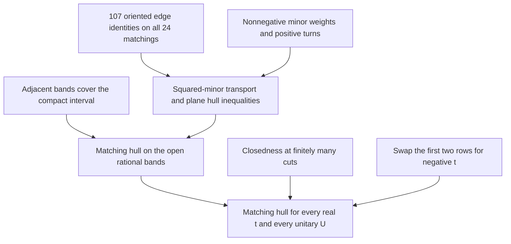

# Order-four real-parameter spectrum

[Proof map index](README.md)

Let $t$ be real and let $U$ be a unitary matrix of order four. Write $U^*$ for the conjugate transpose. Use the spectral lists

$$
a(t)=(t+i,-t+i,1,2+i), \qquad b=(-1+i,-2-2i,2-i,1+2i).
$$

For every $t$ and $U$, the determinant of $\mathrm{diag}(a(t))+U\mathrm{diag}(b)U^*$ is in the convex hull of the 24 matching products $\prod_j(a(t)_{\sigma(j)}+b_j)$. The permutation $\sigma$ sends a column index to a row index. The Lean source gives the full argument. Kernel verification is pending. [Full theorem](../Lean/MOC/FourRealParameterCells.lean#L1288)

## Compact parameter and band coverage

For $t>0$, set $x=t/(1+t)$. This change of variable gives $0<x<1$ and $t=x/(1-x)$. Multiply the first two row factors of each matching product by $1-x$. This multiplies the product by $(1-x)^2$ and gives a polynomial in $x$. Cancel the same positive factor after the hull calculation. [Scaled vertex](../Lean/MOC/FourRealParameterFamily.lean#L811) · [Compact chart theorem](../Lean/MOC/FourRealParameterFamily.lean#L840)

The certificate uses 89 polygon charts on 173 rational bands. There are 89 inner bands and 84 brackets around algebraic transitions. In a bracket, the sign of a specified polynomial selects one of the two adjacent charts. The endpoints of adjacent bands agree. Their union covers $[0,1]$. The band endpoints and the roots of the specified nonzero polynomials form a finite set. Closedness covers those cut points at finite $t$. Swapping the first two entries of $a(t)$ sends $t$ to $-t$. [Band adjacency](../Lean/MOC/FourRealParameterCells.lean#L1167) · [Closedness and row swap](../Lean/MOC/FourRealParameterFamily.lean#L478)

## Edge and turn certificates

For an oriented edge, its gap at a matching product is the signed cross product with the edge direction. Each of the 107 distinct edge identities expresses this gap as a weighted sum of subset-image indicators on all 24 permutations. The same weights express the gap at the scaled determinant as a sum of squared minors of $U$. Nonnegative weights place the determinant on the inner side of each edge. Strict turns at the selected vertices then give membership in their convex hull. [Edge identities](../Lean/MOC/FourRealParameterCells.lean#L1130) · [Minor transport](../Lean/MOC/TwoValues.lean#L182) · [Plane hull proof](../Lean/MOC/PlaneHullEdges.lean#L55)

Write each weight as a product of signed integer polynomials and squares. A square contributes a nonnegative factor. Use the sign of the chart-selection polynomial for its own factor. For every other signed factor, use the quartic Bernstein basis on the rational band. Nonnegative Bernstein coefficients with at least one positive coefficient give a positive value in the open band. Strict turns have no unchecked square factors. [Bernstein sign proof](../Lean/MOC/FourRealParameterCells.lean#L62) · [Turn identities](../Lean/MOC/FourRealParameterCells.lean#L1139) · [Band sign checks](../Lean/MOC/FourRealParameterCells.lean#L1158)

Independent rational arithmetic checked all 257 chart-selection cases that can occur and all 107 edge identities on the 24 permutations. [Historical certificate](https://github.com/ascendnoosphere/MOC/blob/6fa170647b8e111ef388ba95d50e4196960d9c22/data/certificates/categorical/category_moc4_all_real_certificate.json)

## Direct interval proofs

Two smaller certificates give independent routes on parts of the real line. The bounded proof uses nine edges for $|t|\le 1/20$. The tail proof uses eight edges for $|t|\ge 99$ after the substitution $s=5/(1+|t|)$. Both use a coefficient bound for polynomials on $0<s\le 1/20$, with $s=|t|$ in the bounded proof. [Bounded interval](../Lean/MOC/FourRealParameterFamily.lean#L452) · [Unbounded tails](../Lean/MOC/FourRealParameterFamily.lean#L781)
