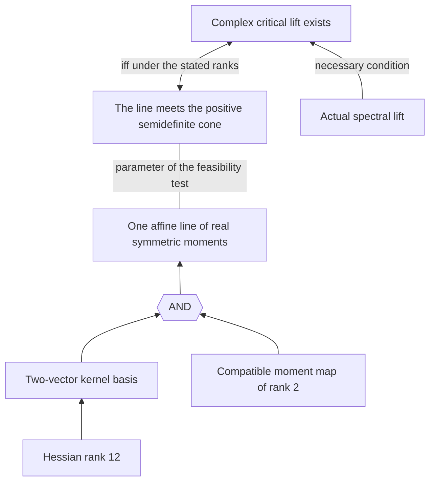

# Order-four real spectral lift

[Proof map index](README.md) · [Unrestricted conjecture](../README.md#proof-tree) · [Order-four routes](order-four-proof-map.md)

The order-four matching cubic is a polynomial in fourteen matching
coordinates. Write $G$ for its gradient and $H(f)$ for its Hessian at
a real vector $f$. For a real vector $g$, the complex critical equation
$G(f+ig)=0$ is equivalent to $H(f)g=0$ and $G(g)=G(f)$. Every
spectral profile in these coordinates satisfies this critical equation.
[Matching coordinates](../Lean/MOC/FourMatchingRelations.lean#L16) · [Spectral vanishing](../Lean/MOC/FourMatchingRelations.lean#L120) · [Critical equations](../Lean/MOC/FourMatchingLift.lean#L39)

## Affine line reduction

If $H(f)$ has rank twelve, rank-nullity gives a two-vector basis
$x,y$ of its kernel. Put

$$
L(a,b,c)=aG(x)+b\bigl(G(x+y)-G(x)-G(y)\bigr)+cG(y).
$$

For $g=sx+ty$ the moment coordinates are $(s^2,st,t^2)$.
They form the symmetric matrix with diagonal entries $s^2,t^2$
and off-diagonal entry $st$. This matrix is positive semidefinite
and singular. Its image under $L$ is $G(g)$.
[Kernel basis](../Lean/MOC/FourSupportCostRealLift.lean#L60) · [Moment map](../Lean/MOC/FourSupportCostRealLift.lean#L44)

For rank at most two, $L$ has a nonzero null direction. A positive
semidefinite solution of $L(a,b,c)=G(f)$ can move along that direction
to a singular positive semidefinite matrix. The matrix factors as
$(s,t)^{\mathsf{T}}(s,t)$ for real $s,t$. Thus positive semidefinite feasibility
is exact for the complex critical equation. For rank two, first test
that $G(f)$ is in the range of $L$. Then any particular solution $A$
and a nonzero null vector $W$ give the complete line $A+rW$.
[Moment equivalence](../Lean/MOC/FourSupportCostRealLift.lean#L93) · [Affine line equivalence](../Lean/MOC/FourSupportCostRealLift.lean#L152)

## Scalar tests on the line

Let $D=\det W$ and write $\det(A+rW)=Dr^2+Br+C$.
Positive semidefiniteness of a real symmetric two-by-two matrix is
equivalent to nonnegative determinant and trace.
[Determinant and trace](../Lean/MOC/FourSupportCostRealLift.lean#L22) · [Determinant polynomial](../Lean/MOC/FourSupportCostRealLift.lean#L181)

| Direction | Feasibility test |
| --- | --- |
| $D<0$ | Test the determinant and trace at $r=-B/(2D)$. This test includes the repeated-root case. [Midpoint](../Lean/MOC/FourSupportCostRealLift.lean#L292) |
| $D>0$ | A positive semidefinite point exists. For large parameters of the appropriate sign, the determinant and trace are positive. [Definite direction](../Lean/MOC/FourSupportCostRealLift.lean#L419) |
| $D=0$, $B\ne 0$ | Test the trace at $r=-C/B$. It must be nonnegative. [Single determinant root](../Lean/MOC/FourSupportCostRealLift.lean#L350) |
| $D=B=0$ and $W\ne 0$ | A positive semidefinite point exists exactly when $C=0$. [Constant determinant](../Lean/MOC/FourSupportCostRealLift.lean#L373) |

For $D<0$, the midpoint determinant is $-(B^2-4DC)/(4D)$.
When the discriminant is positive, its trace decides the sign of the
definite matrices between the roots. A negative discriminant excludes the
lift. At discriminant zero, use the non-strict trace test.
[Discriminant formula](../Lean/MOC/FourSupportCostRealLift.lean#L321)

## Compatibility and finite labels

Let $u+iy$ and $v-iy$ be two complex critical profiles with real
midpoint $f=(u+v)/2$. Put $z=(u-v)/2$. Both $y$ and $z$ lie in
the kernel of $H(f)$, and $G(f)=G(y)-G(z)$. On a two-vector kernel
basis, each term on the right is the image of a rank-one moment.
Their difference gives a particular real moment solution. This
proves compatibility for an actual midpoint of two critical profiles,
including when this particular solution is indefinite.
[Real secant compatibility](../Lean/MOC/FourSupportCostRealLift.lean#L532)

Suppose a profile is given by the bracket products of eight nonzero
vectors $(p_i,q_i)$ in $\mathbb C^2$. Choose a complex number $t$
so that each $h_i=q_i+tp_i$ is nonzero. The excluded set is finite.
Put $z_i=p_i/h_i$. Each bracket becomes
$(z_i-z_j)h_ih_j$. Every matching uses all eight indices exactly once,
so all its bracket products have the same factor $\prod_i h_i$.
Use the first four $z_i$ as one spectrum and the negatives of the
last four as the other. This supplies finite labels and a nonzero
common factor. Repeated labels are allowed.
[Finite labels from bracket data](../Lean/MOC/FourSupportCostRealLift.lean#L452)

## Scope of the chart

The Lean source gives the feasibility test under the stated ranks.
The geometric restriction-rank result on the complex secant variety
uses the polar-map contraction of the eight-point cubic and a tangent
space argument. It remains a paper argument here. The Lean test decides
the critical equation. The quotient result that supplies bracket data
for each nonzero complex critical vector also remains a paper argument.
[Polar map, Theorem 3.4](https://arxiv.org/abs/1103.5255) · [Critical cone, Theorem 1.1](https://arxiv.org/abs/0809.1233) · [Paper restriction-rank proof](https://github.com/ascendnoosphere/MOC/blob/14cf959d78ae5828a92013d13a65b9c50ebb01d0/Docs/research/CORANK_TWO_LIFT_EXACTNESS.md)

An infeasible line excludes an actual spectral profile. A feasible line
still requires further conditions to establish the determinant support
inequality.
