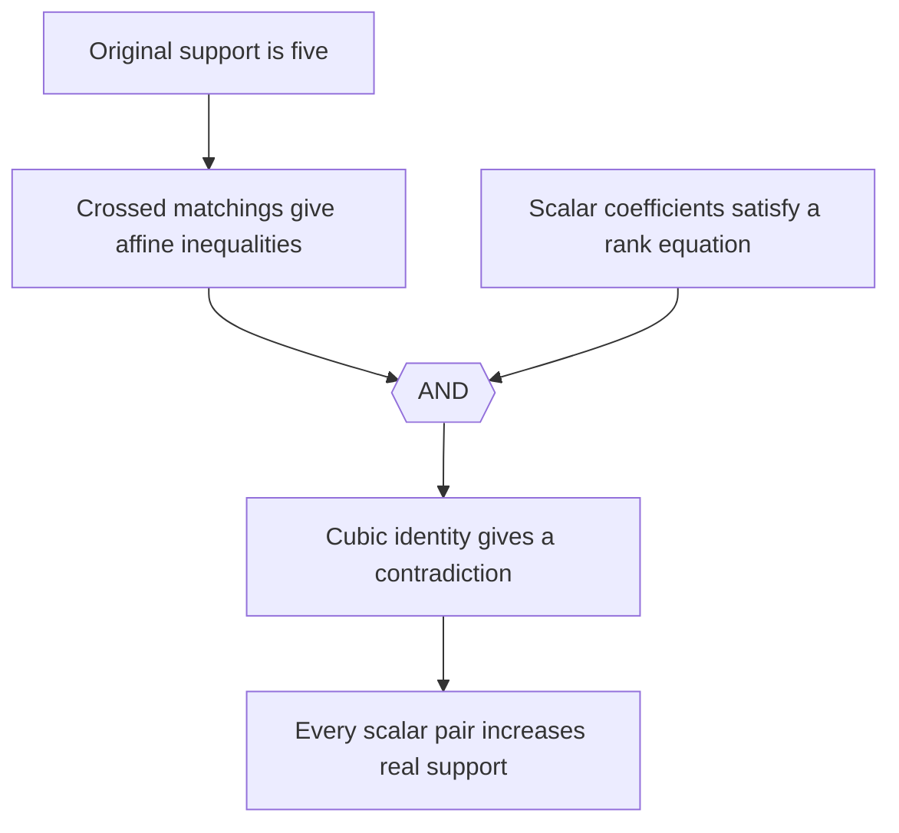

# Order-four scalar padding obstruction

[Proof map index](README.md)

Let $a$ and $b$ be two spectral lists of length four. A permutation
$p$ sends each column label $j$ to a row label $p(j)$. Its matching
product is $P_p=\prod_j(a_{p(j)}+b_j)$. The real support of the matching
hull is $\max_p \mathrm{Re}\,P_p$.

A scalar padding step appends $c$ to $a$ and $d$ to $b$, where
$c+d\ne0$. It divides each enlarged matching product by $c+d$.
Some enlarged matchings pair the two new labels. Their normalized
products give the original matching products. A sufficient condition
for transfer from order five to order four in the real direction is
that every normalized product stays at or below the original real
support. Block diagonal padding multiplies the actual determinant
by $c+d$, so division recovers the determinant at order four.

For the following lists, the original real support is $5$.
For every $c,d\in\mathbb C$ with $c+d\ne0$, there is a permutation of
the five labels whose normalized matching product has real part
greater than $5$.

$$
a=(2+i,\ 2i,\ -2+2i,\ 2-2i), \qquad
b=(1,\ 1-2i,\ -1-i,\ -2).
$$

[Original upper bound](../Lean/MOC/DuplicateAnchorObstruction.lean#L97) ·
[Matching that attains the bound](../Lean/MOC/DuplicateAnchorObstruction.lean#L104) ·
[Obstruction for every scalar pair](../Lean/MOC/ScalarAnchorObstruction.lean#L851)

## Proof map

Fix an original matching $p$ and a column $j$. Put $u=a_{p(j)}$
and $v=b_j$. Let $Q$ be the product of the three factors in
$P_p$ at the other columns. Exchanging the pair $(u,v)$ with the
two new labels gives the normalized product $Q(u+d)(c+v)/(c+d)$.
Write

$$
h=\frac{cd}{c+d}, \qquad
f=\frac{d}{c+d}, \qquad
k=\frac{1}{c+d}.
$$

The factor that multiplies $Q$ is $u+h+f(v-u)+kuv$.
Also, $hk=f(1-f)$. The real and imaginary parts of this equation
give two real polynomial equations. [Scalar equation](../Lean/MOC/ScalarAnchorObstruction.lean#L298) ·
[Replacement factor](../Lean/MOC/ScalarAnchorObstruction.lean#L305)

If every enlarged matching had normalized real part at most $5$,
each of 29 selected crossed matchings would give a nonnegative difference
between $5$ and the real part of its normalized product. Each
difference is affine in the real and imaginary parts of $h,f,k$.
The certificate writes a negative integer as a sum of 71 terms
with positive weights, plus nine polynomial multiples of the two
real equations. Each of the 71 terms is a product of at most three
of the differences.
The first sum must be nonnegative and the remaining terms must be
zero. The Lean proof checks this polynomial identity in the six
real variables and checks the crossed matchings that give the affine
differences. [Polynomial certificate](../Lean/MOC/ScalarAnchorObstruction.lean#L103) ·
[First crossed matching](../Lean/MOC/ScalarAnchorObstruction.lean#L330)

The example rules out this scalar padding criterion for full
downward transfer. The general implication from order five to order
four remains open.
