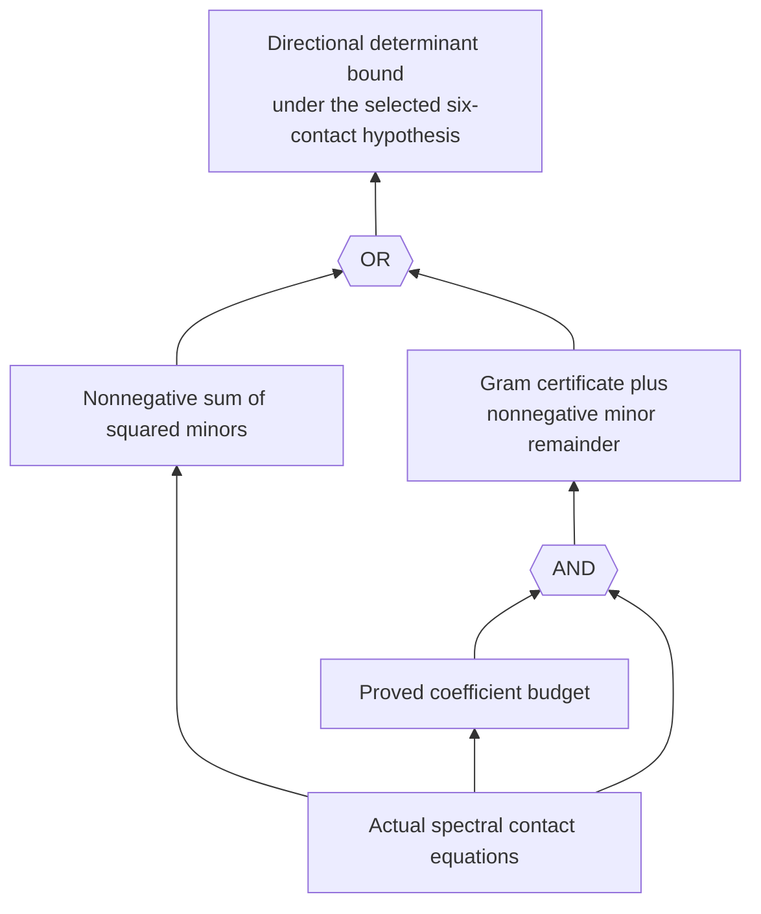

# Order-four support bounds from six contacts

[Proof map index](README.md) · [Order-four map](order-four-proof-map.md#contact-patterns) · [Conjecture and notation](../README.md)

Let $a,b$ be complex eigenvalue lists of length four. Let $U$ be any
complex unitary matrix of order four. Set
$D=\det(\mathrm{diag}(a)+U\mathrm{diag}(b)U^*)$.
For a permutation $\sigma$, set
$P_\sigma=\prod_{j=0}^3(a_{\sigma(j)}+b_j)$.
The directional bound compares the real projections of $D$ and these
24 products. [Determinant](../Lean/MOC/Core.lean#L24) · [Matching products](../Lean/MOC/Core.lean#L21)

Fix $\eta\in\mathbb C$ and $H\in\mathbb R$. Suppose
$H\le\mathrm{Re}(\eta P_\sigma)$ for every permutation $\sigma$.
A contact is a permutation for which equality holds. Each row below
specifies six contacts and states
$H\le\mathrm{Re}(\eta D)$ for every such $U$.
Additional contacts and repeated eigenvalues are allowed. Replacing
$\eta,H$ by $-\eta,-H$ gives the corresponding upper bound.
The check column reports whether Lean checked the full support proof.

Number the permutations of $\{0,1,2,3\}$ from 0 through 23 in
lexicographic order. Write $p_i$ for permutation $i$ and $q_i=p_i^{-1}$.
Each contact set in the table lists the indices $i$ of $q_i$.
[Permutation enumeration](../Lean/MOC/ContactCensus.lean#L15)

| Contact pattern | Indices of the six contacts | Proof method and exact Lean statement | Lean Checked? |
| --- | --- | --- | --- |
| Entry face | $\{0,1,2,3,6,7\}$ | The contact equations give an entry-face minor certificate. [Support bound](../Lean/MOC/FourEntryFaceSupport.lean#L337) | Yes |
| Equal chords | $\{0,1,2,3,6,8\}$ | The spectral equations equate two further projections. Eleven squared minors give the bound. [Support bound](../Lean/MOC/FourEqualChordContactSupport.lean#L339) | Yes |
| Negative defect | $\{0,1,2,3,7,8\}$ | One scalar defect selects an ordinary minor certificate or a two-coefficient Gram certificate. [Support bound](../Lean/MOC/FourNegativeDefectSupport.lean#L13) | Yes |
| Quadratic ratios | $\{0,1,4,5,7,8\}$ | Ratios of quadratic polynomials give the coefficient inequality for a four-coefficient Gram certificate. [Support bound](../Lean/MOC/FourQuadraticRatioSupport.lean#L19) | Yes |
| Mixed budgets | $\{1,2,3,4,6,8\}$ | The signs of the spectral parameters select two-coefficient and four-coefficient Gram certificates. [Support bound](../Lean/MOC/FourMixedBudgetSupport.lean#L14) | Yes |
| Geometric budget | $\{0,1,2,4,6,8\}$ | The spectral chart gives ordinary minor certificates or a Gram certificate with a nonnegative minor remainder. [Support bound](../Lean/MOC/FourGeometricBudgetSupport.lean#L11) | No |
| Ordered ratios | $\{1,2,3,4,6,7\}$ | Ordering the real ratios gives the coefficient inequality for a two-coefficient Gram certificate. [Support bound](../Lean/MOC/FourOrderedRatioSupport.lean#L14) | Yes |
| Rectangle cone | $\{0,3,5,9,11,12\}$ | For distinct spectra and nonzero pair sums, a rectangle of disjoint swaps forces zero height. The spectral cubic removes the mixed coefficient. Ordinary minors give the bound. [Support bound](../Lean/MOC/FourRectangleConeSupport.lean#L276) | No |

These names identify proof methods. The displayed contact sets specify
the hypotheses. None of these individual bounds proves the unrestricted
order-four conjecture. The source for the original contact classification
is Zheng, *The Marcus–de Oliveira conjecture for n = 4*, Proposition 4.3
and its supplement.
[Paper](https://doi.org/10.13140/RG.2.2.36790.25923) · [Pinned supplement](https://github.com/DongzheZheng/The-Marcus-de-Oliveira-conjecture-for-n-4/tree/53ec16567d2307266ce52a8e9678410b2457cc27)

The final theorems also cover the degenerate branches. They use proved
inclusion results when an eigenvalue repeats or a pair sum is zero.
The bound is immediate when the direction is zero.

## Proof routes

A squared minor is the squared absolute value of a square submatrix
determinant. Its value is nonnegative. A Gram certificate writes a
response as a positive semidefinite quadratic form. A coefficient
budget is the scalar inequality that makes that form positive
semidefinite.

The ordinary route uses the signed determinant expansion and the
subset-image law. A subset-image event specifies which row labels a
permutation assigns to a column set. Its signed weight sum equals the
corresponding squared minor.
[Shared minor certificate](../Lean/MOC/FourMinorCertificate.lean#L46)

The Gram route first proves the budget from the actual spectra.
The final support theorems discharge this premise. The intermediate
conditional certificates retain their stated coefficient hypotheses.
[Two-coefficient certificate](../Lean/MOC/FourTwoBudgetMinor.lean#L32) · [Four-coefficient certificate](../Lean/MOC/FourBudgetMinor.lean#L33)

## General lemmas retained with these routes

The projective support theorem uses real homogeneous coordinates
$(x,y)$ for a point on the real projective line. Its matching factors
are brackets $x_i y_j-y_i x_j$. It proves the directional support
bound for real projective lists. A second theorem permits one selected
pair of exceptional points under its stated alignment inequalities.
[Real projective support](../Lean/MOC/ProjectiveTwoOutlierSupport.lean#L70) · [Aligned exceptional points](../Lean/MOC/ProjectiveTwoOutlierSupport.lean#L174)

The paired-cofactor inequalities bound a difference of two complementary
cofactors from row and column norm constraints. They apply independently
of the contact enumeration.
[Cofactor deficit](../Lean/MOC/CofactorPairDeficit.lean#L25) · [Weighted comparison](../Lean/MOC/CofactorPairDeficit.lean#L76)

A triangle and a rectangle of contacts force zero height and additional
contacts under the distinctness and nonzero-product hypotheses in the
statement. The general theorem includes every label choice.
[Contact completion](../Lean/MOC/TriangleRectangleContact.lean#L114)

The allocation and residue lemmas give nonnegative coefficient
decompositions under explicit real inequalities.
[Coefficient allocation](../Lean/MOC/MinorCoefficientAllocation.lean#L36) · [Residue compensation](../Lean/MOC/ProjectiveResidueCompensation.lean#L50)

## Lean check status

| Lean scope | Lean Checked? |
| --- | --- |
| The source modules linked in this map | Partial (14/18) |

Before the latest refactor, compilation passed for the entry-face,
equal-chord, and mixed-budget support theorems. The negative-defect,
quadratic-ratio, and ordered-ratio routes had compile errors. The bounded
build batches ended before the geometric-budget and rectangle-cone checks
finished. The latest proof edits have not been compiled. The table marks
changed routes and their dependent modules as unchecked.

[Status definitions](README.md#lean-check-status). Conditional lemmas retain
their stated hypotheses.
