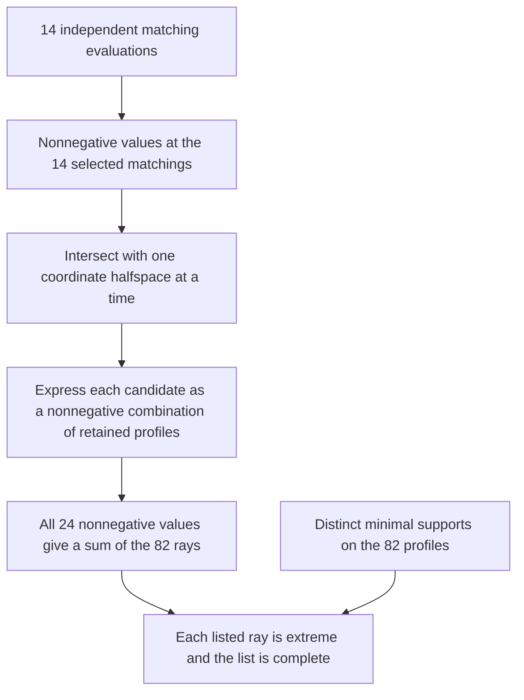

# Order-four support-cost cone

[Proof map index](README.md)

Let a matching be a permutation of four labels. A matching profile assigns
one number to each of the 24 matchings. A subset-image indicator is one
when the permutation sends a specified subset onto another subset of
the same size. It is zero otherwise. The noncrossing
matching evaluation gives 14 coordinates for the space of profiles that
these indicators span. A support cost is a profile in this space whose
entries are nonnegative. [Matching evaluation](../Lean/MOC/FourMatchingRelations.lean#L196)
[Equality of spans](../Lean/MOC/FourSupportConeClassification.lean#L903)
[Support cost](../Lean/MOC/FourSupportConeClassification.lean#L791)

The cone has 34 ordinary extreme rays and 48 mixed extreme rays. The
ordinary rays are the 16 singleton-image indicators and the 18 pair-image
indicators with source pair containing zero. Complementing both pairs
gives the other pair indicators. The mixed rays are a relabeling orbit of the sum of three
ordinary indicators minus a fourth.
[Ordinary rays](../Lean/MOC/FourSupportCostProfiles.lean#L134) · [Mixed rays](../Lean/MOC/FourSupportCostProfiles.lean#L137)

## Proof map

Use the 14 matching evaluation labels
`0, 1, 2, 3, 4, 6, 7, 8, 9, 10, 12, 13, 16, 18` as the initial
coordinates. Their inverse recovers the noncrossing coordinates. Thus
nonnegative values at these labels give a nonnegative sum of 14 initial
rays. Add the remaining 10 inequalities. At each step, keep each ray
whose value at the new label is nonnegative. For a pair of old rays with
opposite signs at that label, take the positive combination whose value
at the label is zero. A balancing identity proves that these candidates
generate the intersection. [Basis and cuts](../Lean/MOC/FourSupportConeClassification.lean#L212)
[Balancing identity](../Lean/MOC/FourSupportConeClassification.lean#L86)

The search keeps one candidate for each minimal support on the active
coordinates. For each input profile $v$, it finds a positive integer $d$
and nonnegative integer coefficients $c_i$ for the retained profiles
$r_i$. The checker verifies $d v=\sum_i c_i r_i$ at all 24 matchings.
Thus each input profile is a nonnegative sum of retained profiles.
The ten cuts have a total of 2,261 input profiles. A final check places
each profile in the last list among the named ordinary and mixed rays.
[Checker](../Lean/MOC/FourSupportConeClassification.lean#L394)
[Final list](../Lean/MOC/FourSupportConeClassification.lean#L652)
[Decomposition](../Lean/MOC/FourSupportConeClassification.lean#L809)

The listed profiles have different supports, and none of these supports
is a proper subset of another. If two support costs sum to a listed
profile, they vanish wherever that profile vanishes. In each cost
decomposition, only the listed profile can have positive weight. Thus
each listed profile spans an extreme ray. Conversely, in a decomposition
of any nonzero extreme cost, each positive-weight summand lies on that
ray. The two indexed families therefore account for all the extreme rays.
[Support test](../Lean/MOC/FourSupportConeClassification.lean#L735)
[Extremality](../Lean/MOC/FourSupportConeClassification.lean#L827)

The historical certificate records a closed oriented chain in the
boundary of the matching polytope. [Historical certificate](https://github.com/ascendnoosphere/MOC/blob/14cf959d/data/certificates/geometry/cone82_completeness_certificate.json)

## Lean check status

| Lean scope | Lean Checked? |
| --- | --- |
| The 3 source modules linked in this map | Partial (1/3) |
| [FourSupportConeClassification.lean](../Lean/MOC/FourSupportConeClassification.lean#L903) | No |
| [FourSupportCostProfiles.lean](../Lean/MOC/FourSupportCostProfiles.lean#L134) | No |

[Status definitions](README.md#lean-check-status). Paper arguments retain their stated scope.
