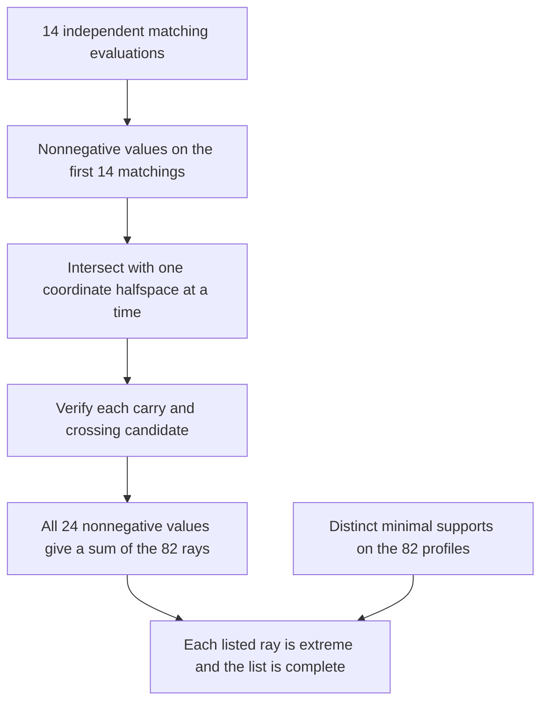

# Order-four support-cost cone

[Proof map index](README.md)

Let a matching be a permutation of four labels. A matching profile assigns
one number to each of the 24 matchings. A graded-minor indicator is one
when the permutation sends the source subset to the target subset. It is
zero otherwise. The two subsets have the same size. The noncrossing
matching evaluation gives 14 coordinates for the space of profiles that
these indicators span. A support cost is a profile in this space whose
entries are nonnegative. [Matching evaluation](../Lean/MOC/FourMatchingRelations.lean#L196)
[Equality of spans](../Lean/MOC/FourSupportConeClassification.lean#L617)
[Support cost](../Lean/MOC/FourSupportConeClassification.lean#L472)

The cone has 34 ordinary rays and 48 mixed rays. The ordinary rays are the
16 singleton-image indicators and the 18 pair-image indicators with source
pair containing zero. Complementing both pairs gives the other pair
indicators. The mixed rays are a relabeling orbit of the sum of three
ordinary indicators minus a fourth. [Ray definitions](../Lean/MOC/FourSupportCostProfiles.lean)

## Proof map

Use the 14 matching evaluation labels
`0, 1, 2, 3, 4, 6, 7, 8, 9, 10, 12, 13, 16, 18` as the initial
coordinates. Their inverse recovers the noncrossing coordinates. Thus
nonnegative values at these labels give a nonnegative sum of 14 initial
rays. Add the remaining 10 inequalities. At each step, keep each ray
whose value at the new label is nonnegative. For a pair of old rays with
opposite signs at that label, take the positive combination whose value
at the label is zero. A balancing identity proves that these candidates
generate the intersection. [Basis and cuts](../Lean/MOC/FourSupportConeClassification.lean#L304)
[Balancing identity](../Lean/MOC/FourSupportConeClassification.lean#L82)

The checker retains candidates with minimal support on the active
coordinates and removes duplicate supports. It checks that each original
candidate is a nonnegative sum of the retained rays. This check takes
positive integer multiples and subtracts nonnegative integer multiples of
retained rays until the residual is zero. Its soundness proof uses only
those arithmetic operations. The 10 steps give 2,261 candidates to check.
The last list consists of the named ordinary and mixed profiles.
[Checker](../Lean/MOC/FourSupportConeClassification.lean#L239)
[Decomposition](../Lean/MOC/FourSupportConeClassification.lean#L490)

The listed profiles have different supports, and none of these supports
is a proper subset of another. If two support costs sum to a listed
profile, they vanish wherever that profile vanishes. In each cost
decomposition, only the listed profile can have positive weight. Thus
each listed profile spans an extreme ray. Conversely, in a decomposition
of any nonzero extreme cost, each positive-weight summand lies on that
ray. The two indexed families therefore account for all the extreme rays.
[Extremality](../Lean/MOC/FourSupportConeClassification.lean#L508)

The published note used a closed oriented chain in the boundary of the
matching polytope. This Lean source uses successive intersections
instead. An independent integer replay checked the initial basis, the
2,261 candidates, the final list, and its minimal supports. The Lean
source awaits kernel verification. [Historical certificate](https://github.com/ascendnoosphere/MOC/blob/14cf959d/data/certificates/geometry/cone82_completeness_certificate.json)
