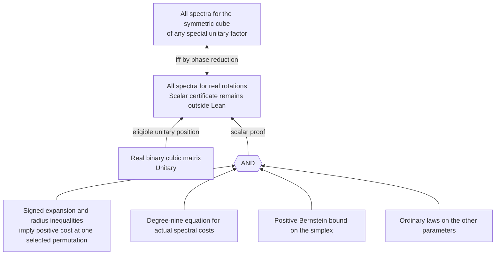

# Order-four symmetric cube mixer reduction

[Proof map index](README.md) · [Conjecture and notation](../README.md) · [Order-four proof map](order-four-proof-map.md)

Let $G$ be a complex unitary matrix of order two with determinant
one. The symmetric cube of $G$ acts on the homogeneous polynomials
of degree three in $x,y$. Its matrix $U$ has order four in the basis
$x^3,\sqrt{3}x^2y,\sqrt{3}xy^2,y^3$. The target is the
Marcus–de Oliveira inclusion for every pair of complex spectra when
$U$ is the change between the two eigenbases.
[Matrix definition](../Lean/MOC/BinaryCubicMixerReduction.lean#L22)

The reduction in the Lean source uses real rotations
$\begin{pmatrix}c&s\\-s&c\end{pmatrix}$ with $c,s\ge0$ and
$c^2+s^2=1$. The symmetric cube of each such rotation is unitary.
Multiplying rows or columns by complex numbers of modulus one
preserves the determinant comparison. Thus inclusion for all
spectra at these real rotations is equivalent to inclusion for
all spectra at the symmetric cubes of the complex matrices $G$.
[Equivalence](../Lean/MOC/BinaryCubicMixerReduction.lean#L152) · [Unitarity](../Lean/MOC/BinaryCubicMixerReduction.lean#L57)

For a finite list of costs, let $a\ge0$ be the cost at one selected
permutation. Let $h_i\ge0$ be the other costs. Suppose $p<0$ and a
signed sum uses weight $p/2$ at the selected permutation and weights
$w_i$ elsewhere. If there are positive $R_i$ with $R_iw_i+p\ge0$
and the signed sum is negative, then $a>0$ and
$\sum_i (2h_i/a)/R_i<1$. This bound places the normalized costs
inside the region of the simplex certificate.
[Conditional cost normalization](../Lean/MOC/BinaryCubicMixerReduction.lean#L279)

The all-spectra proof uses a signed expansion for the symmetric cube,
the corresponding radius inequalities, a degree-nine equation for
actual spectral costs, and a certificate with 497,420 Bernstein
coefficients. This argument remains outside Lean. The Lean check status
below concerns the reduction and the conditional cost normalization.
[Paper proof](https://github.com/ascendnoosphere/MOC/blob/a49606d39e8bb5903c9bb4a51651a18679499c0c/Docs/spin/PROOF.md) · [Certificate calculation](https://github.com/ascendnoosphere/MOC/blob/a49606d39e8bb5903c9bb4a51651a18679499c0c/Code/spin/verify_scalar.py)

## Lean check status

| Lean scope | Lean Checked? |
| --- | --- |
| The 1 source module linked in this map | Yes |

[Status definitions](README.md#lean-check-status). Paper arguments retain their stated scope.
