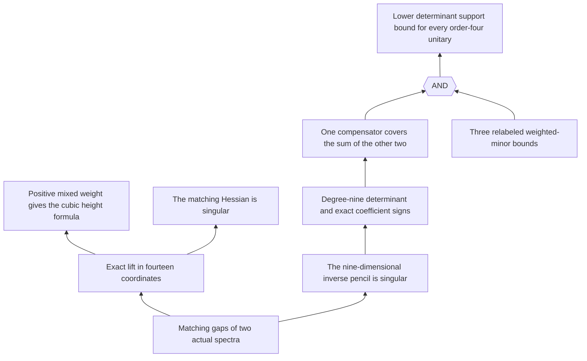

# Order-four symmetric six-contact proof map

[Proof map index](README.md)

This map concerns the Marcus–de Oliveira determinant bound in order
four. Fix complex eigenvalue lists $a,c$ of length four and a complex
direction $\eta$. For each permutation $\sigma$, let
$P_\sigma=\prod_j(a_{\sigma(j)}+c_j)$. Let $-h$ be a common lower
bound of the projections $\mathrm{Re}(\eta P_\sigma)$, with $h$ real.
A contact attains $-h$. The gap at $\sigma$ is
$\mathrm{Re}(\eta P_\sigma)+h$.

An ordinary term is the indicator that $\sigma$ sends a specified
column set to a specified row set. The first four ordinary terms
use singleton sets. The last three use pairs. The mixed term adds
three indicators and subtracts one. It and the seven ordinary terms
have six common zero entries. The family consists of gaps that
equal the sum of these eight terms with nonnegative coefficients.
Write $b_0,b_1,b_2,b_3,p,q,r$ for the ordinary coefficients and
$\lambda$ for the mixed coefficient. The source specifies the row
and column sets, and checks the indicator values on each permutation.
[Row sets](../Lean/MOC/FourSymmetricSixContact.lean#L16) · [Column sets](../Lean/MOC/FourSymmetricSixContact.lean#L20) · [Gap profile](../Lean/MOC/FourSymmetricSixContact.lean#L30) · [Indicator values](../Lean/MOC/FourSymmetricSixContact.lean#L46)

Under this gap hypothesis, the source gives the lower bound
$-h\le\mathrm{Re}(\eta\det(\mathrm{diag}(a)+U\mathrm{diag}(c)U^*))$
for every complex unitary matrix $U$ of order four. Here $U^*$ is the
conjugate transpose and $\mathrm{diag}(a)$ is the diagonal matrix
with entries $a_j$. Kernel verification of the coefficient
certificate is pending.
[Support statement in Lean](../Lean/MOC/FourSymmetricSixContactCertificate.lean#L384)

| Step | Scope |
| --- | --- |
| Noncrossing coordinates | The lift evaluates to the prescribed gap minus $h$ for all real coefficients and all permutations. [Lean source](../Lean/MOC/FourSymmetricSixContact.lean#L54) |
| Height | Assume $\lambda>0$ and let $e_k$ be the elementary symmetric polynomial of degree $k$ in $(b_0,b_1,b_2,b_3)$. The gap hypothesis forces $h=(\lambda^3+e_1\lambda^2+e_2\lambda+e_3+pqr)/(\lambda^2+pq+pr+qr)>0$. [Lean source](../Lean/MOC/FourSymmetricSixContact.lean#L97) |
| Hessian obstruction | The Hessian of the matching cubic at the lifted real coordinates is singular. This includes repeated eigenvalues and repeated products. [Lean source](../Lean/MOC/FourSymmetricSixContact.lean#L128) |
| Inverse pencil | The spectral data make a real symmetric matrix of order nine singular. Its entries represent the nine signed minor evaluations in cofactor coordinates. The complex determinant of order two gives four complex squares. Their real and imaginary linear forms have a common nonzero zero in dimension nine. [Lean source](../Lean/MOC/FourSymmetricSixContactPencil.lean#L273) |
| Compensator budget | An actual spectral gap satisfies $\lambda^2\le p(q+r)$, $\lambda^2\le q(p+r)$, or $\lambda^2\le r(p+q)$. Zero $\lambda$ satisfies the first condition. All four singleton coefficients remain independent. [Lean source](../Lean/MOC/FourSymmetricSixContactCertificate.lean#L355) |
| Unitary bound | For all seven independent ordinary coefficients, the determinant projection is at least $-h$. Coincident eigenvalues and coefficient boundaries are included. [Lean source](../Lean/MOC/FourSymmetricSixContactCertificate.lean#L384) |

For the last step, let $X,Y,Z$ be the squared moduli of the minors
that correspond to $p,q,r$. The weighted-minor inequality bounds the
mixed term together with any pair of these minors. If
$p(q+r)\ge\lambda^2$ and $q+r>0$, apply it to $X,Y$ and $X,Z$.
Use weights $q/(q+r)$ and $r/(q+r)$ to combine the two bounds. The
combined coefficient of $X$ is $\lambda^2/(q+r)\le p$. The remaining
ordinary terms have nonnegative coefficients. If $q+r=0$, the budget
inequality forces $\lambda=0$ and only ordinary terms remain.
[Weighted-minor inequality](../Lean/MOC/FourTwoBudgetMinor.lean#L32) · [Bound under one of the three budget inequalities](../Lean/MOC/FourSymmetricSixContact.lean#L272)

For $\lambda>0$, divide the coefficients by $\lambda$ so that the mixed
coefficient is one. Write $P$ for the determinant of the resulting
order-nine pencil. The code expands $P$ by the determinant recurrence,
collects equal monomials, and checks the resulting coefficients after
four substitutions. It uses $u/(1+u)$ for each compensator in the
region where all three are less than one. In the region where $p\ge1$
and $p(q+r)<1$, take $p=1+s$, $q=x/((1+s)(1+x+y))$, and
$r=y/((1+s)(1+x+y))$ with $s,x,y\ge0$. The other two substitutions
put $q$ and $r$ in the leading position. After multiplication by the
positive denominators, all coefficients are nonnegative and the
constant coefficient is positive. Thus $P>0$ in any region where all
three compensator inequalities fail. Actual spectra force $P=0$.
[Compensation from pencil singularity](../Lean/MOC/FourSymmetricSixContactCertificate.lean#L326) ·
[Full paper closure](https://github.com/ascendnoosphere/MOC/blob/14cf959d78ae5828a92013d13a65b9c50ebb01d0/Docs/research/six_symmetric_general_closure.txt) · [Independent paper audit](https://github.com/ascendnoosphere/MOC/blob/14cf959d78ae5828a92013d13a65b9c50ebb01d0/Docs/research/six_symmetric_general_independent_review.txt)
