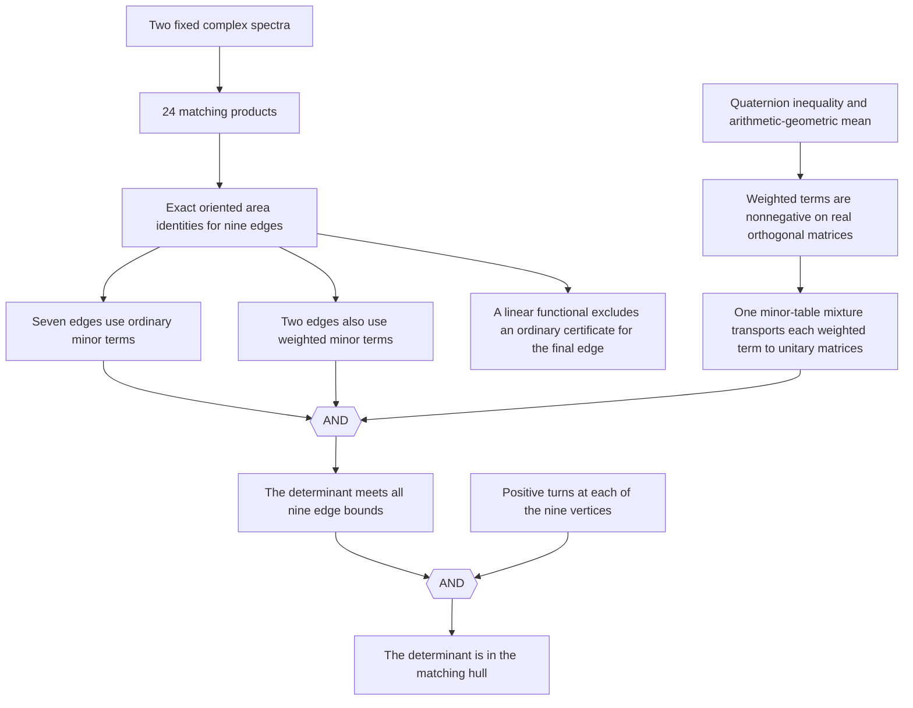

# Order-four weighted-minor center

[Proof map index](README.md) · [Conjecture](../README.md) · [Order-four proof routes](order-four-proof-map.md)

Let $U$ be a complex unitary matrix of order four. Let $U^*$ be its
conjugate transpose and let $\mathrm{diag}(a)$ be the diagonal matrix
with entries $a_j$. Use the eigenvalue lists

$$
a=\left(0,-\frac15+\frac4{15}i,-\frac1{10}+\frac2{15}i,
\frac{177-66i}{793}\right),\qquad
b=\left(\frac12,1,-\frac15-\frac25i,\frac{-232-344i}{1345}\right).
$$

For a permutation $p$ of the four labels, write
$P_p=\prod_j(a_j+b_{p(j)})$. The determinant of
$\mathrm{diag}(a)+U\mathrm{diag}(b)U^*$ belongs to the real convex hull of
the 24 values $P_p$. The theorem applies to every $U$ for these fixed
lists. [Left list](../Lean/MOC/FourWeightedMinorCenter.lean#L37) · [Right list](../Lean/MOC/FourWeightedMinorCenter.lean#L40) · [Hull inclusion](../Lean/MOC/FourWeightedMinorCenter.lean#L471)

## Nine oriented edge bounds

Number the row-to-column permutations from zero in lexicographic
order. The counterclockwise vertex order is $0,6,18,12,11,17,4,10,2$.
For an edge from label $l$ to label $r$, its cost at a matching $p$
is the oriented area form applied to $P_r-P_l$ and $P_p-P_l$.
Multiply this cost by the positive scale for the edge. The resulting
function on permutations is a sum of the terms in the rational table.
The exact identities use the finite eigenvalue lists in the theorem.
[Term table](../Lean/MOC/FourWeightedMinorCenter.lean#L112) · [Edge identities](../Lean/MOC/FourWeightedMinorCenter.lean#L243)

For row and column sets $I,J$, the ordinary indicator is one if
$p(I)=J$ and zero otherwise. Evaluation at $U$ replaces this indicator
with the squared modulus $M_{I,J}$ of the corresponding minor.
Seven edge certificates use only nonnegative coefficients on these
indicators. The edges $10\to2$ and $2\to0$ also use relabeled and
transposed copies of the following expression for a real $\tau>0$:

$$
M_{\{1\},\{2\}}+M_{\{2\},\{1\}}
+(1+\tau)M_{\{2,3\},\{2,3\}}
+(1+1/\tau)M_{\{1,2\},\{1,2\}}-M_{\{1,3\},\{0,2\}}.
$$

Let $x=M_{\{2,3\},\{2,3\}}$ and $y=M_{\{1,2\},\{1,2\}}$.
The quaternion inequality proves nonnegativity on real orthogonal
matrices when the two extra terms are replaced by $2\sqrt{xy}$.
The arithmetic–geometric mean inequality gives
$2\sqrt{xy}\le\tau x+\tau^{-1}y$. The squared-minor table of a complex
unitary matrix is a convex combination of real orthogonal tables.
Since the expression is linear in this table, the bound holds for
each complex unitary. [Quaternion and mean inequality](../Lean/MOC/FourWeightedMinorCenter.lean#L279) · [Unitary evaluation](../Lean/MOC/FourWeightedMinorCenter.lean#L313)

Evaluate the nine identities at the determinant to get the nine
oriented edge inequalities. A positive turn means that the signed
area of the two consecutive edge vectors is positive. In each
projection direction, the edges at a maximizing vertex bound the
determinant projection. Thus the determinant lies in the hull of
the nine selected products and in the full matching hull.
[Strict turns](../Lean/MOC/FourWeightedMinorCenter.lean#L252) · [Edge bounds](../Lean/MOC/FourWeightedMinorCenter.lean#L418) · [Plane hull criterion](../Lean/MOC/PlaneHullEdges.lean#L55)

## Verification status

The Lean source proves the fixed-spectrum inclusion. A separate paper argument permits independent
perturbations of each spectral entry by less than $10^{-17}$. The
uniform neighborhood argument remains outside Lean.
[Neighborhood argument](order-four-proof-map.md#an-open-set-of-spectra-with-a-uniform-proof)

## Lean check status

| Lean scope | Lean Checked? |
| --- | --- |
| The 2 source modules linked in this map | Yes |
| [FourWeightedMinorCenter.lean](../Lean/MOC/FourWeightedMinorCenter.lean#L37) | Yes |

[Status definitions](README.md#lean-check-status). Paper arguments retain their stated scope.
