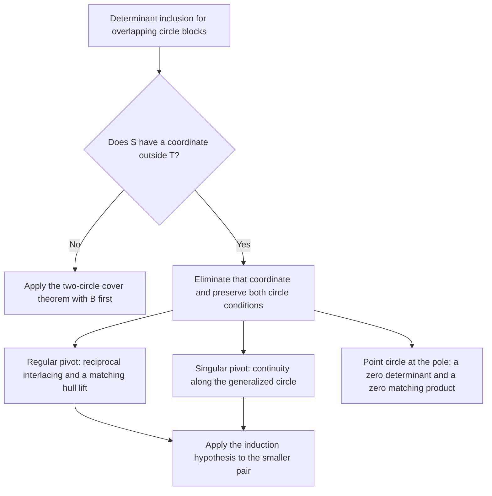

# Overlapping circle blocks

Let $A$ and $B$ be complex normal matrices in a common orthonormal basis.
Let $S$ and $T$ be sets of coordinate labels with $S \cup T$ equal to the full
label set. The matrix $A$ can mix the coordinates in $S$. It is diagonal on
the other coordinates. The matrix $B$ can mix the coordinates in $T$. It is
diagonal on the other coordinates.

A generalized circle is a circle, a point circle, or an affine line. Assume
the spectrum of the $A$ block on $S$ and the negatives of the entries of $B$
on $S \setminus T$ lie on one generalized circle. Assume the negative spectrum
of the $B$ block on $T$ and the entries of $A$ on $T \setminus S$ lie on a
second generalized circle. The two generalized circles can be equal.

Let $(a_i)$ and $(b_i)$ list the eigenvalues of $A$ and $B$, with
multiplicity. Then $\det(A+B)$ lies in the real convex hull of the products
$\prod_i(a_{\sigma(i)}+b_i)$ over all permutations $\sigma$. The order and
the size of $S \cap T$ are unrestricted. Let $n$ be the size of $S$. The
Lean statement labels $S$ by the integers from $0$ to $n-1$, with type
`Fin n`. The labels in $S \setminus T$ come first. The unitary matrix
that gives the eigenbasis of $B$ fixes the coordinate vectors with these
labels. [Overlapping circle blocks](../Lean/MOC/OverlappingCircleBlocks.lean#L83)

A private coordinate of $S$ is a coordinate in $S \setminus T$. Let $j$
be such a coordinate. On that coordinate $B$ has a scalar entry $r$.
Add $r$ to each diagonal entry of the active $A$ block. The pivot is
regular if $A_{jj}+r$ is nonzero and the shifted block is invertible.
The spectrum of the inverse lies on an affine line. A principal
compression of the inverse has weakly interlaced eigenvalues on the
same line. The inverse of the compression gives the shifted Schur
complement. This gives the same generalized circle for the new active
spectrum. [Weak interlacing](../Lean/MOC/WeakHermitianCompressionInterlacing.lean#L13) · [Local pivot](../Lean/MOC/LocalCircleSchurPivot.lean#L58)

For a regular pivot, the pivot factor multiplies the determinant of the
smaller pair. The same factor maps its matching hull into the parent
matching hull. Each matching keeps the partners of the untouched block.
Continuity removes the regularity conditions. If the generalized circle is
the point $-r$, the pivot row is zero in $A+B$, and one matching product
has a zero factor. [Matching hull lift](../Lean/MOC/LocalCircleSchurLift.lean#L125) · [Singular pivots](../Lean/MOC/LocalCircleSchurPivot.lean#L110)

When $S$ is contained in $T$, the active block of $B$ is the full matrix.
Its spectrum and the negatives of the entries of $A$ outside $S$ lie on
one generalized circle. The remaining entries of the negative spectrum of
$A$ lie on the other generalized circle. Apply the two-circle cover
theorem with the matrices in that order. [Two-circle cover](../Lean/MOC/TwoCircleCover.lean#L10)

## Example

Let $S=\{1,2,3\}$ and $T=\{2,3,4\}$. Write $\mathrm{i}$ for the imaginary
unit. Give the $A$ block the spectrum $1,2,4$ and give the $B$ block the
spectrum $\mathrm{i},2\mathrm{i},4\mathrm{i}$. Give $A$ the entry
$3\mathrm{i}$ outside $S$ and give $B$ the entry $3$ outside $T$.
The two generalized circles are the real and imaginary axes. Each full
spectrum contains three collinear points and a fourth point off their line.
